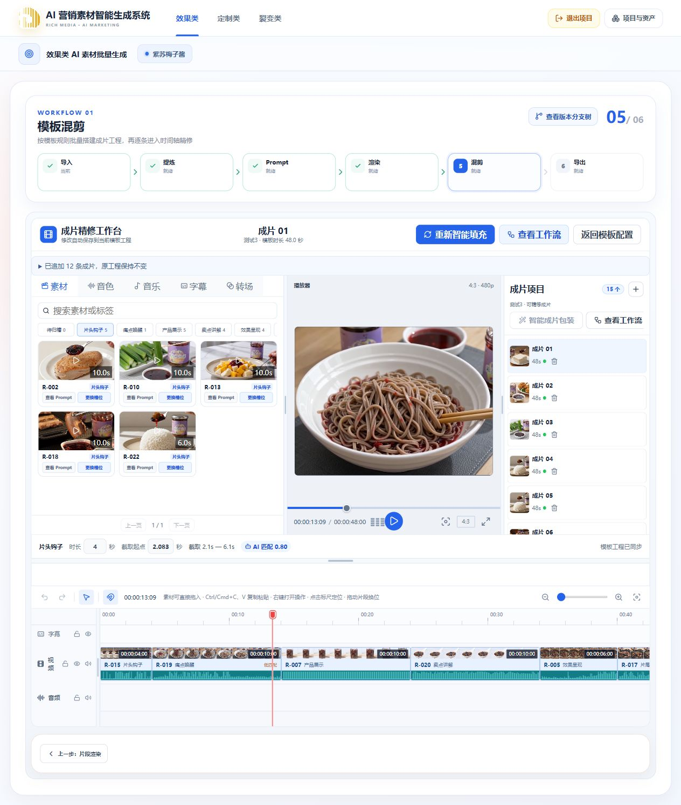
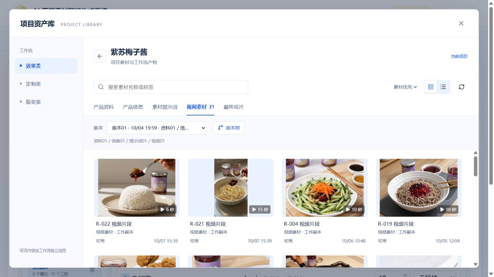
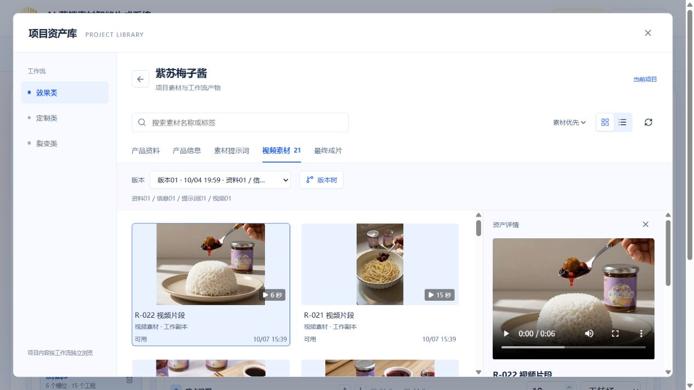
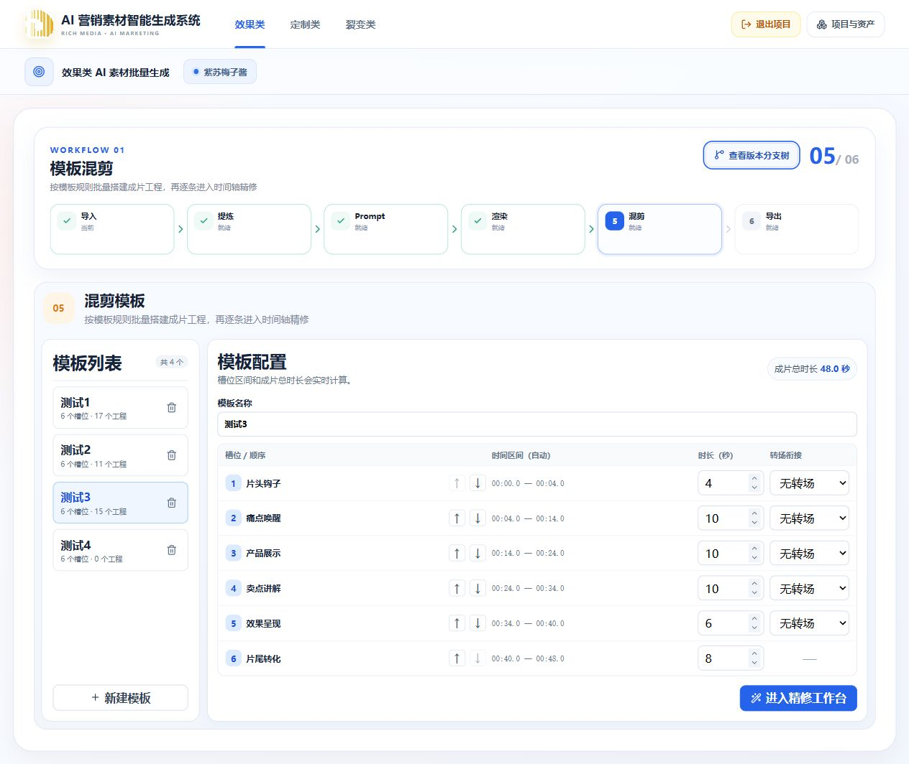
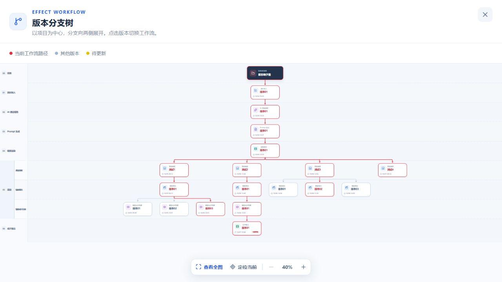
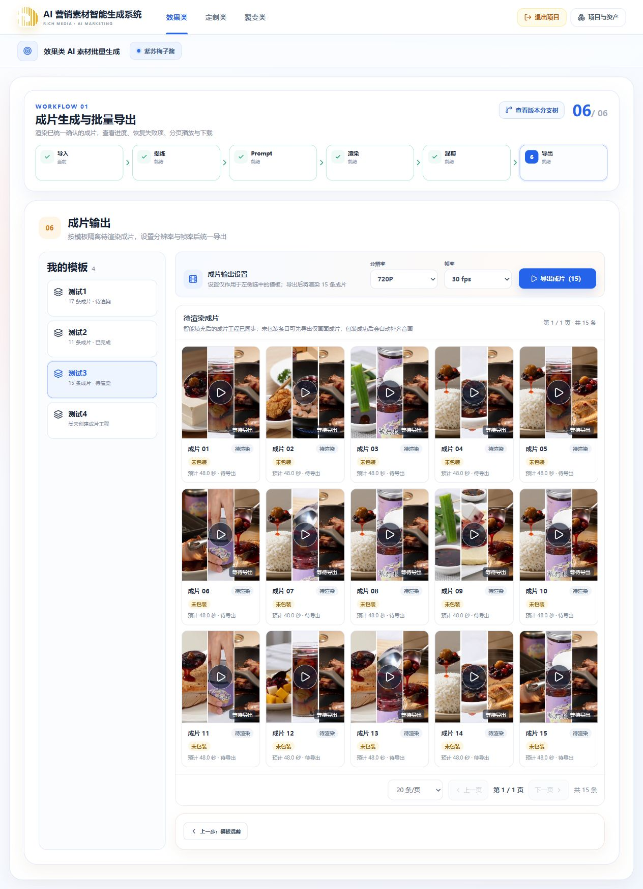

# AI 营销素材智能生成系统

从商品资料出发，把可信卖点转成视频素材，再通过模板混剪、智能包装和批量导出形成营销成片。

面向内部内容生产团队，围绕项目统一管理资料、Prompt、异步任务、剪辑工程、版本与交付资产。当前重点建设效果类生产链路，其他固定工作流的职责与边界见各自业务指南。

[项目定位](#项目定位) · [项目亮点](#项目亮点) · [功能与工作流](#功能与工作流) · [界面预览](#界面预览) · [资产库](#项目资产库) · [产品蓝图](#产品蓝图与需求映射) · [整体架构](#整体架构) · [快速启动](#快速启动) · [验收目标](#质量与验收目标) · [常见问题](#常见使用问题) · [开发与验证](#开发与验证) · [文档导航](#文档导航)

**项目制生产 · 五条固定工作流 · 素材池与时间轴 · 原位局部更新 · 可追溯交付**



> 界面来自 2026-10-07 正在运行的本地项目“紫苏梅子酱”，不是设计稿或第三方示例。截图中的工程、版本和数量仅表示该项目当时的状态，不代表全平台质量验收结论。

### 按你的目标开始阅读

| 你想做什么               | 推荐入口                                                                                      |
| ------------------------ | --------------------------------------------------------------------------------------------- |
| 先了解产品和实际界面     | [项目亮点](#项目亮点) → [界面预览](#界面预览)                                                 |
| 完成一次素材到成片的生产 | [六步使用路径](#一条效果类生产任务如何完成) → [常见问题](#常见使用问题)                       |
| 查找项目资料、素材及交付 | [项目资产库](#项目资产库) → [项目与资产指南](docs/project-assets/README.md)                   |
| 在本机运行、参与开发     | [快速启动](#快速启动) → [整体架构](#整体架构) → [开发与验证](#开发与验证)                     |
| 核对需求、能力范围与验收 | [功能与工作流](#功能与工作流) → [产品蓝图](#产品蓝图与需求映射) → [验收目标](#质量与验收目标) |

### 当前能力一览

| 范围         | README 能确认的范围                                                         | 不据此宣称什么                                            |
| ------------ | --------------------------------------------------------------------------- | --------------------------------------------------------- |
| 效果类六节点 | 正式页面、API 和异步任务链路；具体提交规则见指南                            | 每个历史分支无缺陷、每批画面达标或投放必过审              |
| 项目资产库   | 本次实际浏览了项目、来源分类、视频素材、版本筛选与详情预览                  | 全局资产市场、完整跨项目操作、多角色权限已全部验收        |
| 定制类       | 资料导入、信息提炼、完整故事、资产定义、分镜与单镜 Prompt 的页面/API/Worker | 资产图片 / 视频渲染已接通，或新制作链路已完成付费质量验收 |
| 裂变类       | 固定流程、业务职责与需求方向                                                | 与效果类相同的实现进度或已完成全部付费链路                |
| 质量和性能   | 可复核的目标、范围与验收口径                                                | 数量、时长、首发率、成本指标已经达到                      |

## 项目定位

这不是单次输入一句话、等待一个视频的生成工具，而是围绕**资料 → 创意 → 素材 → 剪辑 → 交付**组织的营销内容生产工作区。希望把可信产品信息、AI 生成能力与可编辑工程连接起来，让运营和设计师能批量生产、逐条精修、复用成果，并控制每次迭代的范围与成本。

| 业务方向       | 面向场景                               | 希望解决的问题                                     |
| -------------- | -------------------------------------- | -------------------------------------------------- |
| 效果类素材生产 | 信息流广告、日常跑量、多品类内容供给   | 素材需求大、创意容易同质化、逐条制作成本高         |
| 定制类素材生产 | 品牌客户、高端品宣、重点单品           | 脚本、镜头与资产需要统一风格，客户反馈需要逐镜落实 |
| 裂变类素材生产 | 参考视频结构复用、数字人口播、局部变体 | 试错周期长，修改一个元素往往被迫重制整片           |
| 通用生产底座   | 项目协作、资产沉淀、版本与交付         | 资料分散、来源难追溯、修改后不知道哪些结果需要更新 |

产品目标是支持单日百条级内容供给，并兼顾差异化、可编辑性、成本与交付效率；百条级产能、平台首发率和客户评审结果仍需通过指定环境与真实批次验收，不能由流程存在或工程数量推导。

### 面向谁

- **运营与投放人员**：明确商品事实、设置创意参数、查看素材与批次结果，组织投放版本。
- **设计师与视频后期**：把 AI 结果作为可编辑的工程继续精修，而不是只能接受或丢弃一个最终文件。
- **项目管理与内容中台**：在项目内集中管理资料、制作过程、资产和交付来源。
- **品牌客户与审核人员**：需求蓝图中的审阅与权限对象；完整多角色权限能力需独立实施与验收。

## 项目亮点

### 1. 从可信商品事实开始，而不是凭空生成卖点

资料导入与制作参数分开维护。文档、图片和公开电商信息进入提炼过程，形成“产品基础 + 统一卖点”信息卡，支持人工审阅与来源追踪。图片理解只补充可见信息，不能自动升级为未经证实的配方、功效或背书。

统一事实目录为 Prompt 创意、后续商品口播声明提供依据，减少不同节点反复复制、重新解释同一套产品信息。

### 2. 数量优先的差异化 Prompt 生产

根据已确认卖点安排观看事件，让正文、叙事结构、场景、人物、产品关联点、镜头语言与情绪基调围绕同一创意展开。新候选先做独立画面执行修正，再评估并通过向量 MMR 兼顾质量和新颖度。

系统目标是严格达到用户指定数量；普通相似性作为软排序与提醒，而不是为了降低重复率随意丢弃条目。“语义重复度 ≤15%”是原始质量目标，不是当前每批自动保证的结果，也不能替代视频画面差异检测。

### 3. 素材生产与成片生产解耦

一条片段 Prompt 对应一条视频素材，素材池再供不同模板组合。智能填充先形成时间轴数据，按槽位语义评分、源视频时长和截取区间选择素材；无需为每一条组合重新生成六段视频。

完整组合内素材不重复，批量组合先覆盖可用素材，再按有效搭配差异扩充。复用有效 AI 结果、同任务检查点与合法截取有助于减少重复计算，但不同来源、不同任务与过期快照不能无条件复用。

### 4. AI 判断语义，程序把守机械边界

AI 负责理解事实、创意、画面与合法截取选择；Worker 负责来源、数量、ID、结构、时长、去重、哈希、revision 和租约校验。不用关键词匹配冒充商品理解，也不让模型绕过跨项目隔离或覆盖已确认产物。

这种分工把“模型质量问题”和“数据/执行正确性问题”分开，便于定位失败与设计有针对性的恢复。

### 5. 可精修的时间轴与独立音画包装

精修工作台整合素材库、播放器、工程列表和时间轴，支持拖拽替换、片段排列、截取与转场调整。智能包装补齐口播、字幕和配乐，按真实配音时长对齐字幕；画面与音画轨道仍可分别编辑。

包装不会直接编码最终成片；用户可以先交付仅画面的版本，也可以包装后导出完整音画。画面修改不擅自删除或锁定已有口播、字幕与配乐，是否适合新画面由用户判断。

### 6. 按依赖局部更新，不把一次修改变成全链路重跑

下游记录真正消费的上游工作副本与 revision，区分信息同步、新增、重渲染和删除。局部更新作用于当前选中的 Run、模板与工程，成功原位覆盖；全量重生成则走对应的新批次/分支路径。

删除素材时只处理实际引用，保留未受影响内容与旧交付文件；新结果失败不应覆盖旧有效结果。重新智能填充是另一个明确操作，来源有变化时对最新全部素材重新归槽。

### 7. 草稿、工作副本、分支与资产各有职责

自动保存用于恢复编辑，不把每一次输入都当作新版本。确认内容通过指纹决定是否增长业务 revision，版本树则按实际父节点组织展示编号；导航、局部更新与新增分支互不混淆。

项目和工作流 Run 是隔离边界。跨项目复用通过明确的资产发布/复制与来源记录完成，不直接引用另一个项目仍在编辑的草稿。快照、revision 与回调校验用于降低旧请求覆盖新结果的风险，不能代替并发回归测试。

### 8. 为长任务设计的异步生产链路

API 通过事务和 Outbox 编排任务，RabbitMQ 投递，Worker 以租约、心跳和冻结输入执行；进度从服务端读取。分片检查点、失败定向恢复与有界并发减少整批重做，Seedance 已创建的任务可恢复轮询，避免不必要的再次创建。

模型、配音、音乐、下载等能力分开限流；最终合成使用 FFmpeg，并逐条保存输出状态。设计目标是可观察、可恢复和可控制费用，不宣称供应商永不超时或消息绝对只执行一次。

## 功能与工作流

### 效果类：从资料到交付

`资料导入 → AI 信息提炼 → Prompt 生成 → 视频渲染 → 模板混剪 → 成片输出`

| 节点           | 当前能力                                                                        | 输出与确认边界                                         |
| -------------- | ------------------------------------------------------------------------------- | ------------------------------------------------------ |
| 01 资料导入    | 按商品导入图片、视频、文档和公开电商链接                                        | 校验后保存商品资料包版本                               |
| 02 AI 信息提炼 | 多源提炼、来源追踪、冲突提示、人工修正；统一“产品基础 + 卖点”信息卡             | AI 结果待审阅，用户保存版本后确认营销洞察              |
| 03 Prompt 生成 | 配置数量、时长、风格、渠道和禁用元素；生成连贯的片段正文与六维创意              | 完整批次成功且通过服务端校验后自动提交；人工编辑需保存 |
| 04 视频渲染    | Seedance 异步批次、预览、单条重生成、参考视频返修、素材导入与删除、来源局部更新 | 完整成功自动提交素材池；人工修改保存，返修候选明确采用 |
| 05 模板混剪    | 六槽位模板、AI 归槽与截取、批量时间轴、精修；智能包装补齐口播、字幕和配乐       | 填充/包装完整成功自动提交，建立或原位升级待渲染工程    |
| 06 成片输出    | 按模板设置分辨率/帧率、FFmpeg 最终合成、逐条进度、失败恢复、分页预览和下载      | 主动导出；整批成功发布输出版本，保存成片与交付资产     |

这些能力已有正式页面、API 与相应任务链路；不再使用旧 README 的“成片输出待开发”描述。实现链路可用不等于所有模型输出、历史分支或部署配置都已通过最终质量验收。

### 生产方式

- **先素材，后成片。** 一条 Prompt 生成一个可混剪的素材片段，不是整条广告。片段以静音可理解的产品动作和价值为主，统一口播、字幕与配乐在后续包装完成。
- **按模板形成多条工程。** 六个有序槽位决定时长与转场，智能填充按原始 Prompt 归槽并选择合法截取区间，工程内素材不重复。
- **更新与重生成分开。** 局部更新覆盖当前分支，保留未受影响内容；重新智能填充遇到来源变化时，使用最新素材全部重新归槽。短素材不能进入比其时长更长的槽位。
- **包装不等于最终渲染。** 未包装工程可先输出仅画面的成片；包装原位补齐音画，最终编码由成片输出节点负责，页面导航不启动生成任务。
- **可追溯，且隔离。** 草稿、工作副本、实际来源 revision 与版本依赖分别维护，项目与 Run 隔离。查看版本、更新当前工程、整批生成新版本不是同一个操作。

详细规则、参数和兼容边界以 [效果类工作流指南](docs/workflows/effect/agent-guide.md) 为准。

### 一条效果类生产任务如何完成

1. 建立项目并导入当前商品资料，完成格式校验后保存资料版本。
2. 提炼商品基础与统一卖点，人工纠正不可信或不准确的信息后保存。
3. 设置目标 Prompt 数量、统一片段时长、渠道、风格与禁用元素，生成并查看片段创意；必要时人工编辑。
4. 在渲染节点设置画幅、分辨率与模型能力，批量生成素材；失败项或待采用返修分别处理。
5. 配置六槽位模板，主动智能填充，得到多条独立工程；在时间轴中精修，按需完成智能成片包装。
6. 选择模板与输出参数后导出。后续修改按真实依赖提示局部更新，旧交付不会因进入页面而自动重渲染。

这是当前六节点的使用路径；素材可用性、商品声明、画面效果与最终投放合规仍需要对应验证，不额外增加一个自动“过审”节点。

### 其他固定工作流

以下是系统固定业务流程，不表示它们与效果类具有相同的落地进度。

| 工作流              | 节点                                                            | 指南                                                            |
| ------------------- | --------------------------------------------------------------- | --------------------------------------------------------------- |
| 定制类              | 资料导入 → 信息提炼 → 脚本创作 → 资产准备 → 视频制作 | [业务边界](docs/workflows/customized/agent-guide.md)            |
| 裂变 · 爆款复刻     | 上传素材 → 深度拆解 → 元素映射 → 成片生成                       | [业务边界](docs/workflows/fission/clone/agent-guide.md)         |
| 裂变 · 数字人口播   | 选择形象 → 口播文案 → 唇形驱动 → 背景配置 → 渲染输出            | [业务边界](docs/workflows/fission/avatar/agent-guide.md)        |
| 裂变 · 局部元素替换 | 选择成片 → 替换粒度 → 解析与替换 → 生成提示词 → 渲染输出        | [业务边界](docs/workflows/fission/local-replace/agent-guide.md) |

定制类当前已接通资料导入与信息提炼：上传简报、固定文件版本、独立异步提炼、来源与差异、信息卡编辑及版本确认。执行图和进度复用效果类组件；品牌图片不参与提炼模型。脚本节点已接通四种视频类型条件分流、多方案 AI 创作、类型专项审校、局部修订与独立复核、逐份发布独立脚本分支、编辑草稿与正式保存、对比和导入导出；第三至第五节点已拆为脚本创作、资产准备、视频制作；新任务生成完整故事后独立整理资产，再于视频工作台拆镜、绑定并生成单镜提示词。资产图片和视频渲染另行接通，新链路真实模型质量验收另行记录。运行与验证边界见[定制类指南](docs/workflows/customized/agent-guide.md)。

## 界面预览

截图直接取自当前正式前端，只做页面导航、现有工程预览和截屏，没有运行新的生成、包装或导出任务。图片保存在仓库内，可点击查看原图。精修工作台见本文首图，以下补充项目资产库、模板配置、版本树与成片输出。

### 项目资产库

从右上角“项目与资产”进入，选择工作流和项目，再按来源节点浏览。截图展示当前项目的“视频素材”分类：素材缩略图、时长、工作副本来源、可用状态与更新时间，以及搜索、排序、网格/列表和版本筛选入口。



点击素材可在同一资产库中查看详情与已有视频预览，不需要重新发起生成。



截图中的 21 项是该版本当时可浏览的素材，不是新增生成数。卡片标注“工作副本”，说明资产库也呈现生产中的已确认产物；不能把图库中的每张卡片都理解成已经归档的 `ProjectAsset`。

| 内容                 | 在生产中的作用                   | 与其他内容的区别                                   |
| -------------------- | -------------------------------- | -------------------------------------------------- |
| 产品资料、产品信息   | 生产输入与已确认商品事实         | 不是可投放视频                                     |
| 素材提示词、视频素材 | 创意与可复用片段                 | 一个片段不等于一条最终成片                         |
| 时间轴工程           | 多片段排列、截取、转场与音画编辑 | 工程数据不等于已经编码的交付文件                   |
| 最终成片             | 按明确输出操作生成的交付结果     | 待渲染工程不能冒充可下载成片                       |
| 正式资产与发布资产   | 按业务边界归档或明确发布后复用   | 工作副本可浏览不意味着已自动公开或可跨项目直接引用 |

当前截图只证明实际可见的资产浏览与预览，未测试下载、跨项目复制、发布或资产删除。详细生命周期与隔离规则见 [项目与资产文档](docs/project-assets/README.md)。

### 模板配置与工作流画布

模板列表与六槽位配置放在同一工作区，自动计算时间区间与总时长；没有工程的模板也保留在列表中。



### 版本分支树

浅色画布以项目为中心展示依赖关系和两侧分支，提供全图、定位与缩放。红色表示当前路径，黄色表示待更新，灰色表示其他版本；本次截图没有待更新条目。



### 成片输出

按模板展示待渲染工程及输出状态。截图中的“待渲染 / 未包装”是真实工程状态，不是已经生成的最终文件；设置分辨率与帧率后由用户主动导出。



## 产品蓝图与需求映射

以下整理用户提供的完整需求，作为产品方向与验收背景。**“需求蓝图”不等于“已经实现”**：效果类当前能力见上表；定制、裂变和通用能力的目标需要按工作流逐项推进，不能从原型、目录或指南存在推断完整链路已可用。

### 模块一：效果类 AI 素材批量生成

目标是面向信息流广告跑量，在多品类内容供给中兼顾规模、成本与差异化，支撑单日百条级投放需求。

- **输入标准化**：原始需求覆盖商品主图、细节图、场景图、文档表格、纯文本及电商链接，以及资料模板下载和字段识别。JPG/PNG/PSD/WebP、Word/Excel/PDF 等是原始需求格式范围，不表示当前每种格式已验收；当前正式效果类流程采用一项目一个活动产品。原始默认 9:16 竖版诉求由渲染配置承接，不把它写成未经核对的当前全局默认值。
- **事实结构化**：产品基础、卖点、需求、人群、场景和可信背书统一为有依据的事实，人工可修正；不恢复旧的核心/次要卖点及平行词池。
- **批量创意**：用户指定数量，通过叙事、场景、人物、产品关联点、镜头与情绪形成不同观看事件。原始“至少三维差异”“默认至少 50 条”属于需求目标，不作为未核实的当前硬门禁或默认值。
- **片段生产**：异步生成素材池，支持失败恢复与人工修正；不把“一条 Prompt”改成一条完整成片，也不固定成片只能由 3–5 个分镜构成。
- **工程生产与包装**：六槽位模板形成可编辑工程，加入口播、字幕与 BGM。节奏自动卡点、完整音效库及视觉双重去重需分别验证，不因已经支持音轨就宣称全部满足。
- **输出与迭代**：主动批量导出，支持来源变化后的关联更新；模板按品类、渠道分类保存等目标继续按具体功能验收。

### 模块二：定制类 AI 素材生成

面向品牌客户、高端品宣和重点单品，目标是完整叙事、统一视觉与逐镜可控，而不是直接复用效果类“素材池随机组合”的生产逻辑。

| 需求方向       | 产品蓝图                                                                                          |
| -------------- | ------------------------------------------------------------------------------------------------- |
| 客户 Brief     | 导入品牌诉求、产品资料、风格参考和制作约束，标准化后供后续节点使用                                |
| 分镜脚本       | 镜号、景别、运镜、画面、台词/口播、时长、音效/音乐；支持多版本选择、编辑与对比                    |
| 镜头 Prompt    | 引用实际分镜字段，维护色彩、光影、人物特征和场景调性；检查空间、动作和状态衔接                    |
| 视觉资产       | 人物三视图/表情/姿态、产品多角度/材质特写、场景概念与光影方案；支持替换、重做与绑定               |
| 逐镜执行与交付 | 一镜一任务、单镜头重渲染、已成功镜头保留，交付素材与清单；完整成片合成/精修诉求需按职责实现和验收 |

当前定制类固定五节点，以“视频制作”结束；脚本创作后独立准备资产，在视频制作中完成分镜、绑定和逐镜提示词，真实视频渲染另行接通。跨项目资产须先复制/导入当前项目并保留来源，不能直接绑定别的项目草稿。

### 模块三：裂变类 AI 素材生成

三条子工作流各自维护输入、任务和结果，目标都是缩短变体制作周期，但不能共享一套含义不同的节点状态。

**爆款复刻裂变**：拆解参考视频的结构、创意、产品、镜头、音频与视觉六维；将产品、人物、场景、字幕、BGM 和口播映射为目标元素，保留有授权的结构与节奏参考，再生成多条变体。原始单参考视频裂变至少 20 条是目标；Prompt 编译与渲染属于现行“成片生成”的内部职责，不恢复独立的前台 Prompt/渲染节点。

**数字人口播**：围绕授权形象、口播文案、音色与语速、唇形驱动、背景与字幕配置形成口播视频。需求包括真人参考、服装/姿态、多语种与方言、超过一分钟的分段长视频；这些能力以及唇形/同步指标要独立验证，不能由形象选择页面推断已经满足。

**局部元素替换**：支持单镜头、片段级和全局统一三种粒度，围绕产品、人物、场景以及字幕/BGM/口播/贴纸等维度绑定素材。目标是在保留范围外内容的前提下执行跟踪与融合，检测光影、透视、色彩、接缝、穿模和同步风险；切换粒度需要重建相关解析与绑定。

### 模块四：通用生产底座

| 能力方向   | 当前基础与持续目标                                                                                               |
| ---------- | ---------------------------------------------------------------------------------------------------------------- |
| 项目管理   | 项目上下文与数据隔离是现有底座；按客户/商品组织生产与交付是产品使用方式                                          |
| 素材与资产 | 区分资料、工作副本和正式资产，维护来源；品类/风格/场景/卖点/渠道的统一标签检索与跨项目复用需要按资产能力逐项验收 |
| 全链路编辑 | 返回节点修改、保存草稿、确认内容、选择历史分支和重生成分别处理；不把自动保存直接解释为自动新增版本               |
| 增量更新   | 根据实际消费的 revision 判断关联变化，局部更新不自动开叉、不替用户更新所有分支                                   |
| 批量操作   | 批量生产、删除与导出按对应节点提供；通用批量重命名、打标签和清单打包不能因局部页面有按钮而宣称全部实现           |
| 输出规格   | 多分辨率、帧率和画幅属于需求范围；MP4/MOV 等格式支持分别核对，素材导入兼容不等于最终编码也支持相同格式           |
| 角色权限   | 管理员、运营、设计师、客户的可见范围和操作权限是完整产品目标；项目隔离不能替代完善的角色权限矩阵                 |

### 原始需求如何与当前规则衔接

| 原始需求口径                                      | 当前采用的边界                                                                                      |
| ------------------------------------------------- | --------------------------------------------------------------------------------------------------- |
| 单品/多品类在同一导入页切换                       | 当前正式效果类一项目一个活动产品；历史批量数据仅兼容，多品类生产不能据此绕过项目隔离                |
| 信息卡包含核心/次要卖点、受众/痛点/场景及制作规则 | 信息卡收敛为产品基础与统一卖点；创意参数在 Prompt，技术参数在渲染                                   |
| 差异化维度中的“卖点侧重”                          | 当前为“产品关联点”，与主线、正文及其他维度保持一致                                                  |
| 独立“质量/原创校验”节点                           | 效果类仍是固定六节点；来源/结构校验、模型评估、人工审片与投放结果分别处理，不增加节点或自动包装审核 |
| 相似度超标自动剔除并无上限补齐                    | 当前数量优先、一般相似软排序、有限补充；硬拒绝仅针对结构/事实/实质完全重复等问题                    |
| 一条成片固定对应 3–5 个分镜素材                   | 当前效果类一条 Prompt 对应一个素材片段，成片由六槽位模板组织                                        |
| 所有编辑自动新增版本，可一键回退                  | 草稿保存、业务 revision 与分支发布分离；显式选择历史版本不自动把局部更新结果回退                    |
| 全链路增量更新无需全量重跑                        | 关联更新保留未变化产物；用户主动重新智能填充时，来源变化仍要求全部素材重新归槽                      |
| 所有资产可直接跨项目调用                          | 明确发布/复制/导入，保留来源资产及版本，目标工作流绑定项目内快照                                    |

以上反映原始需求的后续收敛，并未重新启用旧规则。若要改变这些边界，应另行确认需求并修改对应指南、契约和实现，不通过 README 暗中改变业务。

## 快速启动

### 环境准备

- Node.js **22.12.0 或更高**；pnpm 使用根目录 `packageManager` 指定的 **10.33.0**。
- Docker 与 Docker Compose；本地指南以 Windows / PowerShell 为例。
- 源码运行或测试 Worker 时需要 Python **3.12** 与 uv；仅用容器时不要求宿主机 Python。
- 真实 AI 功能需要相应供应商权限与本机凭据。仅启动前后端和基础设施不会自动生成视频。

### 1. 安装依赖并配置环境

在仓库根目录执行，已有 `.env` 不覆盖：

```powershell
if (-not (Test-Path .env)) { Copy-Item .env.example .env }
pnpm install --frozen-lockfile
```

在本机 `.env` 填写所需配置，不在文档中粘贴真实值：

| 配置范围                          | 用途                                                  |
| --------------------------------- | ----------------------------------------------------- |
| 数据库、Redis、RabbitMQ、API 端口 | 本地基础设施与服务通信                                |
| `ARK_API_KEY` 与分节点模型配置    | 提炼、Prompt、视觉理解等真实 AI 任务                  |
| Seedance 配置                     | 素材渲染与返修；具体模型随渲染节点输入快照冻结        |
| 配音与音乐配置                    | 智能成片包装；不能只凭 Ark Key 假定所有包装功能已配置 |
| 各 Worker 独立 Token              | API 与消费者鉴权；共享/生产环境必须配置匹配的独立密钥 |
| `STORAGE_DRIVER` 与存储配置       | 本地文件或私有 TOS 桶；不开放公共读写                 |

字段与安全占位符见 [.env.example](.env.example)，部署细节见 [本地开发与运行](docs/development/local-development.md)。缺少真实配置应明确失败，不自动退回 Mock。

### 2. 启动基础设施与应用

```powershell
docker compose up -d
docker compose ps
pnpm db:migrate
pnpm dev
```

`db:migrate` 用于本地开发并会修改数据库；已有数据库先检查迁移状态，不在生产环境直接使用开发迁移命令。`pnpm dev` 启动 Web/API，不会启动 Python Worker。

| 服务            | 默认地址                                                      |
| --------------- | ------------------------------------------------------------- |
| Web             | [localhost:5173](http://localhost:5173/)                      |
| API 健康检查    | [localhost:3000/api/health](http://localhost:3000/api/health) |
| RabbitMQ 管理台 | [localhost:15672](http://localhost:15672/)                    |

地址随配置变化。Compose 中的本地服务默认配置不应用于公开或生产部署。

### 3. 按需启动效果类 Worker

在另一个终端按所需节点启动消费者：

```powershell
# 资料解析与 AI 信息提炼（包含一次性 Docling 模型初始化）
docker compose --profile effect-extraction up -d --build effect-extraction-worker

# 素材片段 Prompt
docker compose --profile effect-prompt-generation up -d --build effect-prompt-generation-worker

# Seedance 视频素材渲染
docker compose --profile effect-segment-render up -d --build effect-segment-render-worker

# 智能填充、包装与最终成片合成共用的 Worker
docker compose --profile effect-template-mix up -d --build effect-template-mix-worker
```

`docling-model-init` 成功后显示 `Exited (0)` 正常，常驻 Worker 应保持运行。提炼 Worker 内置 Chromium，不需要再启动独立电商渲染容器。启动容器本身不代表已创建模型任务，但可能消费既有队列中的任务；运行前检查队列与当前活动任务。

## 整体架构

### 分层与依赖方向

系统采用单仓库、前后端分离与独立异步 Worker。业务工作流共用项目、文件、资产和任务底座，但不跨工作流直接引用内部实现。

```text
用户：商品资料 / 创意参数 / 人工审阅 / 时间轴编辑 / 导出
                              │
┌─────────────────────────────▼───────────────────────────┐
│ Vue Web                                                  │
│ 业务层：效果类 / 定制类 / 裂变三条子流程                  │
│ 平台层：项目上下文 / 资产与文件 / 草稿恢复 / 任务进度     │
└─────────────────────────────┬───────────────────────────┘
                              │ HTTP /api
┌─────────────────────────────▼───────────────────────────┐
│ NestJS API                                               │
│ 业务层：节点规则 / 输入快照 / 工作副本提交 / 下游依赖     │
│ 平台层：权限与隔离 / 文件存储 / 版本 / 资产 / 任务编排   │
└──────────┬──────────────────┬───────────────────┬───────┘
           │ Prisma           │                   │
     PostgreSQL          文件存储             Redis
   业务状态 + Outbox    本地 / 私有 TOS       进度缓存
           │
     Outbox Dispatcher → RabbitMQ
                              │
┌─────────────────────────────▼───────────────────────────┐
│ Python Workers：冻结输入 / 租约 / 心跳 / 检查点 / 回写   │
│ 提炼：Docling + 图片/电商理解                            │
│ Prompt：LangGraph + 执行修正 + 评估 + 向量 MMR           │
│ 渲染：Seedance 创建 / 轮询 / 素材传输                    │
│ 混剪：归槽 / 抽帧截取 / 配音配乐 / FFmpeg 最终输出      │
└─────────────────────────────┬───────────────────────────┘
                              │ 供应商适配器
                       Ark / Seedance / 配音 / 音乐

Web + API ──→ packages/contracts：统一请求、响应、枚举、Schema
Workers ────→ 受保护的 API：领取输入、进度/检查点与结果回写
```

前端不直接访问数据库、存储或供应商。API 维护持久化与提交边界；Worker 领取冻结输入执行任务；跨进程字段由 Contracts 统一定义，不能独立维护相互漂移的 DTO。

| 层级         | 主要技术                                  | 核心职责                                               |
| ------------ | ----------------------------------------- | ------------------------------------------------------ |
| 交互层       | Vue 3、TypeScript、Vite、共享 Vue 组件    | 节点画布、表单、即时预览、时间轴和人工操作             |
| 应用与领域层 | NestJS、共享 Contracts                    | 项目作用域、节点输入、工作副本、版本与任务边界         |
| 业务持久化   | PostgreSQL、Prisma                        | 保存草稿、快照、实际依赖、运行状态和正式资产           |
| 异步调度     | RabbitMQ、事务 Outbox                     | 可恢复投递，将耗时任务与 HTTP 请求解耦                 |
| 进度与文件   | Redis、本地存储/私有 TOS                  | 进度缓存、项目文件与生成媒体；缓存不代替持久化权威数据 |
| AI 执行      | Python、LangGraph、Pydantic、httpx、NumPy | 模型适配、分片执行、结构校验、向量择优和受保护回写     |
| 媒体执行     | FFmpeg / ffprobe                          | 抽帧、媒体探测、截取、音画合成与最终编码               |

### 一次异步任务的数据流

1. **发起**：用户选择项目、Run 与节点操作；API 校验权限、版本、来源与任务冲突，冻结输入快照。
2. **入队**：在事务内保存任务与 Outbox，由投递器发送到 RabbitMQ；不在事务内等待外部模型。
3. **领取**：Worker 通过内部 API 领取租约与 attempt token，读取该任务冻结输入；队列消息不搬运完整资料或密钥。
4. **执行**：按阶段调用模型或媒体工具，保持心跳并保存检查点；适用的失败恢复只补未完成部分。
5. **回写**：API 再次校验作用域、token、来源 revision 与结果结构，拒绝过期回调。该节点达到确认边界后才提交工作副本。
6. **展示与传播**：Web 读取真实进度与结果；内容指纹变化后，实际消费旧依赖的下游提示待更新，未受影响内容不盲目失效。

这是可靠性机制的设计与实现分工，不是“恰好一次执行”或自动零失败承诺；供应商错误、文件不可读、任务冲突仍需明确报告。

### 架构取舍与成本控制

- **固定业务流程，而不是任意拼装的通用 DAG**：三大模块对应五条确定流程，人工操作与节点产物都有明确含义，避免界面和任务各自维护一套解释。
- **单仓库、多运行单元**：Web、API、Contracts 和 Worker 可以按职责验证与部署；共享的是契约和平台能力，不是互相导入的业务内部代码。
- **数据库权威，缓存辅助**：业务版本、依赖与提交持久化在 API 数据层；Redis 的速度优势服务于进度读取，不能用缓存“看起来最新”替代真正提交。
- **生成素材后再组合**：素材池可以形成多条不同工程，合法归槽/截取结果在允许的输入范围内复用，避免每个成片组合重新付费生成全部镜头。
- **分项收费、分项恢复**：信息同步与纯删除不同于重新渲染；失败恢复、已创建供应商任务轮询和包装检查点按实际可恢复范围执行，不为了重试无条件重做成功项。
- **最终编码延迟到明确导出**：时间轴预览与最终交付文件分开。编辑、导航、查看状态不自动编码，用户选择输出规格并发起任务后才产生新交付。

这些取舍服务于生产可控性；节省比例、单位素材成本、整批吞吐与最优并发需要实测，不在文档中虚构收益数字。

### 内容版本与文件交付

导航决定“正在看哪里”，草稿决定“正在改什么”，工作副本决定“下游可消费什么”，分支决定“属于哪条制作路径”，正式资产决定“交付或复用什么”。它们不能被同一个页面状态对象替代。

`artifactId + revision + contentHash` 用于记录来源与内容变化；`projectId + workflowType + workflowRunId` 用于隔离工作区与任务。素材任务、模板、成片工程还各有对象粒度，模板目录只是只读投影，不作为覆盖整个 Run 的写入来源。

已导出的文件保留当时的音画结果。上游或工程编辑可产生更新提示，但不会因刷新、切换页面自动改写文件或再次计费；用户明确局部更新后才覆盖当前交付，全量重新导出则发布独立的新输出分支。

### 仓库组织

```text
apps/
  web/                         Vue 3 + TypeScript + Vite
  api/                         NestJS + Prisma
packages/
  contracts/                   共享契约与 JSON Schema
  ui/                          共享 Vue 组件
workers/
  effect-extraction/           资料解析与信息提炼
  effect-prompt-generation/    素材 Prompt、评估与择优
  effect-segment-render/       素材异步渲染与返修
  effect-template-mix/         智能填充、包装、最终输出
docs/                          架构、业务指南、开发说明与证据
references/prototypes/         冻结原型（不作为运行时代码）
compose.yaml                   本地基础设施与 Worker profiles
```

状态模型分工：

| 数据                           | 表示什么                                                |
| ------------------------------ | ------------------------------------------------------- |
| `WorkflowNodeState`            | 编辑与导航草稿，不等于已确认业务产物                    |
| `WorkingArtifact`              | 业务对象的最新工作副本，记录内容与真实依赖 revision     |
| 版本分支                       | 用户可选择的工作流路径；展示编号不等于每次内容 revision |
| `ProjectAsset` / `GlobalAsset` | 项目正式交付资产 / 经明确发布的跨项目资产               |

## 质量与验收目标

### 原始需求中的量化目标

以下来自产品需求，均为**待验证的验收目标**，不是本 README 宣称已经达标的成绩。部分目标依赖供应商、素材授权、硬件、网络、平台判定或客户审阅；必须记录测试条件和样本口径。

| 方向             | 原始需求指标                                                          | 验证需要明确什么                                                              |
| ---------------- | --------------------------------------------------------------------- | ----------------------------------------------------------------------------- |
| 效果类规模与效率 | 连续 3 次，每批 50 条、15 秒视频；单批总耗时 ≤60 分钟；单日百条级产出 | 50 条是生成片段还是最终成片、全链路起止点、模型/并发/硬件、排队和重试是否计入 |
| Prompt 差异化    | 语义重复度 ≤15%，每条至少三维差异                                     | 向量模型、相似关系与分组口径、样本数量；区别于视频视觉重复度                  |
| 画面差异化与首发 | 同批主体/场景/叙事重合度 ≤20%，平台首发率抽检 ≥75%                    | 视觉评估方法、重合定义、投放平台与抽检范围；不得以内部去重结果保证平台过审    |
| 定制类一致性     | 完整脚本与对应成片；风格统一，人物/产品无明显跳变；客户评审通过       | 脚本版本、镜头和资产对应关系、客户约定的评审标准与通过率                      |
| 爆款复刻         | 一个参考视频输出拆解报告及 20 条变体；结构/节奏匹配度 ≥80%            | 六维报告、参考授权、阶段占比与节奏匹配算法或人工评分口径                      |
| 数字人口播       | 唇形匹配准确率 ≥95%；支持超过一分钟；同步误差 ≤0.1 秒                 | 语言、语速、测试片段、逐帧/音轨测量与分段接缝检查                             |
| 局部替换         | 无明显拼接、穿模、光影冲突，范围外内容保持                            | 原片与结果对照、目标范围掩码、光影/透视/时序与音频检查                        |
| 全链路编辑       | 各节点可人工修改，关联下游可正常更新，无功能阻断                      | 保存/取消、连续来源变化、分支切换、刷新、失败恢复、旧回调与项目隔离回归       |

效果类“15 秒片段”与“六槽位最终成片总时长”不是同一指标。未统一产物单位前，不用某次 Prompt 生成数量或截图上的工程数证明视频吞吐达标。

### 质量检查不是一件事

- **事实质量**：商品声明是否有资料依据；缺失信息提示补充，不让模型编造。
- **创意与执行质量**：Prompt 主线、六维与正文是否一致，动作是否可呈现，批次是否存在近似观看事件。
- **机械正确性**：来源、ID、数量、槽位、时长、revision、哈希、任务与文件是否有效。
- **成片审阅**：真实画面、字幕与口播语义、声音、剪辑连贯性和品牌要求，由相应审阅流程确认。
- **投放与客户结果**：过审、首发及客户评审需外部实测，不能以内部结构检查代替。

### 交互与易用性目标

节点画布清楚展示当前状态与失败位置；允许查看已生成结果，不强制等待全流程；异常说明应包含原因和可执行的恢复方向。常用生成、参数修改与导出操作“尽量三步内完成”是设计目标，需要按用户任务逐项测量，不表示所有操作已经满足。

所有人工修改应有明确的保存/取消边界，版本树切换不能冒充自动回退，进度应反映真实阶段与数量。多角色权限、视觉检测和完整批量资产操作仍须分别验收；截图展示的界面只覆盖其实际可见能力。

### 推进顺序

优先稳定效果类资料到交付的闭环及连续局部更新/版本恢复，再建立真实质量、成本与吞吐基线；随后逐条推进定制与裂变任务链路，补齐通用资产检索、授权复用、多角色权限及目标格式。该顺序是文档中的建议路线，不代表已有排期、完成日期或新的实现授权。

## 常见使用问题

### 素材、工程、包装和导出分别完成了什么？

素材渲染产生片段；智能填充把片段组织成可编辑工程；包装添加口播、字幕与音乐；导出才编码最终文件。前三步完成不意味着已经拿到最终成片，未包装工程也可按当前流程导出仅画面版本。

### 局部更新和重新智能填充怎么选？

希望处理关联变化并保留当前制作路径，使用“局部更新”；希望重新安排整个素材池，使用“重新智能填充”。来源有任何变化时，重新智能填充对全部最新有效素材重新归槽，即使已经做过局部更新也一样。局部更新成功原位覆盖，不应创建新分支或退回上一次结果。

### 为什么资产库能看到素材，输出页却没有可下载成片？

视频素材是片段，输出页的待渲染项是工程。确认所选项目、来源版本和模板一致，再查看是否已主动导出成功；不能从素材条数推断成片文件存在，也不要为了解决浏览状态擅自重新生成。

### 哪些操作可能产生外部费用？

提炼、Prompt、视频渲染、返修、归槽/截取分析、配音和音乐可能调用外部服务；费用由实际供应商和任务配置决定。本地编码仍有算力与存储成本。浏览、筛选、打开已有预览不应自动新建这些任务；启动 Worker 可能消费已排队任务，需先核对队列。最终价格和扣费状态以供应商记录为准，README 不给出未经实测的成本承诺。

### 遇到失败或状态不一致，先提供什么信息？

记录项目、工作流、所选版本、模板/工程、操作时间、任务 ID 和安全化错误提示，并说明最近一次成功操作。先分清加载问题、草稿未保存、来源待更新、任务失败和文件缺失；不要用旧快照强制覆盖当前内容。分享日志前移除密钥、Cookie、签名 URL 和敏感正文。

## 开发与验证

### TypeScript 工作区

脚本以根目录 [package.json](package.json) 为准：

```powershell
pnpm dev:web
pnpm dev:api
pnpm typecheck
pnpm test
pnpm build
pnpm lint
pnpm format:check

# 完整 TypeScript 工作区门禁
pnpm check
```

`pnpm test` 不包含 Python Worker 测试。`pnpm build` 不自动部署或刷新已运行的 API 进程，启动方式与安全重启要求见开发指南。

### Python Worker

在对应 Worker 目录执行其 README 中的验证命令。以提炼 Worker 为例：

```powershell
Set-Location workers/effect-extraction
uv sync --dev
uv run --frozen pytest
uv run --frozen mypy src tests
```

[提炼 Worker](workers/effect-extraction/README.md) · [Prompt Worker](workers/effect-prompt-generation/README.md) · [片段渲染 Worker](workers/effect-segment-render/README.md)

混剪、包装、最终输出的当前业务边界优先读 [效果类指南](docs/workflows/effect/agent-guide.md)；历史实施方案与旧 Worker 说明不能覆盖现行提交规则。

真实 Ark、Seedance、配音和音乐调用可能产生费用，必须明确授权并显式启用。Mock 测试、跳过项、截图和旧验收记录都不能冒充当前真实端到端通过；本轮文档更新没有重新执行付费验收。

### 常见排障

| 现象                           | 优先检查                                                               |
| ------------------------------ | ---------------------------------------------------------------------- |
| 任务一直排队                   | 对应 profile/消费者是否运行，API 与 Worker Token、端口是否一致         |
| 提炼初始化容器退出             | 区分正常 `docling-model-init Exited (0)` 与常驻 Worker 异常退出        |
| 构建后接口仍表现为旧逻辑       | 实际 API 进程是否读取新构建；不要在活动任务中贸然重启                  |
| 页面、模板目录或分支状态不同步 | 核对项目/Run/模板作用域、所选版本与实际依赖，禁止用旧草稿覆盖成功结果  |
| AI / 包装任务失败              | 查看安全化阶段错误、配置与租约；保留旧有效结果，使用任务支持的定向恢复 |

## 文档导航

| 想了解什么             | 从这里开始                                                                                                    |
| ---------------------- | ------------------------------------------------------------------------------------------------------------- |
| 全部文档               | [docs/README.md](docs/README.md)                                                                              |
| 编码代理协作约束       | [AGENTS.md](AGENTS.md)                                                                                        |
| 系统架构与目录边界     | [系统架构](docs/architecture/system-architecture.md) · [仓库边界](docs/architecture/repository-boundaries.md) |
| 本地运行与安全重启     | [本地开发指南](docs/development/local-development.md)                                                         |
| 项目、草稿、版本与资产 | [项目资产文档](docs/project-assets/README.md)                                                                 |
| 五条工作流             | [工作流导航](docs/workflows/README.md)                                                                        |
| 效果类当前业务规则     | [效果类指南](docs/workflows/effect/agent-guide.md)                                                            |
| 本轮文档调研与验收范围 | [根目录文档重构记录](docs/development/plans/2026-10-07-根目录文档重构.md)                                     |

## 使用边界与安全

- 本项目用于公司内部生产。学习开源项目的文档结构不意味着本仓库或截图已公开授权；对外发布前另行确认代码、品牌和业务素材的使用权。
- 电商读取限无需登录的公开内容，不绕过验证码、账号权限或平台风控；资料不足时提示缺口，不虚构商品事实。
- 成片质量需要按商品与批次审片，自动结构/来源校验不替代画面、口播声明或营销效果审核。
- 真实密钥只留在本机 `.env` 或部署 Secret；禁止进入浏览器、日志、截图、提交历史或聊天。发现泄露先轮换，不绕过秘密扫描。
- 其他工作流的实现与付费验收范围独立判断；不凭本 README 的流程列表宣称全部已完成。

<sub>文档核对日期：2026-10-07。命令依据仓库脚本与 Compose；业务细则沿链接阅读，历史验收不作为永久通过声明。</sub>
