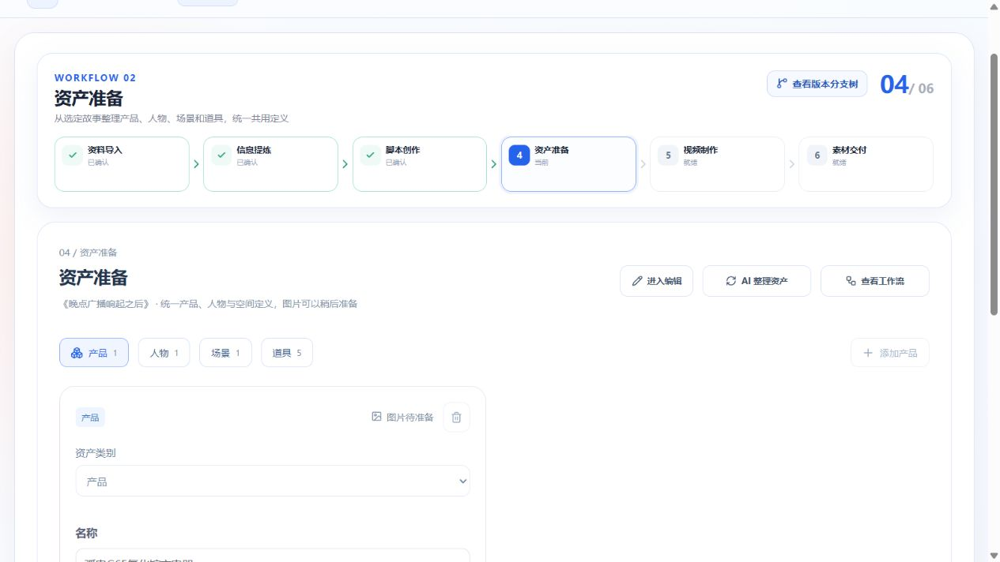
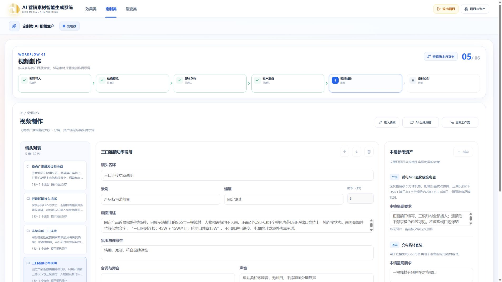
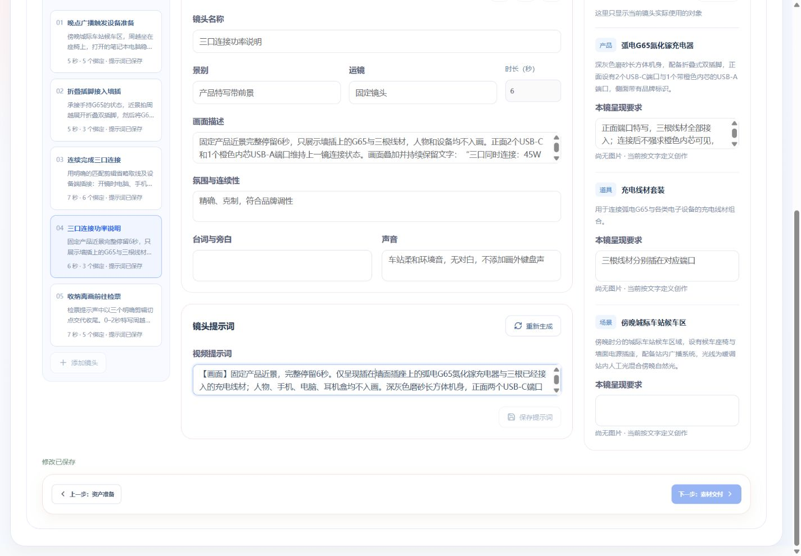
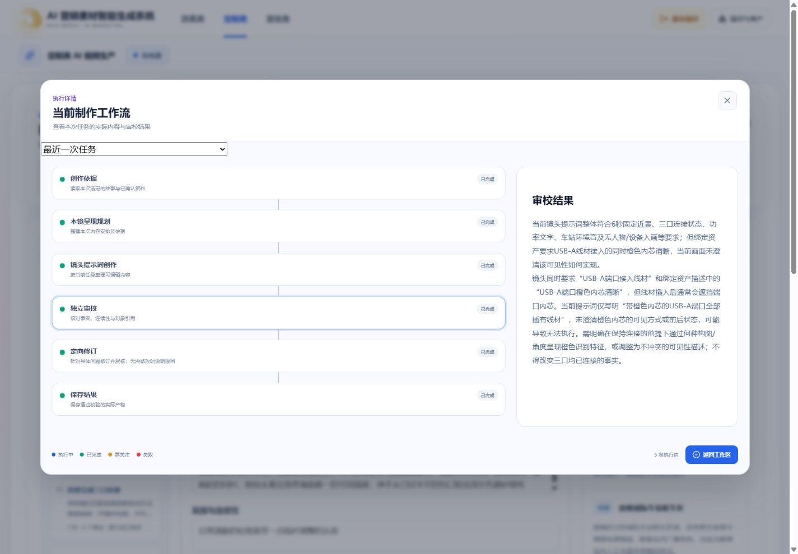

# 充电器新链路真实付费联调

日期：2026-10-12。用户明确授权，在已有“充电器”项目通过正式浏览器按钮执行真实火山模型调用。范围为脚本创作、资产准备、视频制作中的分镜及逐镜提示词；不生成资产图片或视频，不提交 Git。

## 环境与方法

- 正式 Web `localhost:5173`、API `localhost:3100`，真实 PostgreSQL、RabbitMQ 和独立脚本/制作 Worker。
- 创意与审校使用固定 Pro 模型 `doubao-seed-2-1-pro-260915`，细化使用固定 Turbo 模型 `doubao-seed-2-1-turbo-260628`，没有 Mock 或自动降级。
- 使用已有确认简报 revision 1：弧电 G65 氮化镓充电器，深灰色磨砂机身，2C1A、橙色 USB-A 内芯、折叠双插脚，准确区分单口、双口和三口功率。
- 创建与确认均通过浏览器；只读数据库查询用于核对快照、阶段、结果与实际耗时，不直接修改业务数据。日志仅保留阶段、调用量、token 与耗时；原文、凭据和原始响应不进入本记录。
- 任务耗时取创建至终态更新时间，包含排队、模型调用和持久化；失败或未采用结果也如实记录，不把检查点恢复时间当首次生成耗时。实际费用以供应商账单为准。

## 已发现与修正

1. AI 叙事结构模式仍携带历史自定义结构：创建快照和 Worker 均清除 AI 模式的旧结构；历史方案仅用于构思阶段避免重复，不再传给所有阶段作模板。
2. 故事修订后概述、叙事结构和产品呈现重点未同步：同次修订返回故事与方案元信息，完整复核后一起发布，保留旧检查点兼容。
3. 脚本工作流仍显示旧拆镜文案和固定执行边数：改为真实故事阶段和动态边数，沿用同一共享弹窗。
4. 资产规划缺少操作类型，提前生成镜头；审校复述了故事而非资产：输入显式携带操作类型，分别限定资产、分镜和单镜提示词的规划、生成与审校对象。
5. 旧 AI 资产描述被当作事实沿用：重新提取只携带旧身份、名称与类别；产品事实以简报为依据，故事和规划不能证明产品规格。资产规划不再重复输出整份目录。
6. 短叙事段落各自请求模型，重复上下文：新任务合并相邻段落为最多 60 秒的请求，完整保留文字、顺序与总时长；已有检查点沿原分段恢复。
7. 定向修订范围约束不够：对需修订镜头收紧 Schema 身份枚举、数量和合计时长，原稿仅作连续性上下文，正常镜头原样合回并完整复核。
8. 人工复查发现通用审校漏掉短镜头长对白、接线两端及离墙收纳动作：生成和审校补齐这些具体检查，制作审校/复核使用独立 Pro medium 推理，不通过删检查换速度。
9. 故事大纲中的分段时长被照搬为镜头时长，导致短段动作过载：制作模型读取完整故事正文、开场/发展/收束与对白安排，故事大纲的旧时间分配不作为镜头约束；目标总时长仍从冻结来源计算。明确省略必须写出真实剪辑切点和前后状态，不能仅以“快速、压缩动作”代替。
10. 单镜提示词自动提交后顶部画布仍暂时显示待更新：任务终态主动通知父页面刷新分支及节点投影，保留本地未保存编辑；本次通过类型、构建和定制类回归，未为这项通知单独追加付费任务。

## 脚本实测

| 轮次   | 设置        | 耗时      | 结果                                                |
| ------ | ----------- | --------- | --------------------------------------------------- |
| 基线   | 30 秒、2 份 | 222.44 秒 | 两份发布；发现旧结构污染及修订后元信息未同步        |
| 修正后 | 30 秒、2 份 | 231.81 秒 | 两份发布；AI 模式结构为空，修订后的正文及概述等一致 |

采用脚本《晚点广播响起之后》继续下游；另一份《拼车延迟的十分钟》保留在目录。脚本速度未显示提升，不能宣称本轮修正使脚本更快。两个方案都采用等待事件，虽角色协作与产品连接方式不同，广泛创意差异仍需跨产品继续评估。

## 资产实测

| 轮次             | 耗时      | 观察                                                                   |
| ---------------- | --------- | ---------------------------------------------------------------------- |
| 初次             | 102.93 秒 | 8 项资产；规划提前拆镜，审校对象错误；未确认                           |
| 限定操作与审校   | 204.74 秒 | 审校发现“其他插座空置却不可用”的矛盾并修订；旧结构细节仍被继承，未确认 |
| 缩减旧输入与规划 | 95.33 秒  | 8 项资产；公共外观回到简报，端口排列与插脚角度标为待确认；确认用于后续 |

目录包含产品 1、人物 1、场景 1、道具 5。通过页面人工将产品图像要求中的“底部视角”明确改为“插脚视角，安装位置与角度待确认”，验证人工修正及保存；不能将这一处人工修正描述成 AI 自动完成。没有要求先生成图片。执行期间刷新后恢复正确项目、节点和任务；终态进度条消失。

## 工程检查

- Worker 全量 pytest：75 通过；mypy：10 个源文件通过。
- Web 定制类测试：69 通过。
- API 脚本/制作普通测试：7 通过、3 个需显式启用的集成测试跳过；制作 PostgreSQL 集成测试另行显式执行，1 通过。
- `pnpm typecheck`、`pnpm build`、`git diff --check` 通过；构建保留已有大 chunk 提示。
- 真实失败任务保留未完成检查点，不作为确认结果。结构、时长、引用、身份及来源由代码校验；事实、动作和叙事质量由模型及人工复查，不以关键词规则替代语义判断。

## 分镜实测与人工调整

| 轮次             | 耗时      | 结果与采用情况                                                                          |
| ---------------- | --------- | --------------------------------------------------------------------------------------- |
| 原分段请求       | 191.05 秒 | 12 镜；审校发现接线、离墙与插脚位置问题，修订后结构校验失败；未确认                     |
| 合并请求         | 77.74 秒  | 5 镜、30 秒；模型通用审校通过，但人工发现对白容量与收纳状态问题；未按原稿确认           |
| 补强独立审校     | 263.95 秒 | 审校和修订修复位置、引用与断开关系；复核仍发现两处动作容量问题；失败稿未确认            |
| 解除大纲时间锁定 | 448.94 秒 | 7 镜；局部修订身份与时长校验通过，复核仍发现结尾3秒容量及设备收纳衔接问题；失败稿未确认 |

合并请求使实际分镜生成调用由5次减少为1次，但严格语义审校与复核成为主要耗时；77.74秒不能用作“质量达标”的成绩。最后一轮是复核未通过，并非模型超时；没有取消仍在执行的用户任务，也没有放宽检查来提交失败结果。

为完成下游真实联调，在正式工作台人工调整已生成的5镜：时长依次为5/5/7/6/7秒，总计30秒；缩短广播，明确设备端已接好后的三次插接切点；纯产品功率镜头移除人物绑定；收纳镜头明确设备端断开及设备收好、G65先离墙再合脚，并以“转身准备出发”结束。原失败结果及审校记录保留可查。

因此本轮证明了真实生成、错误阻断、编辑、绑定、确认和下游接通；**没有证明全自动分镜质量和速度已经达标**。需要人工调整仍是本轮实测结论，不能描述成模型一次生成成功。最新局部修订输入进一步增加明确的修订总时长与具体省略要求，单元测试覆盖；本轮未额外再购买一轮完整分镜验证这项输入改进。

## 逐镜提示词

以下提示词均消费上述人工调整并确认的分镜，通过正式页面逐镜触发真实模型调用，完整审校后自动提交：

| 镜头                    | 首次耗时 | 成功返回的模型调用 | 结果                          |
| ----------------------- | -------- | ------------------ | ----------------------------- |
| 01 晚点广播触发设备准备 | 43.23 秒 | 3                  | 完成，绑定 5 项               |
| 02 折叠插脚接入墙插     | 26.34 秒 | 3                  | 完成，绑定 3 项               |
| 03 连续完成三口连接     | 62.82 秒 | 5                  | 经修订与复核完成，绑定 6 项   |
| 04 三口连接功率说明     | 33.55 秒 | 3                  | 完成，绑定 3 项；随后另行调整 |
| 05 收纳离画前往检票     | 49.21 秒 | 3                  | 完成，绑定 5 项               |

第 04 镜运镜和声音原字段与人工改过的画面不一致。通过页面改为固定镜头、车站环境音并确认后，仅该镜提示词变为 STALE，其他四镜维持 CURRENT。该镜重新生成用时 87.43 秒、成功模型调用 5 次，经过修订与复核后提交；正文正确保留功率条件、无人物入画与固定镜头。

但这轮审校指出“USB-A 已接线”与绑定要求“橙色内芯清晰”冲突，AI 修订通过设定插头旁边露出橙色边缘满足要求。没有产品图片或结构依据支持这一细节，不能认定其物理可执行性通过。通过正式页面人工将绑定要求改为连接后不强求内芯可见，并同步保存提示词删除该结构设定。最终第 04 镜与其提示词均为 revision 3 / CURRENT。这也是本轮自动修订仍有质量缺口的证据。

第 02 镜通过页面追加外观与品牌标识一致性说明并保存，提示词 revision 2；刷新后再次选择该镜，修改仍存在。第 01、03、05 镜提示词保持 revision 1，未被其他镜头编辑或重新生成覆盖。五份提示词最终均 CURRENT，资产目录及视频计划亦为 CURRENT。保存后无修改时保存按钮禁用。

这里的“完成”指模型任务及结构/引用/持久化检查通过，不代表图像或视频实物验证通过；本轮没有图片生成、视频渲染或最终视觉验收。

## 浏览器与运行验证

- 1920 与 1440 宽屏保持镜头列表、编辑区、本镜资产三列；430 窄屏切为纵向，实际文档宽度没有横向溢出。
- 运行中显示真实进度，终态进度条消失；刷新恢复已有项目、视频制作节点及保存内容。镜头选择在整页刷新后回到第一镜，不声称记住了单镜选择。
- 共享工作流弹窗可查看实际依据、呈现规划、正文、具体审校问题与修订记录；历史任务展示镜头名称，成功和失败记录均保留。ESC 关闭验证通过。
- 本次没有验证浏览器 409、跨项目恶意访问、网络故障和所有租约竞争场景；相应受控测试不能替代这些浏览器或真实模型验收。
- 最新制作 Worker 已运行实际付费任务。最后仅修改 Web 的画布刷新通知，开发服务实际加载；没有为部署中断其他运行任务。

## 调用记录及结论

首次五镜及第 04 镜重新生成共 6 个付费提示词任务，日志观察到 22 次成功返回的结构化模型调用，输入 58,630 token、输出 10,417 token。统计由成功调用日志去重汇总，可能不包含异常返回、供应商侧重试或其他收费项目，不是完整账单；实际费用未读取，按火山账单核对。脚本、资产及失败分镜任务另有调用，不能将提示词统计当成本次全部费用。

真实新链路已贯通至逐镜提示词，失败结果不会伪装确认，人工修改和逐镜依赖隔离有效。资产最后一轮 95.33 秒，首次逐镜提示词 26–63 秒；脚本两份约 232 秒。自动分镜在较严格审校下仍需 264–449 秒且未通过语义复核，本轮采用结果包含明确的人工调整。**自动分镜质量、自动修订的物理可执行性及稳定低耗时仍未达标。**
