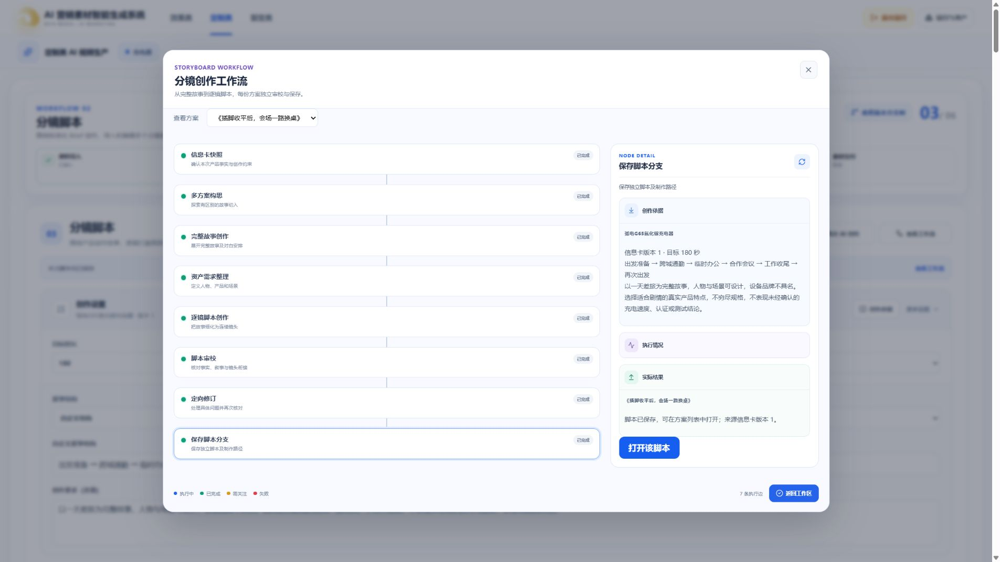
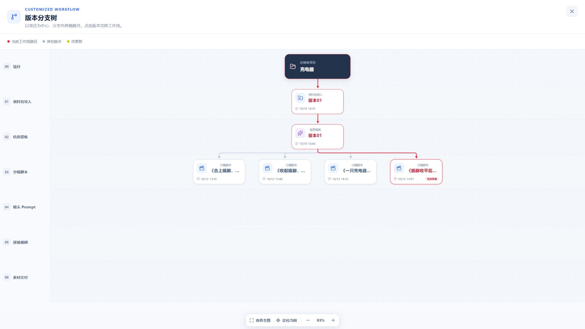

# 分镜浏览器真实付费联调 · 2026-10-12

## 范围与结果

使用已有“充电器”项目，在正式浏览器页面点击“再次 AI 创作 → 开始创作”。未通过脚本或 API 创建生成任务；后台观察脚本只发送 GET，数据库审计只读。真实火山模型执行成功，新方案《插脚收平后，会场一路换桌》已发布为第四个独立脚本分支。

| 项目       | 实际记录                                                                            |
| ---------- | ----------------------------------------------------------------------------------- |
| 项目 ID    | `2863b2c6-927a-48de-8327-b367e21fc64f`                                              |
| 任务 ID    | `0952001d-958f-41a9-8967-0258f7731d36`                                              |
| 新脚本 ID  | `7ab65e92-e6f3-4b5f-88a8-ca8572645636`                                              |
| 新分支 Run | `e5eb3965-73c4-428b-90fc-29990dce98f9`                                              |
| 来源       | 已确认信息卡 revision 1，冻结原始 artifactId `dc5fd94c-bd32-4dc8-9cce-8d0cd63776af` |
| 设置       | 180 秒、1 份、自定义六段差旅结构                                                    |
| 执行时间   | 北京时间 14:50:34.226 至 15:01:31.083，656.857 秒（10 分 56.857 秒）                |
| 最终结果   | COMPLETED；20 镜，合计 180 秒；确认业务 revision 1                                  |
| 模型       | Pro `doubao-seed-2-1-pro-260915`；Turbo `doubao-seed-2-1-turbo-260628`              |
| 真实调用   | 9 次；每次 attempts=1；任务 attemptCount=1                                          |
| Token      | 输入 67,377，输出 33,458，总计 100,835                                              |
| 费用       | 真实付费调用；未读取供应商账单，不以 Token 推算金额冒充实付费用                     |

各次模型耗时：构思 75.706 秒，故事 50.490 秒，资产 67.344 秒，三段分镜 87.291 / 93.295 / 70.028 秒，独立审校 91.071 秒，定向修订 42.408 秒，完整复核 76.784 秒。其余时间为编排、检查点和发布开销。单次结果不能证明稳定耗时上限；本轮没有供应商失败或自动重试事件。

## 浏览器验证

- 运行期间设置不可修改；两处工作流入口指向同一真实任务；阶段状态与后端一致。
- 执行中刷新恢复原任务、35% 进度及原方案选择，没有重复创建任务。
- 八个阶段均读取真实内容：12 项信息卡、方案构思、完整故事、对象定义、已完成分镜、具体审校问题、修改前后、保存结果。修订详情通过“继续阅读”加载后续内容和最终复核。
- 工作流面板支持 ESC、关闭后焦点恢复、Tab 焦点约束及 Enter 选择节点；1440、768、390 宽度检查无横向溢出，另有 1920 完成截图。
- 新脚本追加后仍停留原来选中的方案 02；手动选择方案 04 并刷新恢复方案 04。
- 临时改名只保存编辑草稿，取消编辑后恢复生成内容；不改内容直接“保存修改”，提示“内容未变化，版本保持不变”。
- 版本树展示四个并列脚本；资产目录显示 17 个对象及真实使用位置，包括修订新增的第二台手机；方案对比显示完整镜头与三类资产需求。
- “下一步：Prompt”进入当前脚本自身路径，页面明确显示待接入；本轮没有执行下游模型或视频任务。

## 审校与保留提醒

首轮独立审校发现 3 项 ERROR：会议/收尾阶段时间划分、镜头 9–10 的收纳位置矛盾、两台手机共用稳定对象身份。稀疏修订产生 16 条实际修改记录，完整复核后 0 ERROR、1 WARNING。

保留的 WARNING：概述写“擦净”后收纳，镜头 19 没有擦拭动作。模型判定其不影响执行，按既有规则允许发布并保留提醒。本轮未人为清除提醒，也未宣称生成内容完全无误。

## 联调修正

发现审校说明和资产目录会展示内部资产编号。只读展示层现将已知编号替换为真实对象名称，未建立候选显示“待定义对象”；故事段落与字段引用显示业务名称。修复保存结果标题重复；工作流详情的操作按钮复用共享 BaseButton。浏览器确认修复已在运行服务生效，没有重新付费生成或改写脚本。

## 持久化审计

对照发起前基线，原 3 份脚本内容和 WorkingArtifact 的 ID、Run、业务 revision、contentHash 完全不变。新脚本在取消编辑及同内容保存后仍与生成结果完全相同，业务 revision 保持 1。四个脚本分支共享父 Run `a9ab91cb-991b-448d-a194-102b9fabf602`。

分支依赖绑定自身复制的信息卡 `ffd231cb-205e-4848-8685-68d8a5d28d4b` revision 1，并通过 `sourceArtifactId` 追溯原始信息卡；复制件与冻结来源指纹一致。不能要求分支依赖直接指向原 Run 的信息卡副本。审计结束无活动定制分镜任务。

## 工程验证

- API 分镜详情 / Worker 单测：7 项通过；HTTP 集成测试未设置显式执行开关，1 项跳过，不记作通过。
- Web 展示格式化与分镜状态测试：22 项通过。
- API / Web 类型检查及生产构建通过；Web 构建仍提示已有大包告警。
- 当前修改 `git diff --check` 通过；没有自动提交 Git。
- 本轮未覆盖 3/5 方案并发、跨产品、取消活动任务、断网、409、供应商限流及失败重领，也未重复执行 Worker pytest；这些不能用本轮成功冒充验证。

## 截图

其他截图位于同目录，包含执行中、来源、故事、逐镜结果及窄屏面板。
