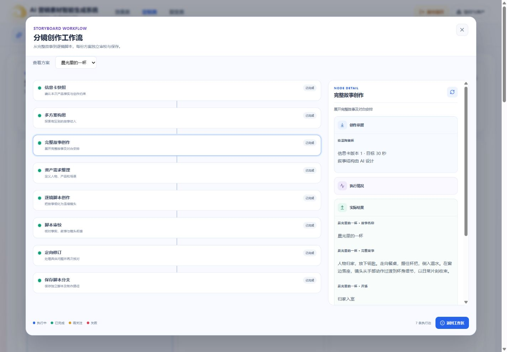
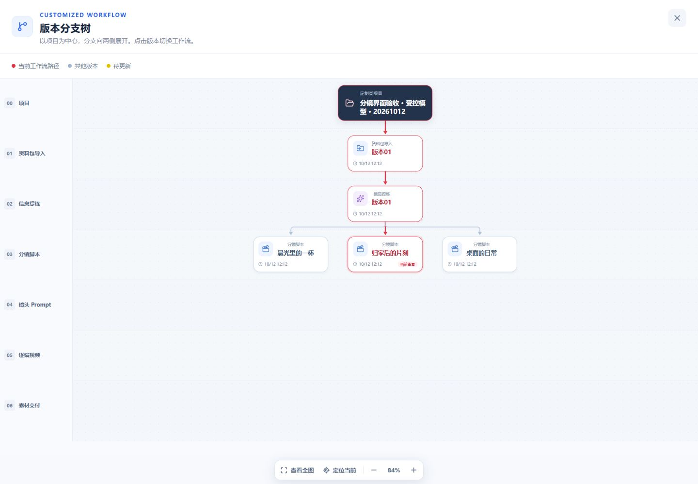

# 定制类分镜生成验收记录

日期：2026-10-12。范围：定制类第三节点、共享工作流详情面板、独立脚本分支、API 与独立 Worker。实现依据见[计划](../plans/2026-10-12-分镜生成与独立脚本分支.md)。本记录区分真实基础设施验证与模型测试替身；没有执行付费模型请求。

本记录是首次受控验收。随后获得付费授权后的真实模型测试、修复、性能观察与提交情况单独记录于[真实付费验收](2026-10-12-分镜真实付费验收.md)，不替换这里的历史结果。

## 实现结果

- 工作区直接读取有效已确认的 `customized-brief`，任务冻结来源、设置、品牌引用及阶段模型。再次创作新增批次，保留旧方案。
- 每份脚本审校通过后独立事务性发布 `customized-script:<scriptId>`，同简报来源下建立兄弟分支；同批其他方案失败不阻止已成功脚本使用。
- 已确认脚本的编辑草稿与正式内容隔离，取消恢复原内容；保存修改更新原分支，同内容不增加业务 revision。人工空白草稿首次有效保存才发布分支。
- 八阶段持久化检查点、恢复、取消、租约及 attempt 校验接通。节点详情展示实际故事、镜头、对象使用位置、审校依据与修订结果，支持分页。
- 效果类 Prompt 与定制类分镜共同引用 `WorkflowExecutionGraphDialog`，并继续使用共享进度、确认、编辑动作、画布和版本树。定制类脚本分支显示脚本名称，未借用模板身份。
- `customized-storyboard-worker` 独立 Compose 服务已运行，镜像不安装 Docling、Torch、浏览器或视频工具。两类提炼 Worker 经兼容入口继续使用提取出的轻量请求实现。

## 已执行工程验证

| 检查                                            | 实际结果                                                                                                    |
| ----------------------------------------------- | ----------------------------------------------------------------------------------------------------------- |
| Contracts 全量 Vitest                           | 15 个文件、197 项通过，包括新增 11 项分镜契约验证                                                           |
| Web 相关 Vitest                                 | 6 个文件、101 项通过，覆盖脚本状态、定制类分支、效果类工作流详情与分支布局                                  |
| Storyboard API Vitest（开启数据库及 HTTP 验收） | 4 个文件、6 项通过                                                                                          |
| 项目删除相关测试                                | 45 项通过，包含新任务清理接入                                                                               |
| 新 Worker pytest / mypy                         | 19 项通过；6 个源文件类型检查通过                                                                           |
| 定制类提炼 Worker 回归                          | 64 项通过；9 个源文件类型检查通过                                                                           |
| 效果类提炼 Worker 回归                          | 最终指定仓库临时目录全量重跑：105 项通过、6 项默认跳过；18 个源文件类型检查通过。初轮临时目录权限问题已排除 |
| 相关新增代码 ESLint                             | 通过                                                                                                        |
| `pnpm typecheck`                                | 通过                                                                                                        |
| `pnpm build`                                    | 通过；Vite 仍提示主包体积超过 500 kB，非构建失败                                                            |
| 数据库迁移与 Prisma 生成                        | `20261012090000_customized_storyboard` 已应用                                                               |
| Compose 配置、镜像构建、容器运行                | 通过；更新容器前分镜排队/运行任务数为 0                                                                     |

数据库验收覆盖重复创建和回调、单份提前发布、部分失败恢复、再次创作保留结果、兄弟分支隔离、编辑取消、409、同内容保存、两轮来源变化、过期租约、取消后旧 token、跨项目拒绝、空白草稿及导入首次发布。

HTTP 验收使用真实运行 API、PostgreSQL 及 Python 生成流程，由测试代码注入受控模型适配器。测试禁止插入 Outbox 消息，因此部署的真实模型消费者不能消费这些测试任务。三份脚本经受保护接口写入检查点并发布独立分支；无 Token 请求返回 401。测试随机项目在结束时清理。

受控模型矩阵包含食品、护肤品、电子、家居和软件，1 / 3 / 5 份、15 / 30 / 180 秒，以及长故事分片、超时、429、无效输出、全局并发上限、失败检查点恢复和有界修订。这些用例验证程序规则，不证明真实模型输出质量。

## 浏览器实际观察

环境：本地 Web 5173、API 3100。界面验收项目为「分镜界面验收 · 受控模型 · 20261012」，使用虚构陶瓷杯资料和明确的测试适配器产物。保留三份脚本便于检查，空白草稿验收后已通过受保护业务接口清理。

- 1920、1440、768 宽度已检查；窄屏没有页面横向溢出。
- 八个执行节点均打开检查真实业务结果，故事正文、镜头内容、审校结论与保存分支可见；未制造后台不存在的示例。
- 工作流详情查询失败后重试恢复；ESC 关闭后焦点回到入口，Shift+Tab 保持在弹窗内。
- 脚本切换、刷新保留选择；编辑自动保存、取消恢复，以及无变化保存保持 revision 1 已验证。
- 人工空白脚本保持 0 镜、未发布，刷新仍选中该草稿，下一步不可用。
- 版本树展示三份具名兄弟脚本。效果类现有「广式腊肠」项目的 Prompt 工作流与实际提炼映射详情使用共享弹窗正常展示；检查未触发生成。





其他截图：[1920 工作台](browser/2026-10-12-storyboard/workspace-1920.jpg)、[768 工作台](browser/2026-10-12-storyboard/workspace-768.jpg)、[768 工作流](browser/2026-10-12-storyboard/graph-768.jpg)、[效果类共享面板回归](browser/2026-10-12-storyboard/effect-graph-regression-1440.jpg)。

## 复现与未验证范围

在根目录执行数据库验收；HTTP 验收还要求 API 正在运行、独立 Worker Token 已配置、新 Worker Python 环境已安装：

```powershell
$env:CUSTOMIZED_STORYBOARD_DATABASE_TEST='1'
$env:CUSTOMIZED_STORYBOARD_HTTP_TEST='1'
pnpm --filter @ai-marketing/api exec vitest run src/workflows/customized/storyboard
```

Worker 命令与配置见[运行说明](../../../../workers/customized-storyboard/README.md)。没有执行真实 Pro/Turbo 生成，未验证账户模型权限、实际创意差异、费用或耗时，不承诺质量及速度指标。未执行下游 Prompt、资产图片、视频生成及交付。单镜 AI 重新创作仍非本批次生成范围。未提交 Git。
