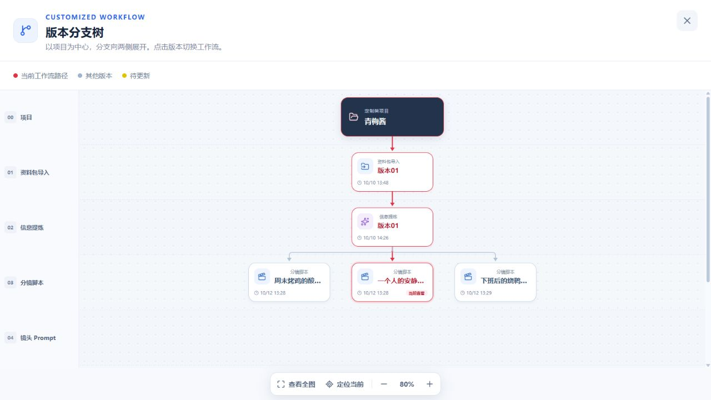
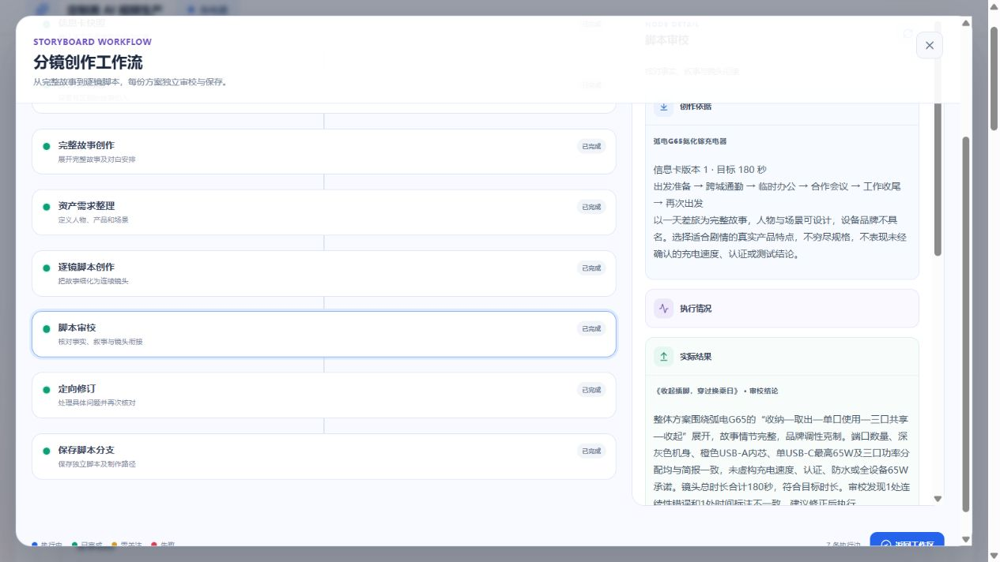

# 定制类分镜真实付费验收

日期：2026-10-12。用户明确授权提交并执行真实付费测试，并补充要求失败自动重试、速度与稳定性。承接[首次受控验收](2026-10-12-分镜生成验收.md)，本记录中的生成请求实际使用火山方舟，不使用测试适配器。

## 环境与输入

本地 Web 5173、API 3100、PostgreSQL、RabbitMQ，以及独立 `customized-storyboard-worker` Compose 服务。创意、故事、审校使用 `doubao-seed-2-1-pro-260915`；资产目录和镜头使用 `doubao-seed-2-1-turbo-260628`，修订按问题类型选择。全局模型并发 2，单消费者预取一个批次；超时 300 秒，请求最多 2 次尝试。品牌图片仅固定引用，没有进入视觉模型。

| 产品            | 已确认信息卡                                        | 核对重点                                                                                      |
| --------------- | --------------------------------------------------- | --------------------------------------------------------------------------------------------- |
| 梅里青梅酱      | `af925000-24e9-44b3-8a74-f9bd05b530a5` / revision 1 | 200g、墨绿瓶盖、米白标签、金黄色酱体与果肉，家庭晚餐熟食蘸食，禁止虚构零糖等背书              |
| 弧电 G65 充电器 | `dc5fd94c-bd32-4dc8-9cce-8d0cd63776af` / revision 1 | 2 USB-C + 1 USB-A、折叠插脚、118g、53×42×30mm，单口与三口功率规则分开，不编造认证、速度或防水 |

## 实际生成结果

| 批次                                                  | 设置                     | 实际结果                                                                           |
| ----------------------------------------------------- | ------------------------ | ---------------------------------------------------------------------------------- |
| 青梅酱 `dea2a939-f60c-4bef-b560-65a56ec9b817`         | 3 份、30 秒、AI 结构     | 全部完成，3 份各 6 镜 / 30 秒，独立审校、修订及复核通过后分别发布                  |
| 充电器首轮 `74162e2c-7dc0-4e56-9595-f63e4edfffbe`     | 1 份、15 秒、参考结构    | 未发布；一次修订后复核仍发现镜头动作与对白超出时长，保留检查点并显示未完成         |
| 充电器短片复测 `0c73e3eb-c5c8-4894-8a55-4bce16e987b9` | 1 份、15 秒、参考结构    | 完成，《合上插脚，带着走》，4 镜 / 15 秒；审校无问题，修订明确跳过                 |
| 充电器长片 `07328335-d14b-4259-b4b1-2d4050ba1eea`     | 1 份、180 秒、自定义结构 | 完成，《收起插脚，穿过换乘日》，28 镜 / 180 秒；一次修订及独立复核通过，revision 1 |

青梅酱三个脚本分别是《周末烤鸡的酸甜蘸碟》《一个人的安静晚饭》《下班后的烧鸭小酌》，同一简报来源下并列为兄弟分支。前两份在批次仍为 RUNNING 时已发布，第三份完成不会改变用户当前选择。15 秒脚本在新增 180 秒批次时仍可查看，没有被覆盖。

长片独立审校定位到具体问题：转移充电器时笔记本与线缆状态缺少交代，以及结构文字时间段与实际镜头累计时间不一致。详情展示相关镜头、原文依据与修改建议，而非仅展示问题数量。

## 发现与修复

1. 短暂 API 重启可能丢弃已返回模型结果。受保护请求增加有界网络 / 429 / 5xx 重试，相同 attempt 与正文重发；真实日志观察到心跳 500 后恢复 200，任务继续。401 / 404 / 409 不重试。
2. 多个细小故事段落各调用一次，重复上下文较多。连续段落合并至不超过 30 秒，并在请求前持久化分片计划；旧分片继续使用原边界。模型输入移除相互冲突的原始段落列表，明确当前片段内容与时长为本次请求边界。
3. 合并请求早期返回时长不足。保存未采用结果及具体机械问题，只纠正一次；预算跨重启保留，不通过刷新重复付费。正确分片、对象目录与已完成脚本继续复用。
4. 审校上下文包含当前方案旧构思，复核可能把旧内容当成修订后内容。排除自身旧构思，明确以当前完整脚本为准；历史已完成修订可以只重新复核，不重做故事和修订。
5. 请求层有限重试后仍遇到暂时供应商故障，任务按 15 / 30 秒退避恢复，最多 3 次领取，记录确切待恢复方案。永久错误和审校未通过不会无限重试。数据库及受控 Worker 测试验证任务退避边界；长片资产目录请求自然遇到真实 429，第二次请求成功（阶段总耗时 117 秒），没有人为制造供应商故障。
6. 并发负载下工作区只读事务超过默认 5 秒。设置 15 秒事务预算和 3 秒连接等待，不新增行锁；这是查询容错，不代表模型变快。观察到查询从几十毫秒至约 6.3 秒波动，未据此宣称性能 SLA。
7. 默认脚本恢复时，父页面刷新编辑守卫尚未就绪，版本树可能仍停留信息卡。等待编辑页面渲染后恢复脚本路径，手动选择、刷新再进入、上游返回均已核对。
8. 运行中的任务轮询可能清空已选工作流节点。按实际作用域字段分别监听，普通任务状态更新不重置选择；跨任务、项目及脚本切换仍取消旧请求。审校与修订详情把内部镜头标识投影为镜号。
9. 再次创作的目标时长不能作为旧脚本的校验目标。逐镜区域显示当前脚本实际合计，目标设置只表示本次新创作。
10. 分片校验不能强制开场立即出现产品。开场允许只包含人物或场景，完整脚本发布前仍要求产品引用；两项受控回归验证不会为合法开场多调用纠正请求，整片无产品仍拒绝发布。

## 耗时与调用观察

调试过程包含 API 重启、取消、等待旧请求结束、部署修复及继续执行。青梅酱从初次创建到完成约 33 分钟，充电器短片复测约 14 分钟，不能当作正常一次生成耗时。青梅酱最后恢复窗口约 6 分钟；短片复测最后仅补镜头与审校，约 55 秒，之前构思、故事和资产已经保存，因此也不能当作全流程耗时。

分片合并减少请求次数；全局有界并发、阶段检查点、已发布方案跳过及固定纠正预算控制重复调用。模型时延仍是主要瓶颈，长片需要更长生成与复核时间，不承诺固定完成秒数。

长片为修复后新建的完整批次，创建至发布 999 秒（16 分 39 秒），包含真实限流恢复。共 7 次片段细化请求产生 28 镜；完整修订响应 14,935 个输出 token、约 281 秒，占据明显耗时。构思约 74 秒、故事约 71 秒、审校约 65 秒、复核约 39 秒。这一轮证明可完成与恢复，尚不能证明稳定低延迟；完整长稿修订仍是性能优化重点。

| 批次                             | 已解析响应数 | 输入 token | 输出 token |
| -------------------------------- | -----------: | ---------: | ---------: |
| 青梅酱（含修复前调用）           |           23 |    102,122 |     49,423 |
| 充电器首轮（未发布）             |           11 |     49,319 |     25,025 |
| 充电器短片复测（含早期无效分片） |            6 |     16,644 |      9,968 |
| 充电器长片                       |           13 |     75,108 |     46,251 |
| 合计                             |           53 |    243,193 |    130,667 |

记录只统计收到并成功解析的模型响应，不把 429 当作成功响应；中断或供应商未返回用量的请求可能计费，不包含在该统计中。reasoning token 已包含在输出 token，不重复相加。未获得账户账单明细，不把推算金额标成实际费用。

## UI 与持久化验证

- 青梅酱八个节点可查看实际快照、构思、完整故事、资产、镜头、审校、修订及保存结果。
- 默认第一份成功脚本，手动选择第二份后刷新重新进入仍保留选择；版本树显示相应兄弟分支为当前路径。
- 真实脚本进入编辑、无变化保存及取消编辑已执行；无变化保存返回“版本保持不变”，其他脚本保留。
- 长片生成时旧短片仍可查看；创作设置冻结，进度来自服务端，未完成不显示 100%。
- 1920 / 1440 / 768 的首次界面回归见受控验收。本轮另在实际浏览器尺寸与 1440 / 768 检查真实产物；长片修订详情分页读到第 28 镜，没有遗漏。运行至完成后原来选中的审校详情仍保留。

## 工程验证与复现

| 检查                                      | 实际结果                                                                    |
| ----------------------------------------- | --------------------------------------------------------------------------- |
| Contracts 全量 Vitest                     | 15 文件、209 项通过                                                         |
| Web 分镜、工作流与定制共享相关 Vitest     | 6 文件、37 项通过                                                           |
| 分镜 API Vitest，开启数据库及 HTTP        | 4 文件、8 项通过                                                            |
| 分镜 Worker pytest / mypy                 | 34 项通过；6 个源文件类型检查通过                                           |
| `pnpm typecheck` / `pnpm build`           | 通过；构建仍有大于 500 kB 的主包提示                                        |
| 相关 ESLint、付费脚本语法、Compose config | 通过                                                                        |
| 相关文件 `git diff --check`               | 通过                                                                        |
| 自动恢复迁移                              | `20261012140000_storyboard_automatic_recovery` 已应用；Prisma Client 已更新 |

数据库验收包含自动退避时间、重复完成回调幂等、待恢复方案集合、过期执行检查点保留、旧 token 拒绝与自动恢复次数上限。Worker 验收包含跨重启纠正预算、暂时故障与永久失败区别、已完成方案跳过、旧分片边界兼容及自身旧构思排除。

付费测试入口为 `apps/api/scripts/verify-customized-storyboard-paid.mjs`。必须显式设置 `CUSTOMIZED_STORYBOARD_PAID_TEST=1`，提供 `--project`、`--run`、`--seconds`、`--count`、`--mode` 及独立 `--manifest`；同一 manifest 再运行恢复观察，`--retry` 才主动恢复终态任务。支持重复创建幂等校验、逐份发布观察、旧方案保留、来源 revision、总时长和八节点完整分页读取。原始 manifest 与日志放本地 tmp，不提交资料正文、凭据或签名地址。

真实测试覆盖两个产品、1 / 3 份、15 / 30 / 180 秒及 AI / 参考 / 自定义结构，未完成五品类和五方案的全部付费组合。结构、重试与隔离矩阵另由受控测试覆盖。未调用下游 Prompt、图片、视频、音频生成，不以脚本审校成功宣称成片质量已验收。
