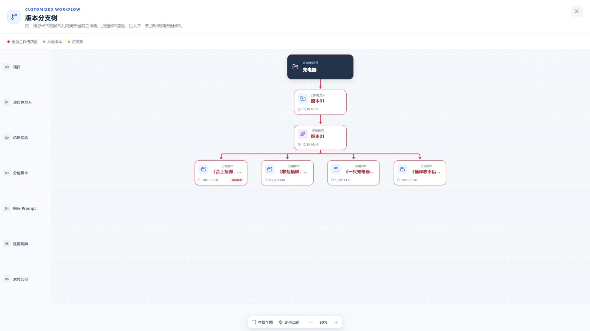

# 分镜统一查看与导航验收

日期：2026-10-12。作用域：定制类分镜节点的查看偏好、版本树和后续导航。使用本地正式 Web / API 与已有“充电器”项目的四份已确认脚本，未创建新的模型任务。本记录不重复证明生成质量或生成耗时。

## 实际浏览器观察

- 列表由方案一切到方案二，活动 Run 保持方案一所属 Run；刷新恢复方案二。
- 版本树由方案二切到方案三，活动 Run 仍保持不变；同一信息卡下四份脚本及连线同时高亮，只有方案三显示当前查看。
- 方案三点击底部下一步后，活动 Run 才切到方案三，当前节点为 SHOT_PROMPT。
- 从 Prompt 页面点击树中的方案四，回到分镜工作区并选中方案四，活动 Run 仍为方案三；从画布点击 Prompt 后才切到方案四。
- 从后续节点在树中选择方案一，仅切回分镜查看。最终保留方案一查看偏好，活动 Run 仍为方案四。
- 每次导航后的数据库只读对比均确认：14 份工作副本的 ID、归属、revision 和内容指纹保持不变；5 个 Run 的身份、父子关系和脚本归属保持不变。
- 已完成任务的进度条和“本次脚本均已保存”栏均不存在，顶部“查看工作流”仍可打开八阶段真实执行详情。
- 1920 × 1080、1440 × 900、390 × 844 检查脚本工作区与版本树。390 宽度 DOM 核对没有页面横向溢出；画布保持已有内部横向浏览方式。完成检查后恢复默认视口。

## 检查结果

- Web 相关四份测试文件：111 项通过，覆盖当前工作流集合、历史信息卡隔离、独立下游路径、唯一当前查看、下游尚无产物时不误标脚本、效果类布局回归，以及排队 / 运行 / 完成 / 部分失败 / 失败 / 取消状态。
- `CUSTOMIZED_STORYBOARD_DATABASE_TEST=1` 的分镜数据库集成测试：1 项通过。新增断言覆盖从不同 Run 读取都优先恢复集合查看偏好、同偏好重复保存不增加设置 revision，以及浏览不修改 Run 和 WorkingArtifact。
- `pnpm typecheck`、`pnpm build`、`git diff --check` 通过。构建仍报告现有 Web 大包体提示。
- 排队、失败及恢复状态使用组件测试验证，本轮未为这些状态触发付费生成。历史信息卡分组隔离由布局测试覆盖，浏览器现有项目只包含一个已确认信息卡来源头。

## 截图

[1440 版本树](browser/2026-10-12-storyboard-navigation/branches-1440.png) · [1440 完成工作区](browser/2026-10-12-storyboard-navigation/completed-1440.png) · [窄屏完成工作区](browser/2026-10-12-storyboard-navigation/completed-390.png) · [窄屏版本树](browser/2026-10-12-storyboard-navigation/branches-390.png)

对应[实施计划](../plans/2026-10-12-分镜统一查看与路径选择.md)。
