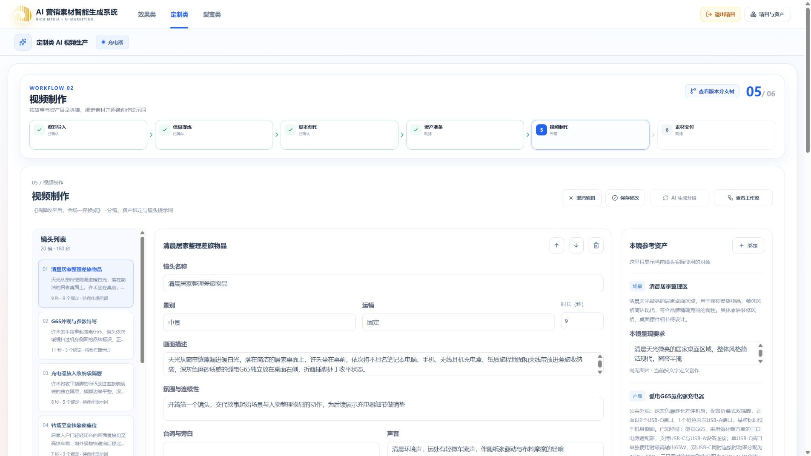
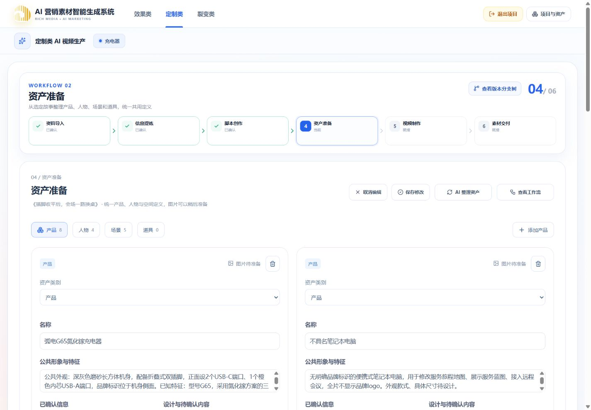

# 脚本、资产准备、视频制作拆分验收

日期：2026-10-12。对应[修订计划](../plans/2026-10-12-定制类脚本资产视频制作节点拆分.md)。本记录区分代码实现、受控验证与真实模型验收，不复用旧分镜链路的付费成绩。

## 已实现范围

- 固定节点调整为资料导入、信息提炼、脚本创作、资产准备、视频制作、素材交付。当前选中的已确认脚本确定后续制作作用域。
- 新脚本任务仅生成多方案完整故事，保留独立审校、有限修订和逐份发布；旧任务继续按原快照恢复。
- 资产准备支持产品、人物、场景、道具的文字定义、事实与设计区分、来源、图像制作要求、增删改及合并。保存目录后即可拆镜，不要求先生成图片。
- 视频工作台统一镜头编辑、排序、氛围/声音、资产绑定和单镜提示词。绑定选择器展示完整目录，镜头参考区与模型输入使用当前镜头绑定子集。
- 资产、分镜、Prompt 使用真实异步任务与六阶段检查点；复用共享进度条、工作流图、弹窗、字段和编辑动作。终态不保留运行进度条。
- 长分镜分段并发生成并保留成功检查点；按总时长预算分配分段误差，避免多个有效检查点合计超时。来源变化、草稿 revision、租约与 attempt token 均在服务端校验。
- 资产与分镜结果先保存为草稿，明确保存才确认；Prompt 生成审校通过后自动提交。相同内容不增长业务 revision。
- 独立制作进程、队列与 Token 已配置。图片生成、图片上传替换、视频渲染、成片交付和历史版本回溯重构不在本次接通范围。

## 工程检查

以下均在本地执行；数据库测试为随机隔离项目，拦截 Outbox 投递，不调用付费模型。

| 检查                                                                                                          | 结果                                                              |
| ------------------------------------------------------------------------------------------------------------- | ----------------------------------------------------------------- |
| Contracts 定制类相关测试                                                                                      | 46 通过                                                           |
| Web 定制类相关测试                                                                                            | 69 通过                                                           |
| API 分镜、制作、项目删除、环境配置相关测试                                                                    | 67 通过、1 个显式启用的 HTTP 测试跳过；含实际 PostgreSQL 集成测试 |
| `uv run --project workers/customized-storyboard pytest workers/customized-storyboard/tests`                   | 67 通过                                                           |
| `uv run --project workers/customized-storyboard mypy workers/customized-storyboard/src/customized_storyboard` | 10 个源文件通过                                                   |
| `pnpm typecheck`                                                                                              | 通过                                                              |
| `pnpm build`                                                                                                  | 通过；仍有现有前端大于 500 kB 的 chunk 提示                       |
| 相关文件 ESLint、Compose 配置检查                                                                             | 通过                                                              |
| `git diff --check`                                                                                            | 通过                                                              |

集成测试覆盖新故事独立发布、幂等、跨项目隔离、草稿冲突、同内容保存、两轮来源变化、每镜绑定与 Prompt、取消后回调、重试 attempt fencing，以及资产重新整理保留已有分镜。Worker 测试覆盖 180 秒分段恢复、只重试失败段落、分段时长误差不进入成功检查点、Prompt 仅接收绑定子集和 JSON Schema 一致性。这些证明程序规则，不证明真实模型的创意质量。

## 浏览器检查

使用已有“充电器”项目，脚本《插脚收平后，会场一路换桌》。本轮仅导航和读取，没有在该项目提交资料或触发付费任务。

- 1920 宽度视频工作台为镜头目录、镜头编辑、当前绑定资产三栏。
- 1440 宽度资产卡片左右排布，类别及图像制作要求可见。
- 430 窄屏单列排列，无横向溢出（测得内容宽与视口内容宽均为 415）。
- 当前镜头参考区显示 9 个绑定对象；绑定选择器显示完整目录 17 个候选，二者没有混淆。
- 工作流弹窗使用共享组件，六阶段可见，无任务时不伪造执行结果。ESC 关闭及焦点恢复已检查。
- 旧对象按原类别兼容投影，没有按名称猜测和自动更改历史产品/道具分类。旧镜头可查看，但不把旧内容当作新链路生成成果。

## 本地运行状态

- `20261012180000_customized_production` 迁移已应用，Prisma 客户端已更新。
- API 已加载独立制作 Token；受保护接口用有效凭据查询不存在的任务返回 404，未再被误判为凭据缺失。
- 更新前查询定制类提炼、脚本、制作任务，排队和运行数量均为 0。
- 重新构建并启动 `customized-storyboard-worker` 与 `customized-production-worker`。两个服务实际日志均报告 ready，未重启其他业务 Worker。

## 尚未验证

本轮没有进行新拆分链路的真实火山模型端到端付费验收，因此不能宣称真实生成耗时、脚本/资产/镜头质量达标。浏览器尚未逐一覆盖真实运行、部分失败、重试、409 冲突全过程；相应规则主要由受控 API/Worker 测试覆盖。跨产品质量矩阵及图片/视频渲染需后续独立验收。

没有自动提交 Git，也没有清理工作区中其他任务的改动。

后续真实付费结果见[充电器新链路真实付费联调](2026-10-12-充电器新链路真实付费联调.md)。上面的“尚未验证”记录本文件原实施验收时点，不代表后续没有执行付费测试；后续报告明确区分自动成功、失败和人工调整。
