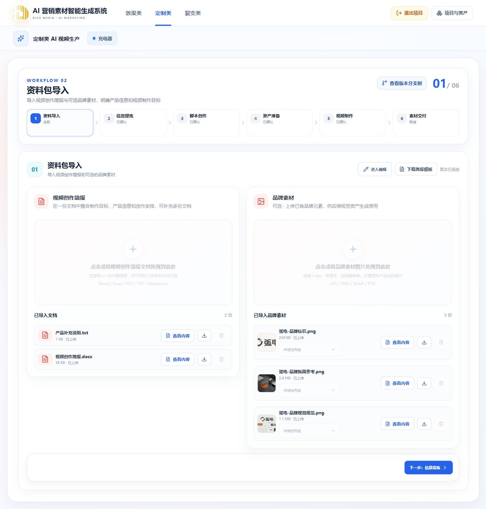
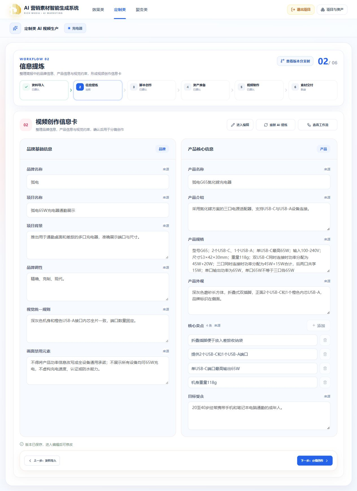

# 资料导入与信息提炼分支恢复验收

日期：2026-10-13。本次只修复定制类前两节点在脚本分支中的数据恢复，不执行模型任务。

## 实际原因与结果

“充电器”当前脚本分支 `7010e343-5800-4354-b3ef-0833b7212b2c` 已保存资料包和信息卡，但没有 SOURCE_IMPORT 页面草稿或本地提炼结果记录。原提炼记录仍在来源 Run，页面原先因此显示空白。

修复后浏览器恢复两份简报文档、三张品牌图片；信息卡恢复“弧电G65氮化镓充电器”及四条卖点。刷新资料页面仍正常。查看工作流可读取原已完成任务，文档解析详情显示两份文档及真实解析节选。

浏览器执行信息卡进入编辑、原样保存，以及资料包进入编辑、取消编辑，均返回同一个原 Run。随后只读 API 核对：资料包与 Brief revision 均仍为 1，脚本、资产准备和视频制作工作副本仍 AVAILABLE。未上传、替换或重新生成用户素材。

1920、1440 与 390 宽度下信息卡字段均能恢复；viewport 已重置。本次未改布局，没有对所有节点进行完整视觉验收。

## 自动检查

- `pnpm --filter @ai-marketing/api test src/platform/workflow/customized-inherited-extraction.spec.ts src/workflows/customized/information-extraction/customized-extraction.service.spec.ts src/workflows/customized/information-extraction/customized-extraction-node-detail.spec.ts`：相关单测通过；新增用例单独再次运行通过。
- `pnpm --filter @ai-marketing/web test src/workflows/customized/source-import/customized-import-state.spec.ts src/workflows/customized/source-import/customized-import-workspace.spec.ts`：19 项通过。
- 设置 `CUSTOMIZED_EXTRACTION_DATABASE_TEST=1` 后执行 `pnpm --filter @ai-marketing/api test src/workflows/customized/information-extraction/customized-extraction-inheritance.database.spec.ts src/workflows/customized/information-extraction/customized-extraction.database.spec.ts`：两项真实 PostgreSQL 集成测试通过，覆盖历史/嵌套继承、只读无写入、来源祖先两轮变化、兄弟隔离、编辑恢复、取消、迟到写入拒绝、同内容保存及修改后只发布当前分支。
- Web / API 类型检查与两端生产构建通过。Web 构建仍提示现有大体积 chunk，未影响构建成功。
- `git diff --check` 通过。

测试只创建并清理独立测试项目；首次失败遗留的测试夹具已清理。没有启动 Worker、调用付费模型或执行完整视频生成回归。本次未提交 Git。
