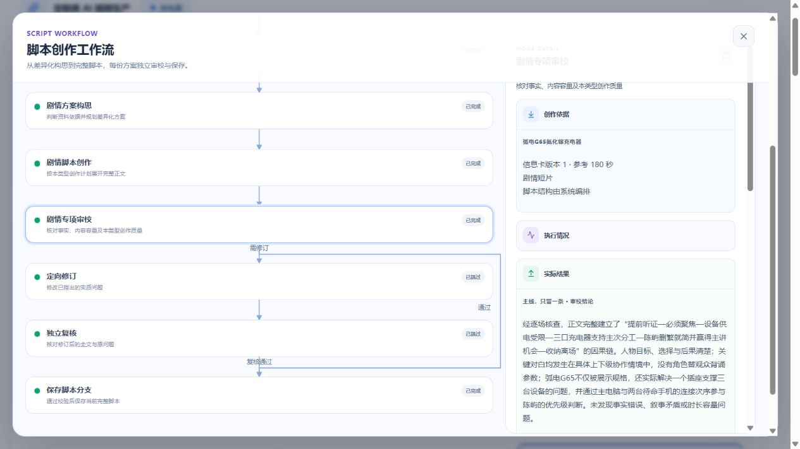

# 脚本专项审校与质量复测

日期：2026-10-13。范围：定制类脚本创作；资产图片、视频渲染未执行。使用已获授权的现有充电器项目，简报 revision 1 保持不变，旧脚本保留。

## 改造与受控验证

四种视频类型各有三项质量判断；判断需引用正文篇章和逐字证据，FAIL 转为实质问题进入现有定向修订与独立复核。API 同时验证路线、引文和失败状态，不能用空 findings 放行质量失败项。工作流详情使用原共享组件展示依据和建议。

`.4` 引入质量检查；真实测试暴露引用不匹配后增加一次有界纠错。`.5` 不向初次审校提供当前方案的概念说明，要求先提取实际证据再判断。历史 `.1/.2/.3/.4` 仍按冻结版本恢复；正常稿不新增模型调用。

- Worker：131 项 pytest 通过，mypy 23 个源文件通过；包含错误引用、一次纠错、质量失败触发修订、复核失败不发布、完整原文索引和旧策略恢复。
- Contracts：两个相关测试文件 22 项通过。
- API：数据库及节点相关测试 15 项通过，HTTP 跨 Python 流程 1 项通过；删除 HTTP 专项未启用。
- API 热更新期间 HTTP 曾因端口未监听失败。在无活动任务时恢复单一 API 开发进程后复跑通过；不计作模型失败。

## 真实测试记录

模型固定 `doubao-seed-2-1-pro-260915`，并发上限 2。token 来自 Worker 成功调用日志；无供应商账单金额，不估报人民币费用。模型通过不等于人工创意验收通过。

### .4 品牌广告

任务 `0575efd5-1e1e-4fc8-b89f-36a62a41a61c`，1 份，参考 30 秒。

首次约 141 秒在审校失败，没有发布；恢复只执行审校，保留构思与正文。恢复第一次审校明确发生引文不匹配，第二次纠错后发布《橙色一格，定位三口秩序》，5 篇章、988 字、预计 30 秒。含中途修复与部署的墙钟时间约 396 秒，不作为连续生成性能。

恢复阶段两次模型调用共 11,909 token，模型延迟合计约 47.7 秒。首次调用日志在容器替换前未完整归档，不能将恢复用量冒充整批用量。

人工结论：未达到本轮品牌创意目标。正文仍主要是接线、功率字卡和收纳；专项审校把导视线、标注变化作为品牌表达而全部通过。这是实际漏判，不能用接口成功掩盖；因此继续进行 `.5` 正文独立审校复测。

### .5 品牌广告

任务 `3a3a27ce-92b8-432e-bb1f-73180eca8a70`，1 份，参考 30 秒。246 秒发布《不看，也能接对》，6 篇章、994 字、预计 30 秒。实际 5 次调用：构思、正文、正文格式纠错、审校、引文纠错，共 26,848 token，模型延迟合计 244.19 秒。

人工结论：仍不满足本轮质量目标。正文继续按接线和功率信息展开，“不看”与依赖橙色接口识别的表达关系不够成立，模型仍全部通过。去除概念说明没有单独解决语义漏判。

对同稿进一步使用 high 推理强度作独立审校，仅写本地结果，不修改项目。共两次调用（含引文纠错）、14,843 token、202.59 秒，仍全部通过。因此未将 high 推理切入正式配置，避免无证据地增加正常任务成本。

### .5 剧情短片

任务 `1b32b246-d2ff-4438-b910-13d366c0849e`，1 份，参考 180 秒。557 秒结束，7 次调用、61,819 token、模型延迟合计 555.553 秒；没有发布。

《后座上的发言权》将“只有一个插座”与是否获得主讲机会相连。首次审校发现两段对白/动作无法容纳于估时，触发局部修订；修订压缩了参数口播，但将关键交接段估为 24 秒，复核仍判容量不足。该稿保持未完成，未放宽校验或将修订稿伪装成成功版本。对白自然度仍被宽松评为通过，这是后续质量校准问题。

### .6 原文索引审校对照

模型只选择实际正文的片段编号，Worker 原样回填内容；最终契约及 API 继续校验准确引文。保留完整正文，不按关键词猜测语义。

最初对照暴露 criterion 使用普通字符串可能混入中文说明，已恢复为与正式质量契约相同的枚举。该失败对照两次调用、9,587 token，未写入项目。

修正后，同一篇 `.5` 品牌正文只需 1 次审校，4,364 token、22.34 秒，引用校验通过。与此前该稿的 medium 审校及引文纠错合计 83.20 秒相比，单样本约减少 73%；不能推导整条链路或 P95 同等提速。内容判断仍为全部通过，不能把引用和性能改进当作创意质量已经达标。

`.6` 同时明确局部修订按真实对白、动作与停顿估时，参考时长不是总量上限，不要求从其他正常段落扣秒。

### .6 完整剧情复测

任务 `3f9f0f52-2dc1-4da0-9a7d-ebc28bf48d69`，现有充电器项目，1 份、参考 180 秒。298 秒完成并发布《主线，只留一条》，8 篇章、1982 字、预计 180 秒。脚本 `8a752c47-ef8a-468c-869b-c5d48a6d2b03`，首次业务 revision 1。

实际仅 3 次调用、20,941 token，模型延迟合计 295.938 秒：构思 113.900 秒、7709 token；正文 129.609 秒、6566 token；审校 52.429 秒、6666 token。没有正文格式纠错、引文纠错或语义返修。这是本次单样本结果，不作为所有类型和长度的耗时保证。

人工阅读：对白没有逐项背诵功率参数，人物围绕听证会开场如何聚焦安全上学路线做出选择，产品连接参与主次安排。仍有说教感、较多产品操作和熟悉的上级认可新人模式；不能据此宣布整体创意质量达标。品牌广告审校漏判仍未解决。

## 部署、浏览器与最终工程检查

- 独立脚本 Worker 已实际运行 `2026-10-13.6`；本轮最终任务成功，未执行资产图片或视频生成。
- 浏览器在充电器项目选择方案 09，确认完整正文、1982 字、预计/参考时长及版本 1；选择方案没有新建生成任务。
- 打开共用工作流面板及剧情专项审校，实际展示人物因果、对白自然度、产品参与因果三项结果、正文引文和理由。定向修订、独立复核如实显示跳过；完成后的工作区没有进度条。本轮未重新覆盖所有响应式宽度和异常 UI 状态。
- `uv run pytest`：131 通过；`uv run mypy src`：23 个源文件通过。
- 相关 Contracts 测试 22 通过；API 数据库/HTTP 相关测试 16 通过、1 项删除专项跳过。
- `pnpm typecheck`、`pnpm build` 通过；构建存在既有 Vite 大包提示。当前范围 `git diff --check` 通过。
- 未自动提交 Git。费用仅记录实际调用 token，人民币金额需以供应商账单为准。

