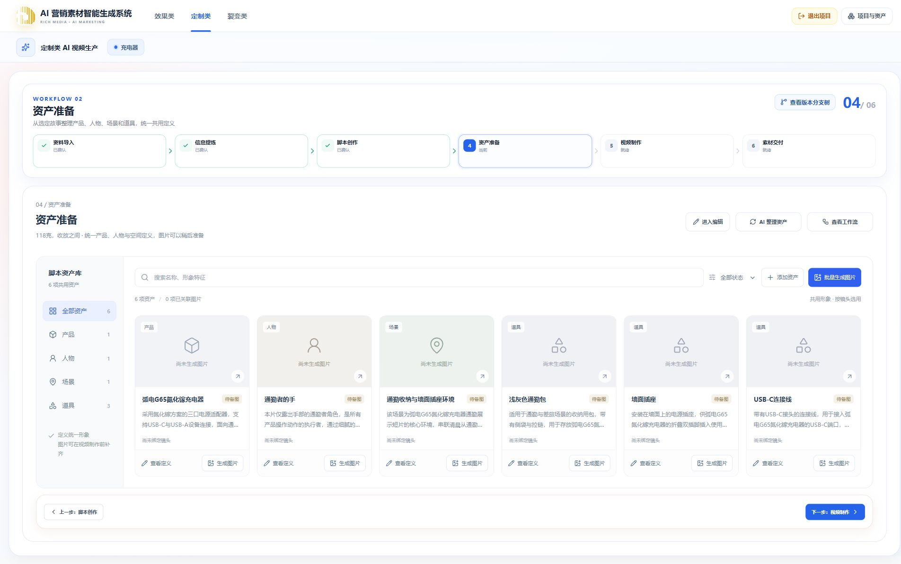

# 2026-10-13 资产准备浏览器真实联调

范围：现有「充电器」项目、已确认脚本《118克，收放之间》，在正式浏览器页面启动真实火山模型资产整理。没有重建项目、重新生成脚本或执行图片/视频渲染。本记录是这个脚本的样本观察，不代表所有产品的质量或性能达标。

## 结果与保存

最终任务 `0d29086a-5b9d-4095-8bf2-b198ad6bfdcc` 完成，11 个执行节点均成功。产出 6 项定义：产品 1、仅手部出镜的人物 1、场景 1、道具 3。独立审校定位墙面插座的事实与适配描述，按指定四个字段修订，独立复核通过后保存草稿。

通过浏览器明确保存修改后，服务端 `assetsConfirmed=true`。退出编辑并刷新后仍为 6 项，描述没有留下取消测试的临时文字，下一步视频制作解锁。产品插脚具体制式及品牌标识精确外观保留待确认，没有通过生成资产定义冒充已经掌握这些产品事实。

## 真实执行中发现与修复

1. 产品分类请求只应生成一个对象，模型却把上下文完整目录也输出了，身份范围校验失败。将输出 Schema 限定到本批准确 ID、类别和数量；旧超范围候选只按准确且唯一的已知 ID 取出本批对象。候选在业务校验前持久化，结构或引用错误最多纠错一次，成功分类继续复用，失败纠错不会在恢复时无限重做。
2. 审校曾把允许创作的墙面颜色当成未提供产品事实，且修订后才逐个追加关联字段问题。明确已知事实与人物/场景/普通道具设计的区别，并要求首次审校一次定位相关字段。
3. 一轮审校把未知插脚制式关联的国标插座设定列为建议，复核才升级为必须修正。补充跨对象事实约束；配套资产不能反向确定未知产品结构或制式。复核读取首次全部结论，包括建议，而非只看到必须修改项。
4. 人物服装字段曾混入动作节奏，并询问分镜时长。明确仅手部出镜不需要全身造型，移除这类超出资产准备职责的提问要求。
5. 节点详情中的模型自写技术称谓、字段路径及对象标识转为中文业务展示。只修改读取投影，不改写保存的来源、模型产物或业务 revision。实际浏览器已确认中文投影生效。

早期任务 `3f0c4425-cb3e-459e-af9e-8310ac33d085` 的失败及检查点保留；恢复验证了人物、场景、道具成功部分没有重新调用模型。第二轮 `c7ea646d-c710-4bdf-abb5-3062e518da06` 因复核仍有必须修正事项而失败，没有伪装成已完成或发布。最终轮为新任务，没有覆盖历史失败结论。

## 耗时与调用

最终轮从任务创建到完成约 459.9 秒（7 分 40 秒）；Worker 领取到完成约 458.5 秒。期间没有部署等待。分类采用两路并发，不能将下表耗时直接相加作为总耗时。

| 模型阶段 | 观察耗时 | 尝试次数 |
| -------- | -------: | -------: |
| 对象识别 |  41.0 秒 |        1 |
| 产品定义 | 221.2 秒 |        2 |
| 人物定义 |  42.4 秒 |        1 |
| 场景定义 |  68.2 秒 |        1 |
| 道具定义 |  90.6 秒 |        1 |
| 独立审校 |  88.8 秒 |        1 |
| 局部修订 |  75.7 秒 |        1 |
| 独立复核 |  30.8 秒 |        1 |

产品调用自动重试后继续成功，未重新生成其他分类。最终轮有 8 条成功阶段用量记录，尝试次数合计 9；成功记录合计 75,327 tokens。该合计不包含未返回用量的失败尝试，不能据此当成完整计费量，也没有查询实际账单金额。安全阶段元数据见[最终轮记录](browser/2026-10-13-assets-paid-final-metrics.txt)和[第二轮记录](browser/2026-10-13-assets-paid-round2-metrics.txt)。真实模型延迟仍有波动，不能承诺稳定在某个时长内完成。

## 浏览器验收

- 运行中刷新能恢复同一任务；进度来自后台，完成后进度条消失。
- 全部 11 个节点可查看已保存的故事、对象、分类定义、图片需求、问题、修改前后内容和复核结果；没有执行记录选择器。
- 失败保留真实状态与恢复入口；曾出现短暂查询中断，页面提示后台继续，不将后台任务误判失败。
- 分类与搜索组合筛选正确；“已关联图片”在没有图片时显示真实空态，可清除筛选。
- 产品详情展示真实规格、分类特征、原文依据、待确认事项和两项图片需求。
- 单项图片制作入口展示本次要求，明确服务未接通并禁用提交，没有创建图片任务。
- 已确认内容可进入编辑；关闭未应用的单项测试修改，再取消整页编辑并刷新，确认内容保持原样。
- 保存修改后进入只读，下一步解锁；刷新后目录和确认状态保留。
- 检查 1920、1440 与 390 宽度；窄屏页面没有整体横向溢出，画布和分类条保留内部横向滚动。ESC 关闭执行面板后焦点回到入口。

证据：[运行中](browser/2026-10-13-assets-paid-running.png)、[真实失败恢复](browser/2026-10-13-assets-paid-recovery.png)、[1440 执行图](browser/2026-10-13-assets-paid-workflow-1440.png)、[390 执行图](browser/2026-10-13-assets-paid-workflow-390.png)、[完成后的窄屏](browser/2026-10-13-assets-paid-complete-390.png)、[中文复核通过详情](browser/2026-10-13-assets-paid-final-workflow.png)。

## 工程检查与边界

- API：`pnpm --filter @ai-marketing/api exec vitest run src/workflows/customized/production/asset-execution-detail.spec.ts src/workflows/customized/production/asset-preparation.domain.spec.ts --maxWorkers=1`，7 项通过；API typecheck、build 通过。
- 资产 Worker：`uv run --project workers/customized-assets --frozen pytest workers/customized-assets/tests -q`，17 项通过；mypy 检查资产入口和共享生产运行时，10 个源文件通过。
- 视频 Worker：`uv run --project workers/customized-production --frozen pytest workers/customized-production/tests -q`，3 项通过。
- 独立资产 Worker 已构建并在无活动资产任务时更新；原视频 Worker 未重启。API 实际运行页面已验证中文投影生效。
- 本次改动的 `git diff --check` 通过。未自动提交 Git。

没有执行全仓组合检查、其他产品付费验收、浏览器 409/跨项目/取消回调故障注入或单项重新整理的付费任务。资产图片生成与视频渲染仍未接通，本轮不以入口存在宣称这些能力可用。
