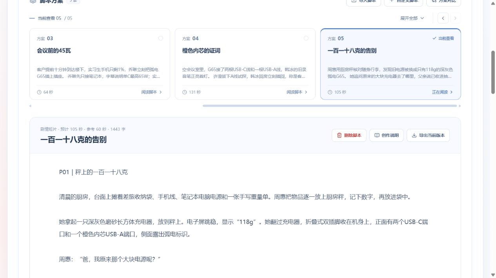
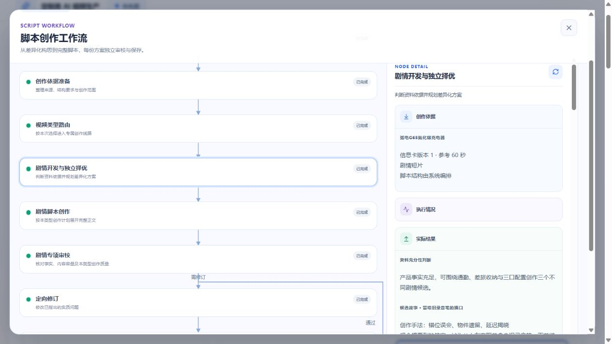

# 剧情短片自动创作验收

作用域：定制类脚本创作，已有“充电器”项目，已确认信息卡revision 1；不改原资料，不渲染图片/视频。用户只选剧情短片，没有新增五类二级选择。每次由浏览器发起1份方案、60秒软参考，保留原两份口播及此前测试稿。模型为冻结 `doubao-seed-2-1-pro-260915`；开发、独立选择、正文及双审分别记录实际用量，最终费用未取得账单，不能以token数冒充实际金额。

## 已观察的试验

| 冻结策略 | 真实任务结果 | 耗时 | 模型调用 | 稿件 |
| --- | --- | --- | --- | --- |
| drama.1 | 完整成功，跳过修订 | 325秒 | 5次，均1次请求尝试；24512 tokens | 《会议前的45瓦》，64秒，5段，919字 |
| drama.2 | 完整成功，容量问题进入一次修订和双复核 | 488秒 | 8次，均1次请求尝试；49961 tokens | 《橙色内芯的证词》，131秒，5段，1355字 |
| drama.3 | 完整成功，连续状态/容量问题进入一次修订和双复核 | 455秒 | 8次，均1次请求尝试；53436 tokens | 《一百一十八克的告别》，105秒，5段，1443字 |

drama.1虽然结构完整，仍主要是低电量、争用、插线顺序和功率字幕，择优/创作审校把功能流程放行；不将其记录为创意成熟。drama.2候选已有责任悬念、外派情绪和误会喜剧的实际差异，独立选择拒绝依赖巧合的喜剧案；采用稿仍把编号与时间巧合当作关联证据，结尾以权威话语总结信任。容量审校真实发现多段动作/对白装不进所标时长，并复核到131秒；60秒是软约束，但两倍以上偏离说明故事选题规模仍值得改进。不能用任务成功掩盖这些不足。

drama.3保持前两版冻结，增加人物怀疑/确证的区分、推断依据核查及结尾去宣讲。短候选开发改用Pro低推理，独立择优、正文和双审仍使用Pro中等推理；没有提高并发、取消审校或扩展返修预算。该轮短开发调用118686ms，上一轮189862ms；整任务只从488秒降至455秒，正文和复核依然占时，不宣称大幅提速或稳定耗时保证。

第三轮独立选择拒绝离职/授权/录音的信息过载及旧案重复，也拒绝MP3乌龙中不沟通、技术关系含混及A口状态矛盾；采用通过纸条、行李牌、门禁卡完成关系回应的情绪短片。成稿经过连续状态与真实容量修订，仍超出60秒参考；仍可见“避开花她的目光”一类局部错字、产品台词刻意等精修点。没有人工改测试稿掩盖问题，任务成功不等于创意已达到成熟广告制作标准。

## 旧稿只读盲评

在生成任务结束后顺序执行，复用现有独立创作/事实审校，单个复评并发2；不写API、不发布或改动原稿。评审输入不含离线期望结果。以下只对照创作侧三项标准，不把复评脚本的固定结构设置当成完整生成验收。

| 正文 | 人物因果 | 自然对白 | 产品参与 | 耗时/调用 |
| --- | --- | --- | --- | --- |
| 旧《橙色内芯的证词》 | 通过 | 通过 | 通过 | 158.81秒 / 2次 |
| 双肩包安静选择样稿 | 通过 | 通过 | 通过 | 47.71秒 / 2次 |
| 软件共创说教样稿 | 不通过 | 不通过 | 通过 | 48.52秒 / 2次 |

录音旧稿复评认为编号相似只引发怀疑，后续承认与播放构成确认，因此接受；不能记录为已拦截牵强推断。软件样稿则明确指出评论操作不能替代人物分歧的解决，连续把产品功能类比信任的台词构成说教。安静正例通过，未将强冲突、反转和大声表达设为通用门槛。这里只是三份正文的实际观察，不能代表通用评审准确率。

## 工程检查

- 最终Worker全量pytest：323项通过，213.33秒；覆盖恢复/复核和版本预算。mypy：56个源文件通过。
- Contracts：253项通过；API详情/数据库/真实HTTP受控链路18项通过，最终策略HTTP与详情17项通过。HTTP测试不发Outbox，不会进入付费消费者。
- Web脚本目录相关56项通过，共享图保留旧线路与新剧情标签；类型检查及生产构建通过。
- 五种产品、1/3/5份的受控用例覆盖编排、原案投影、独立双审、失败预算、恢复及发布；这些不证明五种产品真实质量达标。
- 整个共享工作区`git diff --check`发现效果类指南已有空白问题，本任务未覆盖其他任务文件；本任务范围另行检查。Compose配置通过。

浏览器1440×900与390×844检查：文档内容宽度分别等于可视1425/375像素，无整页横向溢出；完成后progressbar数量为0。刷新后保持当前第05份脚本，原两份口播仍保留，未因阅读脚本再发布版本。工作流面板实际呈现候选、所用手法、信息揭示与选择原因。

付费原始记录保留在忽略目录`tmp/drama1-paid-20261014.json`、`tmp/drama2-paid-20261014.json`、`tmp/drama3-paid-20261014.json`及各轮安全用量、盲评记录。正文含人工编造的测试品牌和情境；不会发布为真实用户证言。实际效果仍需结合稿件阅读，不能由字符数或审校通过率证明。
