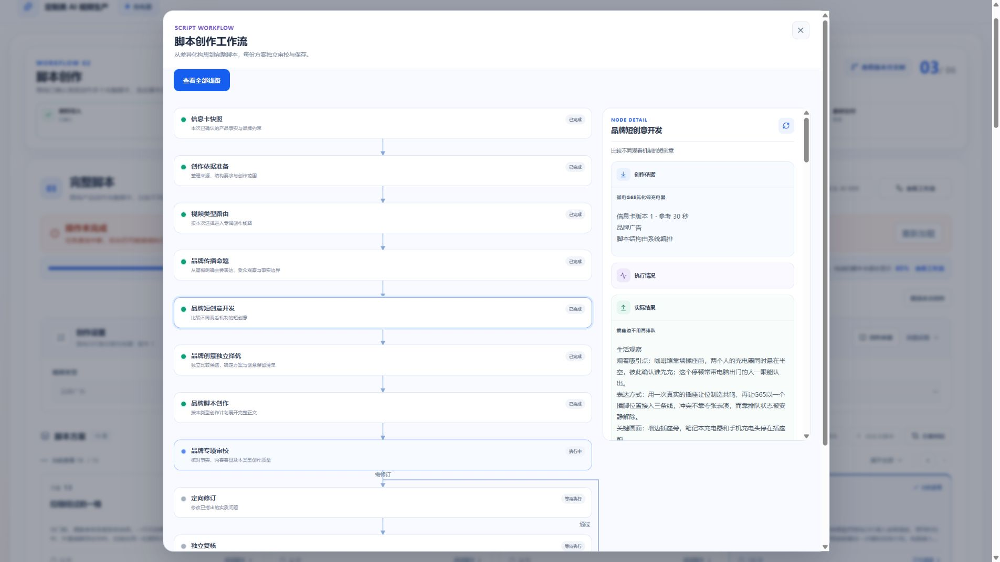
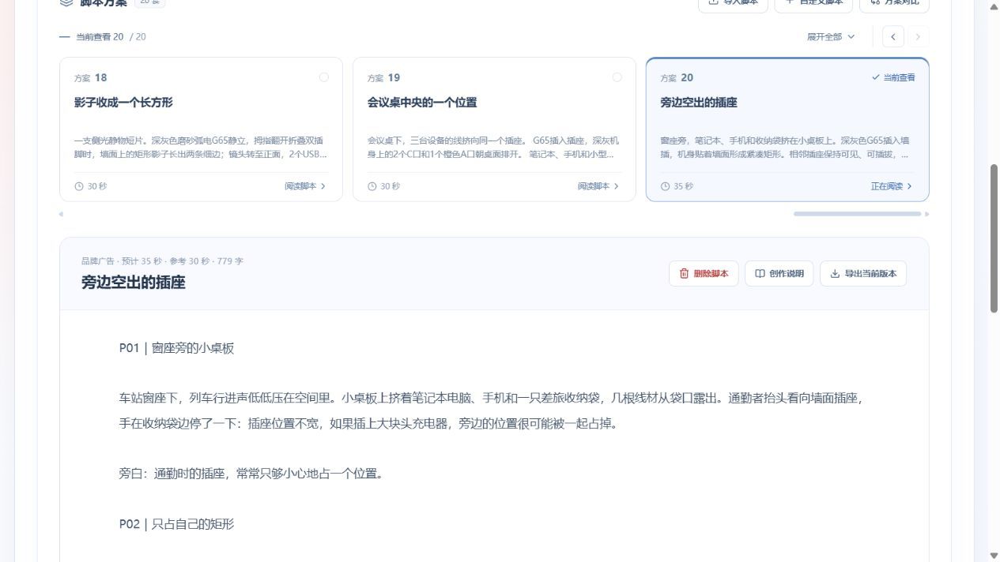

# 品牌创意线路重构与付费验收

日期：2026-10-14。范围：定制类脚本创作 BRAND_AD。用户已授权在现有充电器项目真实付费测试；本次未调用图片或视频生成，未提交 Git。

## 实现

命题与 6–8 个短创意由一次模型调用开发，分别持久化；独立选择调用逐项评价候选，并把选中创意的保留项传给正文与审校。弱候选最多重新开发、选择一次，恢复不重置预算。正常 N 份脚本保持 2+3N 次主要调用、模型全局并发 2；一次正文修订及双路复核最多再增加 3 次调用。历史任务按冻结策略恢复。

产品规则从确认简报读取，没有按充电器名称或关键词选择模板。食品、护肤、电子、家居、软件的受控用例验证契约及链路；这些用例不能证明各品类真实创意质量。

当前 `.14.7`：品牌开发、择优、正文、事实核查及独立创意审校使用 medium。旧 `.14.5` 的创意审校仍按冻结的 high 配置恢复。择优仅输出评价与保留清单，直接沿用候选原始画面和机制，不重复改写全套计划；完整历史概述保留在择优输入中，开发只读取历史标题。所有产品事实仍完整保留。`.14.3/.14.4` 曾把历史概述同时传给开发，实际增加了输入量，不能声称是性能优化。

## 已完成真实测试

项目 `2863b2c6-927a-48de-8327-b367e21fc64f`，来源 Run `a9ab91cb-991b-448d-a194-102b9fabf602`，已确认信息卡 revision 1，弧电 G65 氮化镓充电器。使用真实火山模型 `doubao-seed-2-1-pro-260915`，每轮 1 份、参考 30 秒、AI 结构。

| 策略         | 任务                                 | 结果                                                          | 服务端耗时                 |
| ------------ | ------------------------------------ | ------------------------------------------------------------- | -------------------------- |
| 2026-10-14.1 | ef4c392b-6885-43ea-af0b-38a49ad87f12 | 规格核对方案，修订后容量仍不通过，未发布                      | 426 秒                     |
| 2026-10-14.2 | 9d1fd759-1d58-481b-8cbd-9c89d6d3f7fc | 发布《一声咔哒之后》，31 秒、5 段、856 字                     | 514 秒，包含服务中断及恢复 |
| 2026-10-14.3 | e51f9ed9-ad6f-4045-9228-34dcc167b9bc | high 开发耗尽8192输出token且无业务输出，取消测试，未发布      | 312 秒至取消               |
| 2026-10-14.4 | 0b0c6911-6ee3-4b7f-aee3-c7687dcff766 | 发布《影子收成一个长方形》，30秒、5段；创意审校请求有一次重试 | 841 秒                     |
| 2026-10-14.5 | 81de4d57-8faf-45ec-9a4a-d5cc0ff756df | 《展开的是插脚，不是体积》修订后仍有容量ERROR，未发布         | 878秒观察耗时              |

第一轮选中规格核对，说明“区别于旧方案”不能替代观看价值。第二轮独立择优拒绝五个常规点子，但选中的设计片仍以插接、参数变化和收纳为主。虽然模型审校通过，人工阅读认为其创意仍偏普通，不能作为创意提升达标的证据。因此继续 `.14.3`：要求实际声画组织、变化和观看发现，不能把操作配声与首尾回收当成创意充分依据。

第二轮执行中 API 曾返回 500 并短暂失去监听，Worker 自动恢复同任务。命题、候选、选择、正文、事实审校均复用已持久化检查点；未成功回写的创意审校重新调用。测试观察器沿用同一 manifest，不重复创建任务。这轮总时长不能代表正常无中断性能。API 停止的根因未取得运行日志证据，不归因于模型。

第三轮提高开发推理预算后反而耗尽输出，未将其作为提质办法保留。第四轮恢复medium开发，但high择优仍慢；影子与折叠结构有具体联系，但中段仍出现密集端口/功率展示，人工判断创意完成度不足。第五轮除了减少重复择优输出，也要求正文和审校检查中段是否真正推进观看机制，避免只靠首尾呼应放行。

## 工程与浏览器

- `.14.5` Worker全量 pytest：196 passed；mypy：39个源文件通过。覆盖旧策略恢复、弱案预算、失败恢复、跨品类、1/3/5份生成、完整历史核对及精简择优原文投影。
- `.14.5` Contracts 4文件56 passed。Web工作流面板6 passed；此前脚本相关6文件40 passed。API数据库及HTTP共18 passed、1项删除HTTP未启用。
- `.14.5` 全仓 `pnpm typecheck` 与 `pnpm build` 通过；构建仍有前端chunk体积提示。此前并行任务造成的效果类测试类型错误已恢复，本轮未改动该任务文件。
- Compose 配置检查通过。常规镜像构建受 Docker 本机代理 `localhost:7897` 不可用影响；本轮没有依赖变化，使用已有本地 Worker 镜像加源码层构建更新，运行容器版本逐次核对。
- 浏览器实际验证充电器任务的三新增节点、真实命题及候选、详情查询失败后刷新恢复；1920、1440、390 宽度检查弹窗边界，仍引用效果类共用工作流组件。全量其他页面状态未重测。

费用以供应商账单为准；测试有真实调用与 token/耗时日志，未获取货币账单，不能声称准确人民币费用。以下分别记录各轮观察，不把已发布等同于创意质量达标。

第五轮初审正确指出最长中段退回功能/功率教学；修订加入线框/网格后，创意复核通过，但事实与执行复核仍指出收尾6秒包含过多动作，整体失败且未发布。不能把创意模型PASS当成人工质量通过。8次成功模型响应共74985 tokens（含推理）；前两步共201477ms，较第四轮448471ms减少约55%，但两次独立创意审校分别282885ms、289357ms，整体并未变快。

第六轮 `.14.6` 改为单一职责指令，去除多轮累计重复提示；限制命题信息负担，要求展示项引用原文依据，返修优先取舍动作。独立创意审校medium、事实审校medium，两次独立调用及硬错误拦截不变。其真实效果单独记录，不从较低推理等级推断质量不变。

## 第六轮结果与结构恢复

任务 `dc459ad6-9afc-4553-b207-c07a87c16887` 发布《会议桌中央的一个位置》（30秒、4段、768字）。总观察920秒，包含排障、重建与同任务恢复，不能作为无中断性能。恢复复用了开发检查点；模型将一个scriptId分给4个候选，受限机械纠正使其回到本次1份，未重复发布。首次非法响应未持久化，不能把后续观察的具体原因追溯为首次的确定原因。

7次成功模型响应共55881 tokens，开发118048ms；初次择优66604ms、恢复择优90537ms、身份纠正46777ms；正文101187ms；并行事实27947ms/创意82530ms。加总请求延迟不等于任务墙钟耗时。正文仍以争插座、依次插线、功率说明和整齐收尾为主；原创意审校三项PASS，人工不接受其为创意提升达标。已发布旧稿保留，不篡改历史审校。浏览器刷新后19份方案，仍停留用户原先选择的第16份，完成进度条消失。

## 独立审校校准实验

复用真实火山Provider，对旧充电器正文及明确标识的合成对照做独立审校，未修改业务脚本。强化普通用途演示与观看发现的边界，并恢复完整可观察校准；不是增加关键词拒绝逻辑。

| 样本                       | 判定                             | 模型耗时 | tokens |
| -------------------------- | -------------------------------- | -------- | ------ |
| 第六轮真实充电器成稿       | 三项FAIL：用途演示不构成额外发现 | 57676ms  | 4614   |
| 软件功能演示（合成负对照） | 三项FAIL                         | 22454ms  | 3693   |
| 两份早餐（合成正对照）     | 三项PASS                         | 37337ms  | 3863   |

三次成功响应共12170 tokens，无重试；并发2。正对照与校准提示中的举例相近，因此只证明没有“一律拒绝”，不证明跨品类泛化或食品真实生成质量。实验采用`.14.6` Provider的medium配置加候选校准指令，不冒称当时已运行正式`.14.7`完整链路。

## 第七轮完整链路

正式部署`.14.7`，冻结旧策略；开发、择优、正文及审校共享用途演示/观看发现的区分，独立创意审校保留完整观察校准。通过浏览器在现有充电器项目新增30秒/1份品牌广告，任务 `f7250e7a-bf13-430b-b486-3148b64a274e`，输入仍是同一简报revision1，没有更改资料以迎合测试。

结果：任务完整成功并自动发布《旁边空出的插座》，脚本 `be17188b-5c8d-4bdd-8ae9-4d42932b15e3`、Run `a3732aa9-dd78-45da-8548-f2a77863d71c`、revision1。观察耗时 **419秒（6分59秒）**，实际35秒、4段、779字；参考30秒按软约束处理。原19份脚本保留，目录增加至20份。浏览器在完成时未抢占当前选择；手动选择方案20后可查看全文，任务进度条已消失。

初审发现P03在9秒内堆叠三次接线、邻座插入、收线与功率旁白，P04收纳及说明也过密，标记ERROR并阻止发布。一次定向修订缩短相关说明，将P03调整至12秒、P04至8秒；随后独立事实/执行与创意复核均通过才保存。节点详情展示了具体问题及复核依据。

| 调用              | 耗时     | Total tokens | 尝试次数 |
| ----------------- | -------- | ------------ | -------- |
| 命题及短创意开发  | 100991ms | 6608         | 1        |
| 独立择优          | 53923ms  | 10799        | 1        |
| 完整脚本          | 80351ms  | 6579         | 1        |
| 首轮创意审校      | 55228ms  | 5446         | 1        |
| 首轮事实/执行审校 | 88720ms  | 6461         | 1        |
| 定向修订          | 37415ms  | 8994         | 1        |
| 事实/执行复核     | 17489ms  | 4905         | 1        |
| 创意复核          | 55773ms  | 5224         | 1        |

共8次成功调用、**55016 tokens**（输入37836、输出17180），没有模型请求重试。两轮双审各自并发执行，因此不能把各调用耗时相加当作端到端耗时。实际人民币费用仍须查供应商账单。相较第四轮841秒观察更快，但脚本和返修内容不同，仅有单次样本，不能作为受控速度基准，也未重新验证180秒脚本性能。

**人工质量结论：有限改善，尚未达到高水准品牌创意验收。** 新稿出现“邻座使用空位、通勤者收线”的真实互动，超过单纯列出插线步骤；但规格/功率解说仍偏多，故事仍集中在通勤插座的常规产品使用情景，结尾直接解释意义。模型三项PASS不足以证明创意普通化已解决。另需区分特定插座布局中的空间表现与泛化省位承诺，不能将该画面理解为所有插座均能空出额外位置。上述问题保留在记录中，未改写已发布测试产物以制造通过结果。

## 当前实现的最终工程检查

- Worker `pytest`：**208 passed**；mypy：**43个源文件通过**。相关受控测试覆盖新校准只用于当前策略、旧策略恢复、双审隔离、受限纠正与恢复预算。
- Contracts相关4文件：**56 passed**；Web工作流图：**8 passed**。
- API相关数据库/HTTP3文件：**12 passed，无跳过**。首次使用错误开关导致两项跳过，已改用 `CUSTOMIZED_STORYBOARD_DATABASE_TEST=1` 和 `CUSTOMIZED_STORYBOARD_HTTP_TEST=1` 重跑；不计跳过为通过。
- `pnpm typecheck`、`pnpm build` 通过；构建仍提示前端chunk体积较大。Compose配置和本次范围 `git diff --check` 通过。
- 仅在无活动任务时更新Worker及API，运行任务冻结版本已核对为`.14.7`。本次浏览器检查实际充电器完成状态、目录保留、手动选择、正文和完成后进度消失；各宽度弹窗回归见前述记录，不冒称本轮重跑全部页面状态。
- 没有真实生成资产图片、视频；未自动提交或推送Git。
