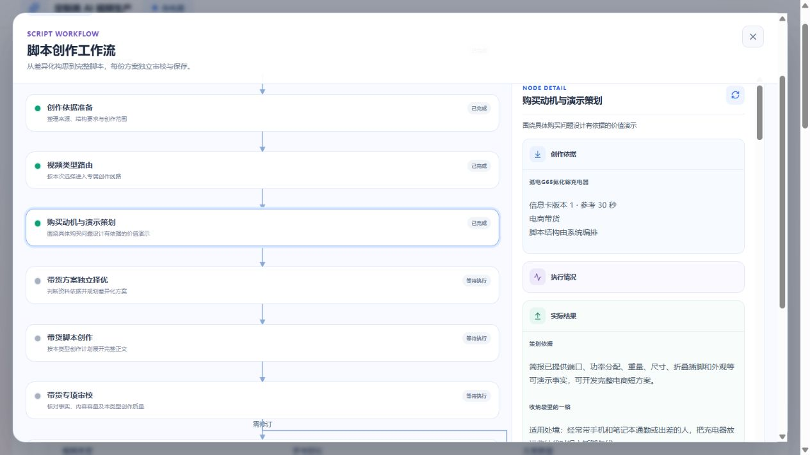

# 电商动机与价值演示付费验收

日期：2026-10-14。范围：定制类脚本创作ECOMMERCE；用户已授权真实付费测试。资产图片与视频没有生成，未自动提交Git。

## 实现与边界

固定消费已确认customized-brief，复用原脚本任务、独立脚本身份、受保护API、租约、Provider、检查点、补丁及单份自动提交事务。新增ECOMMERCE_MOTIVATION执行步骤，六份短方案包含受众处境、购买理由、购买疑问、事实引用和演示起点/过程/可见结果/表达边界。独立选择输出取舍和保留清单，代码原样投影所选方案，不重复改写计划。

成稿商业表达审校与事实/执行审校并行，绑定正文指纹分别保存；任一路实质错误阻止提交，最多一次正文修订和双路复核。弱候选最多整组替代一次，身份/引用结构纠正一次，恢复不重置预算。正常N份2+3N次主要调用，模型共享并发2；网络重试和机械纠正另外记录。旧带货及其他类型的策略保持冻结。

共用失败回调原先会发送output=null，覆盖已经完成的审校子结果。已改为携带当前检查点，受控测试从实际发送的API回调重建恢复状态，验证仅补失败的一侧，而非只验证内存副本。

## 首轮：独立线路接通与中断恢复

项目：充电器，`2863b2c6-927a-48de-8327-b367e21fc64f`。
来源Run：`a9ab91cb-991b-448d-a194-102b9fabf602`。
信息卡：`dc5fd94c-bd32-4dc8-9cce-8d0cd63776af` revision1，未改资料迎合测试。
模型：`doubao-seed-2-1-pro-260915`；所有新带货阶段medium，共享并发2。

浏览器创建任务`539b5b02-5efd-4cdf-8ded-5071f59a380b`，冻结`2026-10-14-commerce.1`，参考30秒、1份、系统编排。完成并发布《量给你看的尺寸》，脚本`e21bbabd-ad65-4f1c-b331-a151cde0f206`、Run`0586224f-4d17-4516-a593-80b18f0f48eb`、revision1，4篇章、680字、预计30秒。此前20份脚本保留，浏览器未自动切走当前方案。

总观察耗时417秒，包含API不可用、租约恢复和选择重做，不能作为正常性能基准。API启动入口检测到现有开发进程，未额外启动第二个watcher；原服务随后恢复。原进程为何短暂不监听未取得确切日志证据，不归因于模型。已保存的六份开发结果复用；中断前选择响应未成功回写，恢复重新调用选择。浏览器如实提示“任务查询中断，后台仍可能继续执行”，点击重新加载恢复同一任务，没有新建批次。

共6次可取得的成功响应，36431 tokens；其中两次选择分别83005ms和44178ms，开发96995ms、正文29515ms、事实审校10278ms、商业审校54718ms。一次完成回调500经原HTTP重试成功，未重复发布脚本。人民币实际费用以供应商账单为准，token不是账单。

**人工结论：尚不足以证明重点质量目标通过。** 选稿回应“是否能放进自己的收纳空间”，比全端口/全功率罗列聚焦；但实际正文三次重复尺寸，主要仍是读数与让观众自行比较，演示的任务利益偏弱。模型三项通过未作为高质量达标依据。

发现并修正一处阶段展示问题：首轮在模型返回后才写入RUNNING，实际调用期间节点显示等待。已在模型调用前保存真实运行状态，受控回归覆盖；首轮运行不被事后改写为已验证修正。

## 第二轮调整

当前新任务冻结`2026-10-14-commerce.2`，`.1`仍可按原提示恢复。开发从实际任务及购买取舍出发，避免每条规格机械产生一个方案；数字必须服务实际选择或利益，不禁止合理参数解释。正文优先呈现产品怎样参与任务，减少旁白、字卡和片尾重复。审校核对画面是否承担购买利益，不用自己补全作者未写的价值。

新带货输入只对照同类型已有脚本，明确属于其他类型的脚本不作为带货避重限制；未知历史格式保守保留。完整历史概述保留，不截断事实或正文。此调整不删除或改写任何旧脚本，不影响其他类型的输入准备。

第二轮完整付费结果及最终检查待完成后补充。
