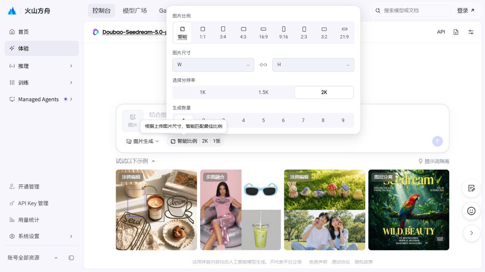

# 火山生图交互调研

日期：2026-10-16。范围：定制类资产准备的单项图片生成入口。本记录区分浏览器观察、用户截图和拟实施设计，不代表已接入新的功能。

## 浏览器实际观察

通过[Seedream 模型详情](https://ark.volcengine.com/region:cn-beijing/model/detail?Id=doubao-seedream-5-0-pro)进入[生图体验](https://ark.volcengine.com/region:cn-beijing/experience/gen_image?model=doubao-seedream-5-0-pro-260628)。公开体验中心一度显示500；新版方舟体验页可操作。当前浏览器未登录，用户历史会话未读取。

| 操作             | 实际观察                                                                     |
| ---------------- | ---------------------------------------------------------------------------- |
| 打开比例摘要     | 一个浮层集中比例、宽高、分辨率和数量；默认智能比例、2K、1张                  |
| 改为2:3          | 摘要立即变化，2K显示1664×2496；面板保持展开                                  |
| 改为1.5K         | 宽高同步为1248×1872                                                          |
| 点击浮层外部     | 面板关闭，选择保留                                                           |
| 打开图片生成菜单 | 显示图片生成、图层分离；模型选择位于顶部，二者职责不同                       |
| 输入文字         | 富文本输入区可编辑；当前未登录状态箭头仍禁用，不能据此断言全部启用条件       |
| 点击图片         | 打开支持多选的文件选择器                                                     |
| 选择测试PNG      | 256×256纯色测试图成为56×56缩略图，紧随添加按钮；文字输入移到下一行，容器增高 |
| 删除参考图       | 缩略图右上角删除入口移除图片；最后一张移除后恢复紧凑布局                     |

测试图不包含品牌、业务或个人资料；没有点击生成、重新生成或触发模型任务。拖拽、粘贴、键盘提交、宽高锁定切换及已登录历史结果中的重新编辑/重新生成尚未实测，不宣称已验证。

## 用户截图确认的目标

上方显示当前资产图片，下方参考火山图片与提示词一体输入框；默认填充当前资产提示词，支持编辑、上传参考图、选择资料导入中已有品牌素材、手动模型选择及参数浮层。与系统现有共享弹窗、资产预览、任务进度及工作流图组合使用。

品牌参考图必须由用户逐次选定并以固定资产版本消费，不能将所有品牌图片无条件传给每个人物或场景。调研开始时的后台只接受文字与固定尺寸；参考图和提示词编辑需要契约、文件读取和供应商输入一并接通，不能只增加装饰性入口。后续实施与实际验证见[输入框验收](2026-10-16-资产生图输入框验收.md)。

## 辅助参考

- [RichiDrama 资产编辑弹窗](https://github.com/Moemu/RichiDrama/blob/main/frontweb/src/views/FilmCreate.vue)：描述和生图提示词分开，已有提示词默认带出且可编辑。
- [Krea 参考图交互](https://www.krea.ai/blog/how-to-generate-images-with-style-references-in-krea)：选中的参考图保持在提示词区域内可见。
- [Runway 生成界面](https://help.runwayml.com/hc/en-us/articles/37053594806419-Creating-with-Gen-4-Image)：提示词、模型设置和结果同处工作区。
- [火山官方模型能力](https://ark.volcengine.com/region:cn-beijing/docs/seedream-5-0-pro)：Pro/Flash支持单图及多图输入；数量能力以适配器和业务持久化为准，不因体验页有1–9选项就宣称已支持多候选图库。
