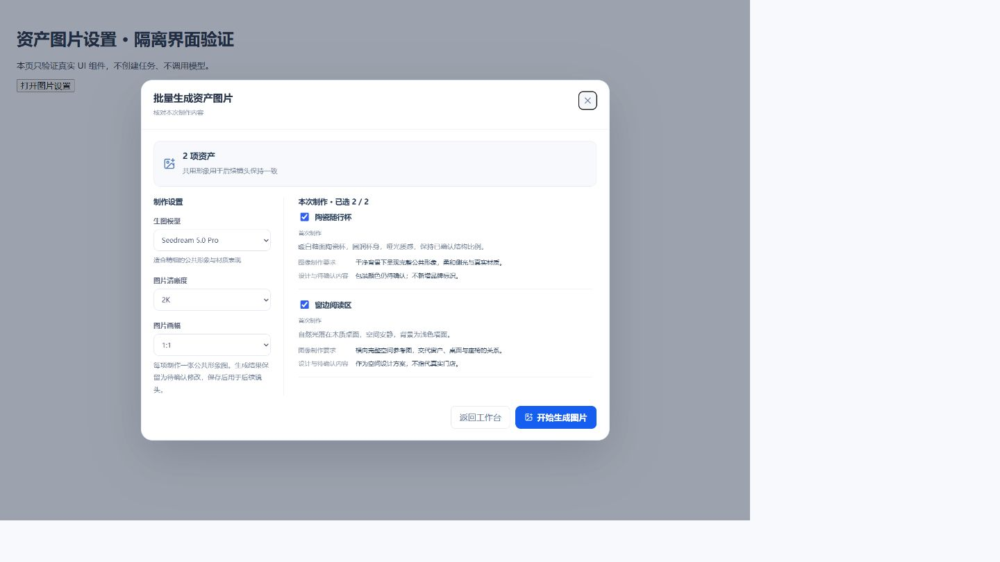
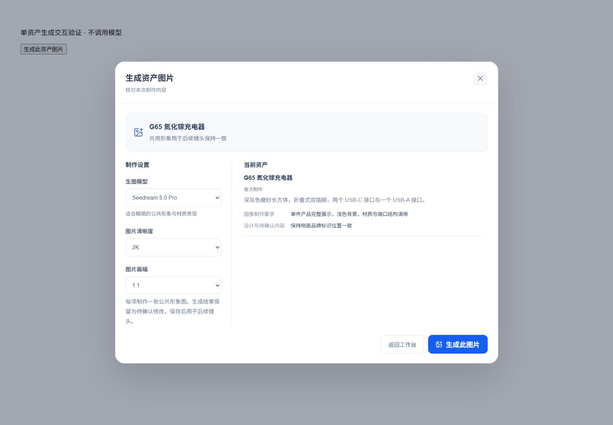

# 资产图片生成接通验收

日期：2026-10-16。范围：资产准备 IMAGE 操作及共享生图弹窗。

## 已实现

- 单项、批量选择和重新生成，手动选择 Seedream 5.0 Pro / Flash、清晰度、画幅；批量默认选择缺图项，最多20项。
- 复用资产 Worker、队列、Token、生产任务表、Outbox、共享进度与工作流面板。无数据库迁移。
- 冻结脚本/目录/Brief、模型与对象。图片通过 Ark b64_json 协议返回，受保护文件回调验证大小、MIME、签名，并事务性登记资产/版本/文件记录和草稿引用。
- 成功项逐张可见，失败恢复跳过成功项，旧租约和取消后回调拒绝；重新生成失败保留旧图。用户保存修改后更新目录与实际依赖关系，尚未确认图片时阻止下一步。
- 文字约束参与图像制作，每对象一张公共形象图；品牌图参考、多个独立视图、图片上传替换、视觉审校和视频渲染未实现。

## 工程与协议验证

- Contracts 的新增设置测试：9项通过，包含 Schema 一致性、模型、尺寸及对象范围。
- API 生产节点测试（启用 `CUSTOMIZED_PRODUCTION_DATABASE_TEST=1`）：10项通过。真实 PostgreSQL 和本地 PNG 验证覆盖项目隔离、幂等、重复文件回调、部分失败恢复、旧 attempt、取消、草稿/确认边界。存储为受控适配器，不调用模型。测试文件清理首次因 AssetVersion 外键失败，修正清理顺序后通过，并仅移除了该次遗留的两个随机测试项目。
- 共享资产 Repository 测试随生产节点测试通过，复用 `createInTransaction` 保持同一份资产登记实现。
- Web 新增生图组件/API 测试：4项通过；覆盖可用图片入口、旧图保留、错误显示、视频仍不可用以及冻结配置写入。
- 资产 Worker pytest：27项通过；视频 Worker pytest：3项通过。覆盖官方请求格式、非法响应、明确429有界重试、不确定超时不立即重发、成功项恢复、部分失败及跨节点隔离。
- 资产 Worker mypy：11个源文件通过。`pnpm typecheck` 和 `pnpm build` 通过；构建有现有大包体积提示。
- 最终扩大 Web 定制页回归：14个测试文件、110项通过；本次未修改脚本创作页与其测试。

## 浏览器检查

使用临时、明确标识的隔离页面加载真实 `ProductionRenderDialog` 和共享弹窗/按钮组件，没有绕过真实系统鉴权、创建业务任务或调用付费模型。验证1920、1440、480宽度，以及模型/尺寸/画幅切换、对象选择、空选择禁用、错误反馈、ESC关闭和焦点恢复。480窄屏未出现横向溢出。临时页面验证后移除。

[1920宽屏错误反馈](browser/2026-10-16-资产图片生成/image-settings-1920.jpg) · [480窄屏](browser/2026-10-16-资产图片生成/image-settings-480.jpg)

单项生成补充：卡片与详情均复用同一个生成入口，仅提交所选资产 ID。单项弹窗展示资产名称，隐藏批量勾选项，区分“生成此图片”与“重新生成此图片”。隔离浏览器验证了单项选择、模型切换、1440及480布局、ESC关闭与焦点恢复；点击测试按钮只记录选择，不创建付费任务。相关 Web 测试5项、Web类型检查、构建及相关文件 ESLint通过。

## 部署与未验证范围

资产 Worker 镜像已构建，在数据库确认没有 QUEUED/RUNNING 资产任务后更新本机容器；API 开发进程保持真实服务响应。没有运行真实付费生图，未证明这些模型对具体产品的图像质量或供应商实际耗时；未执行生产服务器发布，也未进行真实账号下的浏览器完整付费链路。

设计与开源采用点见[实施计划](../plans/2026-10-16-资产图片生成接通.md)。不复用上游许可证、品牌图片或配置。
