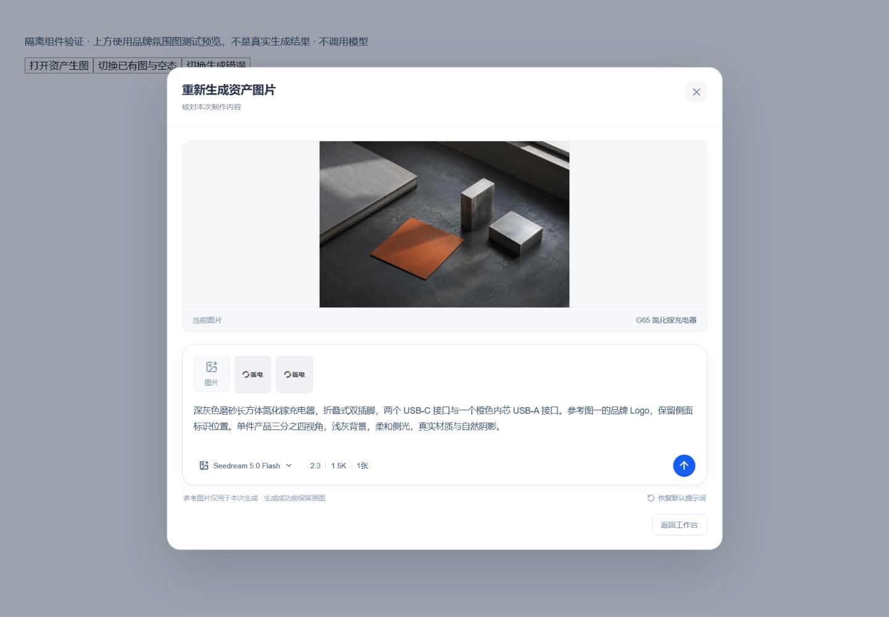

# 资产生图输入框与参考图验收

日期：2026-10-16。范围：定制类资产准备单项 IMAGE 入口。基于[火山浏览器交互调研](2026-10-16-火山生图交互调研.md)实施，沿用系统共享弹窗、资产预览、任务进度和工作流面板。

## 已实现

- 上方当前图片，下方统一输入框。带出当前对象提示词，可编辑、恢复默认；失败保留输入。
- 添加参考图、缩略图移除、上传状态；可选当前 Run 已确认资料包中的品牌素材，或新上传本项目图片。最多4张 PNG/JPG/WebP，每张10 MB以内。
- 手动选择 Seedream 5.0 Pro / Flash；比例与清晰度集中在参数浮层，即时更新摘要和只读宽高。支持智能、1:1、4:3、3:4、16:9、9:16、2:3、3:2，仍为每个对象1张图片。
- 自定义提示词与所选参考图版本写入任务快照。API核验项目/工作流/版本/格式/大小；Worker经有效租约读取固定文件，图片仅在内存中转为供应商输入。无数据库迁移，无任意客户端URL，无新增文件登记体系。
- 批量入口保留；历史未携带新输入的任务使用原提示词编译。图片成功写草稿，保存修改才提交目录，旧图和既有版本边界保持一致。

## 浏览器验证

加载真实组件的临时隔离页面，明确标记受控数据；未绕过系统鉴权，未创建真实业务任务，未调用图像模型。上方使用品牌氛围测试预览图，不是充电器生成结果。验证后移除临时页面与静态文件。

检查1440、1920、480宽度；已有图/无图、模型选择、2:3与1.5K联动（1248×1872）、资料导入品牌图选择、新图上传、移除、提示词编辑、空提示词禁用、失败保留输入。受控提交记录确认只有当前对象，并包含编辑提示词、Flash模型和两张参考图的准确版本。点击提示词区域关闭浮层；ESC先关闭浮层并回到按钮，再关闭弹窗恢复入口焦点。

[参数面板1440](browser/2026-10-16-资产生图输入框/parameters-1440.jpg) · [窄屏参数面板480](browser/2026-10-16-资产生图输入框/parameters-480.jpg) · [空图与失败状态1920](browser/2026-10-16-资产生图输入框/empty-error-1920.jpg)

## 工程与运行验证

| 检查                                                     | 结果                                                                                                                                      |
| -------------------------------------------------------- | ----------------------------------------------------------------------------------------------------------------------------------------- |
| Contracts `customized-image-generation.spec.ts`          | 10项通过；结构、尺寸、参考版本与Schema一致性                                                                                              |
| Web `production-image.spec.ts`                           | 6项通过；单项、旧批量/视频边界、提示词恢复及设置传递                                                                                      |
| API图片服务、Worker策略、共享AssetService测试            | 25项通过；真实文件头验证、上传归属、受保护原始字节响应、拒绝失效作用域                                                                    |
| `CUSTOMIZED_PRODUCTION_DATABASE_TEST=1` 的生产数据库测试 | 1个综合用例通过；真实PostgreSQL，受控存储/模型，含幂等、成功项恢复、固定引用版本、跨项目拒绝、取消及旧attempt拒绝；Outbox测试消息禁止分发 |
| 资产Worker全部pytest                                     | 30项通过；含13项图片协议/参考输入测试                                                                                                     |
| 资产Worker及共享运行时mypy                               | 11个源文件通过                                                                                                                            |
| `pnpm typecheck`、`pnpm build`                           | 通过；保留现有Vite大包提示                                                                                                                |
| 相关文件ESLint、`git diff --check`                       | 通过                                                                                                                                      |

资产Worker镜像重新构建；确认 ASSETS/IMAGE 无 QUEUED/RUNNING 任务后更新本机容器。实际运行容器已载入 `inputs` 及严格参考版本Schema；API健康接口返回200。镜像manifest：`cf89e9f22412bdbc5d6ab3fb8fbd08f0147f36020fa55d68c4398fd603db43ed`。

本轮未执行真实付费生图，未验证供应商实际图像质量、用量或耗时；未发布生产服务器。火山用户历史会话在当前浏览器未登录，公开体验页完成交互调研。多候选图库、图层分离、自定义像素尺寸、拖拽/粘贴和视频渲染不在本次实现范围。未自动提交Git。
