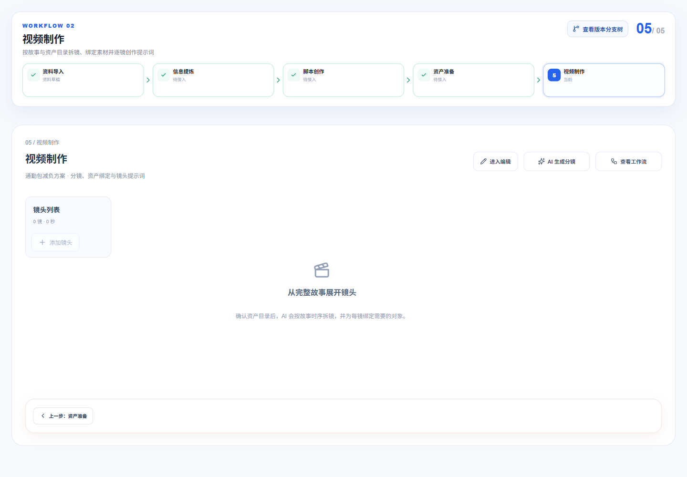
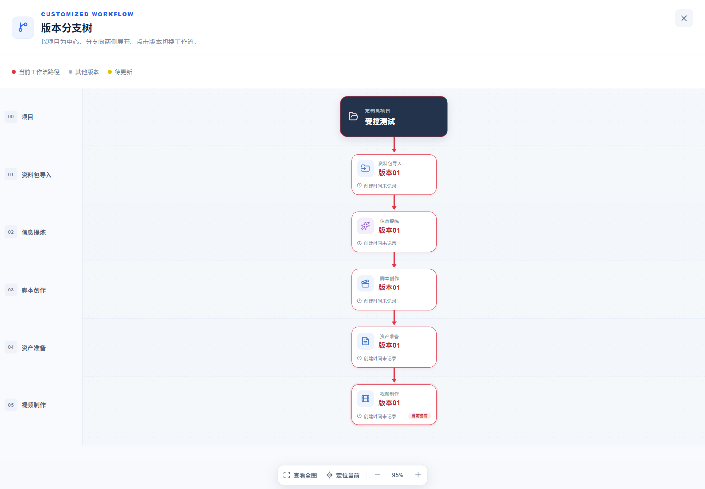

# 定制类五节点流程验收 · 2026-10-19

用户要求移除“素材交付”。当前流程为资料导入 → 信息提炼 → 脚本创作 → 资产准备 → 视频制作。实现依据见[计划](../plans/2026-10-19-移除素材交付节点.md)。

## 变更

- 活动契约与正式 Web 节点目录改为五项；画布当前步骤、分支树行数和导航使用同一目录。
- 视频制作隐藏下一步，仍可返回资产准备；资产准备仍可前往视频制作。不增加“完成流程”、归档或生成动作。
- 历史 DELIVERY 导航映射为 SHOT_RENDER；API 树忽略旧 DELIVERY 产物，避免将交付记录误当视频结果。旧记录、文件与业务 revision 保持原样。
- 定制类分支树投影增加布局版本缓存参数，服务更新后不会命中旧六节点投影。效果类交付类型及资产类型不变。
- 当前 README、AGENTS 与节点指南同步；旧冻结原型、计划和历史验收不改写。

## 实际检查

- `pnpm --filter @ai-marketing/contracts exec vitest run src/customized-import.spec.ts`：17 项通过。
- `pnpm --filter @ai-marketing/web test src/workflows/customized`：16 文件、118 项通过。
- `pnpm --filter @ai-marketing/api exec vitest run src/platform/workflow/customized-node-layout.spec.ts src/platform/workflow/workflow-working.service.spec.ts`：2 文件、65 项通过。含历史导航、只读兼容、旧交付产物不伪造确认状态，以及已有分支树回归。
- `pnpm typecheck`、`pnpm build`：全仓通过。Vite 保留既有主包大于 500 kB 警告。
- 格式检查及 `git diff --check` 无空白错误。
- 浏览器使用正式共享画布、版本树、制作工作台和正式节点目录，数据来自隔离的受控响应。1920 / 1440 / 430 均为五项、05 / 05，无素材交付项和末节点下一步按钮，无页面水平溢出。
- 版本树实际显示资料包导入、信息提炼、脚本创作、资产准备、视频制作五个阶段；从末节点返回显示04 / 05，可通过资产准备下一步返回05 / 05。

## 边界

没有登录真实项目、数据库迁移、历史数据清理或付费任务。本轮未手工重启 API 或 Worker；API 的历史兼容与缓存投影变更通过单元检查及构建验证，不将受控浏览器检查冒称为运行中 API 联调。视频渲染能力不因移除交付节点而改变。

临时受控页面已在验收后移除。截图中的数据为明确测试夹具：

