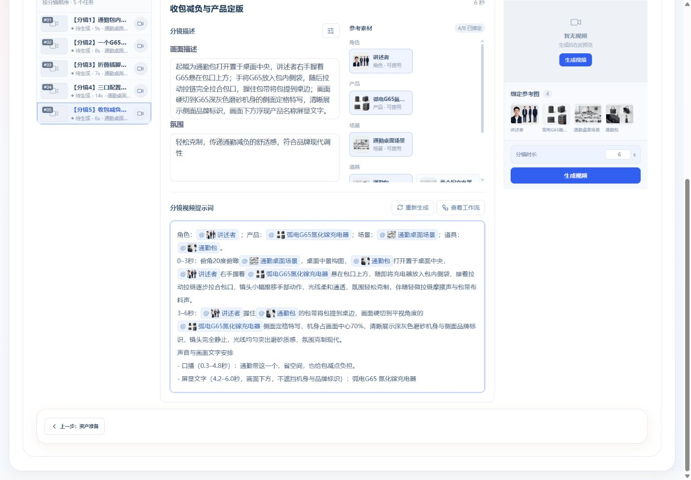
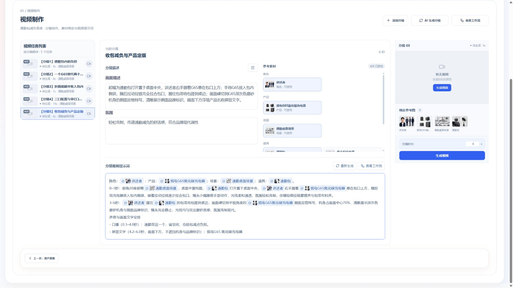

# 五镜提示词付费与行内素材引用验收

日期：2026-10-19。范围：现有“充电器”项目，通勤包减负角度，5个完整分镜、总长44秒。真实浏览器触发Ark逐镜PROMPT任务，经独立视频制作Worker执行；不是Mock，也没有执行图片、视频或语音渲染。此次不提交Git。

## 最终真实结果

最终5份均为`promptWorkflowVersion=3`，完整成功、自动原位提交。下表耗时为持久化任务起止差，包含队列/阶段开销；不是纯模型推理时间，不保证所有项目均达到此速度。

| 分镜                    | 片长 | 任务耗时 | 模型调用 | 实际引用资产 | 独立审校结果                   |
| ----------------------- | ---- | -------- | -------- | ------------ | ------------------------------ |
| 通勤包内的负担          | 9秒  | 44.620秒 | 2        | 6            | 无ERROR/WARNING                |
| 一个G65替代两个旧充电器 | 8秒  | 70.247秒 | 2        | 5            | 0 ERROR；字幕位置/样式建议1条  |
| 折叠插脚并收入包内      | 7秒  | 63.704秒 | 2        | 4            | 无ERROR/WARNING                |
| 三口配置与单C口65W      | 14秒 | 41.842秒 | 2        | 5            | 无ERROR/WARNING                |
| 收包减负与产品定版      | 6秒  | 89.308秒 | 2        | 4            | 0 ERROR；产品名字幕位置建议1条 |

最终平均61.944秒，范围41.842–89.308秒。审校较慢的调用仍如实计入，未跳过独立审校。两条建议均有真实当前提示词引文，人工对照已确认画面后通过浏览器补齐“画面右下角、白色简洁样式”和“画面下方、不遮挡机身与品牌标识”，用新的自动保存交互持久化。历史审校仍记录其当时发现的建议，没有伪造模型复核通过。

最终任务ID按上述顺序：`75f5bf13-872d-4798-9728-85e80d4b1dc7`、`f0afe332-ef93-4584-8d51-76a2e9795a17`、`46f54f95-baa1-4541-a9dc-13f09dbb29d1`、`abdc2c40-415c-4e61-af76-1785aab1cd20`、`72fc93ef-9b4a-46a3-a17a-e9b48e14b8ce`。

## 发现并修复的问题

1. 第4镜原V2任务`57809d74-9cf0-47c5-8aa7-1fd9b156a969`失败，176.180秒、4次调用。审校把上游画面描述中字幕所在的句子顺序当成新提示词的实际发生顺序，而新提示词已明确2–14秒屏显，造成无效返修。
2. V3采用专属提示词审校，明确审阅对象是`prompt.content`，上游是冻结依据；不再使用以“审阅实际result”开头的分镜通用审校。所有非INPUT问题必须附当前提示词逐字引文，API和Worker检查引用真实存在。保留完整本镜事实、原句、实际时间窗与素材，只去掉重复外层简报及无关全片内容。第4镜同一来源复测41.842秒、2次调用成功，未触发返修。不能把这一例推广为所有审校都不会误报。
3. 第一镜恢复草稿与已确认版本不同，旧前端仅检查本次dirty，第一次生成被前置校验拒绝（没有模型消费）。修复为恢复编辑态也先确认，再生成。源视频计划由revision3确认至4；此后的逐镜生成、标签交互均保持计划revision4。
4. 旧提示词查询可能在编辑期间到达并覆盖新字；按请求序列、项目/Run与本地dirty保护，失败保留文字，不用旧服务器数据替换。
5. 移除视频制作的进入编辑、取消编辑、保存修改和单独保存提示词按钮。真实修改防抖保存；分镜任务完整成功后复用已有确认API。资产准备保持原编辑流程。409/保存失败保留本地并允许重试，未完成`@`不自动提交错误正文。

## 质量核对与实际边界

五镜声音原句共178字符，屏显文字共51字符，逐份均在新提示词中原样保留；所有画面时间窗从0连续覆盖本镜完整时长，无空档、重叠或越界。实际`@素材全名`与保存`assetIds`一致，无引用未绑定素材。14秒镜明确区分单USB-C最高65W与多口功率分配，没有新增“每口65W”、未确认充电速度或端口左右顺序。收包镜保留包装动作到产品特写的明确切换。

第三镜“平整插脚收纳面”来自已确认上游画面，并非本次提示词凭空补造；本轮只核对文字转换与引用，不证明实物结构或真实生成画面正确。没有生成视频来验证手部动作、字幕清晰度、口播实测速度或资产外观一致性。

项目分支测试前后均13条。最终当前五镜提示词revision分别2、3、2、5、2；第二、五镜包括上述人工补充。标签显示、图片加载、相同内容复制粘贴/撤销恢复与普通导航不增加revision。旧历史片段产物仍保留，未借当前验证覆盖历史结果。

## 行内素材交互

- `@`显示当前镜已绑定候选，支持名称筛选、上下键、Enter/Tab、Esc及鼠标。右侧参考图仍只跟随正文实际引用。
- 所有已知完整引用显示浅色行内标签，顺序为`@ → 18px缩略图 → 完整名称`；编辑状态不退化成普通文本。无图或加载失败保留占位图标，不改变引用。
- 使用Tiptap原子节点维护光标、整标签删除及撤销重做。只加载纯文本段落、素材节点和历史功能；不增加格式工具栏。保存和复制仍是纯文本，粘贴只接受text/plain，不把HTML、编辑器JSON或签名图片URL写进正文。
- 图片每个编辑器按项目/资产版本读取一次，重复标签共享同一图片结果；切换范围取消旧请求。编辑器单独按需加载，生产构建JS约329.04kB / gzip101.27kB，避免加入初始主包。
- 浏览器实际验证11个标签→Delete后10个→Undo后11个→Redo后10个→Undo后恢复；复制文字与测试前逐字一致。鼠标和键盘替换同一引用也逐字恢复，不增加空格。
- 长正文末尾的菜单跟随光标定位，选择上方/下方并限制可视区；390宽时菜单横向边界约53–323px，无页面横向溢出。1440、1920及390宽的图片和标签均实测。中文输入组合期有事件保护，本轮未操作真实系统中文输入法。
- 刷新后第二镜的字幕位置补充仍存在，跨镜撤销不会恢复上一镜文字；完成后进度条数量0、进入编辑/取消编辑/保存按钮数量0。

最新证据：

## 调用与费用记录

本轮包含最初V2的第一至第三镜、失败的第四镜、修复后的第四/第五镜，以及统一V3后的第一至第三镜复测：共9个实际模型任务、20次成功返回的模型调用；输入107277 tokens、输出26850 tokens，总计134127 tokens。失败任务的4次调用已计入，未把失败消费删掉。首次前置校验拒绝没有模型调用。真实账单金额未由供应商返回，本记录不虚构人民币费用。

## 工程检查

- `pnpm --filter @ai-marketing/web test -- src/workflows/customized/production`：8文件、40测试通过。
- `pnpm --filter @ai-marketing/contracts test`：24文件、309测试通过。
- API production目录Vitest：9文件、32测试通过，包括数据库集成。实际通过本地安全包装脚本注入DATABASE_URL及`CUSTOMIZED_PRODUCTION_DATABASE_TEST=1`，执行`pnpm --filter @ai-marketing/api exec vitest run src/workflows/customized/production --maxWorkers=1`；未打印连接信息。
- `pnpm typecheck`、`pnpm build`：通过。主Web包仍有大于500kB的既有构建告警，富文本包已独立按需加载。
- `uv run --project workers/customized-production --frozen pytest workers/customized-production/tests`：60通过。
- `uv run --project workers/customized-production --frozen mypy workers/customized-production/src workers/shared/customized-production-runtime/src`：17源文件通过。
- 对此次富文本组件、文档投影、测试及工作台执行定向ESLint：通过；`git diff --check`通过（仓库有既有LF/CRLF提示）。

交互依据用户提供的火宝截图；实现API按[Tiptap Vue3](https://tiptap.dev/docs/editor/getting-started/install/vue3)、[Vue NodeView](https://tiptap.dev/docs/editor/extensions/custom-extensions/node-views/vue)及[Mention](https://tiptap.dev/docs/editor/extensions/nodes/mention)官方文档核对。Context7在此环境不可用，未声称调用过它。未复制火宝代码或更换系统配色。
