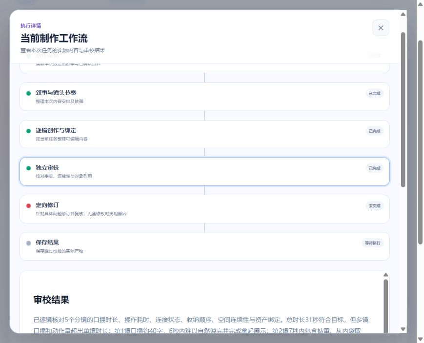
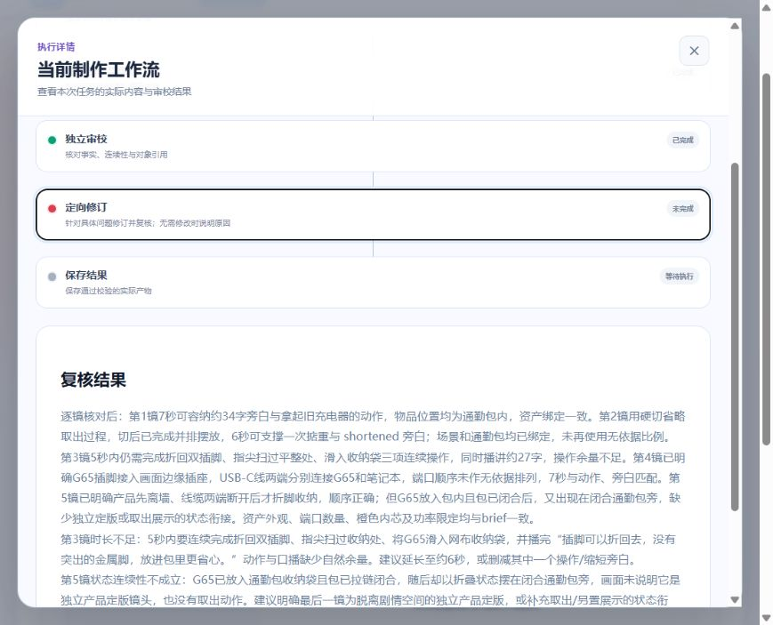

# 充电器 AI 分镜真实联调与质量分析（2026-10-19）

## 范围与输入

用户明确授权真实付费浏览器联调。使用已有「充电器」项目的「通勤包减负角度」，通过正式页面的「AI 生成分镜」创建任务 `c505219a-23ef-41e6-8359-5f8e7200e4f4`；后续均通过浏览器恢复同一任务。脚本工作副本 revision 1、资产目录 revision 10；8 项资产均已有图片引用。本轮文字分镜模型不读取图片像素，不能据此评价与图片的精确视觉一致性。

冻结模型：规划/审校/修订为 `doubao-seed-2-1-pro-260915`，逐镜生成为 `doubao-seed-2-1-turbo-260628`。脚本创作参考 30 秒，正文篇章估时合计 31 秒，现有分镜校验以该 31 秒为目标。未重写上游脚本或资产，没有生成逐镜 Prompt、图片、视频或提交 Git。

## 已观察到的真实问题

首版产出 5 镜、合计 31 秒。以下是人工对照输入及真实结果后的观察，不把“字段齐全”当成可执行质量通过。

| 镜头           | 分配时长 | 口播字符计量 | 主要问题                                                                                                        |
| -------------- | -------: | -----------: | --------------------------------------------------------------------------------------------------------------- |
| 通勤负重痛点   |     6 秒 |           34 | 同时说完整长句、拿起两个旧充电器；画面与绑定说明对电脑在包内还是桌面不一致。                                    |
| 新旧充电器对比 |     7 秒 |           29 | 掂重、取产品、摆放、比较和说话拥挤；增加了“占位约三分之一”的无依据具体比例；可见通勤包和桌面缺对应绑定。        |
| 折叠插脚收纳   |     5 秒 |           22 | 按扣、折脚、扫过、入袋及口播堆叠；新增了简报未确认的插脚卡扣。                                                  |
| 端口与功率     |     8 秒 |           55 | 三口展示、两端接线、长口播难以自然完成；新增“USB-A在中间”“靠上的C口”；充电器平放桌面未接电却讲补电。            |
| 收纳收尾       |     5 秒 |           16 | 拔线、合脚、入包、拉链、提包、切产品特写及定格2秒混在一条；入包后产品再次出现，状态未交代；线缆操作缺线缆绑定。 |

字符计量只计中文、英文字母和数字，共 156；按 4 字/秒粗估仅说话约 39 秒，未计停顿。英文型号与实际发音不等于按字母逐个计时，该数值是容量风险线索，不是合成语音测量或语义硬判定。

独立审校实际定位了全部 5 镜，并列出容量、事实、状态和绑定问题，具有拦截作用。执行面板显示真实初稿及审校结论。

## 程序缺口及本轮修复

首次修订模型调用成功返回后，外层机械校验抛出 ValueError，未进入独立复核；修订稿未在校验前持久化，无法追溯其具体错误内容。不能据此声称首次修订一定是某条非法引用或某个时长错误。

本轮补齐：

- 有类型的修订候选在外层身份、时长及对象引用校验前保存；校验失败仍为未完成，不采用、不提交。
- 恢复优先读取同任务保存候选，不再次购买同一份修订；合法修订后的复核中断也不重复修订。
- 逐镜生成及修订请求的 Binding Schema 限定为真实资产 ID，原服务端及 Worker 机械校验保留。

未更改目标总时长、镜头数量限制和独立审校标准。首轮已经丢失的候选无法恢复，修复部署后从浏览器明确恢复了一次修订。新代码仅更新独立视频制作 Worker，更新前核对该 Worker 无活动任务；其他节点未重启。

## 最终结果与人工复检

修复后再次付费修订返回5镜，时长调整为7/6/5/7/6秒，仍合计31秒。修订候选、采用待复核稿及完整复核均已持久化。删除无依据的卡扣、三分之一比例和端口相对排列；补齐场景、通勤包及线缆绑定，明确接电与断开状态。第4镜口播被缩写，其他4镜口播与首稿完全相同；这是一处应向使用者清楚展示的正文变更，不能声称全部原话零改动。

独立复核最终列出2条问题并阻断保存。任务保持 FAILED，SAVE 未执行，没有正式镜头工作副本；浏览器工作台仍显示0个已采用视频任务。本轮已经得到5镜初稿和5镜修订候选，不能把它们写成“全部生成并确认成功”。

人工核对两条复核意见后：

- **第3镜容量仍偏紧，意见有依据。** 5秒内折回插脚、扫过表面、入袋并说完整原句，仍缺少自然表演余量。
- **第5镜存在明确误报。** 实际修订稿已写“最后硬切到独立产品定版画面”，复核却声称没有说明独立定版；其“缺少独立定版”的论据与当前文本冲突。定版内部是否还应简化是可讨论的制作问题，但不能用不存在的缺口硬拒绝。
- **审校尺度存在漂移。** 第2镜从7秒减为6秒，口播原句未变，复核却称其为 shortened 旁白；它并未准确核对这处修改。第1镜调整到7秒即被判容量充分，但未给出一致的说话及动作估时依据。没有实际语音或视频，不能将这些判断当作已经播放验证。

最终结论：独立审校能拦截首稿问题，但规划、修订和复核之间仍有容量冲突、结构约束与误报问题。本次样本不足以直接进入视频生成，不以单轮模型复核作为人工质量结论。

## 需要结构性优化的原因

1. **容量矛盾过晚发现。** 上游正文估时与实际口播容量有差距，制作规划仍沿用31秒，并未提出冲突；问题直到逐镜生成后才被审校发现，增加整组返修成本。
2. **规划近似重述故事。** `Plan` 只有摘要和文本段落；31秒内容被合为一个请求段落，不能机械追踪每句口播、画面文字和事件的落点。合并请求本身有利于速度，但不能同时丢掉可追踪的场次/节拍边界。
3. **电影镜头与视频任务混淆。** 首版一条镜头内出现多次切镜和多个时序动作。现有时长合计合法，不代表具备明确的起幅、运动和落幅。
4. **修订工具不足以解决结构问题。** 当前 scoped repair 要求准确镜头 ID、数量与修订范围总时长均保持，不能对容量问题拆更多镜头或改变整片时长。独立审校发现了问题，但修订自由度没有与问题类型匹配。
5. **输入存在重复。** 8项资产序列化约13,676字符，包含图片制作清单、来源、人工编辑标记和多处重复信息。`text_assets` 仅排除 image 引用；应按阶段提供事实、公共外观和必要状态投影，不能为减 token 截断相关事实。
6. **复核缺少可核验的具体依据。** 当前 Audit 为摘要、字符串问题列表和镜头ID，没有字段证据或逐条关闭原问题的记录。需要让模型选择实际字段及来源，代码回填保存的原文，减少“已经写了却判没写”、假称文字已缩短等错误。语义是否解决仍由AI判断，不用关键词放行。
7. **失败内容难以被用户利用。** 任务已有镜头和修订候选，工作台仍只有空态；建议增加只读候选预览与明确采用到人工编辑草稿的入口，保留失败状态和人工确认边界，不自动把候选变成正式产物。

## 下一轮建议

建议保留当前五个业务节点及独立 Worker，重构视频制作内部方法，避免增加无界审校循环：

`锁定正文与事实 → 导演规划与容量检查 → 分场逐镜创作 → 对照原文审校 → 按问题类型局部修订/结构重排 → 独立复核与保存`

- **容量先行：** 规划同一次调用先识别原句、动作和画面文字的容量；参考时长不足则明确报告，而非偷偷删词。参考时长与硬性时长应区分：前者提出合理制作时长，后者返回脚本精简建议，不能靠分镜自动篡改确认稿。
- **结构可追踪：** 每镜关联场次、正文事件和语音/画面文字来源，明确本镜给观众的新信息、构图、起止状态与采用对象；声音可跨连续镜头，不每镜重复整句。
- **请求批次与渲染任务分开：** 继续按容量合并模型请求并发2；批内保留场次与边界状态。电影镜头与后续视频片段分别表达，片段时长按实际模型能力组合，不机械照搬所有任务8–15秒。
- **问题分流：** 措辞/局部动作只改指定字段；需要拆镜、调时或重排的结构问题使用单独的受控补丁，记录旧新镜头对应及影响范围，不用固定数量修订器承担所有问题。仍只允许有限修订并独立复核。
- **审校聚焦：** 沿用当前独立审校，对原稿覆盖、声音容量、物理状态、产品事实、绑定完整性与镜头表现给出具体证据，正常项不重写；不为“导演感”固定景别配额或多塞运镜。
- **减少误报：** 复核逐条对应旧问题、真实修改字段和原文依据，区分必须修正与可选审美建议；新增问题同样须有证据。摘要不再长篇重复问题列表，使用现有保存字段呈现真实内容，减少无意义输出与耗时。
- **速度验证：** 优先减少重复上下文和整组返修，不降低事实/执行审校门槛。用同一原稿对照新旧流程，记录首稿可用率、返修范围、阶段耗时、token 和独立复核漏判；先用充电器复测，再覆盖无对白品牌片、剧情对话及软件界面。

未来流程调整须冻结新的分镜策略版本，历史失败任务沿其原规则恢复；修改契约、镜头身份和提交范围时覆盖同内容、旧回调、来源变化及兄弟作用域。以上是下一轮方案，未在本轮实现。

## 开源依据

固定提交与源码入口见[本轮计划](../plans/2026-10-19-分镜质量联调与开源调研.md)。本轮主要学习：火宝的段落/子镜头区分及实际出场绑定；Toonflow的正文兑现、语音计时与状态审阅；RichiDrama的完整结果、快照一致性和事务保存。没有把上游宣称当成本项目质量验证，也没有复制其长篇提示词或资产。

## 耗时、调用及费用边界

| 主任务阶段   | 模型实际耗时 | input / output tokens | 结果                                 |
| ------------ | -----------: | --------------------: | ------------------------------------ |
| 制作规划     |     32.257秒 |         8,866 / 1,054 | 成功并保存，恢复未重复购买           |
| 首稿逐镜生成 |     59.536秒 |        10,528 / 3,897 | 5镜成功并保存                        |
| 独立审校     |     78.627秒 |        12,031 / 2,394 | 5镜均需修订                          |
| 修复前修订   |     87.544秒 |        15,654 / 3,784 | 模型返回成功，外层校验失败，候选丢失 |
| 修复后修订   |    111.651秒 |        15,905 / 4,017 | 候选保存并通过机械校验               |
| 独立复核     |     76.767秒 |        12,746 / 2,063 | 2条意见，任务保持未完成              |

6次主任务成功模型响应记录合计92,939 tokens，模型请求耗时相加446.382秒（约7分26秒）。排除丢失候选的那次修订，选用最终修订的五阶段模型耗时合计358.838秒（约5分59秒）；这是对分散执行阶段的合计，不是一次连续端到端成功任务的墙钟耗时，更不是完成质量通过。

任务09:29:30创建，最终复核09:49:26返回失败；09:50:26再次通过浏览器恢复，复用已存修订和复核后保持相同失败结论，没有新增模型调用。全程还包括白名单配置、排障、开发、测试、部署与人工检查，不能把这些等待混入模型性能。

额外做过一次Turbo最小鉴权诊断（75 tokens）和一次相同分镜输入的独立诊断重放（成功产出5镜，只写临时文件，不提交；未保留该次usage）。401鉴权失败请求未返回usage。上述统计不是完整账单，没有查询供应商费用金额，不按价格猜测实际费用。安全阶段元数据见[记录](browser/2026-10-19-charger-storyboard-paid/model-metrics.json)。

## 浏览器与工程验证

- 正式浏览器创建、鉴权失败恢复、同任务检查点恢复、运行时刷新、查看真实初稿/审校/复核及最终失败状态均已观察。失败后无进度条，不以空工作台冒充候选不存在。
- 修复后真实候选和复核均保留；再次点击恢复没有新的模型阶段调用，未增加正式业务revision。
- `uv run --project workers/customized-storyboard --frozen pytest workers/customized-storyboard/tests/test_production.py`：15项通过，含新增的Schema范围、失败候选持久化、恢复不重复修订及复核中断恢复。
- 全脚本Worker测试：403项通过，3项因Windows系统临时目录权限在setup阶段失败；使用独立 `--basetemp` 定向重跑这3项，3项均通过。没有把首次环境错误记为首次全绿。
- `uv run --project workers/customized-production --frozen pytest workers/customized-production/tests`：3项通过。
- `uv run --project workers/customized-production --frozen mypy workers/customized-production/src workers/shared/customized-production-runtime/src`：11个源文件通过。
- 独立视频Worker镜像构建、更新和实际队列领取通过；部署前无活动视频制作任务。相关改动 `git diff --check`、文档相对链接和截图可读性检查通过。
- 未重跑全仓pnpm组合门禁，未改Web/API/跨进程业务DTO；未验证其他产品、长视频、真实语音时长、生成视频运动或图片像素与分镜一致性。未自动提交Git。
