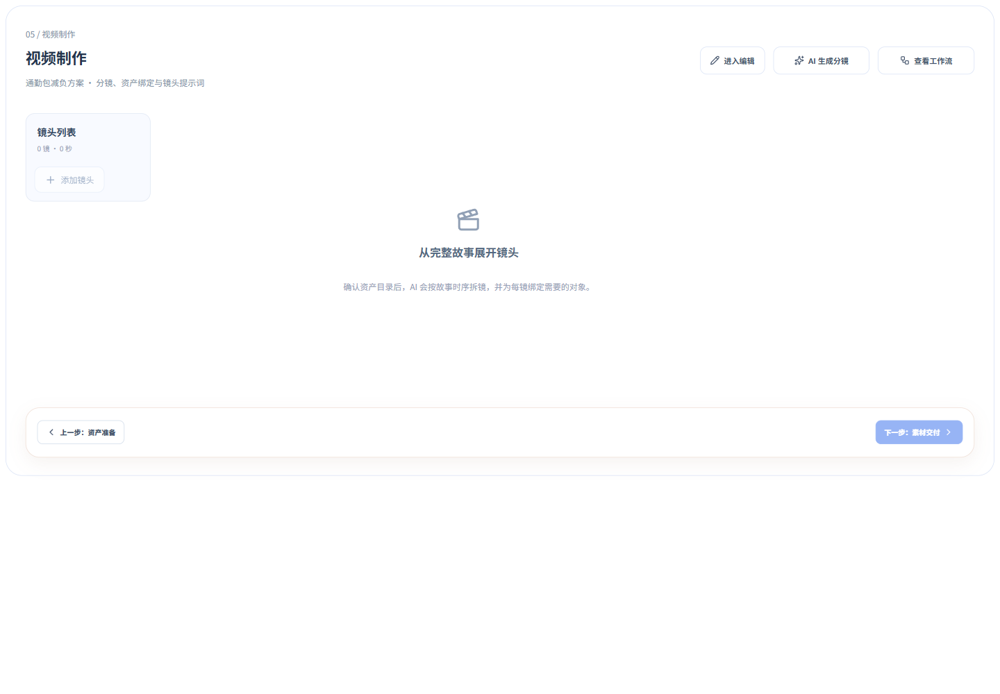

# 制作节点空态编辑状态修复 · 2026-10-19

截图问题来自共享制作页面加载逻辑：未确认资产/分镜被直接当成正在编辑，导致零镜头也显示“取消编辑”。改为仅在当前节点持久化草稿与已确认内容不同时恢复编辑。空页默认浏览，用户明确进入编辑后仍可手工添加；生成后尚未确认的草稿、已有结果的修改和删除草稿继续恢复编辑。

范围为定制类资产准备/视频制作的 Web 初始化；继续消费服务端既有脚本、资产目录及准确 revision。不改变 API、任务、工作副本内容、提交与下游依赖规则。

## 验证

- `pnpm --filter @ai-marketing/web test src/workflows/customized/production`：3 个文件、11 项通过。新增两节点的初始化回归，覆盖空白未开始、未确认结果、已确认内容、删除草稿。
- `pnpm --filter @ai-marketing/web test src/workflows/customized`：16 个文件、118 项通过。
- `pnpm --filter @ai-marketing/web build`：通过，包含 vue-tsc；保留既有大包警告。
- `git diff --check`：无空白错误。
- 浏览器使用正式 Vue 制作组件和隔离的受控 workspace 响应；1920 / 1440 / 430 均无页面横向溢出，初始“进入编辑”1 个、“取消编辑”0 个、“保存修改”0 个。点击进入编辑后，取消和保存各 1 个。

测试浏览器打开主站要求登录，未读取登录凭据，也未将受控测试冒称为真实项目联调。未创建真实生成任务、未改变业务 revision。临时测试页面在验收后删除。

