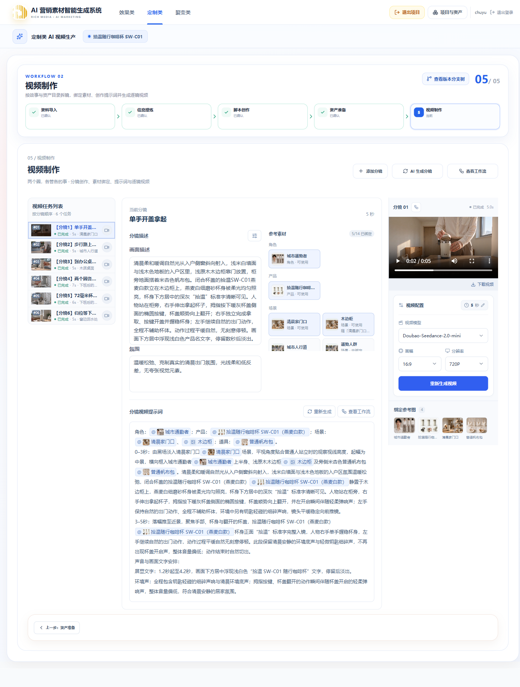

# 咖啡杯线上浏览器联调验收

## 作用域

- 日期：2026-10-19；入口：`https://marketing.richbest.cn`；初始发布：`20261019-bb8250fa`。
- 项目：拾温随行咖啡杯 SW-C01，`edc219c3-fa7f-4991-9540-0f3cb20d3836`。
- 初始 Run：`990d1c4c-8743-4aff-8e46-467e9f5d2c20`。
- 用户已授权一个产品、一个脚本方案的必要真实生成费用；问题交由指定的前端/后端会话先修本地，再由联调会话验证和部署。
- [验收计划](../plans/2026-10-19-线上咖啡杯全流程浏览器联调.md)。

## 验收结果速查

真实五节点已走到6条逐镜视频，刷新、播放、下载及原失败任务恢复通过。发现的问题按用户指定交给两个会话先修本地，再部署验证。

样片仍有密封圈形状、字幕字形等生成质量限制，需要人工审片返修；本报告不作为商业画面质量验收。定制类完整局部更新链路尚未实现，本轮只验证已有编辑、来源失效与单镜恢复边界。

| 环节           | 实际结果                                           | 真实任务耗时                             |
| -------------- | -------------------------------------------------- | ---------------------------------------- |
| 项目、资料导入 | 已创建；2文档、3品牌图，刷新与同内容保存通过       | 人工操作，不计模型耗时                   |
| 信息提炼       | 已完成并确认；保留容量冲突与未知性能               | 22分00.073秒                             |
| 脚本创作       | 1份品牌广告《两个圈，各管各的事》                  | 10分19.250秒                             |
| 资产定义       | 14对象，10独立、4附属                              | 10分58.076秒                             |
| 分镜           | 5场、6片段、6镜头；人工调整后规划33秒              | 7分51.473秒                              |
| 图片           | 9张必要图片已保存，4附属使用父图，未使用钥匙未生图 | 单图14.656秒；8图117.190秒；返修70.016秒 |
| 逐镜Prompt     | 6条当前有效，3镜时长变化后已更新                   | 初批成功单条41–76秒；失败与恢复另计      |
| 逐镜视频       | 6条有效；全部1280×720，播放、下载、独立probe通过   | 新视频单条144–179秒；视频2恢复4.711秒    |

最终实际发布 `20261019-2bc27f33-qa25d52d5d`，包含 C01—C17修复。当前Run为`a4ae4781-e0f0-4d1b-881c-becb097ee16f`；43份工作副本全部CURRENT，6条Prompt/6条视频有效，20个制作任务全部完成，版本分支仍3。下文按发生顺序保留历史过程，历史“进行中”描述不代表最终状态。

## 已实际观察

1. 使用真实已登录 Cookie 创建同名定制类项目，未继承旧项目的本地状态。
2. 浏览器上传简报 DOCX、补充 TXT 和三张品牌 PNG，上传与草稿接口成功；保存资料包后包含 2 份文档、3 份品牌图片。
3. 资料包 `customized-source-package` 为 `e6e83282-0eb8-4aa0-b9fe-15f6c8b30e09` revision 1、CURRENT；刷新可恢复五个文件。
4. 1440、1920、390px 视口未发现整页横向溢出。截图见 `browser/2026-10-19-coffee-server-qa/02-import-saved-*.png`。
5. 进入资料编辑，不改内容再保存：返回原 Run，资料包 ID 和 revision 1 保持不变，公开分支仍只有一个；页面提示“资料内容未变化，保持当前版本”。
6. 上游未确认时，脚本创作保持空态且不得生成；点击资产准备/视频制作会留在脚本页面，提示先确认有效脚本。没有模型任务被这些导航触发。

## 首轮问题记录

| 编号 | 现象与证据                                                                                                                                                                                                                                                                               | 处理与状态                                                                                                    |
| ---- | ---------------------------------------------------------------------------------------------------------------------------------------------------------------------------------------------------------------------------------------------------------------------------------------- | ------------------------------------------------------------------------------------------------------------- |
| C01  | 从已确认资料包进入信息提炼，GET `workflows/customized/information-extraction?workflowRunId=990d1c4c-8743-4aff-8e46-467e9f5d2c20` 返回 400 `VALIDATION_ERROR`，提示 `property workflowRunId should not exist`。独立已鉴权只读请求复现，requestId `078a47a3-0172-459a-9ec7-406b43551571`。 | 已发「16-定制类视频节点-后端」；对方定位为 Controller 的 DTO 仅类型导入造成运行时校验元数据丢失，修复验证中。 |
| C02  | 信息提炼加载失败直接展示英文校验器内部文案。                                                                                                                                                                                                                                             | 已发「16-定制类视频节点-前端」，修复验证中。                                                                  |
| C03  | 定制类空项目说明仍含旧“交付”表述，和当前五节点边界不一致。                                                                                                                                                                                                                               | 已发同一前端会话，修复验证中。                                                                                |

阻断截图：[信息提炼加载失败](browser/2026-10-19-coffee-server-qa/01-extraction-load-error-1440.png)。

## 初始待验范围（历史）

部署本地修复并恢复信息提炼后，继续真实提炼、脚本、资产图片、分镜/提示词和逐镜视频测试。尚未执行的节点不记为通过；节点耗时以实际任务时间与浏览器动作记录分别统计，不把人工操作间隔当作模型性能。

## 第一轮修复与发布

- 两个指定会话先修改本地代码：后端恢复 DTO 运行时导入并加编译后元数据与 HTTP 测试；前端添加安全错误映射，修正空项目五节点说明。
- 后端报告 26 项相关测试、API 类型检查及生产构建通过，并审计 6 个 Controller 的 46 个 Query/Body 参数；前端报告 50 项测试、类型/构建和宽窄屏恢复回归通过。
- 联调会话实际执行工作区 `pnpm typecheck && pnpm build`、相关文件 ESLint、密钥扫描及 `git diff --check` 均通过。过程中发现新回归测试使用 `import.meta` 与 CommonJS 不兼容，交后端改为 `__dirname` 后重新通过；未更改全局模块配置。
- 本地修改未提交 Git，按源码与本地修改快照发布为 `20261019-bb8250fa-qa11a4b65e`。服务器发布记录于 `2026-10-19T09:52:34Z` 完成，备份成功、业务数据一致，API 与 8 个 Worker 镜像全部更新。
- 线上刷新后原信息提炼 GET 200，正常显示信息卡，C01 阻断解除。安全错误映射的异常分支由前端隔离浏览器测试覆盖，未故意破坏线上接口复演。
- 另发现提炼页面指向第三节点的旧“分镜创作”文案（C04），已交前端先本地修正为“脚本创作”；23 项测试及类型/构建通过，等待后续无活动任务时发布。

## 信息提炼真实任务（进行中）

- Task：`45e65275-6e43-4a08-9582-193678f9b2b2`，创建于 `2026-10-19T09:53:16.178Z`，来源为已确认资料包 revision 1。
- 实际文档解析完成 2/2，DOCX 表格保留填写内容与示例列分隔，TXT 补充说明完整可查看；品牌图不冒充文本事实。
- 运行中刷新恢复同 Task；切换效果类后为空项目，返回定制类恢复本项目和同 Task，额外创建次数为 0。
- 工作流节点详情可打开，Esc 可关闭。运行截图：[提炼运行与解析详情](browser/2026-10-19-coffee-server-qa/03-extraction-running-1440.png)。

## 信息提炼终态与候选问题 C05

- Task 于 `2026-10-19T10:15:16.251Z` 完成，创建至终态更新相差 **1320.073 秒**。各节点终态检查点：快照 09:53:16.699、解析 09:53:26.683、单文档提取 09:56:43.156、融合 09:58:46.787、语义精炼 10:15:16.206、结果保存 10:15:16.230（UTC）。相邻检查点间隔约 10 / 196 / 124 / 989 秒；这不是单个模型调用的精确计时。
- 最终字段保留容量记录冲突、两种独立硅胶圈、完整品牌调性、夜班受众和未确认能力限制，未把模板示例当作产品资料。
- C05：5 张待确认卡中，“性能尚未测试”“配件未确认”也出现以 430 / 480mL 为差别的整段规格候选，处理一个提示可能顺带选定另一个未确认事实；外观提示也重复整段候选。已交指定后端会话，定位为末步强制每条提示至少两个整字段答案；前后端正改为 AI 区分已声明未知与真实冲突、精确片段替换和历史候选保护。
- 本次对 5 卡全部使用“确认保留当前填写”，按钮数依次 5→4→3→2→1→0，前后全部字段逐字相同。确认提交 `customized-brief`：`951f3b9d-a0af-4b44-b968-3b2838c572dd` revision 1，依赖原资料包 revision 1。
- [候选问题截图](browser/2026-10-19-coffee-server-qa/06-extraction-differences-1440.png)、[确认后的信息卡](browser/2026-10-19-coffee-server-qa/07-brief-confirmed-1440.png)。

## 脚本创作终态

- Task：`44f0195c-1532-43ea-bc71-b060b752ce06`，品牌广告、参考 30 秒、固定一份；创建 `10:33:28.517Z`，终态更新 `10:43:47.767Z`，处理 **619.250 秒**。浏览器后续读取时的总经过时间更长，不能替代任务计时。
- 结果《两个圈，各管各的事》：5 个故事段落、预计 33 秒。参考时长为软约束，未将 33 秒误判为超限。
- 实际独立审校拦截了原稿把“清洁刷可伸入 72mm 杯口”写成“成人伸手清洁”的无依据动作，以及 P04 九秒内动作与四段字幕过载；任务进入一次定向修订和独立复核，使用普通清洁刷并精简字幕后才发布。没有人为绕过审校。
- 正式分支 Run：`569b1935-d3d7-427f-b33d-c3565e67f09a`；`customized-script:88d6fbd5-adae-4648-ad91-06b64fe8128c` 工作副本 ID `840cf38a-4959-46d9-b83e-1029261fdfe0` revision 1。接口脚本实体 revision 2 与业务工作副本 revision 1 含义不同。
- 发布后浏览仍停在原 Run；点击下一步才进入脚本的实际分支。分支中的资料/简报快照均保持 revision 1，并记录继承来源。刷新后方案数仍为 1，1440 / 390px 无整页横向溢出。
- [审校与修订证据](browser/2026-10-19-coffee-server-qa/10-script-review-repair-1440.png)、[正式脚本](browser/2026-10-19-coffee-server-qa/11-script-confirmed-1440.png)。

## 资产准备（进行中）

- 点击下一步仅加载空资产工作台，尚未生成资产或付费任务；明确点击“AI 整理资产”才创建 ASSETS Task `dab63432-6b79-4114-b6ed-58935b37e508`。
- 当前在产品、人物、场景、道具定义阶段，工作流只展示资产操作的阶段。运行中刷新恢复同 Task，额外任务创建次数为 0。尚无图片或视频生成任务。

## 资产定义完成与第二轮发布

- ASSETS 创建于 `2026-10-19T10:45:33.344Z`，完成于 `10:56:31.420Z`，共 **658.076 秒**。独立审校将受众范围与人物设计设定分开，自动修订复核后才发布。
- 资产 Run `a4ae4781-e0f0-4d1b-881c-becb097ee16f`；目录 `3fba7f8a-4d0c-413d-8724-808d24c660f6` revision 1；14 个对象中 10 个独立制图、4 个随父场景准备。尚未生成图片。
- C01—C05 配套版本 `20261019-dacea2c0-qad1171cc6` 于 `2026-10-19T11:04:19Z` 发布。当前 Run 的 18 份工作副本 ID、revision、指纹及 14 个资产定义在发布前后完全相同。
- 主会话执行 `pnpm lint`、`pnpm typecheck`、`pnpm test`、`pnpm build` 通过；Lint 为 0 错误、30 条既有警告。UI / Contracts / Web / API / API 脚本分别 17 / 319 / 1850 / 1852 / 11 项通过，API 另有 86 项按原开关跳过。完整格式门禁存在远程基线的 25 个文件问题，本轮不据此声称 `pnpm check` 全绿。
- C05 新逻辑通过隔离测试与本地浏览器验证，未再次付费提炼，因此不将旧任务的质量或耗时作为新逻辑效果证明。

## 新发现 C06、C07 与分镜测试

- C06：批量图片对话框默认选择 14 个对象，而木边柜、通勤人群、木质桌面、细水流已明确是 SCENE_DETAIL、无需独立制图。仅打开并取消，未创建错误 IMAGE 任务。[批量计数](browser/2026-10-19-coffee-server-qa/14a-batch-all-selected-1440.png)、[附属定义](browser/2026-10-19-coffee-server-qa/14b-scene-detail-not-independent-1440.png)。指定两会话负责本地筛选与父图引用配套修复，待线上真实验证。
- C07：资产→信息提炼→资产的普通导航错误激活脚本祖先 Run，显示空目录并禁用下一步；原资产仍完整存在于资产 Run，API 隔离正确。通过版本树显式回到资产 01 才恢复。该操作仅是继续联调的临时恢复，不算修复。[下一步禁用](browser/2026-10-19-coffee-server-qa/15-assets-next-disabled-1440.png)。前端已处理当前脚本后代路径保持，待发布复演。
- 在正确资产 Run 点击下一步无额外任务；主动点击“AI 生成分镜”才创建 SHOTS `bf9b9088-6ab7-49bb-a27f-06522610127b`。运行中刷新恢复同任务，工作流只显示本次分镜阶段。[运行态](browser/2026-10-19-coffee-server-qa/16-shots-running-1440.png)。当前规划 5 场、6 片段、32 秒，正在独立审校；尚未据此宣称分镜或视频完成。

## 分镜完成与本轮发布前门禁

- SHOTS 创建于 `2026-10-19T11:08:35.785Z`，完成于 `11:16:27.258Z`，共 **471.473 秒**。真实结果为 5 场、6 片段、6 镜头，合计 31.5 秒；每片段各绑定一个镜头，原 14 个资产定义完整保留。
- 分镜自动提交到同一资产 Run：计划 ID `18f81203-08ee-406b-88c0-f8204019bd3c` revision 1；另有 6 镜头、6 片段工作副本，均 revision 1。当前 Run 合计 31 份工作副本。此时尚无 Prompt 或视频文件。[分镜完成](browser/2026-10-19-coffee-server-qa/17-shots-completed-1440.png)。
- 独立审校给出双圈说明字幕停留偏短的 WARNING，没有触发强制返修。人工复核另发现 C08：第一镜写成开盖同时左手扶杯，与原稿单手演示条件不符；审校未指出。已交后端只读核查，确认现有规则未明确验证卖点成立条件。计划人工编辑纠正当前镜头并验证自动保存；另由后端小范围增强通用生成/审校条件，不靠单手/双手关键词硬拒绝，不增加模型调用。
- C06/C07 稳定源码的主会话门禁：`pnpm lint`、`pnpm typecheck`、`pnpm test`、`pnpm build`、`git diff --check` 全通过；UI / Contracts / Web / API / API 脚本为 17 / 328 / 1866 / 1863 / 11 项通过，API 86 项原开关跳过，Lint 0 错误、30 既有警告。Worker 验证由指定后端执行，见[本地验证](2026-10-19-附属资产父图引用本地验证.md)。
- 冻结快照 `20261019-dacea2c0-qa332e43c5` 包含本地未提交修复；C08 后续源码尚不包含于该快照。构建前查证全站活动业务任务为空，8 个队列 ready/unacknowledged 均为 0、各 1 消费者。正在无活动窗口发布；未完成的线上复演仍不计通过。

## 第三轮发布与 C06/C07 线上复演

- `20261019-dacea2c0-qa332e43c5` 于 `2026-10-19T11:23:00.435549Z` 发布完成，业务数据校验一致。浏览器新模块 `/assets/index-82DAEuw9.js` 已实际加载；31 份工作副本发布前后 ID、revision 和指纹完全一致。
- 普通导航“视频制作→信息提炼→资产准备→下一步视频制作”保持 `a4ae…` Run，14 项资产完整、Next 可用，生成任务 POST 增量为 0；C07 原阻断路径解除，未借助版本树恢复。
- 批量弹窗首次默认 10/10，4 项附属对象不在制图选择列表；[线上计数](browser/2026-10-19-coffee-server-qa/18-batch-ten-independent-1440.png)。视频“木边柜”缺图入口导航回资产并打开父对象“清晨家门口”定义，不直接生图，无付费任务。

## 真实图片任务与保存

- 产品 IMAGE `f3f865cc-75de-45f7-a5d2-d17beb4bc566`：`11:28:16.989Z` 至 `11:28:31.645Z`，**14.656 秒**。Flash / 1K / 4:3，真实文件 1152×864；成功后显式保存资产修改。
- 其余实际使用的 8 项 IMAGE `131ce3b9-221a-4ed1-bb0b-6891d101c3a4`：`11:34:44.670Z` 至 `11:36:41.860Z`，**117.190 秒**。同参数；已有产品图默认取消选中，手动取消未绑定任何镜头的“钥匙”，没有生成4个附属项。运行中刷新恢复同任务，没有重复创建。
- 8 图成功后点击“保存修改”返回 200；当前草稿 revision 11，assetsConfirmed / shotsConfirmed 均 true；完整 videoPlan 与 SHOTS 原成功结果逐字相同。9 个独立对象各保留实际 ProjectAsset version 1，4 个附属对象 image 仍为 null，界面按 parentId 复用父图；未将父图投影回写子资产。 [保存后的资产库](browser/2026-10-19-coffee-server-qa/20-images-saved-parent-reuse-1440.png)。
- 图片预览真实可用：[产品设定图](browser/2026-10-19-coffee-server-qa/22-product-reference-preview.png)、[家门口父场景含木边柜](browser/2026-10-19-coffee-server-qa/23-parent-scene-reference-preview.png)。模型结果是设计参考，不代表商品实物还原：产品图存在轻微锥形趋势，场景图也自行包含杯子，后续应以产品主图约束主体，不能据文件成功声称所有画面质量达标。

## 新阻断及编辑问题

- C09：起止状态真实存储并参与 Prompt，原参数弹窗却没有编辑入口。指定前端已补两个字段，测试覆盖同步镜头/片段、自动保存、刷新、409 和运行禁用，待上线实际操作。
- C10：首次产品生图前曾操作品牌 PNG 上传，最终任务 references 为 []，不能证明品牌图已使用。随后相同 PNG 上传返回201、缩略图与移除按钮正常；未因此再付费生成。前端查证组件在同ID对象替换时确会静默中止上传并清空参考图，普通 load(true) 没复现；两者不能直接画等号。正窄范围修复组件生命周期，首次线上缺引用原因仍未定位。
- C11 P1：补图确认后原分镜被标待更新。没有改分镜，正常进入视频选片段2并点 AI 生成，API 返回409“请先保存当前片段和分镜”，页面无保存按钮；没有创建 PROMPT 任务。[实际错误](browser/2026-10-19-coffee-server-qa/21-prompt-blocked-after-images-1440.png)，390px 错误态无整页横向溢出。已交后端修依赖/提交边界，不通过假编辑或付费重跑 SHOTS 解锁，不无条件清除真实语义变化的待更新。

## 第四轮发布与 C11 原记录恢复

- 快照 `20261019-dacea2c0-qa0ed171b2` 于 `2026-10-19T11:58:17.765282Z` 发布完成，包含 C08—C11 配套代码。主会话最新 `pnpm lint` / `typecheck` / `build` / `git diff --check` 均通过；Lint 保持 0 错误、30 既有警告。各修复相关测试与真实本地数据库边界见[补图依赖验证](2026-10-19-补图后分镜依赖对齐本地验证.md)。
- 浏览器加载 `/assets/index-oiqpvrPR.js`；原31份工作副本的ID/revision/hash/freshness发布前后完全相同，12个镜头/片段仍STALE，证明GET未偷偷改状态。
- 未编辑或保存分镜，直接对原片段2点击AI生成：原409变201，真实PROMPT `ad2540aa-d6a3-4814-9d13-fb1a26c3c59f` 创建并成功。草稿11→12，6镜头与6片段内容逐字相同，仅计划来源随真实图片对齐；STALE归零，版本分支仍3。
- PROMPT 创建 `11:58:55.461Z`，完成 `11:59:36.692Z`，共 **41.231秒**。绑定产品、人物、父人行道和附属通勤人群4个逻辑对象，右侧实际3张参考图，附属父图去重显示。任务只在当前提示词区域展示；切片段3不显示片段2进度，返回2恢复同任务，期间不允许再创建另一任务。[真实运行态](browser/2026-10-19-coffee-server-qa/25-prompt-running-after-recovery-1440.png)。
- 产品图片另做一次必要的定向返修：Pro / 1.5K / 4:3，明确上下外径一致、采用品牌标准字，不标未知容量。IMAGE `0c14017f-c41a-4254-ab74-69f5b0e8f641` 的冻结输入确认包含资料导入品牌标识资产 `1bcdaad4-ea80-4884-a8c2-93a9fce49ed0` version1；尚未完成时旧图和现有Prompt均保留。该次用于检查实际质量与第二轮图片变更，不重跑整批图片或SHOTS。

## 第二轮图片变化与单镜编辑恢复

- 定向返修于 `12:01:20.340Z` 创建、`12:02:30.356Z` 完成，**70.016秒**，真实图1792×1344。[新版产品参考](browser/2026-10-19-coffee-server-qa/26-product-reference-corrected.png)直筒造型明显改善，仍是AI设计参考，不将其当作实物证明。
- 保存资产返回200，当前产品引用新ProjectAsset `5cab4088-6eaa-44e5-a69e-39ccb0b191fd` version1，旧资产保留。草稿变14，全部分镜与片段核心内容未变化，仅来源/图片快照对齐；已有片段2 Prompt 正文逐字相同、stale=false、业务revision1→2，版本分支仍3。没有重新生成Prompt或SHOTS；此处revision增长采用了真实新依赖，同内容反复保存的无增长由本地真实数据库测试覆盖。
- C09线上操作：第一镜画面改为右手独立拿取/按键/握稳，左手不辅助；新参数字段将结束状态改成右手单手，镜头和片段同步。两次自动PUT均200，草稿14→16；刷新后的正文与结束状态均恢复，片段2 Prompt仍有效且正文不变。[刷新后起止状态](browser/2026-10-19-coffee-server-qa/27-shot-states-saved-reloaded.png)。
- 当前第一镜 PROMPT `a44988b8-c2c8-4f73-ad14-38e23aaf4f42` 正常201创建，使用人工修正后的真实分镜。C08新增AI审校策略并未重新付费SHOTS验证，本次人工编辑只证明当前镜头能被纠正及保存，不能证明新策略已识别所有同类问题。

## 提示词编辑与视频配置

- 第一镜PROMPT于 `12:04:48.557Z` 创建、`12:05:51.055Z` 成功，**62.498秒**，审校确认单手动作及原画面文字窗口。片段2原Prompt继续有效。
- 在片段2正文增加“镜头保持平稳，不突然变焦。”，自动PUT200，Prompt revision3、stale=false；刷新重新选择片段2，新增要求和4个逻辑引用均恢复，右侧仍显示3张去重参考图。没有新增分支或重新付费生成。
- 六个片段的模型分别通过正常下拉设置为 `Doubao-Seedance-2.0-mini`、720P、16:9；六次配置PUT均200，公开workspace均恢复revision1设置。内部兼容能力键为SEEDANCE_1_0，当前映射模型为 `doubao-seedance-2-0-mini-260615`，不能据内部旧键误判为选择了旧1.0模型。
- 片段3 PROMPT `fdd08044-394d-4a17-ac0c-52a5d90406f2` 正常201创建。视频尚未发起，不以配置保存宣称已渲染。

## 剩余提示词、首次视频与新问题

- 片段3/4/5 PROMPT均成功；片段4 `f9426686-2958-4aa3-b51c-34d03b694b76`、片段5 `18a36879-10ca-4d9e-977e-8f690c9ca705`。当前5条已提交提示词均有效，事实与引用保持正常。
- C12：片段6 PROMPT `bfbadb51-018f-44bf-b0b3-32821096bd93` 在REVIEW65%失败。模型已有真实ERROR“缺少盖内密封圈已装回杯盖的归位状态”，纠正后的结构候选保存后仍未通过机械校验，未进入REPAIR；具体机械原因正由指定后端核对私有检查点。不能把有业务修订建议本身当成结构失败根因，也未将失败候选当作已提交提示词。
- C13：失败后主页面提示词区域直接变空、按钮恢复AI生成，没有当前片段失败提示；工作流详情才可见失败。指定前端已定位原任务组件仅展示排队/运行，正补局部失败与取消反馈、精确详情入口；不自动付费重试。[失败页面](browser/2026-10-19-coffee-server-qa/28-final-prompt-review-failed-1440.png)。
- 先对已完成的片段2通过正常UI发起真实RENDER `fa97ceb1-916c-4df3-a0e0-e653ded49493`，Mini/720P/16:9/5秒，API201。快照列明4个逻辑对象，固定图片版本校验完成，GENERATE成功取得视频原文件；REVIEW60%在解码封面/探测实际媒体时失败。[运行](browser/2026-10-19-coffee-server-qa/29-first-video-render-running-1440.png)、[失败](browser/2026-10-19-coffee-server-qa/30-first-video-render-failed-1440.png)。尚未形成正式视频产物，不记视频通过。
- C14部署缺陷实证：只读执行当前API与customized-production-worker的ffmpeg/ffprobe版本命令均127，Worker内shutil.which均null。Worker当前Dockerfile已声明FFmpeg，但主会话复用旧依赖基底时只核对Python清单，漏查系统工具；canonical API Dockerfile也未安装指南要求的ffprobe。主会话本地发布helper已补缺失时构建系统依赖层、成品镜像和实际容器双探针（语法检查通过）；指定后端补canonical Dockerfile和可复用运行探针。修复部署前不再次生成视频，先核对已成功供应商检查点能否恢复，避免重复费用。

## C12/C14 安全诊断与恢复依据

- 后端新增只读诊断脚本；主会话实际执行语法及4项测试通过，再在API容器临时脚本路径只读运行。诊断使用显式Task UUID、只读事务及白名单输出，不输出正文、系统指令、URL或凭据。
- C12旧机械错误被笼统分类为QUOTE_NOT_FOUND，已纠正候选也有同问题N1的两条引文（20、38字），两条均逐字匹配实际Prompt，所有证据对象/字段/受影响镜头和片段都在冻结快照内；来源和草稿仍有效、无其他活动任务。后端据代码确认真正原因是一问题只允许一条quote的seen集合；正允许同问题多条不同且真实的引文，继续拒绝完全重复、未知问题和不匹配内容，不降低审校结论要求。
- C14的私有检查点已保存providerTaskId、createStarted=true、未拒绝创建；GENERATE成功，来源/草稿仍有效。存在受保护的同Task retry接口，保留output并校验来源/并发。前端正接显式“继续本次任务”，不用新建任务替代，不自动执行，不承诺所有未完成步骤免费。
- 系统依赖构建另发现node-slim没有OS CA。Context7工具当前不可用，涉及CA引导已核对[Node22官方TLS文档](https://nodejs.org/docs/latest-v22.x/api/tls.html#tlsrootcertificates)：采用当前Node内置Mozilla PEM建立首次可信CA，再安装ca-certificates与FFmpeg，未关闭TLS或包签名校验。
- 官方Debian CDN的包索引传输停滞；只取消了主会话独立依赖构建进程组，没有停止运行服务。从服务器验证[清华镜像](https://mirrors.tuna.tsinghua.edu.cn/help/debian/)的同一bookworm索引Range206、64KiB约0.22秒；主包源切换该HTTPS镜像、安全更新保留官方security.debian.org、保留原Debian签名键，正重新构建依赖层。此时尚未把新镜像切换到运行服务。

## 原任务恢复发布前检查

- API与视频Worker的独立系统依赖层均完成，实际镜像中的ffmpeg/ffprobe版本探测成功；运行服务此时仍是上一发布，尚未因此创建新付费请求。主会话发布helper会复用与当前基底ID匹配、再次探测通过的准备镜像，并复制canonical只读运行探针到成品镜像；切换后还会探测实际容器。
- C14 Worker补充已由指定后端完成：新供应商创建前验证同一ffmpeg/ffprobe工具可执行，缺失、权限、异常退出和超时均先失败、create调用为0；保留output/providerTaskId，工具恢复后不重建供应商任务。视频Worker97项、资产Worker45项及mypy通过，尚待线上原任务恢复实证。
- C13显式失败反馈、同Task“继续本次任务”、C15共享详情重查后的ESC/嵌套关闭与焦点恢复已由前端完成。82项相关测试、受控浏览器与构建通过；409保留内容，不自动重试、不用新建任务代替恢复。实际线上恢复与正常详情交互仍待发布验收。
- 当前Git基线为`2bc27f33`，补充修复仍保留在本地工作区，发布使用包含这些修复的冻结源码快照。打包器已补正常删除/重命名文件处理：只删除旧受控发布快照中的明确文件，逐个校验路径与类型、先备份，失败可回滚；不枚举或删除业务存储。
- 主会话本轮 `pnpm lint`、`pnpm typecheck`、`pnpm test`、`pnpm build`、`git diff --check` 均通过：UI17、Contracts328、Web1903、API1865及API脚本11项通过；默认API87项跳过未计为通过（C11数据库测试此前已另行显式通过）。Lint为0错误、30既有警告；新诊断脚本4项测试另行通过。
- 发布前重新读取当前Run，36份工作副本、0份STALE，5条正式Prompt；两项失败任务和供应商检查点仍保留。已单独保存首轮失败耗时：片段6 PROMPT 136.962秒，片段2 RENDER 148.195秒；后续恢复不把人工修复等待计入模型处理时间。

## 第五轮发布与原任务真实恢复

- 冻结快照 `20261019-2bc27f33-qa15b6fe74` 于 `2026-10-19T13:04:57.522599Z` 发布完成。API及8个Worker均核对实际运行镜像；API ffprobe与视频Worker ffmpeg/ffprobe运行探针均成功。业务数量与交付文件身份校验一致，当前Run原36份工作副本ID/revision/hash/freshness逐项相同，未借部署清除待更新或改写产物。
- 本次API依赖层增加OpenSSL后，Prisma需要对应3.0引擎；初次无网络构建明确失败，未切线上服务。构建阶段开放正常网络下载官方引擎后重新构建成功，没有绕过校验或复用错误引擎。
- C13线上出现明确失败卡、详情及“继续本次任务”；视频详情准确展示文件校验失败，Esc关闭并将焦点归还“查看失败详情”。正常Prompt详情Esc亦通过；线上未复演详情重查错误分支，该分支证据见前端隔离验收。
- 原视频Task `fa97ceb1-916c-4df3-a0e0-e653ded49493` 经UI原Task retry返回201，点击 `13:05:54.514Z`、完成 `13:05:59.225Z`，恢复约 **4.711秒**。复用已有供应商结果完成探测/封面/保存，未另建RENDER。原首轮失败148.195秒与人工等待分开记录。
- 原第6镜Prompt Task `bfbadb51-018f-44bf-b0b3-32821096bd93` 经UI原Task retry返回201，点击 `13:06:37.308Z`、完成 `13:07:16.856Z`，恢复约 **39.548秒**。真实进入定向修订复核，正文补齐盖内密封圈洗净装回、杯底圈独立保留；未将失败候选直接采用，也未重跑其他5条。
- 视频2浏览器原生播放readyState4、无媒体错误，下载按钮取得真实MP4。独立ffprobe核对H.264 1280×720、AAC，视频轨5.041667秒、容器5.088秒。完成文件不等于全片画面审美与口播内容全部达标。
- [失败恢复入口](browser/2026-10-19-coffee-server-qa/31-prompt-failure-resume-1440.png)、[视频2完成播放](browser/2026-10-19-coffee-server-qa/32-video2-resumed-complete-1440.png)。

## C16 半秒镜长与整数模型冲突

- 当前4个渲染模型均接受整数秒，但原SHOTS生成片段1/4/5为4.5/6.5/5.5秒。UI严格阻止付费，但“支持4–15秒，调整分镜或切模型”漏写整数且切换其他模型也不能解决。前后端指定会话已核实为规划与渲染能力不一致，正窄修新任务快照约束与入口文案，历史记录不自动取整。
- 当前计划为REFERENCE 30秒。通过正常分镜参数分别明确延长1/4/5为5/7/6秒，三次自动PUT200，草稿16→19，刷新恢复；总长由31.5增为33秒。没有缩短声音/文字时间窗或重跑SHOTS。
- 只有这3个修改过的Prompt变STALE；2/3/6仍CURRENT，已有视频2的完整DTO逐字相同、revision1且stale=false。证明片段来源更新没有误伤兄弟提示词和已付费视频。正在逐条重生成这3条Prompt后继续视频。

## C17 审校多处机械错误与显式恢复

- 时长调整后第一镜PROMPT `a1b06343-4f79-4ed4-ae2d-8ff9db898521` 于 `13:11:09.327Z` 创建、`13:13:57.294Z` 失败，**167.967秒**；旧正式Prompt保留STALE，未用失败候选覆盖。
- 原审校确有需要修订的声画不同步：翻盖在0–3秒发生，弹响被写到后段/全程。但审校报告自身还包含无效TIMING字段和两条使用省略号而非逐字原文的引文；一次纠正只修正了字段。只读白名单诊断确认原/纠正后引文93、106字不匹配，第三条48字匹配，来源/草稿有效。
- 后端确认原校验遇首个错误便抛出，唯一一次结构纠正未收到其余错误；后续同Task恢复还会重新命中无效纠正缓存。已要求一次汇总全部机械问题；只有显式“继续本次任务”才开启新的受保护恢复轮次，归档旧失败记录并保留候选，自动重投/租约恢复不重置纠错预算。逐字引文校验和每轮至多一次纠正保持不变，不能靠丢审校或新Task绕过。
- 第4镜按7秒更新PROMPT `4a1a18de-022a-43e0-b105-65ab5aad3a85` 于 `13:15:17.853Z` 创建、`13:16:37.535Z` 完成，**79.682秒**；第5镜更新任务 `2681b545-a692-4b01-8f74-640dfc41ccb6` 正在执行。
- 390/1920px运行页实测document scrollWidth均不超innerWidth；切到第4镜不显示第5镜的运行进度，任务保持按当前目标展示。[390px](browser/2026-10-19-coffee-server-qa/33-video-workbench-running-390.png)、[1920px](browser/2026-10-19-coffee-server-qa/34-video-workbench-running-1920.png)。

### C15 线上只读异常恢复补验

仅在联调隔离浏览器拦截当前第6镜 `production/prompt-task` GET，真实详情显示“工作流查询未完成”与“重新查询”。撤销网络拦截后点击重新查询，恢复真实记录；Esc正常关闭，焦点回到“查看当前分镜提示词工作流”。拦截未返回伪造业务响应、未触碰生成POST或其他用户上下文；最终已解除全部route。此前仅正常详情通过的范围说明由本次补齐。

### 生成画面的独立观察

抽看视频2与视频4的真实下载文件。视频2能呈现通勤握杯；视频4在4秒位置把待洗部件画得接近透明整片杯盖，未充分兑现“独立盖内密封圈”，画面字幕亦出现模型字形误差。该样片通过的是文件、播放、下载与持久化链路，不据此标记商品部件还原或字幕质量合格。当前参考主要是AI设计图而非实物分解图，保留此质量限制；不把文件校验冒充语义审片，也不自动无限重渲染。

## 其余逐镜视频实测

| 分镜                  | RENDER Task                            | 创建→终态（UTC）          | 耗时      | 浏览器播放、下载与文件                                    |
| --------------------- | -------------------------------------- | ------------------------- | --------- | --------------------------------------------------------- |
| 03 到办公桌前轻轻放下 | `0c3e42a4-28e5-46b6-b4f2-087625100126` | 13:18:31.943→13:20:56.209 | 144.266秒 | 通过；1280×720 H.264/AAC，容器5.088秒                     |
| 04 两个圈各管各的事   | `db23eb52-01e9-413a-9dc4-b31a1748b60c` | 13:21:22.935→13:24:20.142 | 177.207秒 | 通过；1280×720 H.264/AAC，容器7.104秒；画面质量限制见前节 |
| 05 72毫米杯口刷洗内胆 | `3ff7d7c7-5091-4261-a24c-4dc93de93113` | 13:26:24.036→13:29:00.728 | 156.692秒 | 通过；1280×720 H.264/AAC，容器6.080秒                     |

- 第5镜按6秒更新PROMPT `2681b545-a692-4b01-8f74-640dfc41ccb6`，13:17:20.843→13:18:18.843，58.000秒。三处时长变更没有重新触发其它镜头生图、分镜或整批Prompt。
- 视频3运行中刷新仍恢复同Task，RENDER任务总数当时仅2（原视频2+视频3），没有重复创建；切换片段后进度按目标展示。
- [视频3](browser/2026-10-19-coffee-server-qa/35-video3-complete-1440.png)、[视频4](browser/2026-10-19-coffee-server-qa/36-video4-complete-1440.png)、[视频5](browser/2026-10-19-coffee-server-qa/37-video5-complete-1440.png)。
- 当前第6镜RENDER `83673bff-0217-4827-8eaa-767affcf6f68` 生成中。第一镜须先部署C17后恢复原失败Prompt任务，不能计为已完成。

## 最后一轮发布前状态

- 第6镜RENDER `83673bff-0217-4827-8eaa-767affcf6f68`，13:29:32.844→13:32:32.306，**179.462秒**，播放、下载与独立probe通过，1280×720 H.264/AAC、容器5.088秒。[完成页面](browser/2026-10-19-coffee-server-qa/38-video6-complete-1440.png)。
- 当前Run有6条正式Prompt、5条正式视频，42份工作副本；只有第一镜旧Prompt仍STALE，所有任务均终态，草稿revision19、版本分支3。已保存完整ID/revision/hash/freshness及五个视频DTO用于部署前后逐项比较。
- 指定后端完成C16/C17并冻结代码：视频Worker119、资产Worker45、Contracts340、API制作57项及另行显式的真实本地数据库恢复测试通过，mypy与类型/构建通过，无数据库迁移或依赖变更。详见[整数秒验证](2026-10-19-分镜整数秒对齐本地验证.md)、[显式恢复验证](2026-10-19-提示词全量机械反馈与显式恢复本地验证.md)。指定前端完成整数秒提示与直达参数入口，29项测试及受控浏览器通过。
- 主会话正在执行冻结源码的完整Lint/类型/测试/构建；完成后无活动任务窗口发布，再由UI恢复原第一镜Prompt Task，不能将尚未完成的第一镜记为通过。

冻结源码最终门禁实际通过：`pnpm lint`（0错误、30既有警告）、`pnpm typecheck`、`pnpm test`（UI17、Contracts340、Web1919、API1875，API另87跳过，脚本11）、`pnpm build`及`git diff --check`。最新Web入口`index-Dajvvsmp.js`；发布前密钥扫描11个实际值，源码无命中。完整格式门禁的既有25文件问题未作为本轮通过项。

## 第六轮发布与C17真实恢复启动

- 最后修复快照`20261019-2bc27f33-qa25d52d5d`于`2026-10-19T13:42:40.656366Z`完成发布，包含C16/C17。API/Worker真实镜像、媒体工具及业务数据一致性均通过；浏览器加载`index-Dajvvsmp.js`。
- 部署前后42份工作副本ID/revision/hash/freshness、五个视频完整DTO及版本分支完整返回值全部相同。部署没有把第一镜STALE强行清除。
- 新右侧“编辑分镜时长：5秒”按钮可直接打开原参数弹窗，读到5秒，Esc关闭且未改值。
- 原失败第一镜Prompt Task `a1b06343-4f79-4ed4-ae2d-8ff9db898521`经UI继续返回201、ID不变，点击`13:43:48.888Z`。只读诊断实际看到恢复version1/epoch1/phase audit/historyCount1，来源与草稿有效，无其它活动任务；旧失败记录已归档，正在继续未完成审校，没有新建Task或重跑五个视频。

### C17恢复成功

原第一镜Prompt Task于`13:45:27.763Z`成功，UI继续到终态 **98.875秒**，与原首轮失败167.967秒及人工修复等待分开统计。机械审校、业务修订、独立复核和原位保存全部完成；正文将弹响明确放在0–3秒翻盖瞬间，3–5秒只留环境底声/钥匙细碎声。旧历史仍归档、Task未增加，未将失败候选直接提交。[恢复修订](browser/2026-10-19-coffee-server-qa/39-prompt1-recovery-repair-1440.png)、[最终提示词](browser/2026-10-19-coffee-server-qa/40-prompt1-recovery-complete-1440.png)。

随后通过UI对第一镜创建真实RENDER `2f218967-bfdc-4c8f-8617-a3f857b7943d`，13:46:19.336Z、Mini720P16:9/5秒，201受理。当前只剩该视频终态及全项目最终刷新验收。

## 最终核验与边界

- 第一镜RENDER `2f218967-bfdc-4c8f-8617-a3f857b7943d` 于13:46:19.336→13:49:14.018Z完成，**174.682秒**；正常播放及下载成功，1280×720 H.264/AAC，视频轨5.041667秒、容器5.088秒。
- 全页刷新后逐一播放六镜，全部readyState4、媒体error为空，容器时长依次5.088 / 5.088 / 5.088 / 7.104 / 6.080 / 5.088秒；六份实际下载文件均用独立ffprobe核对音视频轨及尺寸，未拿占位图或供应商受理当作成片成功。
- 最终workspace：14资产、6镜头/6片段、6个Prompt、6个视频；43工作副本全部CURRENT，Prompt/视频STALE均0，制作任务20个全部COMPLETED，草稿revision19，分支仍3。先前五个视频完整DTO与最后发布前逐字相同，恢复第一镜没有重生成或覆盖兄弟视频。
- 服务器最终health为ok，13个服务运行，API/PostgreSQL/RabbitMQ/Redis健康；8个业务队列消息均0、消费者各1，实际发布保持`20261019-2bc27f33-qa25d52d5d`。
- 当前工作流结束于逐镜视频，没有额外创建整片交付节点。C05新提炼策略及C08新SHOTS语义策略有本地验证，本轮没有额外重复购买整批提炼/SHOTS来宣称新策略画面质量达标。生成画面的密封圈还原、字幕字形及短字幕停留等限制仍需人工审片处理。
- 本轮修复保留在本地，并同步已部署服务器；最后一轮没有自动提交或推送。报告后续追加记录和截图属于验收证据，不改变已发布应用源码。

最终截图另见[390px完成态](browser/2026-10-19-coffee-server-qa/42-final-complete-390.png)、[1920px完成态](browser/2026-10-19-coffee-server-qa/43-final-complete-1920.png)，均无整页横向溢出。实际视频1预览还出现双手配合开盖，与已修正Prompt的单手要求不完全一致；这属于已生成画面需要返修的质量问题，不能用Prompt文字审校通过代替视频语义达标。
