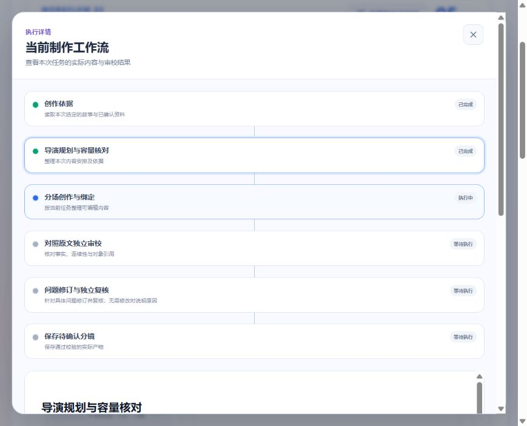
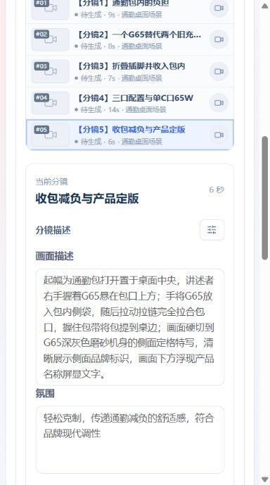
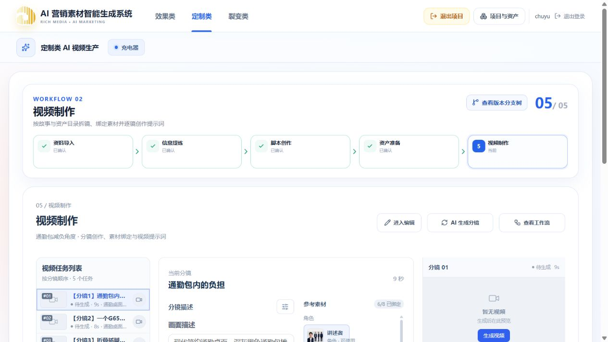

# 审校一致性与分镜质量付费复测

日期：2026-10-19。用户授权本机现有充电器项目真实火山方舟调用。仅测试文字分镜与片段Prompt，不生成图片、视频或TTS，不自动提交Git。

## 改动与范围

新任务冻结 `2026-10-19-capacity-clips.6`；保留旧任务版本。首审与复核沿用问题身份，改变定级必须明确记录原/新级别、证据及原因；未改范围保留原建议，不靠强制降级放过真实错误。复核聚焦实际改动和相邻衔接。纯时长与声音安排使用小补丁，镜头画面、身份与对象引用原样保留；真正结构问题仍可拆并。

增强主观看信息、实际摄影表达、连续持物/接线与释放、真实声音落点、产品未知结构边界。品牌图片不参与本次文字模型输入。保持原脚本、简报与目录，参考时长沿用脚本创作，不新增设置。

同时修复短暂API中断重投消息的重复确认，以及已付费候选的有界检查点持久化重试；租约和旧attempt隔离不放宽。

## 已完成的单点付费复核对照

针对历史失败任务 `309b5e0d-e96b-41f5-9cdf-52b9626f1f20`，保留同一修订前后候选及首审问题，用固定Pro模型重新执行局部复核。此项为独立模型回放，不是浏览器全链路测试。

- 原全量复核149.098秒；局部复核57.117秒，输入12,730、输出1,628，总14,358 Token。
- 只重新审阅6片段中的4片段及完整首审账本；容量问题解决，保留范围外同一WARNING身份，未出现新的硬升级。
- 结果0 ERROR、1 WARNING，无级别变更。单样本耗时对照不能代表P95或长期稳定性。

## 中间版本观察

`.4`浏览器任务 `5cc71545-9347-45af-8be6-e345a5e4eac8` 墙钟535.579秒，包含API中断、恢复等待以及未保存批次的重新调用，不作为纯性能对照。模型首审没有ERROR，但人工发现持物交代、未知收纳机构、端口左右顺序和声音落点问题，未将“模型通过”当作人工质量通过；据此继续实施`.5/.6`。模型响应合计64,412 Token，其中恢复前后同一未持久化批次响应均计入。新版已修复消息重复确认及有界持久化重试，不能反向声称这次中断零损耗。

## 浏览器新版完整复测

使用“充电器 / 通勤包减负角度”，原确认脚本revision 1、资产目录revision 10。任务 `c0a7cd1a-3152-4b6d-ac6d-66f92db27f2c` 在浏览器点击AI生成分镜与开始生成创建，冻结策略`.5`、Pro规划/审校与Turbo逐镜、REFERENCE 30秒。

`.5`完整任务438.476秒（7分18秒），5片段、10镜头、42秒，2个逐镜批次并行完成，无连接/供应商重试。首审发现2处ERROR：端口左右顺序与Logo居中位置，均与人工在审校返回前记录的观察一致。局部字段补丁只改3镜的相关事实措辞和引用，没有重写正常范围；复核沿用2个问题ID逐项解决，0 ERROR、0 WARNING、无级别升级。178字符口播和3处画面文字完整保留。6次主要调用合计78,717 Token，其中局部修订45.436秒、局部复核31.849秒；包含真实问题修复，不能与无返修样本直接比较全程提速百分比。此前同镜持物问题通过真实拆镜、合理镜间省略解决，未被再次误报。

不过，人工回看仍发现端口段将部分口播压在前段时间窗，首审只笼统以42秒全片/12秒片段判断容量。因此继续增加`.6`确定性的真实声音时间窗投影：代码直接展开准确原句、当前秒数和镜头归属给模型判断，避免让模型从字符索引与镜长自行重建；没有按固定字数速度写硬门槛。

`.6`浏览器发起期间碰到本地API热重载，页面挂在保存校验。确认没有创建新任务或产生该次模型调用；API与Web均已恢复200，但内置浏览器控制随后无法导航，已请求用户关闭后重开浏览器面板。新增完整复测仍待浏览器恢复，不预记通过。

## 工程检查

- Contracts分镜V2测试17项、Web工作台测试2项通过。
- API生产域与数据库集成9文件29项通过。
- 视频Worker pytest 44项，资产Worker 34项通过；两者共享运行时mypy 16文件通过。
- 脚本Worker回归403项通过，3项因Windows默认临时目录拒绝访问未启动；将相关两文件改用工作区唯一临时目录重跑5项全部通过。
- `pnpm typecheck`、`pnpm build`、相关TS ESLint、`git diff --check`通过。构建仍提示既有前端单bundle较大，本次未做独立拆包。
- 确认全项目无活动任务后重新构建并启动独立视频Worker；付费任务期间未更新API/契约或重启Worker。

## 新增声音容量专项核对（非浏览器）

`.6`独立付费审校回放首次返回了派生时间窗字段作为证据，结构校验拒绝采用。实际调用105.839秒，输入12,360、输出3,923，共16,283 Token；此项失败，不记为质量通过。诊断脚本未在校验前保存该次响应正文，无法保留具体问题结果，已修正为先保存候选。正式Worker的既有候选检查点流程始终在校验前落盘。

已给时间窗提供准确的CUE.parts、CUE.sourceRef和SHOT.durationSeconds证据，明确禁止用派生字段代替持久化字段，机械错误反馈列出具体对象、字段及合法字段。随后通过真实Provider与正式run_video完成局部审校—修订—复核回放：重用`.5`修订后计划作为固定测试样本，本地检查点保存候选；不写项目、不冒充新的浏览器任务。

该回放220.890秒，3次真实Pro调用，合计44,621 Token：首审93.366秒，局部修订31.551秒，局部复核95.898秒；没有机械纠错或供应商重试。新增1处片段摘要/首镜起始状态不一致的ERROR完成修正，复核沿用原问题ID解决，0 ERROR、1 WARNING、无级别升级。该WARNING准确指出人工先前关注的“给笔记本补电，用单个C口，最高65W；”被分配约2.3秒，建议在现有12秒内跨镜重排原话。按既定边界，WARNING不触发强制重写；这仍是文字风险提示，没有TTS实测，不能声称口播时长已精确合成验证。

回放还暴露了重复维护片段摘要的代价：仅为统一起始状态，模型返回了整段结构替换，导致正常镜头身份重建。已将新候选片段边界改为首末镜头的确定性投影，局部修订仅同步问题范围；受控测试验证不改镜头动作、不改变原句、来源和正常片段，也无需因此额外模型返修。该机械投影补丁在上述回放后实施，真实浏览器新生成仍待面板恢复，不把之前回放冒称为补丁后的完整联调。

## 此前未完成项（后续进展见下文）

- 最新`.6`的完整浏览器生成、明确保存和关键片段Prompt联调：浏览器控制连接无法导航，已请求用户重开面板。本地API与Web均为200，无活动任务。
- 当前项目保留`.5`生成草稿，未将本地回放结果写入项目；原已确认分镜与Prompt保持原提交边界。
- 1920/1440/窄屏的最后一轮完整回归未完成，已清除临时视口；已有本轮浏览器导演规划截图仅证明该阶段真实执行，不代表终态或全部尺寸通过。
- 未读取供应商账单或换算实际人民币费用。已知16次主响应合计218,391 Token，包括`.4`连接恢复前后的5次响应、同样本局部复核1次、`.5`完整6次、首次容量核对失败1次、局部流水线3次；结构拒绝的响应同样计入，不当作免费或成功结果。

## 浏览器恢复跟进

用户回复已重开面板后，再次读取原标签仍无法完成调试同步；同一浏览器新标签导航也超时，显式显示浏览器未恢复。仅发现内置浏览器和MCP Apps，没有可直接接管的Chrome/Edge。已请求关闭全部浏览器标签后重建localhost标签，未重复触发付费生成。API健康检查200，任务列表无活动任务，Docker运行时确认已加载片段边界投影与时间窗证据实现，原充电器草稿仍为已完成任务产物。此项为连接恢复失败记录，不记为最新版本浏览器验收通过。

## 浏览器恢复后的完整复测

用户再次提供连接失败截图后，直连API健康检查、Vite代理健康检查和Web首页均返回200。浏览器控制也恢复；通过登录页“重新连接”按钮恢复原会话与充电器项目，无需输入密码，没有修改登录配置。

随后在浏览器创建任务 `3e60e99d-965e-4098-b15a-8e77ba6d504f`，固定`.6`及V2。与`.5`样本的脚本、简报和准确上游来源完全相同，资产目录仍为8项。本轮执行期间不更新API/契约、不重启Worker，结果与保存仍在验证中。

该`.6`任务已完成：542.867秒，6个任务、12个内部镜头、48秒。首审2处ERROR（持物状态和未知端口顺序）及1处容量WARNING；修订25.511秒，复核42.036秒，复核七维结构不合法后进行一次有界机械纠错26.351秒。共7次响应、120,704 Token。此轮没有解决用户新提出的任务/分镜一一对应要求，不能作为当前UI验收通过。

## 一条任务对应一份完整分镜

用户进一步明确左侧任务与分镜一一对应。依据[新计划](../plans/2026-10-19-视频任务与分镜一一对应.md)，生成策略升级为`.7`；一条任务只维护一份完整画面描述、氛围、时长、素材与Prompt。生成及修订均要求一个clip恰好一个shot，Worker与API完成校验拒绝嵌套子镜头。旧任务只读合并呈现，编辑时才合并当前任务并准确平移声音落点，不自动修改历史确认版本。

已移除内部镜头列表、内部添加/删除/排序与片段编排；顶栏添加分镜创建独立任务。共享参考素材库、进度条、工作流详情及逐镜渲染入口保留。完成Contracts 19项、Web 3项、API含数据库9文件30项、视频Worker46项、mypy16文件、`pnpm typecheck`、`pnpm build`与`git diff --check`。前端构建仍有既有单bundle大小提示。

浏览器在1920、1440、390宽度检查：每个当前任务只有一个画面描述字段，没有子镜头入口，页面无横向溢出。历史双镜内容合并完整保留。`.7`真实任务`de409193-535f-4c58-875f-4b47fef36ddb`已由浏览器发起，上游仍为脚本revision1、资产revision10和原简报；最终质量与耗时待任务结束后记录，不将运行中状态记为通过。

该`.7`任务已完整完成：330.428秒（5分30秒），5条视频任务、5份完整分镜、44秒；178字符口播与3句画面文字完整保留，各任务6至14秒。2个创作批次并行，72.595秒与78.714秒。首审87.416秒，与人工独立观察一致地指出端口左右/上下位置无事实依据；局部修订14.422秒只改该分镜，独立局部复核28.096秒沿用同一问题身份确认解决，0 ERROR、0 WARNING、无定级变化、无机械纠错或供应商重试。6次响应合计71,359 Token。相同上游的`.6`为542.867秒和120,704 Token；这仅为两次样本观察，不作为其他时长/产品的性能保证。

人工复查另外将对比段“掂起旧充电器”之后的放回桌面写清，避免含混的持物状态；通过浏览器修改完整描述并保存，不冒称该人工补充属于AI返修。浏览器测试还发现两处交互问题并修复：编辑模式本身阻止加载已完成结果（现在只保护实际未保存修改）；编辑描述时内部镜头标题会覆盖任务名（现在以显示任务名为准）。补充真实组件轮询恢复和未保存编辑保护测试，Web制作目录6文件27项通过；Contracts新增标题保护后共20项相关测试。

已在原项目明确保存5份一一对应分镜；关键“单C口65W”分镜的真实Prompt任务`cf6b6ff7-930b-4048-9bfa-c5c494eddb5e`由浏览器发起，正在检查自动提交与刷新。没有执行图片、视频或配音渲染，声音时长仍为文本估算。导演摘要误写“两段画面文字”，但实际结构与后续审校均完整保留3句；该摘要计数瑕疵单独记录，不能据摘要判断原文覆盖。

该Prompt任务已完成并自动提交：58.285秒，2次响应、13,680 Token，审校0问题，无返修。明确消费当前14秒端口分镜和5项实际资产，口播功率边界及屏显完整，没有虚构充电进度、端口布局或全设备65W能力。人工将提示词标题中的技术别名及字段标签改为可读分镜名，保存成功；该标题格式是模型输出的展示瑕疵，本次人工清理不代表未来模型输出已保证不会再出现技术别名。

持久化复查：`customized-video-plan` revision3，准确为5任务、5分镜、44秒，全部一一对应；当前端口Prompt revision2、目标仍为原端口任务。保存提示词后当前任务保持选中；终态刷新改为静默刷新，避免卸载工作台造成跳回第一条。轮询组件测试同时验证真实未保存修改仍保留，不能为更新结果覆盖人工草稿。最后一轮Web 27项、Contracts相关20项、API含数据库30项、视频Worker46项及资产Worker34项通过；类型、构建与格式检查通过，构建保留既有bundle大小提示。浏览器临时视口已清除，当前无活动测试任务。

## 当前节点待更新误报修正

使用者指出画布视频制作显示待更新。只读核查确认：当前制作计划revision3和当前端口Prompt revision2均为CURRENT，唯一STALE来自被替换的旧版端口Prompt，其来源是已移除任务的旧revision。原分支树对同节点全部历史工作副本汇总，误把该残留算入当前状态；没有因此创建局部更新或付费任务。

已改为按该Run已确认V2制作计划的当前任务、分镜及对应Prompt汇总，旧任务、移除标记和旧Prompt仍保留历史但不影响当前画布；真正当前Prompt过期仍保留待更新。旧版/不合法计划采用保守原逻辑，不跨Run推断当前集合，缓存投影键增加作用域版本。当前制作计划与Prompt revision不变，不清除数据库历史新鲜度。

新增6项覆盖旧提示词残留、移除标记、当前真实STALE、兄弟Run隔离、旧版和不合法计划；连同工作副本服务回归共68项通过，API类型检查、生产构建、ESLint及diff检查通过。实际充电器页面已恢复“当前”，不再被历史Prompt标黄；此次没有模型调用或费用。

