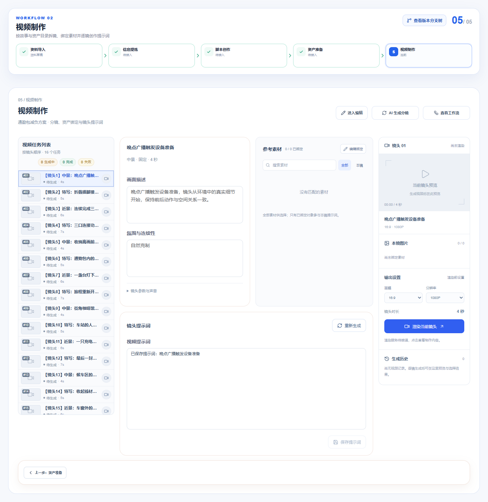

# 火宝式镜头任务列表验收 · 2026-10-19

按使用者最新补充，采用[火宝官方源码](https://github.com/chatfire-AI/huobao-drama/blob/master/frontend/app/views/drama/episode.vue) video-task-table 的信息顺序与紧凑行结构，替换为本系统浅色及蓝色选中态。未复制上游代码或图片。范围及边界见[计划](../plans/2026-10-19-紧凑镜头任务列表.md)。

列表只保留视频任务标题、任务数、生成中/完成/失败统计、预览与序号、摘要、时长/场景及视频按钮。移除提示词进度、额外空态插画、列表底部添加区。原手动添加入口移至页面进入编辑后的操作区。右侧按钮复用已有制作弹窗，不创建模型任务。

当前契约没有视频任务或成片结果，所有镜头显示待生成，视频统计为0，缩略图为占位；不以提示词或产品图伪造视频状态。API/Worker、工作副本、提交与 revision 不变。

## 检查

- `pnpm --filter @ai-marketing/web test src/workflows/customized/production`：4文件、14项通过，包含列表层级、空列表、顺序、未生成视频与锁定状态。
- `pnpm --filter @ai-marketing/web test src/workflows/customized`：17文件、121项通过。
- `pnpm --filter @ai-marketing/web build`：通过，包含 vue-tsc；仍有既有主包超过500kB提示。
- 格式与 `git diff --check` 无空白问题。
- 浏览器：1920 / 1440 / 430，每次16条、无页面横向溢出；状态徽章筛选/还原保留编号；鼠标与键盘选择联动编辑区；打开第四镜制作面板显示第四镜实际提示词。
- 模拟409保存失败时，打开第五镜制作被阻止：仍选第四镜，本地未保存文字保留，无制作弹窗。空列表没有额外插画和添加区。浏览器无pageerror。

## 验证边界

受控页面使用正式 Canvas / Workspace / Directory 组件与隔离的16镜头夹具，未登录或修改真实项目，未调用付费模型、未生成视频。Playwright MCP 专用浏览器的配置目录被占用，未结束占用者；改用现有 Playwright 包启动独立无用户资料的临时浏览器，测试结束后关闭。临时受控HTML验收后移除。

## 截图

- [1920](browser/2026-10-19-shot-directory/workspace-1920.png)
- [430](browser/2026-10-19-shot-directory/workspace-430.png)
- [空列表](browser/2026-10-19-shot-directory/empty-1440.png)
