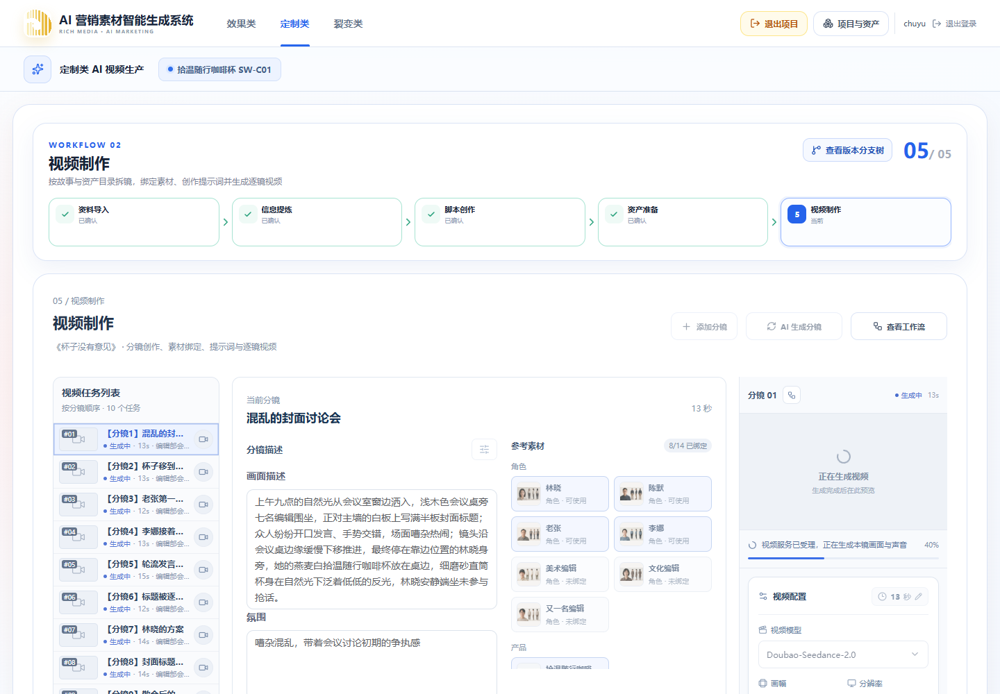
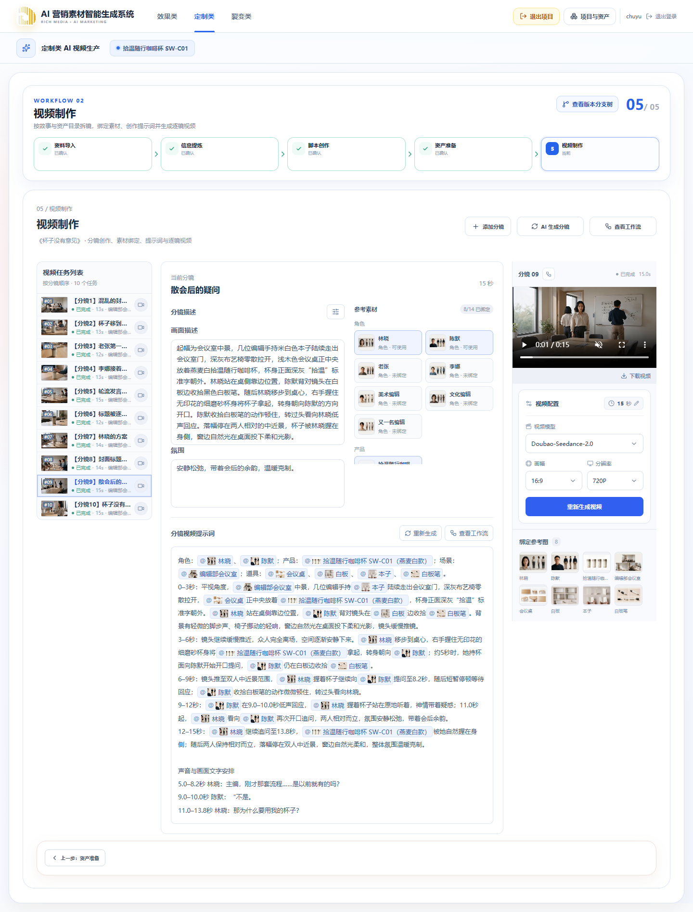
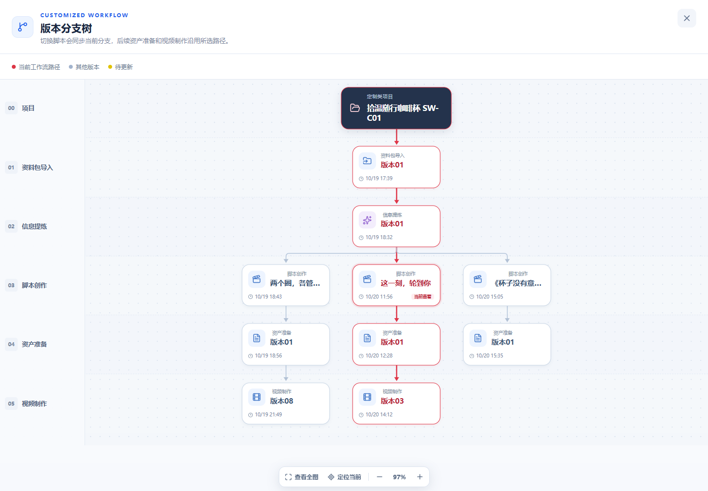
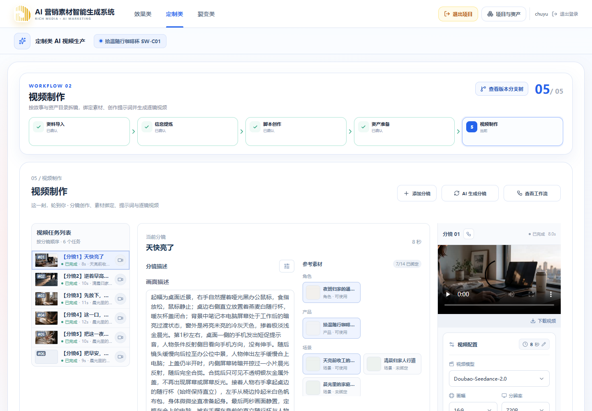

# 咖啡杯短剧真实付费测试

## 范围与验收口径

- 项目：拾温随行咖啡杯 SW-C01。
- 从脚本生成节点创建剧情短片《杯子没有意见》，不是导入脚本；生成设置为 60 秒、单份方案。
- 用户澄清：60 秒是脚本生成设置，并非最终视频的固定总时长。后续采用参考时长，保留完整脚本。
- 视频使用 Seedance 2.0、16:9、720p。验收任务成功、当前产物有效、文件可播放；不因画面或对白质量反复修改和重新渲染。
- 本轮通过正式业务 API 执行真实付费链路。集成浏览器通道不可用后，使用独立 Chrome 无头环境完成线上页面点击回归，不占用已有浏览器会话。

## 已完成的修复与部署

1. 脚本选择同步激活对应版本路径，下游导航保持该路径，版本树只高亮当前路径。组件测试与线上 API 的 12 项切换检查通过，业务 revision 和分支数未因导航增加。见[分支联动验收](2026-10-20-脚本选择分支联动验收.md)。
2. 资产审校返回了目录之外的对象 ID。修复为限定实际目录 ID、保存原始审校检查点并允许一次定位修正，失败恢复不重复已成功步骤。
3. 默认生图输入漏掉结构化发型、服装和视图定义。已补齐共用默认提示词及 Worker 兼容路径，显式编辑提示词保持原样。见[结构化输入验收](2026-10-20-资产生图结构化输入验收.md)。
4. 原先 Run 级任务互斥和串行消费阻止不同分镜同时生成。改为不同分镜的提示词、视频任务可并行，同一分镜仍互斥，整份分镜规划仍受保护；前端同时轮询全部活动任务，只锁住正在执行的分镜。见[逐镜并行计划](../plans/2026-10-20-逐镜提示词与视频并行.md)。

以上先修改本地，再部署。逐镜并行版本为 `20261020-e52b9197-qa653dfe9d`，源码快照 `653dfe9d1a7fc3fbd34f513a99944809f113a350b9e648bec7a23cd6d5672dc3`，于 09:16:37 UTC 完成切换。

完整 `pnpm check` 通过：Contracts 343 项、Web 1986 项、UI 17 项、API 1877 项。API 另有 88 项按环境跳过，不能记作已执行通过。资产 Worker 53 项、视频 Worker 135 项、Worker 类型检查和独立数据库并发集成测试通过。Lint 仍有 30 条警告、无错误；构建存在体积提醒。

部署前后确认无活动任务再切换；HTTPS 健康、登录与退出、未登录访问拦截、6 个静态资源及部署业务数据一致性检查通过。

## 执行记录

时间为服务端 UTC，耗时包含排队与模型调用；发生人工排障的任务另行说明。

| 环节                | 结果                                                              | 耗时                            |
| ------------------- | ----------------------------------------------------------------- | ------------------------------- |
| 脚本生成            | 生成并提交单份 AI 脚本                                            | 4 分 18 秒                      |
| 资产整理            | 14 个对象；审校引用修复后沿原任务完成                             | 28 分 45 秒，包含排障与部署等待 |
| 首批资产生图        | 发现输入缺字段，取消后保留 3 张结果                               | 3 分 37 秒                      |
| 修正后前 3 张资产图 | 完成                                                              | 3 分 34 秒                      |
| 剩余 11 张资产图    | 完成                                                              | 11 分 8 秒                      |
| 首次分镜规划        | 测试执行误设固定 60 秒；系统估算完整内容约需 136 秒并正确阻止提交 | 任务终态失败，未触发视频渲染    |
| 参考时长分镜规划    | 完成并确认 10 镜，计划总时长 136 秒                               | 15 分 59 秒                     |
| 并行生成与渲染阶段  | 补齐第 9、10 镜提示词并完成全部 10 个视频                         | 18 分 29 秒                     |

首次分镜的固定时长是本次测试设置错误，不是通过放宽服务端校验修复的产品 Bug。原脚本与资产未因此重做。

第 3 镜提示词审校因开口时间与已确认声音时间点不一致而失败。沿用任务已修正的正文，仅明确 2.5 秒开始发言、后续继续发言，通过正常人工保存接口提交；原 AI 任务保留失败记录，没有伪装成自动审校通过，也没有重新生成脚本或分镜。

09:19:51 UTC 启动并行阶段：第 9、10 镜提示词任务与第 1、2 镜视频任务同时处于运行态，其余已有提示词的镜头直接进入视频队列。Worker 同时处理最多 4 个任务；每镜提示词保存成功后即可提交该镜视频，无需等待整批提示词完成。

### 逐镜耗时

下表使用服务端任务创建至最终状态的耗时，**包含排队**，不能当作供应商纯渲染耗时。提示词前 8 镜在并行修复部署之前执行，后 2 镜与视频同时执行。并行阶段整体为 09:19:51 至 09:38:21 UTC。

| 镜头 | 内容             |      提示词任务耗时（秒） | 视频任务耗时（秒，含排队） | 视频文件时长（秒） |
| ---- | ---------------- | ------------------------: | -------------------------: | -----------------: |
| 01   | 混乱的封面讨论会 |                      46.7 |                      407.0 |             13.088 |
| 02   | 杯子移到桌心     |                     126.7 |                      297.0 |             13.088 |
| 03   | 老张第一次开盖   | 257.7，失败后人工保存修正 |                      628.2 |             12.096 |
| 04   | 李娜接着发言     |                     181.3 |                      571.2 |             13.088 |
| 05   | 轮流发言的仪式   |                     108.7 |                      647.4 |             15.104 |
| 06   | 标题被逐个划掉   |                      60.1 |                      781.4 |             12.096 |
| 07   | 林晓的方案       |                     194.6 |                      804.2 |             14.080 |
| 08   | 封面标题定稿     |                     236.3 |                      863.1 |             14.080 |
| 09   | 散会后的疑问     |                     370.5 |                      736.7 |             15.104 |
| 10   | 杯子没有意见     |                     309.7 |                      567.7 |             15.104 |

### 最终视频验收

- 10 个视频任务全部 `COMPLETED`，每个任务 `attemptCount = 1`；没有重复视频生成、失败重试或画面质量返修。
- 10 份当前提示词与视频工作副本均有效、未待更新；视频 revision 均为 1，实际任务模型全部为 `SEEDANCE_2_0`。
- 10 个文件全部为 1280 × 720、H.264 视频及 AAC 音频；文件时长合计 136.928 秒。交付为系统内 10 条分镜视频，本轮未额外拼接为单个长片。
- 每个文件的 HTTP Range 均返回 206；全部下载后通过 `ffprobe` 与 FFmpeg 完整解码检查。
- 浏览器逐一选择全部 10 镜并实际播放，播放时间前进、无媒体错误；页面无 JavaScript 异常。

## 隔离与验证边界

本轮生成新脚本和资产分支后，对比项目内两个既有脚本路径的基线：脚本、来源、草稿、确认内容、revision、提示词、视频与渲染参数均未改变。

浏览器在 1440 × 1000 下实际点击项目资产库进入咖啡杯项目，依次切换“这一刻，轮到你”“两个圈，各管各的事”及新短剧。版本树分别只高亮所选脚本及其路径；从脚本进入资产、视频，刷新后仍保持对应路径。最终恢复新短剧的视频节点，页面显示实际分镜任务进度。没有页面异常，也未因导航创建任何生成任务。

全部视频完成后，再次对比两个旧脚本路径，业务内容保持不变。最终验收覆盖任务状态、持久化产物、下载和播放；按用户要求未进行逐字对白、动作或画面质量复审，也未为这些质量项再次付费渲染。
