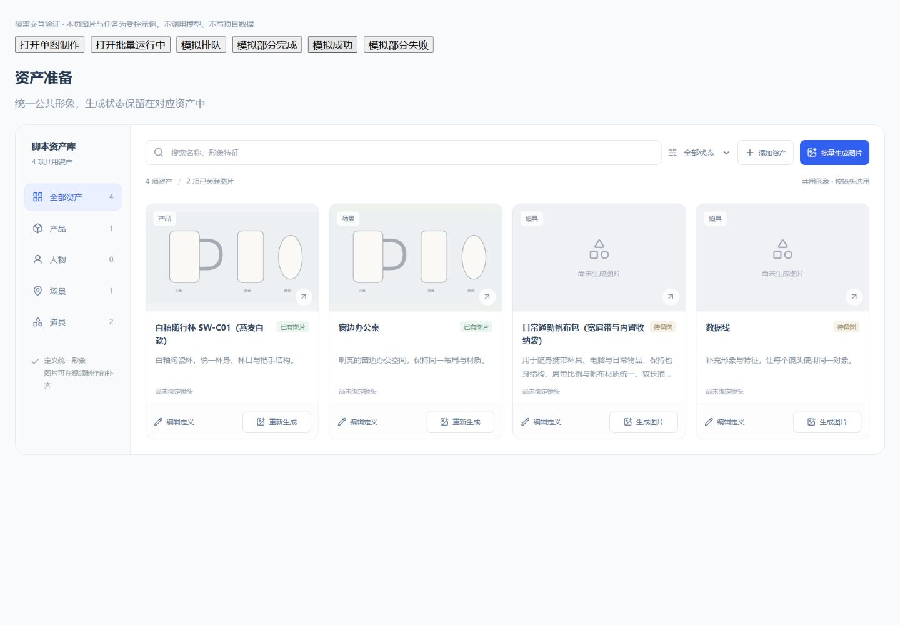

# 资产卡片对齐验收（2026-10-20）

范围：定制类资产准备节点 `ProductionAssetStudio.vue` 的卡片布局。沿用当前脚本及资产目录，不调整来源、草稿、确认、revision、任务或下游引用。

标题预留两行并截断超长内容，完整名称可通过悬停查看；描述统一两行高度，使用镜头信息统一行高；卡片采用纵向布局，底部操作区和按钮宽度统一。

浏览器使用 `tests/browser/asset-image-activity.html` 隔离页面，直接加载正式资产卡片组件。测试资料包括长短名称、长短及空描述、已有图与缺图、部分生成中的状态；图片为本地 SVG 示例，无项目写入或模型调用。并非真实项目或新生图质量验收。

- 1440 和 1920 宽度：同排卡片高度、使用信息、底部分隔线及按钮纵向位置一致；各卡片生成按钮宽度均为 110px。
- 480 宽度：单列卡片高度及操作区相对位置一致，页面可见宽度与内容宽度均为 465px，无横向溢出。
- 生成中状态不改变标题区及底部操作区高度。

检查通过：相关 Web 单测 2 个文件 / 14 项、Web 类型检查、Web 构建、相关文件 Prettier 检查、`git diff --check`。构建保留既有大包体提示。

