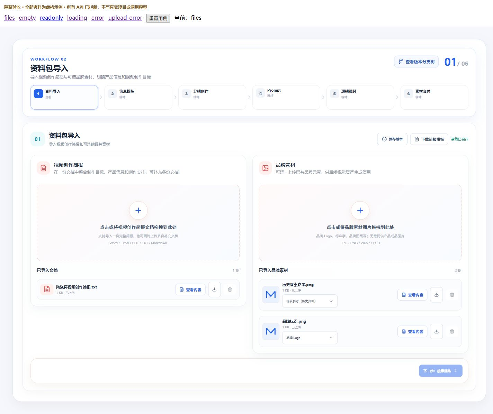

# 品牌素材导入验收 · 2026-10-09

## 变更与边界

定制类 SOURCE_IMPORT 保留视频创作简报和图片的两区布局，图片区改为可选品牌素材。新增 Logo、标准字、品牌图案、品牌 IP、包装平面图用途；新图片不自动猜测用途。保留历史产品、人物、场景、风格及其他用途、固定文件版本和内部 VISUAL_REFERENCE/schemaVersion 3。Word 模板与填写示例继续两部分、12 项，产品外观示例说明固定特征与允许 AI 设计的部分。

浏览器错误用例发现加载异常时中止请求导致 loading 未清除，页面一直显示加载；已修复为显示失败与重新加载按钮，重复失败后仍可重试。

产品资产基础形象确认、脚本所需视角与逐镜绑定仅记录后续设计，本轮没有新增模型任务或生成服务。

## 实际执行

- Contracts：`pnpm --filter @ai-marketing/contracts build` 通过；`pnpm --filter @ai-marketing/contracts exec vitest run src/customized-import.spec.ts`，17 项通过。覆盖五种新用途与五种历史用途的恢复、规范化、校验及固定文件版本；仅图片不能代替简报。
- Web：`pnpm --filter @ai-marketing/web exec vitest run src/workflows/customized --maxWorkers=1`，4 文件、34 项通过；`pnpm --filter @ai-marketing/web build` 通过类型检查与生产构建，仍有既有大于 500 kB 分包提示。
- API：`pnpm --filter @ai-marketing/api exec vitest run src/workflows/customized src/platform/workflow/workflow-working.service.spec.ts src/platform/workflow/workflow-working.repository.spec.ts --maxWorkers=1`，3 文件、74 项通过；`pnpm --filter @ai-marketing/api typecheck` 通过。
- 真实隔离接口：设置 `CUSTOMIZED_CACHE_DATABASE_TEST=1` 后运行 `pnpm --filter @ai-marketing/api exec vitest run src/platform/cache/customized-cache.http.spec.ts --maxWorkers=1`，1 项通过。使用独立 Nest 进程、真实 PostgreSQL、Redis 与本地存储，随机项目在 finally 清理；不触发模型。上传图片后确认历史场景用途与五种品牌用途，分别确认版本并重复读取缓存，同内容保存不增节点 revision，原历史分支固定文件版本与用途保持不变。
- Word：执行现有 Python 构建脚本，使用文档技能 render_docx.py 在临时 LibreOffice 容器渲染；模板与示例各两页，全部四页逐页查看，无截断、重叠或乱码。

## 浏览器观察

正式页面使用现有本地服务，仅导航与读取，不向用户项目上传或保存资料。1920、1440、390 宽度下无页面横向溢出；桌面两区并排，手机纵向排列。

- [正式页面 1440](2026-10-09-brand-materials-1440.jpg)
- [正式页面 1920](2026-10-09-brand-materials-1920.jpg)
- [正式页面 390](2026-10-09-brand-materials-390.jpg)

有文件和异常状态使用 ignored 临时验收页，挂载正式 Vue 导入组件，明确标注虚构资料并拦截所有 API；下列观察属于前端交互验收，不作为真实 API 持久化证据：

- 品牌图片只显示未指定及五种品牌用途；历史场景用途只作为当前图片保留项显示。用途修改自动保存后刷新恢复，另一张历史图片仍为场景用途。
- 移除所有图片后，只保留简报仍可保存版本并进入只读状态；进入编辑、上传新图后选择用途，再取消编辑并确认放弃，恢复原已确认资料。
- 上传首次失败，成功项保留且失败项可重试；重试后显示已上传，新图默认未指定用途。
- 空白页禁用下一步；已确认资料禁用上传、删除和用途编辑，提供进入编辑与可用下一步；加载中显示共用居中加载组件。加载失败显示重新加载，重复失败仍保留重试入口。
- 图片内容预览可打开和关闭；隔离页的原文件内容端点没有提供图片二进制，预览显示可重试错误。未把此用例视为真实图片预览成功。
- 有文件状态下 1440、1920、390 均无页面横向溢出。

[390 排版](2026-10-09-brand-materials-populated-390-fixture.jpg) · [1920 排版](2026-10-09-brand-materials-populated-1920-fixture.jpg) · [用途菜单](2026-10-09-brand-materials-options-fixture.jpg)

## 未验证范围

没有执行真实付费生成、产品资产质量评估或后续节点端到端生产。更新了 verify-customized-source-import.mjs 的五用途循环，但未对用户正在使用的 API 再执行该脚本；真实 round-trip 由上述独立进程集成测试验证。未重启主 API 或 Worker，未提交 Git。
