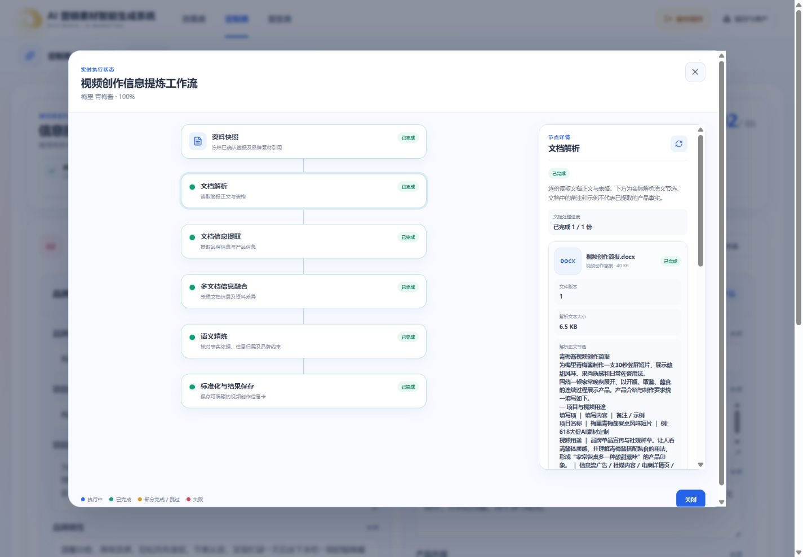

# 2026-10-10 定制类提炼节点详情验证

作用域：本机正式页面，既有“青梅酱”项目的完成任务；本次未重新调用模型，也未提交业务版本。

- 六个阶段依次选中，核对固定资料包版本、逐文件解析正文、12 项提取信息、4 条独立卖点、文档版本及位置、融合和精炼结果、最终草稿说明。
- 当前任务解析产物为 6.5 KB；页面正文来自该任务已保存文件，并明确为原文节选，包含文档原有备注，不冒充产品事实提取结果。
- 验证详情刷新、ESC 关闭与焦点返回“查看工作流”。
- 回归效果类既有“广式腊肠”任务，三路并行执行图和文档详情仍能正常查看。
- 1920、1440、390 宽度下，标题说明均为完整单行，`overflow-x: visible` 且 `scrollWidth === clientWidth`，没有标题横向滚动条。
- 运行中、未执行阶段、部分失败、正文不可读、差异候选、来源版本不匹配通过单元测试验证，本次未为浏览器回归创建新的失败或付费任务。

检查：API 定制详情、Service 及效果类详情共 36 项单测通过；前端两类提炼及共享编辑动作共 57 项单测通过。Web `vite build`、本次文件 Prettier 及 `git diff --check` 通过。API `typecheck` 早前检查通过；结束复查时，工作区包装测试 `effect-packaging.domain.spec.ts:176` 出现依赖字段缺失（`sourceNodeId/sourceKey/sourceHash`）而未通过。

API 生产源码类型检查 `pnpm --filter @ai-marketing/api exec tsc -p tsconfig.build.json --noEmit` 通过。

完整构建限制：Web `build` 的类型检查被工作区既有 `EffectTemplateMixNodePage.vue:2225` 的 `TemplateUi | undefined` 赋值错误阻挡；API `build` 两次均因 `dist/config` 目录占用返回 EBUSY。未为此终止其他进程或覆盖其他任务改动。开发 API 通过 `dist-dev` 热更新，浏览器已实际返回新增详情。
