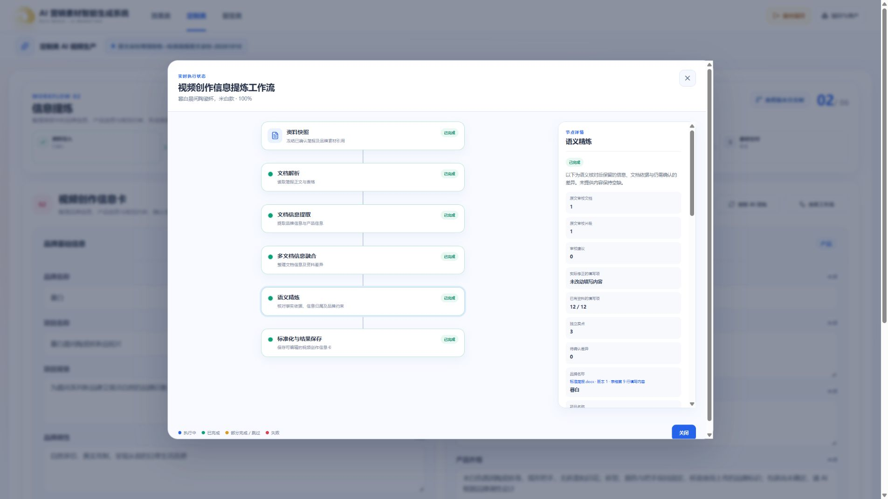

# 2026-10-10 定制类信息提炼增强验收

范围：CUSTOMIZED / INFORMATION_EXTRACTION，输入仍消费已确认资料包的固定版本。用户授权真实付费验证；资料均为虚构样本，不代表实际产品声明。AI 结果只保存待确认草稿，未修改模板的两组 12 字段，也未分析品牌图片。

## 实现

- 自由文档分片提取后，模型按平衡归并整理事实与冲突，不机械拼接业务字段。
- 标准模板和自由文档都执行独立原文审校。模型对照原文、文档候选和融合候选检查全部 12 字段。
- 审校建议及已有冲突涉及的字段，独立重新读取全部原文片段，收集支持事实；修正模型判断建议是否误报，保留跨段落的互补信息。
- 原文提供稳定编号，模型选择证据编号，由系统回填固定版本、位置和逐字引文。编号、来源、全字段覆盖和卖点索引由代码校验；语义判断仍由模型负责。
- 最终复核要求已有差异逐项以原 ID 返回处理决定，遗漏最多纠正一次，持续遗漏不能完成。仍成立的冲突再独立划分共同属性和互斥选项，由代码将共同属性组装进每个完整候选；最终复核新发现的冲突字段也补充原文依据。确认版本仍由用户触发。
- 同任务失败恢复保留成功的解析、提取与逐文档审校检查点；主动重提创建新任务。共享详情组件展示真实审校数量、建议、原文证据及实际修改字段。

## 真实测试中发现并修复的问题

1. 跨片段审校把“真实自然”和“克制、轻盈”误判为相互排斥，修正后漏掉后两项。补充独立全原文依据收集，禁止仅凭某条引文未提及就删除其他事实。
2. 净含量 200g / 250g 冲突的某个候选漏掉共同保质期。已有冲突也进入原文依据收集，最终复核必须逐项返回完整字段候选。完整复测仍观察到通用复核偶发漏项，因此补充独立的共同属性/互斥属性结构化划分，代码只负责共同事实在每个候选中的格式化，不用关键词判断语义。
3. 模型转述引文造成严格校验失败。模型改为选择原文编号，系统回填引用；保持来源校验，不放宽成相似文本匹配。

## 验证范围

隔离样本见[素材说明](../../../../../素材/定制类项目素材/原文审校验收/说明.txt)：标准 Word 简报、两片长文、多表 Excel、三份相互补充且净含量冲突的文档。cases.json 与 ledger.json 仅保存在本机并被忽略；台账记录已有任务及重试，不删除后重复触发。

针对性付费探针：

| 探针                                   | 实际观察                                     | 时长                      |
| -------------------------------------- | -------------------------------------------- | ------------------------- |
| 首轮故意遗漏净含量、保质期及防拆封卖点 | 独立审校发现问题并修复，未改动品牌和产品名称 | 148.63 秒（初次引文实现） |
| 故意错误的审校建议只保留一种品牌调性   | 独立重读 4 片原文后保留真实自然、克制、轻盈  | 84.63 秒（初次引文实现）  |
| 故意不完整的规格冲突候选               | 200g 与 250g 两项候选都保留保质期 12 个月    | 53.45 秒（初次引文实现）  |

最终编号引用及独立候选补全实现的冲突探针通过：耗时 102.28 秒，两项候选均包含保质期 12 个月，保留原冲突 ID 和阻断状态。

最终编号引用实现的遗漏探针通过：检查全部 12 字段，发现 3 条建议，恢复规格、保质期和防拆封卖点，保留未涉及的品牌及产品名称，耗时 212.42 秒。上述探针含受控错误输入与真实模型调用，不冒充完整 API、版本和前端验收。

端到端观察（耗时为 Worker 阶段总和，排队与人工修复等待不计入）：

| 样本           | 真实任务与结果                                                                                                             | 处理时间                                                                             |
| -------------- | -------------------------------------------------------------------------------------------------------------------------- | ------------------------------------------------------------------------------------ |
| 标准 Word 简报 | `2460fdf3-9fa3-419f-9c6b-20dd93999f08` 完成；12 字段、3 卖点、来源合法、AI 未确认版本                                      | 343.39 秒，含供应商请求重试；采用原有逐字引用实现                                    |
| 多表 Excel     | `d3d69c7b-a462-43cd-b70d-5369ea6419c2` 完成；三条独立卖点、规格及 ABS/PET 外观保留，未泄漏模板示例                         | 86.11 秒；采用原有逐字引用实现                                                       |
| 两片长文       | `82d1db89-9ce7-4d07-9ad9-59f50ac54ede` 恢复后完成；保留真实自然、克制、轻盈及 18L、620g、三条卖点，来源合法、AI 未确认版本 | 最终恢复约 219.61 秒；此前引用校验失败的处理加总约 570.80 秒，不作为一次成功性能指标 |

三文档最终任务 `29c6c0bd-39f0-43a1-ba9c-58f0257cf6c7` 完成并通过断言，阶段合计 461.74 秒：提取 39.76 秒、融合 175.46 秒、语义审校/依据收集/复核/候选补全 244.65 秒。两个候选分别为“净含量250g/瓶；保质期12个月”和“净含量200g/瓶；保质期12个月”（实际结果包含产品名）。未处理冲突时确认 API 返回 400，没有提交版本。

根目录设置既有付费验收开关与素材目录后执行 `node apps/api/scripts/verify-customized-extraction-deep-paid.mjs --assert`：四组既有任务全部通过，包含固定来源版本、未确认草稿、长文品牌调性、多表卖点及冲突候选共同事实校验。该命令查询现有任务，不触发重提炼；冲突确认探针被服务端阻断。

此前 `0e0f253d-045f-439d-9d6e-d12aa5259f73` 与 `604f2b0d-d387-4494-b3ee-422c63732c1c` 虽任务状态为完成，但共同保质期断言失败，未作为质量通过结果。不能把任务完成状态等同于语义验收通过。

长文的成功解析、分片提取、融合及逐文档审校均被复用；恢复日志中四个既有阶段各不足 30 毫秒，后续原文依据收集、修正与最终复核执行真实模型。此前丢失品牌调性的旧结果未被当作通过样本。

## 自动检查与浏览器

- `workers/customized-extraction`：`uv run --frozen pytest`：58 项通过；`uv run --frozen mypy src tests`：17 个源文件通过。
- API 详情与服务相关测试：23 项通过；Contracts 测试 165 项通过；Web 相关测试 23 项通过。
- 根目录 `pnpm typecheck` 通过；Web 独立生产构建通过。全量 `pnpm build` 曾因现有 API 的 `dist/config` 被占用（EBUSY）失败，未用覆盖或停服规避。
- 效果类 Worker 的 Provider / 文档事实测试：26 项通过；未触发效果类付费任务。
- Worker 镜像构建通过；仅在定制提炼无排队或运行任务时更新独立容器。
- 1440、1920 与 780 宽度检查共享查看工作流及真实详情，页面无水平溢出；未重做所有历史版本场景。
- `git diff --check` 通过。未自动提交 Git。

1440 证据：[查看截图](2026-10-10-extraction-raw-audit-1440.png)。运行中真实阶段与耗时日志仅保留安全元数据：[初次推理配置](2026-10-10-extraction-raw-audit-baseline-metrics.txt)、[分级推理配置](2026-10-10-extraction-raw-audit-profile-metrics.txt)、[引文问题恢复前](2026-10-10-extraction-raw-audit-context-metrics.txt)、[编号引用恢复与通用复核](2026-10-10-extraction-raw-audit-final-metrics.txt)、[独立候选补全最终验收](2026-10-10-extraction-raw-audit-choice-metrics.txt)。

测试仅覆盖本次样本。模型语义判断仍可能出错，不能用调用次数、推理耗时或样本数量证明普遍质量；长文、冲突和供应商重试会增加耗时。
