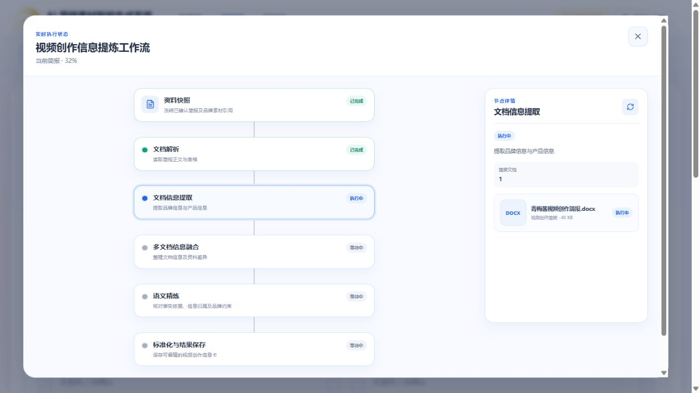
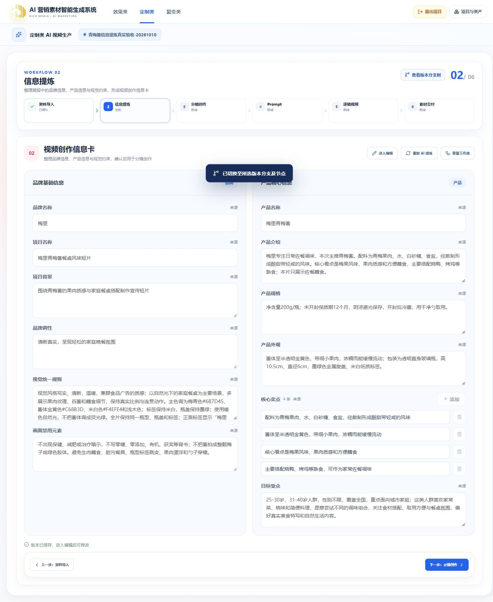
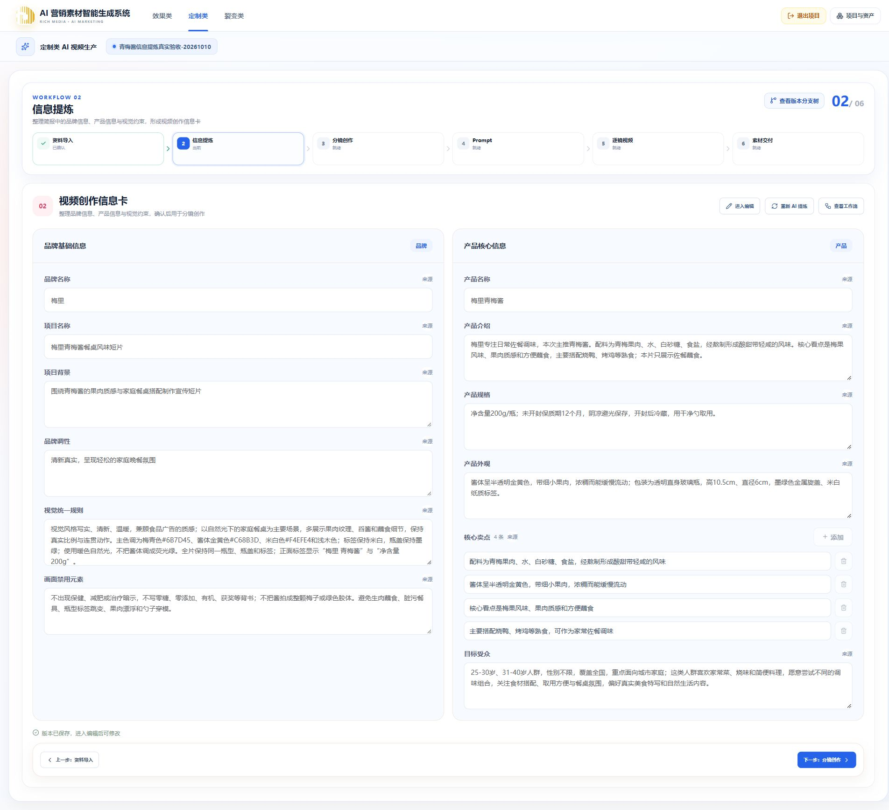
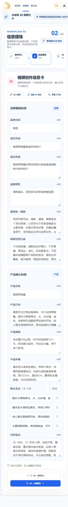

# 定制类信息提炼真实付费验收 · 2026-10-10

用户授权“自行真实付费测试，有 Bug 则修复”。本次只调用信息提炼，未触发分镜、Prompt、图片或视频生成。样本为仓库中虚构品牌的青梅酱简报、当前陶瓷杯 Word 填写示例和隔离项目中的规格补充文本，不代表真实商品认证或功效。

## 真实执行与修复

调用实际 API、Outbox、RabbitMQ、独立定制 Worker、共享 Docling 和 Ark Responses，模型为 `doubao-seed-2-1-pro-260628`。共创建 8 个真实任务，均达到服务端 `COMPLETED / 100 / NORMALIZATION`；早期任务虽在执行上完成，但存在下述内容问题，修复后另建任务复验，没有将它们当作质量通过。

| 问题              | 实际观察                                                            | 修复与复验                                                                                                                     |
| ----------------- | ------------------------------------------------------------------- | ------------------------------------------------------------------------------------------------------------------------------ |
| 旧模板漏提        | 青梅酱旧 Word 只得到项目名称，产品与卖点为空                        | 不能仅凭“填写项 / 填写内容”表头认定新版模板；已填写旧字段排除示例后送 AI 映射。重新提取到 12 项信息及独立卖点、固定文档来源    |
| 字段归属不清      | 时长、分段节奏进入视觉统一规则                                      | 提示词明确品牌调性、视觉规则、产品规格的边界；复验视觉规则保留颜色、光影、外观一致性，无 30 秒、9:16 或分段时长                |
| Word 卖点换行丢失 | 当前陶瓷杯示例三条卖点被 Docling 合成一条                           | 在定制适配层恢复原始 OOXML 显式换行，唯一文本匹配，不作语义猜分；真实重跑得到三条卖点和 0、1、2 来源索引                       |
| 新结果无法保存    | 来源更新后已完成新提炼，但旧正式工作副本的 STALE 使页面继续禁用保存 | 草稿新鲜度按其消费的资料指纹判断；确认前旧正式产物仍保持 STALE。缓存使用新投影版本，避免沿用旧判断；浏览器已处理冲突并成功保存 |

## 任务记录

主验收项目 `31310928-2236-4176-be55-ad965f8ce2e7`，项目名称“青梅酱信息提炼真实验收-20261010”（创建于 09:13）。最终 Run `051218e5-dac3-4413-bbd5-ed55ef4c0c9b`，已确认第三版资料包及相应信息卡。为便于复查保留验收项目。

| 任务 ID                                | 验证内容                                               |
| -------------------------------------- | ------------------------------------------------------ |
| `9a194bcc-ef0f-4727-950f-139ca5593f2c` | 旧模板漏提复现                                         |
| `31b430f2-818c-41ec-a5df-f68adcabecb3` | 旧模板映射修复；观察到字段归属问题                     |
| `4655c66f-d5ff-4cb0-88aa-67297843579e` | 字段边界修复后重新提炼                                 |
| `5d9be1f3-0ffc-40bd-8633-a526f4ba543b` | 当前 Word 示例复现卖点换行丢失                         |
| `94c98ced-eecf-4a0c-831e-3dbaf7c9a265` | 同来源真实重提保留人工修改                             |
| `139f745f-1ccc-4cc1-8487-8da8a1213b77` | Word 换行修复后三条卖点独立保留                        |
| `6808dfa9-d88d-4c47-9c1d-ae7460402368` | 200g / 250g 多文档冲突、来源变化清除人工覆盖、品牌引用 |
| `e352ac2a-8666-414c-966e-8935da891a44` | 第二轮来源更新、移除旧冲突文档、重新确认               |

陶瓷杯模板项目 ID `0baabfd0-efef-4eaf-b182-624ca26a1c51`（创建于 09:19）。该辅助项目沿用了验收脚本默认项目名与上传文件名，实际上传字节来自仓库的陶瓷杯填写示例；脚本已改为保留原文件名并支持自定义项目名。

## 已验证行为

- 重复创建返回同一任务；六阶段及详情真实可查。过期 revision 返回 409，跨项目读取返回 404。
- 重复确认同内容不增业务版本；相同草稿不增编辑 revision；无修改的编辑确认返回父 Run，不发布空分支。
- 人工编辑刷新恢复、保存发布当前分支、父分支不被修改、取消编辑返回原版。
- 相同来源重新提炼保留人工调性；资料包从 revision 1 更新到 2、再到 3，均保留旧结果可查并要求重新提炼，新资料不被旧人工覆盖遮蔽。
- 两份文档的 200g / 250g 规格冲突保留来源与候选；未解决时确认返回 400。在浏览器手动保留完整 200g 规格并确认差异后保存成功，“下一步：分镜创作”恢复可用。
- 品牌素材保留版本引用，工作流快照显示 1 份品牌引用；Worker 下载路径只处理文档，模型输入不包含品牌图片。未调用视觉模型。
- 浏览器查看真实进度、工作流节点详情、编辑与保存、刷新恢复、历史版本切换再返回最新版本；1920 / 1440 两列卡片，390 单列卡片。

## 检查与运行结果

| 检查                                                              | 结果                                                                                                  |
| ----------------------------------------------------------------- | ----------------------------------------------------------------------------------------------------- |
| 定制 Worker `python -m pytest`                                    | 21 passed                                                                                             |
| 定制 Worker `python -m mypy src tests`                            | 11 个文件通过                                                                                         |
| API 定制提炼 service / database / HTTP 测试，开启两项隔离集成开关 | 9 passed，无跳过                                                                                      |
| `pnpm typecheck`                                                  | 通过                                                                                                  |
| `pnpm --filter @ai-marketing/web build`                           | 通过；现有大 chunk 提示仍在                                                                           |
| API Nest 构建，临时配置仅关闭 deleteOutDir                        | 通过；临时配置已删除                                                                                  |
| 根 `pnpm build`                                                   | 未通过：Windows 锁定 `apps/api/dist/config`，删除输出目录时报 EBUSY；不能据分别构建结果宣称根命令通过 |
| `git diff --check`                                                | 通过                                                                                                  |
| 当前镜像 `--network none` 的真实 Docling                          | Word 示例三条卖点、空模板示例排除、XLSX、PDF 均通过                                                   |

Worker 在确认无活动任务后更新，使用原镜像依赖层加当前源码；未重新下载大型依赖、未重启其他 Worker。API 实际运行于 `dist-dev`，已通过真实查询与保存验证新判断生效。未自动提交 Git。

供应商日志返回了真实模型用量和耗时。保留的后 11 次调用元数据合计 35,132 tokens；早期容器替换前的调用不包含在这个合计中，不能当作本轮全部用量。未读取供应商账单，未推算人民币金额。

部分失败、租约失效、取消回调和非法输出通过隔离集成或受控 Provider 测试验证，未故意制造真实供应商故障。没有执行长文质量压力测试，也没有验收尚未实现的后续生成节点。

## 浏览器证据

