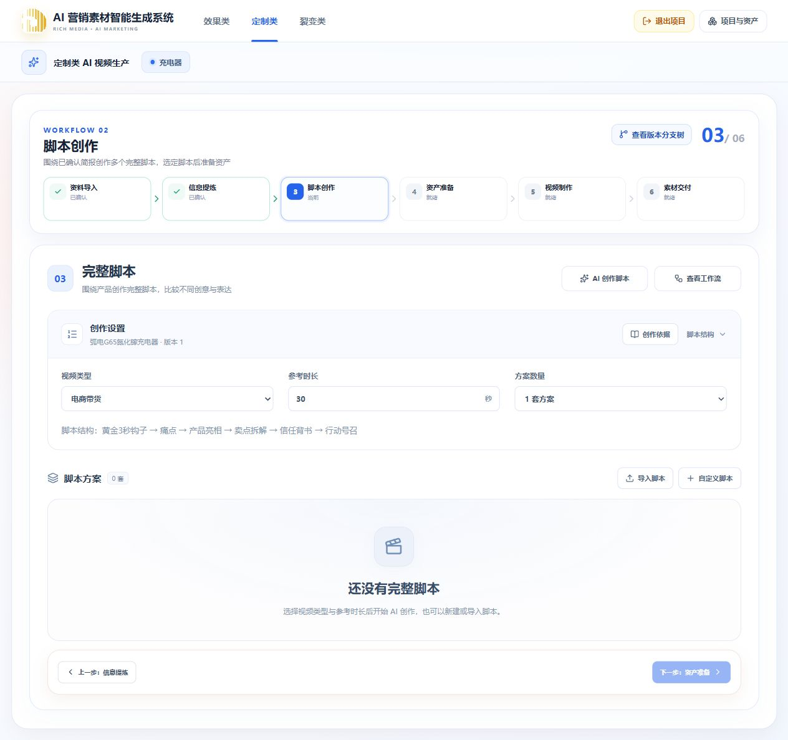

# 充电器项目全部脚本真实删除 · 2026-10-13

用户明确要求自行测试删除当前充电器项目的所有脚本。本次通过正式 DELETE 接口执行真实删除，数据库只作识别、统计和断言，没有直接用 SQL 清除业务数据。

- 项目：充电器，`2863b2c6-927a-48de-8327-b367e21fc64f`。
- 删除前：20 条脚本记录（17 条已发布、3 条未完成），17 个脚本分支，13 个生产任务。没有正在执行或排队的脚本任务。
- 先删除原活动脚本分支，接口返回活动 Run 已改变，自动回到保留的上游 Run。其余请求均按最新脚本 revision 串行删除。
- 删除后：脚本、脚本任务、检查点、生产任务均为 0；17 个分支及其范围内的节点草稿、工作副本、历史快照和文件记录均为 0。全项目 `customized-script:*` 工作副本和历史快照为 0，分支归档资产为 0。
- 保留：1 个上游 Run，资料包和信息卡共 2 个工作副本的 ID、revision、内容指纹完全未变；5 项上游项目素材的 ID、版本和存储引用未变。其他项目的脚本 ID、项目归属及 revision 未变。
- 剩余 1 条 Outbox 为已有上游信息提炼任务的已发布消息，所关联提炼任务仍存在，不是脚本或后代分支残留。
- 本次没有待清理的独占文件，清理队列为 0；没有调用模型或重新生成脚本。
- 20 次删除请求及逐次数据断言合计约 2.9 秒，是本次本机观察值，不作为通用性能承诺。
- 正式 API 返回 0 个脚本且信息卡来源有效；版本树不含全部被删 Run。浏览器刷新后显示“0 套”“还没有完整脚本”，下一步禁用，资料导入和信息提炼仍为已确认。

原始断言结果见[记录](2026-10-13-charger-script-deletion.json)。本次没有发现删除失败或数据残留。

