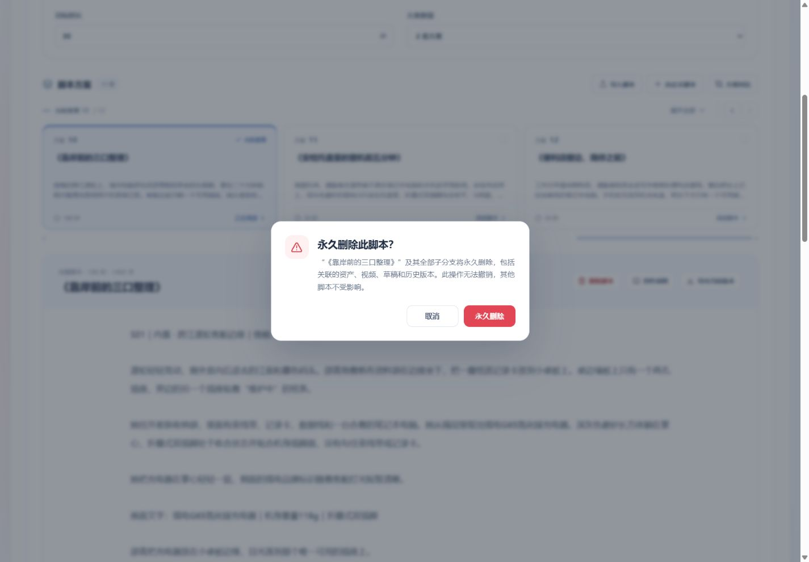

# 脚本永久删除验收 · 2026-10-13

当前脚本操作区增加“删除脚本”，使用系统危险操作确认弹窗。确认后数据库事务硬删除所选脚本及全部后代 Run，独占对象文件进入现有持久清理队列，不等待对象存储返回。

## 已执行

- `CUSTOMIZED_STORYBOARD_DATABASE_TEST=1 CUSTOMIZED_STORYBOARD_DELETE_HTTP_TEST=1` 下运行 API `src/workflows/customized/storyboard`：14 项通过，1 项未启用（原有受控 Python HTTP 流程）。实际 PowerShell 中分别赋值 `$env:` 后执行 Vitest，不使用此处的 POSIX 内联写法。
- Web `src/workflows/customized/storyboard`：36 项通过，包括确认取消、409 保留修改、等待在途自动保存并使用最新 revision、迟到读取不恢复脚本、删除已提交但刷新失败仍发出删除通知。
- 随机数据库项目包含兄弟脚本、两层后代、工作副本、历史快照、生产任务、Outbox、归档项目资产及独占/共享文件。直接查询确认后代实际记录消失；共享文件最后一个引用移除后也进入清理队列；上游保留，活动 Run 正确回退；迟到脚本回调无法恢复记录。
- 本地运行 API 的真实 DELETE 接口验证 409、成功删除、重复请求 404 及工作区清空；删除前预热版本树，删除后树投影不再包含两个被删 Run。
- `pnpm typecheck`、`pnpm build`、删除相关文件 ESLint、`git diff --check` 通过。构建仍提示现有前端主包较大，不影响构建成功。
- 浏览器 1440×1000、390×844 下均可打开确认弹窗，页面无横向溢出。取消后恢复焦点至删除按钮，原脚本保留。恢复默认浏览器尺寸。

## 边界

没有删除现有用户脚本。浏览器仅验证入口、提示、响应式与取消；真实删除由随机隔离项目的数据库及 HTTP 测试验证。没有执行模型调用或付费验收。文件验证覆盖入队及引用保护，未以真实远端对象完成时间声称删除性能达标；物理文件清理由现有后台清理器重试完成。

工作区同时存在新的剧本格式修改；删除用例兼容当前字段，保留该修改。最后一轮 API 分镜测试通过，不将中间热重载期间的连接中断或尚未同步的旧格式断言算作通过。

实现范围见[计划](../../plans/2026-10-13-脚本与后代分支永久删除.md)。

## 选择性提交复核

将 HEAD 与仅删除功能的暂存内容导出至隔离目录，不包含工作区中的脚本展示、视频类型、效果类及其他未提交修改。隔离快照中 Contracts 构建、API 类型检查、删除 API 单元/数据库测试 3 项、Web 脚本测试 29 项通过。Web 全量类型检查仅报告既有 `EffectSegmentRenderNodePage.vue:729` 缺少 `getEffectSegmentRenderWorkspace` 引用；该文件导出后的 Git blob 与 HEAD 完全相同，此提交不包含该无关文件。此记录与上面的完整工作区检查使用不同快照，不混称全部通过。
