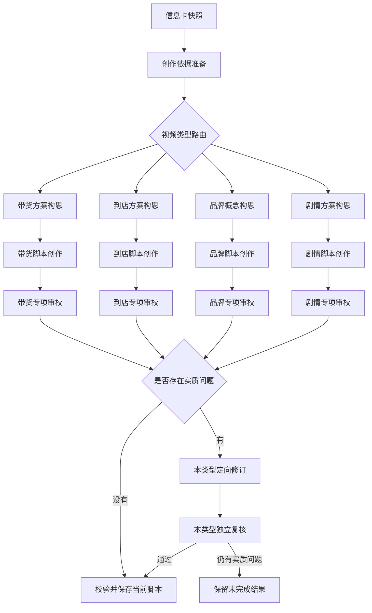

# 脚本创作类型分流与创作线路重构计划

日期：2026-10-13。状态：已实施并部署类型分流、局部修订和输出超限分片恢复，工程回归及充电器付费测试完成；人工创意质量、完整跨产品矩阵与稳定性能基准尚未全部达标。实施与实测边界见[验收记录](../evidence/2026-10-13-脚本类型分流验收.md)。下文第2节保留计划制定时的现状。

## 1. 目标与业务边界

依据使用者最新确认：脚本结构默认由 AI 编排，只有确有需要时展开高级设置；四种视频类型通过条件节点进入独立创作线路，各自拥有构思、正文创作和审校规则。结构约束内容推进，不要求营销环节直接成为正文标题。

保持固定六节点：资料导入 → 信息提炼 → 脚本创作 → 资产准备 → 视频制作 → 素材交付。本计划只重构第三节点的内部执行图与对应设置、详情展示，不增加顶层节点。

| 边界 | 本次采用 |
| --- | --- |
| 直接上游 | 当前项目、定制类、有效来源 Run 的已确认 `customized-brief`，冻结准确 `artifactId + revision + fingerprint` |
| 导航与设置草稿 | 继续使用 `STORYBOARD` 的 WorkflowNodeState、设置 revision 和现有工作区 API |
| 正式输出 | 继续使用 `customized-script:<scriptId>`，完整脚本通过审校和服务端校验后逐份自动提交 |
| 直接下游 | 资产准备消费完整脚本与 Brief；视频制作消费脚本及对象目录，再分镜、绑定和生成逐镜 Prompt |
| 不包含 | 资产拆分算法重写、图片生成、视频渲染、交付、新版本回溯体系、新的用户创意表单 |
| 既有语义 | 多方案并列、单份完成先发布、再次创作追加、编辑/取消、同内容不增 revision、项目隔离及旧回调拒绝继续有效 |

必读依据：[定制类指南](../agent-guide.md)、[项目与资产](../../../project-assets/README.md)、[开发 Skill](../../../../.agents/skills/develop-workflow-node/SKILL.md)、[上一轮类型与软时长计划](2026-10-13-视频类型脚本结构与软时长.md)。本计划的结构映射与执行图要求替代上一轮“一项结构对应一个同名正文篇章”的新任务规则；历史任务保持原规则。

## 2. 当前实现与问题定位

以下是读取代码得到的现状，不是未来设计：

- API 创建 `STORY_ONLY + VIDEO_SCRIPT_V2` 任务，冻结视频类型、参考时长、结构、来源和模型；阶段仍是通用 SNAPSHOT、CONCEPT、STORY、REVIEW、REPAIR、SAVE。
- Worker `pipeline.py` 联合构思后，有界并行执行每份脚本；`story_creation.py` 完成正文、审校、必要修订及复核，再提交单份脚本。
- `video_script.py` 用四段类型说明叠加统一的构思、写作和审校指令，尚没有四套独立执行节点及类型规划产物。
- `validateStoryboardVideoScript` 要求自定义结构数量与正文篇章相等，标题逐字一致。这保证了机械一致，却限制了真实场景组织。
- 查看工作流已经复用 `WorkflowExecutionGraphDialog`；当前适配器按线性 rows 展示，进度仍依赖旧阶段权重。
- 模型请求、并发、超时与重试已经集中在 Provider/共享 ai-runtime，租约、Outbox 和提交在 API；不能再建一套任务或状态底座。

代码入口：[Worker 编排](../../../../workers/customized-storyboard/src/customized_storyboard/pipeline.py)、[脚本执行](../../../../workers/customized-storyboard/src/customized_storyboard/story_creation.py)、[类型指令](../../../../workers/customized-storyboard/src/customized_storyboard/video_script.py)、[契约](../../../../packages/contracts/src/customized-storyboard-generation.ts)、[任务仓储](../../../../apps/api/src/workflows/customized/storyboard/storyboard.repository.ts)、[工作流面板](../../../../apps/web/src/workflows/customized/storyboard/StoryboardExecutionDialog.vue)。

上一轮[真实验收](../evidence/2026-10-13-视频类型脚本结构付费验收.md)还显示：参数复述、容量判断、产品物理状态和剧情自然度需要继续改善。单纯设置四个条件出口不会自动降低模型延迟或提高创意质量；需要一起改变每条线路的中间计划、上下文和审校标准。

README 模块二部分文字仍保留拆分前“逐镜视频”职责，与当前指南及已确认六节点不一致。实施时仅同步相关描述，不以该旧句恢复合并节点。

## 3. 开源调研与采用判断

调研方式：检索公开仓库，读取默认分支元信息、固定 commit 的相关源码及许可证。没有运行这些项目，也没有把 README 宣称、代码注释中的性能结论当作本系统实测结果。调研覆盖八个项目；未找到能够直接替代本系统“四类型、产品事实约束、多方案独立发布”的完整即插即用模块。

### 3.1 火宝：学习剧本与拆镜的职责分离

固定 commit：`26de7df59806588e98e103a21bd0bfd26d4a55a6`。

读取 [script-tools.ts](https://github.com/chatfire-AI/huobao-drama/blob/26de7df59806588e98e103a21bd0bfd26d4a55a6/backend/src/agents/tools/script-tools.ts)、[剧本指令](https://github.com/chatfire-AI/huobao-drama/blob/26de7df59806588e98e103a21bd0bfd26d4a55a6/backend/workspace/prompts/script_rewriter.md) 和 [改写方法文件](https://github.com/chatfire-AI/huobao-drama/blob/26de7df59806588e98e103a21bd0bfd26d4a55a6/backend/workspace/skills/script-rewriter/SKILL.md)：改写工具读取已有原文，由 Agent 写成带场景、动作和对白的正文，再调用保存工具；镜头语言留给后续拆镜。这里的 rewrite 工具本身返回原文和格式要求，不等于工具内部已经生成完成。

采用：正文作为页面主体，完整场景/篇章与后续镜头分开；剧情线路参考可读场景格式。

不照搬：已有小说改写作为必需前提、每场固定30–60秒、对白驱动所有类型、直接写数据库的工具执行模式。

[当前许可证](https://github.com/chatfire-AI/huobao-drama/blob/26de7df59806588e98e103a21bd0bfd26d4a55a6/LICENSE)为 CC BY-NC-SA 4.0。本计划不直接复制其源码、提示词或素材；独立实现上述职责与交互设计。

### 3.2 NarratoAI：按内容类型组织可版本化的创作策略

固定 commit：`9fa69e022d4add41205ee385207561df8796b3f1`。

[注册表](https://github.com/linyqh/NarratoAI/blob/9fa69e022d4add41205ee385207561df8796b3f1/app/services/prompts/registry.py)按 category/name/version 查找提示词；[管理器](https://github.com/linyqh/NarratoAI/blob/9fa69e022d4add41205ee385207561df8796b3f1/app/services/prompts/manager.py)处理渲染及输出验证。[影视解说片段规划](https://github.com/linyqh/NarratoAI/blob/9fa69e022d4add41205ee385207561df8796b3f1/app/services/prompts/film_tv_narration/segment_planning.py)与[短剧混剪脚本](https://github.com/linyqh/NarratoAI/blob/9fa69e022d4add41205ee385207561df8796b3f1/app/services/prompts/short_drama_editing/script_generation.py)使用不同输入和职责。

采用：四个类型模块独立维护构思、正文、审校及修订策略，任务冻结策略版本；类型之间不串用正文规则。

直接复用候选：轻量注册表的思路或独立小段实现。[许可证为 MIT](https://github.com/linyqh/NarratoAI/blob/9fa69e022d4add41205ee385207561df8796b3f1/LICENSE)，若复制实质代码须保留版权与许可说明；不能整体引入其日志、模板渲染器和应用配置。现有普通字典即可满足时优先本地简洁实现。

不照搬：原片时间戳、字幕选段、画面分析、固定原声/解说配比。该项目主要处理已有视频，不能把它当作从产品 Brief 创作四类视频的现成引擎。

### 3.3 VidForge：参考商品语境、有限反馈与调用记录

固定 commit：`bcd9dfdf1d89dfe217dbc544ce5dfe04c959a95a`。

[脚本服务](https://github.com/WANGLEVY9/VidForge/blob/bcd9dfdf1d89dfe217dbc544ce5dfe04c959a95a/apps/backend/src/modules/script/script.service.ts)注入产品知识和参考案例，但正文生成固定为三镜 hook/demo/cta，且缺配置或请求失败会返回 fallback。[Script Agent](https://github.com/WANGLEVY9/VidForge/blob/bcd9dfdf1d89dfe217dbc544ce5dfe04c959a95a/apps/backend/src/modules/agent/agents/script-agent.service.ts)接收质量反馈；[编排器](https://github.com/WANGLEVY9/VidForge/blob/bcd9dfdf1d89dfe217dbc544ce5dfe04c959a95a/apps/backend/src/modules/agent/orchestrator.service.ts)使用条件边和有上限的质量循环。

采用：将具体审校意见传回当前方案、记录阶段耗时和实际调用，不重新生成已发布方案。

不照搬：三镜硬模板、按素材数组位置绑定、模型失败后用模板替代真实结果、将历史反馈混入卖点事实。已有参考案例尚未建立来源与授权集合，本轮不增加 RAG 案例库。

[Provider operation](https://github.com/WANGLEVY9/VidForge/blob/bcd9dfdf1d89dfe217dbc544ce5dfe04c959a95a/apps/backend/src/modules/agent/provider-operations/provider-operation.service.ts)记录幂等键、请求哈希及远程操作 ID，值得用于分析重复付费窗口。但同步文本请求不一定支持远程结果重取，账本不能消除“响应已返回、检查点尚未落库”窗口，不能宣称 exactly-once 模型调用。[许可证为 MIT](https://github.com/WANGLEVY9/VidForge/blob/bcd9dfdf1d89dfe217dbc544ce5dfe04c959a95a/LICENSE)；不引入其 TypeORM、队列或另一套任务服务。

### 3.4 MoneyPrinterTurbo：正文简洁与规则/输入分离

固定 commit：`bd6939b61292d2acf435e0c8bd442470843a2781`。

[llm.py](https://github.com/harry0703/MoneyPrinterTurbo/blob/bd6939b61292d2acf435e0c8bd442470843a2781/app/services/llm.py)将脚本规则与主题、语言、段落数等运行参数分开拼接，主要输出可直接使用的文本；[候选模板](https://github.com/harry0703/MoneyPrinterTurbo/blob/bd6939b61292d2acf435e0c8bd442470843a2781/docs/loomloom/moneyprinterturbo-script-candidates.template.json)通过候选编号提示不同切入点。

采用：规则与本次事实分离，正文不夹杂内部策划和审核说明。

不照搬：纯口播正文、通过编号保证多样性的假设、删除括号内容等清洗方式、应用内供应商代码。我们的场景说明和对白状态不能被文本清洗误删。[许可证为 MIT](https://github.com/harry0703/MoneyPrinterTurbo/blob/bd6939b61292d2acf435e0c8bd442470843a2781/LICENSE)，本轮没有值得替换现有 Provider 的代码。

### 3.5 IBSEN：剧情中的人物目标和选择

固定 commit：`ad63221171c2e76b32034b0d253ee77e17f6f038`。

[director.py](https://github.com/OpenDFM/ibsen/blob/ad63221171c2e76b32034b0d253ee77e17f6f038/server/director.py)围绕当前幕目标、人物关系与记忆规划情节，再按角色推进对白，检查目标进展。

采用：剧情构思明确人物欲望、阻碍、选择、后果和关系变化，正文对白体现人物差异。这些作为构思与审校的结构化依据，减少“产品操作即故事”。

不照搬：逐轮导演/演员调用、持续角色记忆、互动玩家机制；这些会显著增加短脚本延迟。另有代码中生成的导演指令随后被清空的细节，不能仅凭角色名称就认定每步指导实际生效。[代码为 MIT](https://github.com/OpenDFM/ibsen/blob/ad63221171c2e76b32034b0d253ee77e17f6f038/LICENSE)，[data 目录另用 CC BY-NC-SA](https://github.com/OpenDFM/ibsen/blob/ad63221171c2e76b32034b0d253ee77e17f6f038/data/LICENSE)，不导入其剧本数据或角色记忆。

### 3.6 RichiDrama：完整正文与生产动作分开

固定 commit：`d64ada392adde1d02349de5e07bad09fc7451dbb`。

[CanvasScriptPanel](https://github.com/Moemu/RichiDrama/blob/d64ada392adde1d02349de5e07bad09fc7451dbb/frontweb/src/components/dramaCanvas/CanvasScriptPanel.vue)围绕单集正文编辑、保存和显式提取资产提供操作；[scriptEpisodes](https://github.com/Moemu/RichiDrama/blob/d64ada392adde1d02349de5e07bad09fc7451dbb/frontweb/src/utils/scriptEpisodes.js)处理分集文本导入。

采用：脚本是独立可读产物，资产提取是显式生产动作。

不照搬：多集小说导入、角色/场景/道具按钮移进我们的脚本页、Element Plus 组件与画布状态。现有正式阅读器和共享组件更适合本系统。[许可证为 MIT](https://github.com/Moemu/RichiDrama/blob/d64ada392adde1d02349de5e07bad09fc7451dbb/LICENSE)，本轮不需要迁入其 UI 代码。

### 3.7 Atlas Marketing Studio：多入口需要不同执行策略

固定 commit：`18ec178052f6f97612813997613d88ce34b02fc5`。

[Ad Skit 入口](https://github.com/AtlasCloudAI/atlas-marketing-studio/blob/18ec178052f6f97612813997613d88ce34b02fc5/src/app/api/ad-skit/plan/route.ts)、[Drama 入口](https://github.com/AtlasCloudAI/atlas-marketing-studio/blob/18ec178052f6f97612813997613d88ce34b02fc5/src/app/api/drama-studio/script/route.ts)和[Drama 提示词](https://github.com/AtlasCloudAI/atlas-marketing-studio/blob/18ec178052f6f97612813997613d88ce34b02fc5/src/lib/drama/prompt.ts)体现不同生产模式分开处理，剧情指令强调具体反差、口语对白与段落闭环。

采用：不同视频模式有自己的规划输入与写作标准；只把“反差、具体细节、自然对白”作为剧情可选手法，不强制所有故事喜剧化。

不照搬：固定段数/渲染时长档、剧本阶段提前生成图像 Prompt、自动模型降级、要求用户提供人脸或产品照片。README 宣称 MIT，但所核对 commit 的文件树未找到许可证正文；暂不列为直接代码复用对象。上游注释中的模型速度和质量评价不作为本系统选型依据。

### 3.8 FilmAgent：采用批评—修正—复核，避免逐句多角色循环

固定 commit：`4ac54cb05ca6e27187339872cc8224a7842b0167`。

[main.py](https://github.com/kekewolf/FilmAgent/blob/4ac54cb05ca6e27187339872cc8224a7842b0167/FilmAgent/main.py)包含想法发展、剧本创作、导演与编剧讨论、演员反馈以及后续摄影步骤，分别有讨论上限；[研究说明](https://github.com/kekewolf/FilmAgent/blob/4ac54cb05ca6e27187339872cc8224a7842b0167/README.md)区分这些生产阶段。

采用：写作与独立审校角色分离；修订必须回应具体问题并再次核对。剧情审校覆盖动作合理性、主题一致性、对白与人物匹配。

不照搬：Unity 场景依赖、演员逐个发言、摄影辩论及多轮讨论；不在脚本节点规划镜头。所核对文件树未找到许可证正文，不直接复制源码或提示词。

### 3.9 直接复用结论

本次最值得直接复用的是本仓库现有的 Provider、ai-runtime、任务检查点、工作副本及效果类共享 UI。外部项目主要提供创作方法与模块组织参考。

外部代码只有轻量、独立、许可清楚且确实减少维护成本时才考虑摘取；实施前记录具体文件、commit、版权与改动。没有预先决定新增任何外部运行依赖。不能因仓库自称开源就整体复制，也不能把可复用代码等同于可复用其样例、数据和品牌素材。

## 4. 新执行图：条件路由与四条创作线路

执行解释：

1. 同一批次只选择一条类型线路，路由直接读取冻结设置，不调用 AI 猜类型，也不同时启动四条线路。
2. 快照与准备阶段用代码整理已确认字段、准确来源、限制和引用，不新增一次产品信息提炼。
3. 所选线路的构思节点联合规划本次全部方案；每份方案随后独立写作、审校和发布。不是把三份方案分别固定成三个类型。
4. 构思同时判断资料是否足以支持所选类型，不另加常规前置模型调用。缺关键依据时停止正文调用，并保存具体缺失项与依据；不是自动切成另一类型。
5. 未选线路只是图中未采用的出口，不创建任务、检查点或模型调用；不能显示为失败或长时间等待。
6. 定向修订与复核共用调度，实际使用所选类型策略；无需修订明确标记跳过，不伪造模型执行。
7. 一份脚本通过就提交，不等待其他方案。仍沿用后台独立 Worker，不为四种类型再部署四个容器。

这是可执行路由和独立业务策略，而不是只在一个通用提示词前加四段标签；请求、检查点与提交能力仍然共用。

## 5. 四条线路的创作规格

### 5.1 电商带货

构思：选择适合本片的购买理由，确定具体吸引点、表达手法、产品价值的呈现事件和收束方式。演示、情境、对比、口播均可，系统按资料选择，不增加用户表现形式必填项。

规划产物：受众处境、购买理由、关注问题、采用事实及来源、演示依据、表达手法、段落推进、可选行动引导。对比须说明比较范围与资料依据；不设计虚假实测或贬损竞品。

写作：写实际发生的画面、动作、必要声音/旁白/画面文字。围绕主要价值选择少量信息，不强行逐条念参数，不要求每份覆盖全部卖点。

专项审校：吸引点是否具体、购买理由是否成立、演示与资料是否对应、是否虚构价格/评价/认证/性能、口播是否自然、参数是否反复堆砌。

充电器规划例子（仅用于理解，不是固定配额或生成结果）：参数误解澄清、通勤收纳、有限插座下的设备连接，各自设计不同观看事件。不得把三个方案都写成“出门—接线—收纳”。

### 5.2 同城到店

构思：围绕真实到店理由、空间/服务/商品体验和用户决策，规划可理解的体验路径。体验可以通过明确虚构的情境人物表达，但不能冒充真实顾客证言。

规划产物：已提供的门店/服务依据、体验主体、到店价值、体验步骤、内容推进、可选到店信息。地址、营业时间、价格不是全部必填；一旦写入必须有依据。

资料充分性：至少有能够支撑具体场所或服务体验的资料。当前充电器 Brief 如果只有单品信息，就报告“缺少具体到店体验依据”，不编店名和服务。缺少非必要地址时可以不写地址，不能一律要求补齐整张门店表。

写作：展示具体体验过程与感受，避免景点式空泛赞美和无依据活动宣传。

专项审校：到店理由、体验可理解性、服务事实、人物表达真实性、地点与行动连续性；不能将影视化情境等同于真实评价。

来源仍是现有12字段 Brief：门店/服务内容可以存在项目背景、产品介绍等已确认文字中。本轮不扩充信息卡或模板；若原文有但提炼结果缺失，提示回信息提炼补充，而不是暗中消费未确认原文。

### 5.3 品牌广告

构思：先提出具体的视觉命题和品牌记忆，再设计它如何出现、发展、变化和收束。抽象词如“高级、连接、秩序”不能单独成为通过的创意。

规划产物：希望留下的品牌印象、视觉概念、主题推进、产品参与方式、拟采用事实、品牌收束。视觉隐喻、无人场景、无对白、材质/空间表达均可，不硬加人物冲突、参数说明或 CTA。

写作：形成连续可读的视觉篇章，写清实际画面事件与变化。可以描述必要的光影、环境和声音，不在这里写逐镜景别、运镜参数、图像 Prompt。

专项审校：主题是否实际贯穿、视觉概念是否具体、篇章之间有无推进、产品是否不可替代、结尾是否形成记忆、隐喻是否被误写成真实能力。不能以无人物或无对白判错。

充电器规划例子：围绕“连接秩序”设计具体现象与变化，而非把一篇接线教学改名为品牌 TVC。能否自然成立由模型结合事实创作和审校，不预先指定固定视觉场景。

### 5.4 剧情短片

构思：围绕人物目标、阻碍、选择及后果展开；先建立值得观看的事件，再决定产品如何自然参与。冲突可以来自关系、信息、误解、规则或价值选择，不强制反转与喜剧。

规划产物：主要人物及动机、关系、初始处境、触发事件、升级、关键选择、结果/变化、产品因果作用、采用事实。这里的人物描述是写作设定，不提前制作正式资产目录或出图外观 Prompt。

写作：按实际场景组织正文，地点/时间、可见动作和必要对白清楚。对白有目标和人物差异，不替品牌背参数，不以旁白解释全部心理变化。

专项审校：人物是否有动机、冲突是否推进、选择是否改变局面、动作是否成立、对白是否有潜台词与区分、产品是否生硬植入、结尾是否回应事件。不是简单要求“必须有反转”。

充电器规划例子：有限连接条件如何参与人物协作与选择，而不是“没电—拿出产品—大家满意”的流水账。允许不同创意机制，不限定职场会议。

## 6. 多方案与创意质量

- 构思一次联合输出准确的1–5份最终规划，差异围绕观看问题、表现机制、推进方式、产品作用与收束；不通过换职业/场所/标题凑数。
- 本批其他规划作为简短上下文传给写作和审校，不反复传所有完整正文。已有方案只提供有限长度的创意摘要、类型和记忆点用于避重，不能当作固定范本。
- 构思产物先由当前模型自查事实支持和方案差异，再输出；这不是宣称存在一次独立审校调用。正文仍必须有独立模型审校。
- 审校包含共同的事实、约束、连续性、容量检查，以及该类型的专项问题；具体正文和证据必须可定位。
- 实质重复、没有展开正文、类型明显不符、未落实明确结构、虚构产品事实、物理矛盾或明显容量不成立为实质问题。一般审美偏好为提醒，不能无限追求模型评分。
- 不使用关键词、字符相似度、固定字数或职业是否不同来替代语义判断。代码只检查数据结构、引用、数量、编号与合法值。
- 不建立“写得越长质量越高”的规则。参考时长控制事件和信息规模，优先删去不必要的信息，而不是默认将30秒扩成数分钟。
- 每份最多一次语义修订和一次独立复核；仍有实质问题保留失败结果。模型/网络重试与创意修订是两套预算，不能相互套娃。

## 7. 脚本结构与最终正文分离

### 7.1 设置交互

默认展示视频类型、参考时长、方案数量。高级设置默认折叠，只包含可选脚本结构，不恢复创作要求或其他风格表单。

展开后先显示“由 AI 编排”；用户可按类型选择少量参考结构，或编辑有序环节。继续支持添加、删除、改名、排序；最多20项，每项最多200字，允许清空回到系统编排。

类型预设只作起点：

| 类型 | 参考结构示例 |
| --- | --- |
| 电商带货 | 黄金3秒钩子 → 痛点 → 产品亮相 → 卖点拆解 → 信任背书 → 行动号召 |
| 同城到店 | 到店理由 → 体验展开 → 特色价值 → 到店引导 |
| 品牌广告 | 主题建立 → 视觉推进 → 产品关联 → 品牌收束 |
| 剧情短片 | 人物处境 → 事件触发 → 冲突推进 → 关键选择 → 结果变化 |

这些不是生成配额，不自动勾选、不强制每条采用，也不要求各环节等时长。“黄金3秒”是前段吸引目标，不把整个脚本再次硬锁秒数。缺背书时不能编造；系统可以采用真实依据表达，并在创作说明指出缺失，严重影响结构执行时报告不足。

切换类型时不自动套用新预设或删除用户自定义；已有自定义显示原内容，用户可主动清空或换预设。不能在高级设置关闭时悄悄留下用户不知道的历史约束；关闭时仅显示一行“自定义结构已启用”的简洁状态。

### 7.2 新结构契约

结构要求使用稳定 ID 的有序列表；正文仍是一份完整脚本，由实际场景/视觉篇章组成。增加结构落实映射：每项要求指向一或多个正文单元及实际引文。

- 一个结构环节可以跨多个场景，一个场景可以完成相邻多个环节。
- 不再检查结构数量等于正文篇章数量，不再要求正文标题逐字等于“痛点”“卖点拆解”。
- 代码校验结构 ID、正文单元引用、引文存在、覆盖完整及基本顺序；AI 审校判断是否真正落实、推进是否自然。不能把引用了某段文字等同于语义通过。
- 用户没有指定结构时，不要求额外覆盖表；模型自行组织正文。
- 页面默认只显示正文，结构落实与创意依据留在“创作说明”和工作流详情，避免恢复多组文本框。

## 8. 数据契约、执行版本与迁移

### 8.1 新任务冻结

新增执行标识 `graphVersion=TYPED_CREATION_V1`，正文标识 `storyFormat=VIDEO_SCRIPT_V3`。执行版本和正文格式分别表达调度与内容规则，不用某个模型名或正文标题猜版本。

冻结内容包括：视频类型对应的 routeId、各阶段策略版本、模型 ID/配置、准确 Brief 来源、自定义结构及设置 revision。新格式的 creation 元数据保存类型、参考时长和有序结构要求；实际预计时长继续由正文单元相加。

建议契约扩展：

| 数据 | 作用 |
| --- | --- |
| 路由定义 | 四种类型与其构思/正文/审校节点、连线和标签；Contracts 为唯一跨进程来源 |
| 路由选择产物 | 当前类型、选用线路及依据；代码确定并持久化，不伪造 AI 判断 |
| 创作依据准备产物 | 实际字段和来源摘要、缺失字段、事实/约束引用；不复制另一份 Brief 权威数据 |
| 类型规划 | 使用判别联合类型，保存本类型必要创作字段；不做四种类型字段全部为空的大 DTO |
| 资料充分性 | READY / NEEDS_INFORMATION、具体缺失项和依据；在类型构思中完成语义判定 |
| 正文结构映射 | 要求 ID → 正文单元 ID 与引文；不把结构环节改成镜头 |
| 审校问题 | 增加正文单元引用，保留历史 shotIds 兼容；新脚本不得假装存在镜头 |
| 任务投影 | 返回冻结执行版本、routeId 及实际步骤，供面板和进度使用 |

### 8.2 阶段持久化

新图使用显式业务节点 ID：共用 SNAPSHOT、PREPARE、ROUTE、REPAIR、RECHECK、SAVE；四组分别使用 `ECOMMERCE_CONCEPT/STORY/REVIEW`、`LOCAL_STORE_CONCEPT/STORY/REVIEW`、`BRAND_AD_CONCEPT/STORY/REVIEW`、`DRAMA_CONCEPT/STORY/REVIEW`。

共享前三步及所选类型 CONCEPT 属于批次，其余写作、审校、修订、复核、保存属于 scriptId。类型规划可以包含每份方案的资料不足结果，阻断的方案不执行正文；其他确有依据的方案可继续。未选线路不建步骤记录。

现有 CustomizedStoryboardStep.nodeId 为40字符文本，拟定 ID 可容纳；不能因此忽略 API 白名单、阶段数量和检查点校验更新。默认不新增一套阶段表；字段如全部存入现有 JSON 快照与检查点，则不需要数据库结构迁移。若实施发现必须新增索引/列，单独补迁移和回滚验证，不暗改历史记录。

将当前 REPAIR 内部的复核拆为独立真实 RECHECK 检查点，保存修订候选后再复核；恢复时不重写已经持久化的候选或重复复核。最终提交校验必须使用修订后正文与最终复核，而不是原始正文加初审结论。

### 8.3 兼容与提交

- V3 新任务走新图；V2、SCREENPLAY_V1、无标记任务按原图、原校验、原检查点恢复。部署不得解释旧任务为新线路。
- 旧草稿结构可以读取为高级自定义设置，但新任务开始前必须在界面明确展示其启用状态；不因页面打开自动保存或发布。
- 既有 P 编号及 story.content/beats 保持可读；V3 解耦结构环节，正文可继续用自然标题组织，不新增第二份可编辑正文。
- 所有写入仍校验项目/Run、输入哈希、租约、attempt token、来源、期望 revision。Worker 不直接访问数据库。
- 单份完整成功自动提交、幂等发布；失败和待修订候选不创建正式脚本。普通编辑和查看不新建兄弟分支。
- 同内容不增加业务 revision；只使实际消费旧脚本 revision 的对象目录/分镜/Prompt 待更新，不制造不存在的产物。
- 下游消费完整正文与实际估时，不能依赖营销结构标题或把参考时长当硬时长。资产与视频 Worker 做新 creation/结构字段读取兼容测试，不新增付费生产范围。

## 9. 前端执行图、详情与进度

继续使用效果类共享的 WorkflowExecutionGraphDialog、WorkflowRunProgress、编辑动作、确认、加载、错误提示和导航组件。

### 9.1 图的表达

- 显示真实条件分流：从路由节点分出四条类型线路，选中线路突出显示，其他线路用“未选择”中性状态。
- 当前任务默认聚焦选中线路，可展开查看四条整体结构；不能为了图完整创建四套待执行状态。
- “未选择”是根据冻结 routeId 得到的展示态，不冒充服务端 SKIPPED 执行结果。无需修订的 REPAIR/RECHECK 则是真实 SKIPPED。
- 查看全部方案时聚合实际状态；切到单方案只过滤本批详情，不切换项目分支或触发生成。
- 共用图若只支持相邻行连线，需要扩展显式 edges/条件边配置，效果类先回归；不能复制定制类专用画布和弹窗。

### 9.2 点击后展示的真实信息

| 节点 | 使用者能看到的内容 |
| --- | --- |
| 信息卡快照 | 本次品牌、产品、卖点、受众、约束及准确版本 |
| 创作依据准备 | 实际提供的信息、保留的限制、缺失项；不把普通空字段都标成阻断 |
| 视频类型路由 | 当前所选类型和进入的创作线路 |
| 类型构思 | 完整方案名称、核心创意、类型特有规划、产品作用与方案差异；资料不足时显示具体问题 |
| 类型正文 | 实际可阅读全文、场景/篇章、必要对白和声音、预计时长；不是“生成6段” |
| 专项审校 | 具体结论、问题正文、资料依据、影响和建议；正常项有检查结论 |
| 定向修订 | 实际修改前后、修改原因，未改内容保持；跳过明确说明 |
| 独立复核 | 对修订稿的最终结论及剩余提醒 |
| 保存 | 实际脚本名称、来源、预计时长及打开入口 |

只显示持久化产物，不暴露原始 JSON、提示词、内部 ID、存储地址或模型思考。长正文继续分页，切换项目/任务/方案/节点取消旧请求并拒绝迟到响应。

### 9.3 进度

新版本按实际选中线路计算：快照5、准备5、路由0、构思15、正文40、审校20、修订8、复核5、保存2，总计100。共用阶段按批次完成量，逐份阶段按实际方案完成量加权。

权重是阶段完成进度，不是预计剩余时间；没有检查点不能靠计时递增。未选线路不进入分母，无需修订的步骤按实际跳过完成。保存未完成不能显示100%；部分失败如实显示部分完成。完整终态后进度条消失，工作流入口保留，不增加“全部已保存”横幅。

断网只提示查询中断，不将后台任务改判失败。保存冲突保留本地修改，主动加载最新内容才替换。页面仍以完整正文阅读为主体，不增加四条路线的大型设置卡片。

## 10. 质量与速度安排

### 10.1 常规调用预算

路由与资料整理不新增模型调用；资料充分性及类型规划并入一次联合构思。正常单份三次主要调用：联合构思、正文、独立审校。

N份方案、R份需要修订时，常规主要调用数为 `1 + 2N + 2R`。因此3份无修订约7次，5份无修订约11次；不是每份都重复进行一次全批构思。格式纠错、网络重试和长稿分片单独统计，不能混在这个理想次数中。

初始沿用当前全局模型并发2；正文/审校/修订共享限额，不为每条线路各开2个并发导致实际超限。调度允许完成的方案先进入审校并逐份发布，不设置全批正文写完才能审校的屏障。具体排队公平性通过测试确认。

### 10.2 上下文与写作成本

- 使用同一份确认事实和约束，类型规划只选择适合该片的事实引用；不能为了减 token 截断有效事实或丢掉禁用内容。
- 当前方案携带完整规划，其他方案只给精简差异摘要；用户页面的创作说明从真实规划投影，不另生成一遍解释。
- 完整正文只生成一份；概述、开场/发展/收束等旧辅助字段保持兼容，但新任务不重复输出整段正文到多个字段。
- 长稿根据实际内容规模按自然篇章分片，携带全局规划、确定的事实、前文连续性摘要和相邻段落，保存每片检查点；不固定“180秒必分几片”。默认短稿整篇生成，避免无谓拆分。
- 格式问题优先确定性校验并最多一次有限修正；不能删掉未解析段落、截短正文或使用模板 fallback 假装成功。
- 定向修订保留未受影响段落，可用带稳定正文 ID 的替换补丁；代码验证合法修改路径与整体拼接，AI复核完整修订稿。不能只复核补丁而漏掉跨段影响。

### 10.3 模型与恢复

沿用现有火山模型适配器和独立 Worker 配置。初始以当前已实测固定 Pro 型号为质量基线，不未经对比把某类型静默降为 Turbo；允许按类型/阶段配置模型，但必须冻结在任务中并记录实际调用。

限流/短时断网按当前有界退避重试；永久配置错误和资料不足不反复调用。已保存检查点在相同任务/输入/策略版本内复用，主动再次创作使用新批次。

上一轮出现过 API 短暂不可用，模型正文已返回但检查点未写入，恢复后重复调用的费用窗口。实施中应先保存待提交输出并在本次存活进程内重试同一检查点，提交失败期间不能再调用模型；若增加持久化待提交缓存，必须有严格作用域、加密/权限与清理设计，不能随手写正文进日志或 Redis。进程在响应与持久化间崩溃仍有窗口，单纯增加账本不解决同步请求的远程可恢复性，本轮不承诺零重复计费。

### 10.4 验收如何判断更快

记录构思/正文/审校/修订/复核耗时、排队、调用次数、输入输出 token、首份可用时间、整批完成时间及失败恢复耗时。单样本不报告 p95；有足够重复样本后再比较分位数。

使用同一模型、同一 Brief、同一类型/数量/参考时长与旧图对比；按结果质量、修订比例及实际信息容量共同判断。不得通过跳过独立审校、放宽事实校验、强行压缩正文或隐藏修订耗时实现速度达标。

## 11. 实施文件与顺序

1. **Contracts：**定义新图版本、路由/节点描述、类型规划联合类型、充分性结果、结构映射、正文引用和 V3 校验；同步 JSON Schema/Python 一致性测试。历史类型不破坏性改义。
2. **API：**任务冻结版本与策略、仅创建选中线路步骤、详情投影、阶段白名单/权重、最终复核和完整提交校验；复用现有接口前缀与任务表。
3. **Worker：**在 customized-storyboard 内新增 router 与四个类型策略模块，共用执行器及 Provider；拆出独立 RECHECK，覆盖资料不足、部分成功和恢复。保留 V1/V2入口。
4. **结构与正文：**V3使用结构要求映射和自然正文单元，不再严格同名/同数量；同步人工编辑、导入导出和下游读取兼容。
5. **Web：**结构收进高级设置；共享图支持真实条件边及未选择线路，接入真实规划/正文/审校详情；复用现有完整脚本阅读和方案目录。
6. **部署与文档：**更新指南、Worker/Web README及相关根 README 旧描述；验证无活动任务后安全更新现有 Worker，核对运行镜像/配置实际生效，不新增四个服务。

条件路由使用现有异步执行底座和显式策略表，不为显示一张条件图引入另一套持久化引擎。若进一步采用图框架，必须证明能复用现有 API 检查点而不是再建立第二份权威状态；不把迁移框架作为本计划前置任务。

## 12. 验收矩阵

| 范围 | 必验内容 |
| --- | --- |
| 路由 | 四类准确选路、未知类型拒绝、只建所选阶段、未选类型零模型调用；代码路由不产生付费请求 |
| 创作 | 食品、护肤、电子、家居、软件；品牌可无人无对白，带货不限口播，剧情有实际动机/选择，到店有真实体验依据 |
| 资料不足 | 充电器仅产品资料选择到店时指出不足且停止正文；有真实体验信息时通过；缺非必要地址不机械阻断 |
| 多方案 | 1/3/5份；真实表达差异、再次创作保留旧稿、单份先发布、失败恢复不覆盖成功方案 |
| 结构 | 默认AI、经典预设、自定义增删排序；一要求跨多场景、一个场景落实相邻要求；引文/ID/顺序与语义分开验收 |
| 正文 | 正文不能是概述；自然场景标题；预计时长按实际容量，参考偏差本身不失败；不强迫全部参数进入短稿 |
| 审校 | 虚构功效/规格/认证、物理状态矛盾、口播超容量、严重类型错配必须处理；审美建议不触发无限循环 |
| 修订 | 精确正文补丁、正常段落保持、修订后完整复核；补丁非法/复核仍有错误不发布，检查点恢复不重复修改 |
| 历史 | V1/V2/无标记任务按原图恢复；旧标题/时长规则不暗改，旧脚本可查看和编辑；读页面不发版本 |
| 隔离 | 项目/Run/兄弟脚本、revision、两轮来源变化、重复消息/回调、租约失效、取消/删除后迟到写入 |
| UI | 1920/1440/窄屏；高级设置默认折叠、类型切换保留自定义；条件图/详情/分页/键盘、加载/空/失败/部分完成/完成/待更新/409 |
| 恢复 | 查询断网、API检查点提交中断、Worker重启、非法输出、429/超时、永久缺配置；报告实际重试费用风险 |
| 下游 | 新正文/creation读取，资产拆分及分镜消费实际时长；不要求本文营销结构就是镜头或资产目录 |

工程门禁：相关 Contracts/API/Web 单测及数据库集成、Worker pytest/mypy、`pnpm typecheck`、`pnpm build`、Compose 配置检查、`git diff --check`。效果类共享图扩展必须回归其拓扑、详情、焦点、加载和迟到响应行为。

真实付费验收使用现有授权范围与项目，单独记录模型、配置、调用、耗时、token、实际可取得的费用和人工质量判断；没有账单时不虚报人民币金额。充电器用于带货/品牌/剧情及到店不足反例，到店成功样本使用真实提供或明确标为虚构测试的门店资料，不能把虚构样本宣称为真实商家证据。

计划制定阶段仅检查文档；后续实施和真实调用已独立记入验收记录。本文验收矩阵是目标，不代表每项都已通过。不自动提交 Git。
