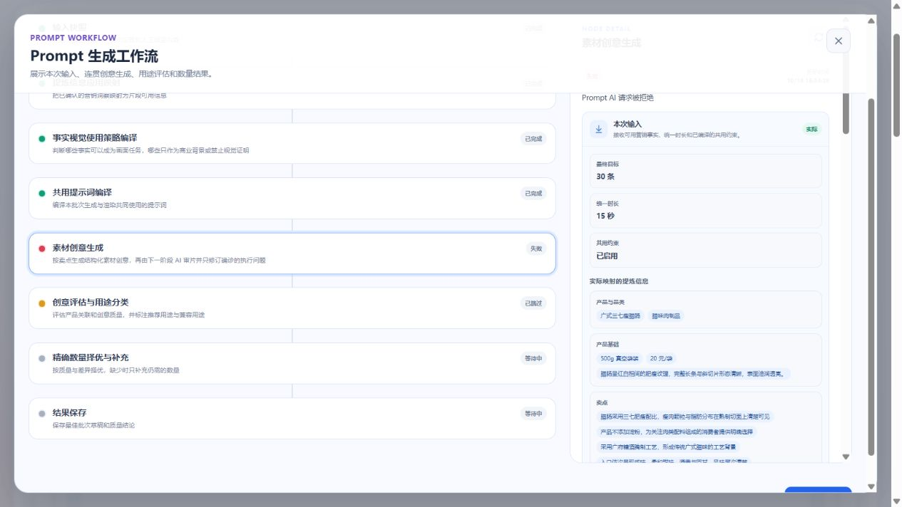

# Prompt 先诊断后定向修正：本地付费验收

日期：2026-10-16。仅本地；代码提交 `ec49602`。没有推送、服务器部署或视频渲染。本轮只创建一个付费业务任务，没有另开第二轮。

## 结论

「逐拍诊断 → 问题项定向重写 → 分片评分」已真实执行，诊断和修订检查点成功保存。但本轮在最后一个修订分片被供应商 HTTP 400 拒绝，未完成整批，也没有发布新分支。不能把它记为成功验收。

文本人工复查仍发现长静止、握持工具交接和机位矛盾。诊断可追踪性改善，不等于画面质量已经达标；本轮不支持“彻底消除故障”的结论。评分、MMR 和质量淘汰规则未提高。

## 作用域与实测结果

| 项目 | 实际观察 |
| --- | --- |
| 本地项目 | 广式腊肠，`7fdf5521-e1eb-496d-9b1b-09f9d724371b` |
| 配置 | 30 条 × 15 秒，淘宝，AI 根据场景选择风格 |
| 生成、诊断、修订模型 | `doubao-seed-2-1-turbo-260628` |
| 原有评分模型 | 同上，未更换 |
| 上游提炼 revision | 1 |
| 付费任务 | `71841386-4cb3-4c8e-b9f0-d50b3f2b1a91` |
| 新任务作用域 | `aadcaf01-ad2f-4dd2-b2c8-1ce19f371fd4`，未发布 |
| 保留的父分支 | `776105a2-4760-4bfc-8ba1-41437f5779ad`，ACTIVE，无编辑会话 |
| 开始 / 失败 | 北京时间 16:24:29.920 / 16:34:28.072 |
| 总耗时 | 598.152 秒，即 9 分 58 秒；这是失败截止耗时，不是完整成功耗时 |
| 生成 / 逐拍诊断 | 30 / 30 条 |
| 诊断问题 | 17 个：时长稀疏 9、信息重复 7、镜头关系 1 |
| 完成定向重写 | 12 条 |
| 未要求改写 | 16 条；只说明诊断模型未报问题，不代表人工复查无风险 |
| 尚未完成重写 | 2 条：内部任务 M0_028、M0_029 |
| 已持久化评分 | 21 条；其他在途评分随失败取消，不能算整批评分完成 |
| 完成生成分片 | 9/10；最后一个分片保留生成正文及诊断 |
| 新批次重复度 | 未产生。页面 3.3% 是父分支旧结果，不可当成本轮结果 |

## 失败原因与边界

最后的 `effect_prompt_execution_correction` 请求输入约 10,844 字符，在 47.267 秒后收到 Ark Responses HTTP 400。内部归一化错误为 `AI_REQUEST_REJECTED`。既有日志没有保存供应商细分错误码，因此无法据此确定是参数、内容审查还是供应商其他限制；不能说成限流、超时或质量门槛淘汰。

此前部分调用出现 JSON/字段结构错误，经原有重试或拆分恢复；最终 HTTP 400 没有被绕过。失败保留草稿与诊断，没有伪装正常修订，也没有替换父分支。没有再次调用供应商探测原因或重开付费批次。

## 有效改动与残留问题

以下使用内部任务编号 M0_001…M0_030，不是页面父分支 P 编号；本轮未发布，不能混称为新批次 P001…P030。

- M0_007：原落锅后的低信息停留，改为拨开表层显露下层腊肠丁与蛋碎，实际动作与可见变化都写入正文。
- M0_014 / M0_015：开头静止准备分别从 2.6 / 2.4 秒缩为 1 秒。不过省出的时间主要分配给原动作，后半静态展示仍偏长。
- M0_020 / M0_021：增加揭示被覆盖接触面、撩动粉丝的动作，工具前的盖子放置或双手释放在这些条目中有交代。
- M0_002：补充跟拍到停机的衔接；但尾拍仍写“固定机位，向前推近”，没有完全统一。
- M0_010 / M0_011 / M0_012：为解决末拍重复新增筷/勺操作，却没补右手所持盖子的落点，保留了工具交接断裂。针对诊断 ID 改动，不代表整条状态链自动正确。
- M0_027：两段各 3.5 秒悬停仍未被诊断；M0_024 的落盘后 9.5 秒静置也被当作正常展示。模型仍容易把推近、换景别和重复质感描述算作新信息。

## 逐条人工文本复查

这是已保存方案的人工风险分析，不是渲染实测，也不是新增自动淘汰规则。“已重写”只指实际返回并保存完整修订。

| 内部任务 | 事件 | 模型处理 | 人工复查 |
| --- | --- | --- | --- |
| 001 | 掰开整根腊肠 | 正常保留 | 掰开过程合计 7.5 秒偏慢；“固定机位小幅向前推进”仍矛盾 |
| 002 | 整根夹起落盘 | 已重写 | 跟拍停机有补充；落盘后 7 秒主要静物观察，末拍固定与推进并存 |
| 003 | 三种切法 | 正常保留 | 形态变化明确；开头准备 2.5 秒偏长，末段切条切丁需注意动作容量 |
| 004 | 揭盖腊肠蒸饭 | 正常保留 | 揭盖后大部分时间只是移盖、蒸汽和推镜；画面发展不足 |
| 005 | 端煲仔饭揭盖 | 正常保留 | 后半重复成品观察；热煲单耳端入的支撑也值得复核 |
| 006 | 糯米饭舀起倒回 | 正常保留 | 事件连贯但多拍仍缓慢；糯米松散落下的材料状态需谨慎 |
| 007 | 颠炒蛋炒饭 | 已重写 | 拨表层增加实际信息；末拍舀起悬停仍可收紧 |
| 008 | 切萝卜糕 | 正常保留 | 末 3 秒静止；前拍微抬糕体，终帧却停回盘上，缺少落放衔接 |
| 009 | 掰芋头糕 | 已重写 | 静止改为刮断面，但刮擦 4.5 秒生硬，支撑与动作商业价值仍待优化 |
| 010 | 腊肠芋头同蒸 | 已重写 | 新增夹片揭示接触面；右手持盖后拿筷未交代盖子放置 |
| 011 | 腊肠南瓜同蒸 | 已重写 | 去掉开头空停留；持盖→竹勺仍断裂，中间连续静置 7 秒 |
| 012 | 腊肠蒸鸡 | 已重写 | 去掉开头空停留；持盖→筷子仍断裂，中间连续静置 6.7 秒 |
| 013 | 腊肠蒸排骨 | 正常保留 | 端盘落放完整；中后段轻拨、静态观察及返回全景的信息密度仍低 |
| 014 | 切蒸蛋 | 已重写 | 开头缩到 1 秒；切开后 6.9 秒主要静止与收工具，未解决整段停滞 |
| 015 | 荷兰豆颠炒 | 已重写 | 减少开头与重复颠炒；仍有“固定机位上下跟拍”，末段铺展拖慢 |
| 016 | 蒜薹腊肠盛盘 | 正常保留 | 盛盘后约 9.5 秒主要推镜、换角度、静止，明显信息稀疏 |
| 017 | 芥兰腊肠翻炒 | 正常保留 | 翻炒有发展；后 6 秒平息/静止，低至锅沿的视角有遮挡风险 |
| 018 | 莲藕腊肠翻炒 | 正常保留 | 翻片与并置有信息；后 6.3 秒偏静态，锅沿平视未必能看到锅底切面 |
| 019 | 香菇腊肠煸炒 | 已重写 | 收尾增拨动；中段仍连续静置 6.5 秒，低于锅沿观察有遮挡风险 |
| 020 | 腊肠蒸豆腐 | 已重写 | 盖子放置明确，新接触面揭示有效；中段 6.5 秒静置仍偏长 |
| 021 | 腊肠粉丝煲 | 已重写 | 双手释放再取勺连贯，撩粉丝有效；落锅后到新动作前仍偏静态 |
| 022 | 腊肠炒面 | 正常保留 | 挑起/翻拌有过程；固定机位与平移跟随并存，“焦点推近”混用运动概念 |
| 023 | 掰花卷 | 正常保留 | 有显露与落盘；7.5 秒掰开偏慢，固定机位与前推仍混用 |
| 024 | 腊肠披萨出炉 | 正常保留 | 落台后 9.5 秒纯静置，多个角度反复描述油润；机位切换也未说明 |
| 025 | 腊味拼盘 | 已重写 | 静止改夹片，但挑起 1 厘米安排 4 秒，仍可能以慢动作凑时间 |
| 026 | 三种切面拨开 | 正常保留 | 三堆不同形态依次显露较明确；末拍 3.5 秒退刀推镜仍可收紧 |
| 027 | 夹起腊肠斜片 | 正常保留 | 两段各 3.5 秒悬停，加微调角度仍拖长；正是本轮典型漏诊 |
| 028 | 煲仔饭夹片 | 未完成重写 | 已诊断 3.5 秒悬停，供应商拒绝导致尚未应用修订，不能称已修复 |
| 029 | 舀蛋炒饭 | 未完成重写 | 已诊断 3.5 秒悬停，同上；将勺口正对镜头时的承托关系也应检查 |
| 030 | 荷兰豆盛盘 | 正常保留 | 盛盘后 8 秒几乎静置；固定机位与推近同拍，漏诊明显 |

## 为什么还没达到目标

实际观察：模型诊断返回的 17 个问题全是信息节奏或镜头，没有指出任何握持支撑、工具连续性、材料时间问题；人工却能在盖子→工具处找到明确断裂。诊断并非全面可靠。

推断：模型仍用“现在更清楚/更近/换一个角度”的文字差异代替真正的信息差分，且针对单个诊断修订后，没有可靠地重新推导整条手/工具/物体状态。仅把同一模型调用拆成两次，还不足以消除这种偏差。

后续建议（本轮未继续付费或实施）：诊断应明确区分商品状态变化、遮挡关系变化和仅景别变化，并逐拍记录手/工具/承重的实际起止状态；改写时同步修订所有受影响上下文，不把盖子落点留在辅助说明中。这应作为生成与修订内容约束，而非新增拒绝门槛或无限审查循环。供应商失败原因还需要未来请求的安全错误码诊断，不能从本轮通用 400 猜测。

## 免费验证与未验证范围

- `uv run --frozen pytest -m 'not ark_integration' -k 'not test_item_evaluate_preserves_user_authored_content_and_structure' -o addopts='' -q`：578 passed，5 deselected。1 项付费集成、4 项此前已知人工编辑断言未跑，不记作通过。
- `uv run --frozen mypy src`：27 个源文件通过。
- `git diff --check`：本任务改动通过。
- 跨品类、4–15 秒的 48 项新增协议测试通过；它们不是其他商品的真实生成质量测试。
- 本轮只更新 Prompt Worker，不修改 API/Web/Contracts 公共契约，未宣称重跑这些层的全量测试。
- 不测试视频、不声称时间码精确执行、不产生本轮最终重复度、不再开第二轮付费生成。

