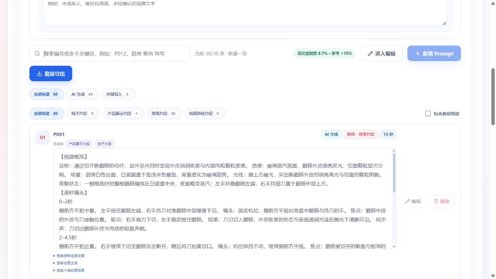
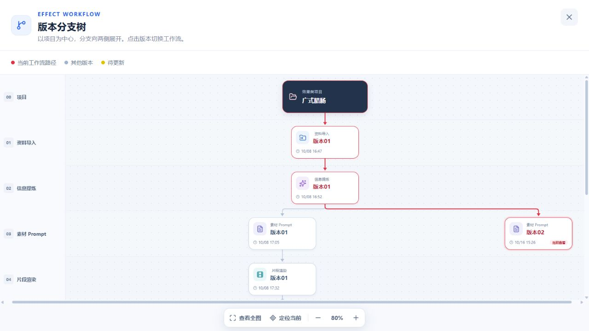

# Prompt 动态节奏：本地广式腊肠第 1 轮

## 范围与结论

2026-10-16，仅本地项目 `7fdf5521-e1eb-496d-9b1b-09f9d724371b`，30 条 × 15 秒，AI 按场景选择风格，Turbo 模型不变。未部署服务器、未修改服务器项目、未渲染视频，也未追加第二轮付费生成。用户所举 4 秒示例来自服务器，本轮不冒称验证过该服务器项目。

时间表达和动作细分有所改善，但尚未解决长时间静止、重复展示和物理执行风险。段数增加不等于新信息增加；本轮不能宣称画面质量达标。

## 任务与耗时

- 任务：`9b331fc3-8614-4ae5-b47c-1085c5527b75`。
- 新子 Run：`8c874e8b-183a-499c-92e6-f1a90f280566`。
- 模型：`doubao-seed-2-1-turbo-260628`。
- 开始：14:50:41.618；模型链路完成：15:02:07.976（北京时间），共 11 分 26 秒。
- 生成 30/30，无补充轮次，无结构硬拒绝。
- 自动发布曾因子分支缺少商品设置节点返回依赖冲突。修复后利用已有结果于 15:26:54 完成发布，没有重新调用模型。修复与恢复耗时不计为模型生成耗时。

## 同商品旧新 AI 结果比较

比较对象为旧批次原始 AI 30 条与新批次 AI 30 条，不把人工编辑后的 34 条草稿当作对照。旧来源已复制进新子 Run 的冻结基线，不能依据冻结副本所在 Run 推断它就是原版本树节点。

| 指标 | 旧 AI 批次 | 新 AI 批次 |
| --- | --- | --- |
| 数量 | 30 | 30 |
| 时间段数 | 全部 2 段 | 24 条 5 段、6 条 6 段 |
| 使用小数秒的条目 | 0 | 28 |
| 最后一段平均时长 | 6.87 秒 | 2.62 秒 |
| 语义重复度 | 6.67% | 6.67% |
| 画面清晰度均分 | 94.10 | 91.93 |
| 画面可执行性均分 | 89.03 | 89.07 |
| 商业价值均分 | 90.23 | 90.47 |
| 镜头矛盾提醒 | 5 | 1 |
| 执行风险提醒 | 4 | 3 |
| 时长过密提醒 | 2 | 4 |
| 时长稀疏提醒 | 0 | 5 |

最后一段时长不是静止时间。本轮 P003 将长停留分拆进多个段落，不能用该均值声称静止时间下降。评估指令本轮也发生变化，分数只作观察，不构成严格因果实验。所有结论来自 Prompt 文本与 AI 评估，没有视频实测。

## 逐条人工排查

以下为阅读最终正文后的风险判断，不是已经发生的视频故障；“较丰富”也不代表渲染已验证。

| 编号 | 排查观察 |
| --- | --- |
| P001 | 切片后约 8 秒以展示/静止为主，切面与俯视机位关系需复核。 |
| P002 | 推、翻、搅、提起、回落较丰富；多食材翻炒的精细一致性仍有风险。 |
| P003 | 0–5 秒舀起，5–15 秒持勺不动；典型的分段增加但信息没增加。 |
| P004 | 芝士拉丝长度要求缺少可靠材料边界；放回悬空位置后撤工具的支撑关系可疑。 |
| P005 | 揭盖前准备偏长，后续蒸汽和静态展示占比高。 |
| P006 | 搅、夹、落回较丰富，但精确缠绕和回位要求可简化。 |
| P007 | 撕开后的分开、举高、停留偏慢；手持与末帧静置衔接不清。 |
| P008 | 多形态呈现有新信息；仍需明确视点切换方式，末段静止偏长。 |
| P009 | 全片主体基本静止，主要依靠缓慢镜头和重复细节。AI 已提示稀疏。 |
| P010 | 单手撕花卷的受力支撑不明确，结束回位缺少必要性。 |
| P011 | 揭盖约 5.5 秒后，剩余约 9.5 秒主要是蒸汽和观看。 |
| P012 | 放盘后停留、轻拨、停留、撤手，填充性动作较多。 |
| P013 | 放盘与撤手后约 7 秒静态，静态被拆成多个阶段。 |
| P014 | 翻炒有连续动作，但收拢、停下等动作的商业必要性不足。 |
| P015 | 切蛋、举起后再次平移和放回，后半重复展示同一信息。 |
| P016 | 切开后约 6.5 秒静态；推动前片的施力主体需明确。 |
| P017 | 翻锅后引入工具操作，手与工具交接需清晰；AI 提示过密。 |
| P018 | 推炒较丰富，但最后约 5 秒停留；AI 提示过密，需要区分动作负荷与真实静止。 |
| P019 | 正文描述双手握蒸锅两侧把手却向上揭锅盖，握持对象错误；热盘转动另有风险。 |
| P020 | 夹起后又放回，再看与停留，增量信息有限；AI 提示稀疏。 |
| P021 | 揭盖后同一手改持木勺，缺少交接/放置；AI 提示占用与过密。 |
| P022 | 连续炒青菜较丰富，仍有重复抬起、落回和停留。 |
| P023 | 藕片翻炒有动态，但按压、收拢等后续动作应服务可见价值。 |
| P024 | 开头明确静止酝酿，后续仍是揭盖/蒸汽模板，与其他揭盖题材趋同。 |
| P025 | 约 6.5 秒后主要持勺展示和角度变化，稀疏未被 AI 充分提示。 |
| P026 | 举起、移动、放回、再触碰；重复回位。AI 提示稀疏和执行风险。 |
| P027 | 短时间切片、堆叠、切条、切丁，精细操作密度高；AI 提示过密和执行风险。 |
| P028 | 5–10 秒明确静止，之后触碰和停留；AI 提示稀疏与固定机位/推进矛盾。 |
| P029 | 揭盖后蒸汽与静态超过 7 秒，开头也有准备停留，与 P011 类似。 |
| P030 | 包装翻转/按压/静态观看，视觉基础事实未转化为足够独立的商业事件；AI 提示稀疏。 |

## 原因与后续方向

1. 隐藏的旧时长意图曾把素材约束成单动作、少数长段；本次已移除，新增 0.1 秒精度规划与总时长机械校验，适用于所有支持品类及 4–15 秒 AI 时长。
2. 模型仍会用停顿、回放原位、重复描述同一纹理来填时长。需进一步强调“每段新增可见信息”，不是规定固定段数或让所有动作变快。
3. 独立画面修正更擅长显式物理冲突，未稳定识别跨段重复停留。后续应在现有生成/修正/评估中同步检查事件推进与手、工具、支撑连续性，不盲目增加串行节点和付费重试。
4. 稀疏、过密仍是软排序/提醒，不恢复过重淘汰。人工编辑正文不自动改写。

## 本轮额外修复：重新生成隔离

原分支保持活动且不进入人工编辑；后台子任务独立冻结设置、轮询进度。原结果、重复度和下游任务不被半成品覆盖。成功校验后发布同一子分支；用户已切走则不抢占活动分支。历史漏设置子分支只补建哈希一致的冻结设置，不改父分支或重新付费。

## 验证记录与限制

- Worker：463 项通过，5 项排除（1 项付费集成未执行；4 项既有人工编辑维度类相等断言失败，原模型基线亦复现）；mypy 27 个文件通过。
- Web：相关测试 76 项通过；类型检查与生产构建通过，保留既有大 chunk 警告。
- API：相关测试 144 项通过、2 项既有 mock 失败、7 项跳过。失败分别为确认设置保护测试缺少 products mock、移除旧质量门测试缺少 commitValidatedResult mock。
- 真实数据库回滚测试：后台生成父分支不变、重复启动拒绝、冻结设置、缺失设置安全恢复、同一子分支发布、用户切走不抢占，2 项通过、5 项跳过；无模型费用。
- API 类型检查与生产构建通过。完成隔离修改后再次运行数据库 2 项、Web 布局 30 项均通过。
- 浏览器完成本地付费启动、进度与生成结果检查；发布恢复后显示 30/30、重复度 6.7%、进入编辑，不再停留在保存修改。
- 未运行服务器测试、未渲染视频、未执行全仓库门禁；不能由本轮推断所有品类实际画面质量达标。

## 浏览器证据

本地版本树保留素材 Prompt 版本 01 与本轮版本 02，旧分支的渲染/混剪/输出仍可见。截图只证明当时 UI 状态，不替代数据库隔离测试或视频质量验证。

