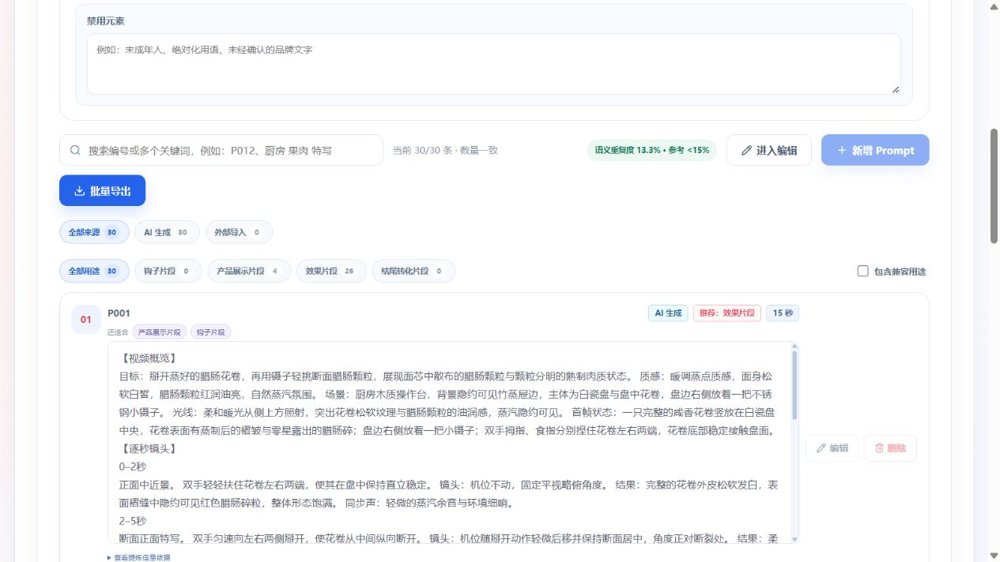

# Prompt 漏判修复：本地版本04付费验收

日期：2026-10-16。实现提交 `d37abe0`。仅本地修改与测试，没有推送、服务器部署或视频渲染。本轮只创建一个付费业务任务。

## 结论

任务完整成功，发布了本地 Prompt 版本04，30 条均保留；未提高淘汰门槛，未更换生成或评分模型。逐拍诊断现在明确区分真实变化与仅景别变化，并能定位工具交接缺口。但人工复查证明漏判仍未完全消失，部分修订新增了精细操作或不合理材料结果；整体质量不能判为达标。

HTTP 400 本轮未复现。已修复 Provider 丢失安全诊断信息的问题，但上一轮原始错误码未留存，不能宣称查明或彻底解决了历史 400 的具体根因。

## 任务与指标

| 项目 | 本轮实际结果 |
| --- | --- |
| 本地项目 | 广式腊肠 `7fdf5521-e1eb-496d-9b1b-09f9d724371b` |
| 任务 | `b52945c2-c662-4601-b45f-461e28a6bf95` |
| 新分支 Run | `38216a3b-c4c8-42e2-85df-de51e6ce0902`，版本04，已发布 |
| 父分支 | `776105a2-4760-4bfc-8ba1-41437f5779ad`，版本03保留，未进入编辑 |
| 配置 | 30 条 × 15 秒，淘宝，AI 根据场景选择 |
| 模型 | 生成/诊断/修订/原有评分均保持 Turbo `doubao-seed-2-1-turbo-260628` |
| 上游 | 任务冻结的提炼 revision 1 |
| 开始 / 完成 | 北京时间 16:52:42.552 / 17:10:18.332 |
| 耗时 | 1055.78 秒，17 分 36 秒 |
| 诊断 / 修订 | 30 条完成诊断；24 条定向重写，6 条原样保留 |
| 问题定位 | 32 个：信息重复 21、信息稀疏 1、工具连续性 10 |
| 最终数量 / 硬淘汰 | 30/30；0 条硬淘汰，0 次补充 |
| 重复度 | 13.33%，4/30，4 组；不是旧结果的 3.33% |
| HTTP | 0 次 400；1 次 429 / ServerOverloaded，既有降并发与重试恢复 |

与上一次完整成功的版本03比较（不是与失败轮比较）：

| 指标 | 版本03 | 本轮版本04 |
| --- | --- | --- |
| 重复度 | 3.33% | 13.33% |
| 画面清晰度均分 | 92.73 | 91.33 |
| 画面可执行性均分 | 88.93 | 86.53 |
| 商业可用性均分 | 91.40 | 90.67 |
| 时长稀疏软提醒 | 14 | 7 |
| 时长过密软提醒 | 0 | 1 |
| 镜头冲突软提醒 | 1 | 6 |
| 执行风险软提醒 | 1 | 6 |

这些是不同随机生成批次的文本评估，不是受控同题 A/B，也不是视频质量实测。稀疏提醒减少，其他关键指标没有共同改善。审片提醒可能误报，尤其某些理由把明确硬切也判作不稳定，不能将全部提醒等同确定故障，更不能据此加硬淘汰。

## 三个重点的实际效果

### 推近冒充新信息

新诊断确实把原方案的 5.5 秒切面横移、6 秒落盘后变焦标为 CAMERA_ONLY 与信息重复，不再仅复述“更清楚”。但改写常用轻碰、轻压、拨颗粒、放回原位补时长：有动作不等于有新的商业信息。P024 用再次碰动肠身填原6秒，P025 用按压切面填原5.5秒，P008 仍是转角度再悬停，尚未根治。

### 持盖换工具

- P015 / P018：正文明确右手放盖到台面/餐垫并松手，之后才持筷/持勺。
- P030：正文明确放锅盖、松手，再从台面拿木筷。
- P026：正文明确先把小碗放到台面，再扶勺晃动。
- **P022 仍漏修**：前文右手持锅盖在画外，后文右手持筷操作，没有放盖或交接。这是本轮确定的残留反例。

### 固定机位与推进

大量正文已改成“机位不动，光学变焦”或明确“机位平移/跟拍”，可区分两类运动。但 **P016 第4拍仍写“侧方平视机位不动，镜头随食材…上下…跟移”**，同拍矛盾依然存在。P023 / P030 还有固定机位跨观察角度却未交代切镜/移动的问题。不能宣称已清零。

## 新增或保留的其他风险

- **P012**：改写新增“汁水牵丝”，现有事实只有油润汁水，不能推出拉丝性能。
- **P018**：改写要求蒸南瓜受压后慢慢回弹，材料行为没有资料依据。
- **P001**：改写新增镊子挑起单粒腊肠，虽补全双手与工具交接，却引入精细小颗粒操作，商业动作不自然。
- **P021**：用炒勺自身边缘精准推动勺内一片食材并与另一片对齐，工具能力与精确排布风险明显。
- **P010 / P007**：大块蒸蛋由普通汤勺承托侧转、糯米饭块挖出再精准填回，都比普通取食更难稳定执行。

## 最终30条逐条人工文本复查

编号为版本04正式 P 编号；内部 M 编号用于对应检查点。此表是风险分析，不是自动拒绝条件。

| 正式编号 | 内部任务 | 事件 | 主要观察 |
| --- | --- | --- | --- |
| P001 | 023 | 掰花卷 | 放回两半后取镊子的交接完整，但新增挑单粒精细操作，面丝拉扯也需谨慎 |
| P002 | 022 | 炒面翻拌 | 放锅铲后再拿筷明确，揭示下层食材有效；多次翻拌/拨开仍有同义动作 |
| P003 | 020 | 豆腐蒸菜端出 | 端盘落放有衔接；单手夹盘边承托热盘及末3.5秒静置仍需复核 |
| P004 | 024 | 披萨出炉 | 手套与小铲有落点；挑单片腊肠精细化，奶酪丝条件与单手脱手套未充分说明 |
| P005 | 003 | 三种切法 | 左手支撑及收刀更明确；最后5秒移位、切条切丁、拨堆、收刀偏密 |
| P006 | 009 | 切芋头糕 | 状态发展较清楚；切开6.7秒、推开3.5秒仍慢，双手“离开厨刀”的支撑去向欠清楚 |
| P007 | 029 | 糯米饭墩取块 | 仍有4秒近距离保持；要求规整断面、把饭块精准填回缺口不自然 |
| P008 | 030 | 荷兰豆背景夹片 | 仍以转角度4秒加静止3秒重复展示颗粒，信息密度不足 |
| P009 | 005 | 煲仔饭揭盖 | 放盖明确，新增接触面揭示；3.5秒伸筷准备仍偏慢 |
| P010 | 014 | 舀蒸蛋 | 首拍1.5秒直接切入有效；掌心大蛋块由汤勺托起侧转的承托风险，后6.5秒主要观察 |
| P011 | 017 | 芥兰炒菜盛盘 | 放勺再拿筷有交接，揭示下层有效；不必要的两工具方案仍可简化 |
| P012 | 004 | 腊肠蒸饭 | 放盖与左手筷子占用明确，但新增无依据的汁水牵丝；开头2秒仍静止 |
| P013 | 019 | 香菇同炒 | 多次真实翻炒有进展，运镜描述明确；末3.5秒成品观察可收紧 |
| P014 | 007 | 翻起蛋炒饭 | 机位不动与光学变焦明确；开头2.3秒静止、4秒舀起加3.5秒悬停仍慢 |
| P015 | 010 | 芋头同蒸 | 放盖、松手、拿筷有完整交接，底部接触揭示有价值；揭盖与等待合计仍偏长 |
| P016 | 021 | 粉丝煲 | 固定机位与上下跟移同拍冲突；单筷稳定缠粉丝、短时更饱满等结果不可靠 |
| P017 | 016 | 蒜薹同炒 | 放铲后再持筷明确，有下层切面揭示；准备2秒、翻炒4.5秒仍可紧凑 |
| P018 | 011 | 南瓜同蒸 | 放盖再持勺明确；新增南瓜回弹及油光均匀覆盖，材料结果不可靠 |
| P019 | 013 | 排骨同蒸 | 原物落点与双手分工较清楚；“移动到…位置不动”先后停机应明确，薄片斜立回落需支撑 |
| P020 | 008 | 切萝卜糕 | 切开、推开有发展；双手离开刀未写稳定落点，机位观察贴合切面可能过早 |
| P021 | 018 | 双圆片展示 | 将静物改为勺内精确对齐，新增不稳定精细操作，不应算有效修复 |
| P022 | 012 | 腊肠蒸鸡 | 右手持盖在画外后直接拿筷，工具交接仍缺；中段3.2秒静置 |
| P023 | 025 | 腊味拼盘 | 固定正俯与侧俯来回切换无说明；开头5.5秒主要静物及推镜 |
| P024 | 002 | 整根夹起落盘 | 跟拍停住与撤夹更明确；末6秒改轻碰再晃，仍在重复同一油光 |
| P025 | 001 | 纵切腊肠 | 收刀和左手动作有交代；7.5秒切割加5.5秒轻压仍拖慢，按压是否增加信息存疑 |
| P026 | 027 | 肉丁倒入勺 | 小碗落放后再扶勺衔接明确；倾倒、晃勺、局部特写事件较完整，末收束可紧凑 |
| P027 | 006 | 舀糯米饭 | 左手工具预置和落放有交代；新增悬勺上拨数粒糯米的精细操作，不自然 |
| P028 | 028 | 煲仔饭夹片 | 末拍从重复悬停改回落；依赖腊肠片连带锅巴精准悬挂，姿态控制与材料粘连风险 |
| P029 | 015 | 荷兰豆夹片 | 有翻拌、夹起、转面、回落；转面与放回仍占6秒，未充分展开使用过程 |
| P030 | 026 | 电饭锅同蒸 | 盖落台面再拿木筷的交接修好；跨固定观察角度缺切镜、压后回弹与蒸格遮挡仍有风险 |

## HTTP 400 排查与耗时

历史失败只能确定 Ark 返回了 HTTP 400 / REQUEST_REJECTED，原实现没有保存细分码；当前无法重建那次响应。官方错误码表中 400 包含不同错误类别，不能从状态或47秒延迟推定原因。[官方错误码](https://docs.volcengine.com/docs/ark/error-codes?lang=en)

已补状态码、已知错误码类别、未知码哈希、格式校验过的请求 ID、输入/Schema 哈希；不记录原始 message、响应、商品正文或凭证。受控测试确认400只调用一次、不盲重发，安全诊断不泄漏回显内容。本轮真实429日志成功识别 ServerOverloaded 并记录请求标识，证明安全诊断在实际供应商响应中生效。新增的 JSON Schema const 属官方支持关键字，不因这一字段猜定参数错误。[结构化输出语法支持](https://docs.volcengine.com/docs/ark/structured-output-beta?lang=en)

本轮比版本03的11分48秒更慢，不能宣称提速：

- 诊断10组，累计调用耗时455.677秒，平均45.568秒；这是并行调用累计，不是墙钟耗时。
- 24条进入完整修订，修订成功调用累计825.958秒（含内部重试）；不能与总时长直接相加。
- 1次429/ServerOverloaded后并发降至2；5次JSON结构错误经原有重试恢复。
- 最后一组修订达到8192输出上限，108.618秒后截断，再拆为2条和1条，额外调用65.419秒与26.203秒。这是有界结构恢复，不是语义淘汰或新业务批次。
- 没有启动第二轮、没有自动视频渲染；父分支未被写入编辑态，新结果完整成功才发布。

## 原因判断与下一步方向

观察：诊断识别的工具问题由上一失败轮0个增至10个，明确的放盖/放碗衔接进入正文；但诊断仍会把次要的手退场细节当作问题，且改写后新增的工具不一定重新核对完整动作链。推近被识别为 CAMERA_ONLY 后，修订常退化为轻压、轻碰、挑单粒等微操作，增加相似度和精细执行风险。

推断：继续加长自然语言禁令不足以保证修订一致性；模型更容易保留原时长分配，在末拍补一个小动作，而不是重新设计同一使用事件的发展。诊断的文字状态记录仍可能与真正输出的动作分离。

后续应优先把手部占用、支撑移交和相机操作作为生成正文的结构化输入并统一编译，而不是增加淘汰门槛或无限修订循环；节奏修订要允许整体重排事件，避免仅在尾拍补微动作。本轮没有继续实施这一更大改造或再开付费测试。

## 免费验证与未验证范围

- Worker 非付费回归：588 passed、5 deselected。命令：`uv run --frozen pytest -m 'not ark_integration' -k 'not test_item_evaluate_preserves_user_authored_content_and_structure' -o addopts='' -q`。沿用此前1项付费集成与4项人工编辑断言的跳过范围，不记作通过。
- `uv run --frozen mypy src`：27个源文件通过。`git diff --check`：本任务通过。
- 受控测试覆盖显式AI冲突引用补齐、CAMERA_ONLY不自动判错、新请求Schema、历史字段缺省兼容、HTTP400不重发及隐私日志。
- 只改Worker内部字段和Prompt，不修改Web/API/Contracts公共契约，未宣称重跑这些层全量测试。浏览器真实启动、版本04切换和结果统计已核对。
- 无其他品类的付费生成、无视频渲染实测；通用协议测试不等于跨品类画面质量达标。

