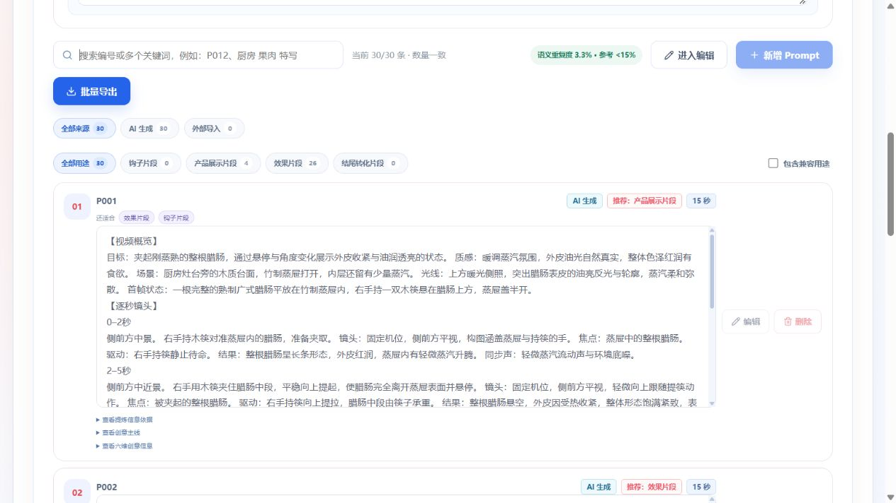

# Prompt 逐段信息推进：本地第 2 轮

## 结论

已实施跨品类的逐拍信息增量与物理状态辅助结构，并完成用户授权的一轮本地付费测试。重复度下降，但“每段都有新画面信息、解决长静止及握持/支撑/镜头冲突”的质量目标尚未达到。不能将字段齐全、AI 高分或批次成功视为画面无故障。

仅本地，无远程推送/部署/服务器数据修改，无视频渲染，无第二轮付费重开。评分模型未更换，候选与修正保持 Turbo。代码提交：`cc95311`（优化：增强提示词逐段信息推进与握持镜头连续性）。

## 实际改动

- `shotPlan.beats[]` 新增内部 `informationDelta`、`continuityState`，要求新生成和修订响应填写，分别说明与前拍相比新出现的可见内容、拍末握持/承重/朝向/观察状态。历史缺省序列化省略，不改旧检查点哈希。
- 辅助字段不编译进最终正文或向量，不增加商品事实；实际拍法仍由已有动作、驱动、机位、焦点和结果表达。
- 现有任务规划、生成、全量画面修正和独立评分统一核对跨段静止与信息推进；明确握持对象、反向受力、承重转移、工具交接和切镜关系。
- 不增加节点、评分后修订循环、产品关键词规则或语义硬淘汰。按 Skill 保持既有 artifact/revision、完整成功提交和后台子 Run 隔离。
- 每条增加 300 Token 容量估算余量；8192 上限下 15 秒每组由 4 条变为 3 条，候选总数与并发不变。

## 付费运行证据

- 项目：广式腊肠，`7fdf5521-e1eb-496d-9b1b-09f9d724371b`。
- 任务：`667c1a5e-3f21-4158-9164-4fa62e62d43f`。
- 新 Run：`776105a2-4760-4bfc-8ba1-41437f5779ad`；父 Run 为上一轮 `8c874e8b-183a-499c-92e6-f1a90f280566`。
- 实际上游营销洞察 revision 1；30 条 × 15 秒，淘宝，AI 按场景选风格。
- 开始 2026-10-16 15:50:25.165，模型任务完成 16:02:12.675，自动发布 16:02:13.033（北京时间）。耗时 707.51 秒，约 11 分 48 秒。
- 30/30，零补充轮次，零硬拒绝。30 个修正后计划共 153 拍，153 拍均保存两个新增字段；字段实际生效，不是仍在跑旧镜像。
- 更新前无 Prompt QUEUED/RUNNING；仅重建对应本地 Worker。容器/工作区 SHA-256 对齐：models.py 为 `2f057b9094db9d07e8cf22516dd00721c97c075abac00682baf2716cc588844b`，修正模板为 `67923102f0b3f2af19ea134db14e2895e625b36a938dadcec764028b89ecdd42`。
- 浏览器启动时仍展示父分支 30 条与 6.7%，未进入人工编辑。成功发布版本 03；版本树保留 01、02、03 及旧渲染/混剪。完成后原页面仍保留旧结果，显式点击版本 03 后读取到新正文与 3.3%，没有重新调用模型。

## 同商品相邻两轮比较

| 指标            | 上一轮            | 本轮              |
| --------------- | ----------------- | ----------------- |
| 完整数量        | 30/30             | 30/30             |
| 模型任务耗时    | 11 分 26 秒       | 11 分 48 秒       |
| 语义重复度      | 6.67%（2 条冗余） | 3.33%（1 条冗余） |
| 画面清晰度均分  | 91.93             | 92.73             |
| 可执行性均分    | 89.07             | 88.93             |
| 商业价值均分    | 90.47             | 91.40             |
| AI 稀疏提醒     | 5                 | 14                |
| AI 过密提醒     | 4                 | 0                 |
| AI 镜头冲突提醒 | 1                 | 1                 |
| AI 执行风险提醒 | 3                 | 1                 |

本轮评估口径更明确，提醒数量变化同时可能受识别敏感度影响，不能直接当成质量改善/恶化的因果证明。零过密提醒不代表没有过密操作；人工发现的 P013 即为反例。向量重复度只衡量素材之间的正文近似，不衡量单条内部长静止，3.3% 不代表动态质量达标。仍有一个相似对，计划序号 30 与 5，最终对应 P007 与 P028。

## 逐条人工排查（最终编号）

以下为阅读最终修正后计划与正文的风险判断，未渲染视频。较好的动作推进也不等于已经视频验证。

| 编号 | 实际观察与残留问题                                                                                                        |
| ---- | ------------------------------------------------------------------------------------------------------------------------- |
| P001 | 夹起后 5–9 秒悬停，末段再停 2.5 秒；捻筷带整根绕纵轴旋转支撑不稳定，固定机位又向上跟随。AI 未充分提示。                   |
| P002 | 双手掰开比上一轮单手方案的反向受力更清楚；但固定机位连续推进、抬高仍自相矛盾，停留与回盘填充偏多。                        |
| P003 | 推圆片、翻拨有可见关系变化；中间停 4 秒仍以同一对比细节为主，整锅均匀结果要求偏强。                                       |
| P004 | 切蒸蛋、推开后剩余 10.5 秒主要静态观察同一断面，AI 标稀疏；用刀推开后完整切面朝向缺乏可靠几何说明。                       |
| P005 | 15 秒切斜片、圆片、丁并分区，精细操作密集；固定机位又平移，大小均匀要求过强。AI 没有过密提醒。                            |
| P006 | 舀、颠、滑落形成连续变化；多颗粒在勺上颠动且完整可控仍有精细风险，固定机位又上移。                                        |
| P007 | 确诊固定与跟随冲突、盖子未移开、手/筷衔接及末帧放置缺失。全量修正后仍残留，专职审片有 5 条诊断；没有恢复评分后修订循环。  |
| P008 | 揭盖后 10 秒以静态肉菜细节/换角度为主，AI 标稀疏；辅助状态有拍末仍盖合的错误，不能作为正确性证据。                        |
| P009 | 放披萨后 10.5 秒静止展示，AI 标稀疏；不再要求精确奶酪拉丝，这是局部改善，但事件仍太短。                                   |
| P010 | 拨粉丝、舀起有显露变化；中间及末段悬停合计 6 秒，AI 标稀疏；勺子在煲中左右位置衔接需复核。                                |
| P011 | 转盘后 9.5 秒重复静态颜色/质地，停止旋转动作未清楚交代；AI 未充分提示稀疏。                                               |
| P012 | 双手掰花卷有明确反向受力；5 秒后约 10 秒分开/悬停反复观察，固定机位又推进，AI 标稀疏。                                    |
| P013 | 要求夹具依次精确翻六块，末 5.5 秒翻四块并齐整复位；固定机位又平移、末帧夹具自行放下。AI 只标稀疏，漏过密与执行风险。      |
| P014 | 揭盖后 11 秒主要静物/汁水聚集；自然渐变有一定观察价值，但已有成品是否仍能持续流出 7.5 秒汤汁缺少条件。AI 标稀疏。         |
| P015 | 颠锅、翻炒、拨开下层有新关系；固定机位又上下浮动仍冲突，停 3.5 秒偏长。                                                   |
| P016 | 放切片、再加入整根有不同形态；新整根的来源与拿起衔接不清，额外加入也是为填时长，低位机位看切面需复核。                    |
| P017 | 推、圆周翻拌比纯静物有动作发展；后 6 秒又回到静态质地，AI 标稀疏。                                                        |
| P018 | 相比上一轮 10 秒纯持勺，增加翻动内层；但转腕让黏糯米在勺内翻半圈的实现不明确，后 5.6 秒仍静态，AI 标稀疏。                |
| P019 | 切熟腊肠时米饭作为柔软承重面不够稳定，平视却要求看朝上的切面；抬刀、撤手被拉长，AI 未充分提示。                           |
| P020 | 轻拨后保持、抽筷、整盘停 4 秒，有约 10 秒低增量展示；AI 标稀疏。                                                          |
| P021 | 加片、翻面条有实质变化；右手持铲关系主要靠辅助状态补写，正文缺少清晰衔接，低平视锅内内容可能被锅沿遮挡；AI 标稀疏。       |
| P022 | 两次翻拨有真实进展，但固定机位又左右跟移，间隔 3.8 秒停留；未被 AI充分提示。                                              |
| P023 | 揭盖后 10 秒静物，多个镜头复述同一荤素关系；锅盖移至画外后辅助状态直接声称无持物，缺少真实放置。                          |
| P024 | 揭盖后 10 秒以蒸汽/静态角度展示为主，整碗“铺满上层”又声称鸡肉纹理清楚，视野与遮挡需复核。                                 |
| P025 | 右手离刀柄后直接推糕，未写刀抽离与安全放置；切开两断面相对却同时朝向同一镜头，后 6 秒重复静物。                           |
| P026 | 连续翻拌有明确颗粒位置变化；固定机位又平移跟拍，末 4 秒低增量，均匀分布要求偏强。                                         |
| P027 | 纵向切开与“中段下切”方法含混，切面朝上缺少翻转；后 7.5 秒静态/复看纹理，AI 标稀疏。                                       |
| P028 | 拨开遮挡锅巴是新信息；开头 2.5 秒等待，后 9 秒反复细节，平视锅内剖面受遮挡，AI 标稀疏。                                   |
| P029 | 揭盖后 9.8 秒静态复看；两侧握钮是否是实际盖子结构需依据参考图/明确事实核对，AI 标稀疏。                                   |
| P030 | 单只右手却“端住碗两侧”；手套持碗后持勺缺少换工具交代，局部蛋羹凹陷回弹超出可靠操作边界，低位碗沿遮挡。AI 未确诊这些问题。 |

## 为什么没有达到目标

1. 辅助字段成为了新的自我解释：如“回到全貌收束”“纹理更清楚”仍被写为增量，真实正文没有推进。字段本身不能证明信息有效。
2. 部分 `continuityState` 记录的是拍前状态，或与正文不一致；模型没有稳定地从动作推导拍末状态。字段名与文字要求不是可靠的状态模拟器。
3. 修正模型与生成模型同一路由，仍倾向接受原拍法；部分显式固定/跟随矛盾也未改掉。评分模型的高分与稀疏提醒同时存在，不能依赖高分掩盖问题。
4. 单一静态价值被要求统一撑满 15 秒时，规划仍选择几秒便结束的事件，正文只能复看或增加无关操作。独立事实多不自动意味着每条都有 15 秒的真实事件容量。
5. 降低批间语义近似与解决单条时长稀疏是不同目标，MMR 不会替代逐拍设计。

下一步建议是改造现有修正响应：先给出基于实际正文的逐拍信息/状态问题证据，再针对这些问题整段修订，而非只凭 `changed=false` 或辅助字段自评放行；不增加固定工作流节点、不恢复严苛淘汰、不依赖产品关键词。此建议尚未实施或付费验证，本轮不继续追加调用。

## 耗时与稳定性

输入/策略/任务规划至首组正文调用约 2 分 7 秒；正文生成、全量修正、评分和审片并行至完成约 9 分 40 秒。并发调用时长不能简单相加。

安全日志中成功模型调用记录：事实策略 2、素材任务规划 2、正文生成 12、全量修正 11、评分 10、专职审片 5。另观察到 5 次 JSON 格式异常与 2 次长度截断，沿已有有界重试/拆分恢复，没有重开业务批次。日志计数不替代供应商账单。

最大正文成功调用记录约 130 秒（含其内部尝试），主要等待仍在模型生成。新增分片保护没有消除所有截断，本轮比上一轮约慢 21 秒；不能由单轮推断稳定性能。

## 验证与边界

- `uv run --frozen pytest -m 'not ark_integration' -k 'not test_item_evaluate_preserves_user_authored_content_and_structure'`：527 passed、5 deselected。排除 1 项未执行付费集成，以及上一轮已确认的 4 项既有 CreativeDimensions/ManualCreativeDimensions 类相等断言失败；不冒称全套通过。
- `uv run --frozen mypy src`：27 个源码文件通过。
- `git diff --cached --check` 通过；跨品类结构测试覆盖果酱、护理液、磁吸电源、旅行箱及全部 4–15 秒，证明协议/编译兼容，不证明真实生成语义质量。
- 本轮未改 Web/API/Contracts，不冒称重跑其构建或全仓库门禁。
- 浏览器实际确认付费启动、后台保留父内容、版本 03 发布与切换后 30/30、3.3%。未渲染视频，未测试服务器项目；所有画面风险是文本审阅发现。

