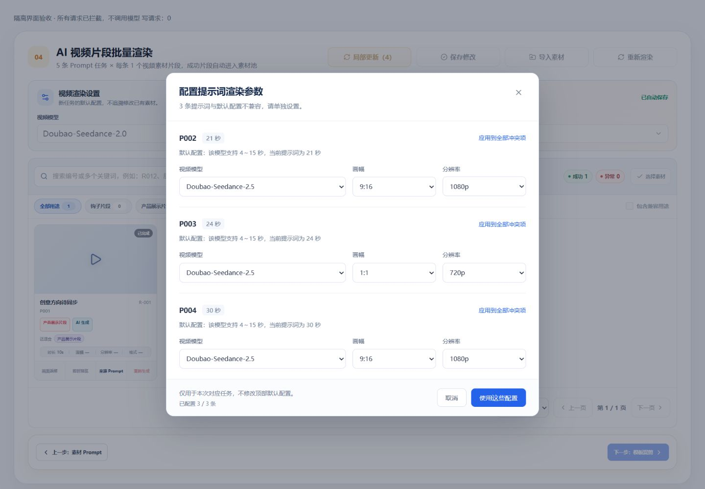
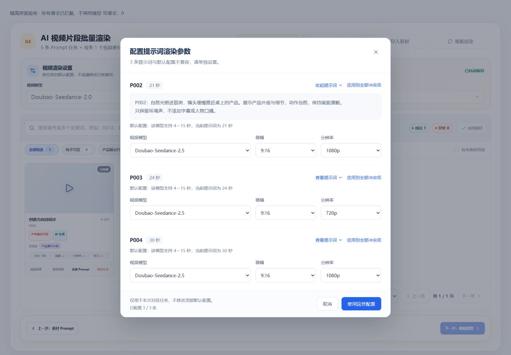

# Prompt 渲染参数确认验收

日期：2026-10-10。范围：效果类片段渲染的新任务默认参数及逐 Prompt 冲突配置。

## 浏览器观察

通过本地 Vite 加载正式 `EffectSegmentRenderNodePage.vue` 与正式弹窗组件，使用 `.tmp` 中的隔离验收入口拦截全部网络请求；未连接用户项目或创建模型任务。以下是界面与提交载荷验证，不代表真实供应商生成验证。

- 1920、1440、390 宽度下表单没有横向溢出，窄屏模型占独立一行，画幅与分辨率并排，底部操作保持可见。
- 21、24、30 秒的三条人工 Prompt 集中显示；12 秒兼容项和已有素材不进入冲突列表。
- 选择 2.5 后仍保留原 4K 并禁用提交，必须明确选择受支持的分辨率；没有自动降级。
- 合法配置可应用到全部冲突项，再独立修改某条为 `1:1 / 720p`。局部更新的拦截载荷保留三条各自参数以及可见工作区的设置 revision；顶部默认 `2.0 / 9:16 / 4K` 不变。
- 整批重新渲染同样先确认三条冲突项，再提交逐条参数与默认设置 revision。
- 取消配置、Esc 和取消最终生成确认均为零写请求；关闭后焦点恢复原按钮。Tab / Shift+Tab 在弹窗首尾循环。
- 100 条 Prompt（其中 98 条时长冲突）的列表可批量配置，显示 `98 / 98`；窄屏列表滚动、底部固定，取消仍为零写请求。这只证明该界面的承载与交互，不是生成吞吐结论。
- 隔离接口返回配置过期 409 时，页面展示“视频渲染设置已更新，请重新确认”，按钮恢复可重试，没有控制台错误。

[98 条冲突项的窄屏截图](mobile-many.png)

## 自动化验证

- `pnpm --filter @ai-marketing/web exec vitest run src/workflows/effect/segment-render --maxWorkers=1`：148 项通过。
- `pnpm --filter @ai-marketing/api exec vitest run src/workflows/effect/segment-render src/platform/workflow/effect-edit-session.scope.spec.ts --maxWorkers=1`：247 项通过、9 项跳过（数据库门控用例未启用）。
- `pnpm --filter @ai-marketing/contracts exec vitest run src/effect-segment-render.spec.ts --maxWorkers=1`：24 项通过。
- Worker 目录执行 `uv run --frozen pytest`：42 项通过。
- API 类型检查、Web 生产构建、相关文件 ESLint 和 `git diff --check` 通过；Web 构建保留已有大分包警告。
- `pnpm build:api` 被 Windows `dist/config` 目录锁定阻止。未中断任何运行进程；使用 `pnpm --filter @ai-marketing/api exec tsc -p tsconfig.build.json --outDir .tmp/prompt-render-config-build --tsBuildInfoFile .tmp/prompt-render-config-build.tsbuildinfo` 完成隔离输出编译。不能将此记为标准 Nest 构建成功或 API 运行进程已更新。
- 另行只读核对：3100 端口监听进程使用 `dist-dev`，启动时间晚于本次服务文件最后编译时间，编译产物包含新增摘要与配置快照逻辑；`GET /api/health` 返回 200。此观察确认开发进程已热更新并可响应，不代替真实项目接口及数据库端到端验证。

未验证：真实数据库完整事务链路、生产部署、付费 Seedance 生成及画面质量。

## 调研采用点

- [方舟视频生成任务 API](https://docs.volcengine.com/docs/ark/create-video-generation-task-api?lang=zh)、[Seedance 2.5](https://docs.volcengine.com/docs/ark/seedance-2-5?lang=zh)：核对模型、时长、分辨率能力，复用共用契约，不静默切换参数。
- [WAI 模态弹窗规范](https://www.w3.org/WAI/ARIA/apg/patterns/dialog-modal/)：焦点限制、Esc 和焦点恢复。
- [Atlassian 按钮规范](https://atlassian.design/components/button/usage)：明确动作名称，配置确认与付费任务提交分开。
- 视觉沿用系统现有白底、灰蓝边框和蓝色主操作，没有采用外部品牌主题。

## 同日补充：查看提示词正文

每条配置项新增“查看提示词 / 收起提示词”按钮，只读展示当前已确认 Prompt 正文，独立展开不改变其他条目状态与已选参数。API 工作区投影版本提升，避免旧缓存缺少正文；未确认的 Prompt 不提供查看摘要。

隔离浏览器验证了 1920、1440、390 宽度、逐条展开/收起、多行显示、顶部参数不变、零写请求、Esc 与焦点恢复。展开 P003 后收起 P002，P003 正文继续可见、其分辨率仍为 720p，表单没有横向溢出。没有连接用户项目或调用付费模型。

- Web 渲染相关测试 149 项、API 服务测试 102 项、Contracts 24 项、Worker 42 项通过。
- 共用契约构建、API 类型检查与隔离输出编译、Web 生产构建、相关 ESLint、`git diff --check` 通过；标准 Nest 构建未重试，沿用上述目录锁定说明。

[窄屏正文展示](prompt-content-mobile.png)
