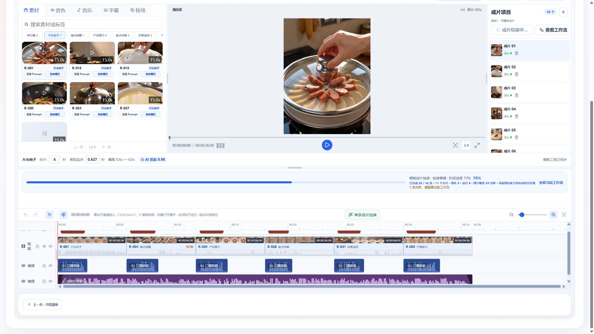

# 混剪音频波形验收 · 2026-10-11

后续用户配色修正：视频原声音量0不再自动置灰，保持原有绿色。只有原本的视频轨声音关闭操作沿用既有灰色提示；以下初次验收的灰色截图属于修正前证据。

绿色回归：9项波形单测、Web类型检查/生产构建及diff检查通过；浏览器六段原声波形均READY，背景为原有 `rgb(19,124,134)`、柱色为 `rgb(109,226,223)`。

范围：localhost:5173，广式腊肠，测试1的36秒工程。复用用户已有包装文件，只查看、缩放、定位及播放；未触发生成、包装或导出，未改变音量、素材或业务版本。该项目有用户已启动的包装任务运行中，本次未中断任务。

## 原因与修改

- 视频原声波形已解码成功，但包装原声音量0使显示高度降至约0.26px。视频改为显示源波形，静音/零音量置灰，不擅自恢复声音。
- 音乐柱数上限320与固定最大柱宽叠加，长条末端出现没有波形但仍有声音的假空白。柱列现在等分完整时间宽度；极窄条目的间距同步缩小，避免横向溢出。
- 波形取样按实际源偏移和时间轴区间映射，不把源结束后的静音区间拉伸成有声数据；口播/音乐的增益、淡入淡出保持既有规则。

## 验证

- `pnpm --filter @ai-marketing/web test -- effect-template-mix-waveform-window.spec.ts effect-template-mix-media-cache.spec.ts effect-packaging-sample-clock.spec.ts effect-template-mix-playback-clock.spec.ts`：4个文件，47项通过。
- `pnpm --filter @ai-marketing/web build`：类型检查与生产构建通过，仍有大体积chunk警告。
- 修改文件 `git diff --check` 通过。
- 既有布局波形定向用例 `effect-template-mix-layout.spec.ts -t 'draws real waveforms'`：1项通过，58项未执行。
- 浏览器六个原声条均为READY，静音时波形最高约13.2px，保持灰色显示；六条口播及音乐正常加载真实样本。
- 1920宽度下，音乐在38及62缩放时分别宽1355.4px和2219.4px，最后一柱始终距末端4px（内边距），不再被320柱的固定柱宽截短；视频末柱距末端3px。
- 1440及900宽度下重复检查，视频/音乐末柱分别保持3px/4px内边距。
- 定位33.9秒时曾出现预览失败提示；再次点击播放后提示消失，播放到36秒结束。后续切换再播放也出现过启动加载等待，当前后台包装查询存在502及失败条目；本次不将波形显示修复宣称为所有媒体播放/服务异常已消除。
- 切换成片02后，六个视频原声、六条口播和音乐均重新加载为READY，末柱仍与条目结束位置一致。

未验证：付费重生成、最终导出编码及所有历史源文件格式。不把静音源、加载中或解码失败伪造为有声波形。

截图聚焦时间轴控件、视频原声及完整音乐条，不证明逐帧流畅度或听觉质量。

