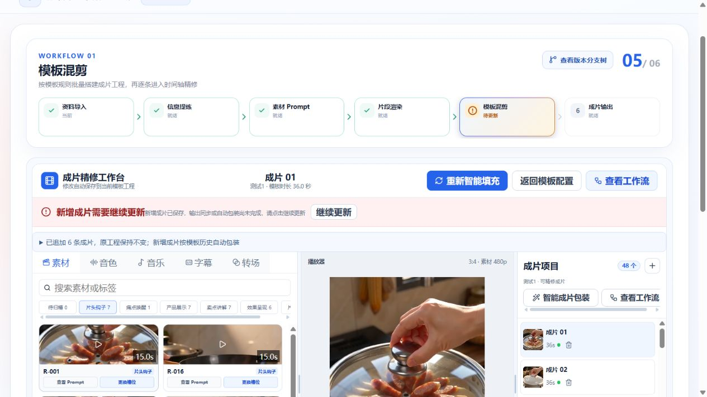

# 当前模板精修入口与局部更新锁分离

日期：2026-10-11。范围：效果类模板混剪的配置页进入精修工作台。

## 原因与修复

配置入口和 `openTemplateWorkspace` 共用 `mutating` 请求锁，导致局部更新提交、任务回执后的工作区读取等期间，查看已有工程也被禁用。

同 Run、同模板且已正确安装的工作区先执行 CONFIG → EDITOR 视图切换，不等待请求或自动保存。入口不再使用请求锁。未安装工作区、Run 切换、跨模板/Run 的提交保护和冻结工程编辑锁保持有效；不改变任务、内容或 revision。

## 验证

- `pnpm --filter @ai-marketing/web exec vitest run src/workflows/effect/template-mix/effect-template-mix-instant-navigation.spec.ts src/workflows/effect/template-mix/effect-template-mix-local-update.spec.ts src/workflows/effect/template-mix/effect-template-mix-update-lifecycle.spec.ts src/workflows/effect/template-mix/effect-template-mix-source-update.spec.ts`：4 文件、88 项通过。
- 新增测试执行真实入口函数，覆盖 mutation + 编辑锁 + 未完成保存下的同步进入，不触发保存、加载、停止任务轮询或 revision 变更；跨 Run/来源更新/未安装作用域仍被拒绝。另执行实际按钮禁用表达式，防止仅修处理函数而遗漏按钮。
- Web `typecheck`、`build` 通过；构建仍有现有大 chunk 提醒。
- `git diff --check` 通过，仅有工作区既有 CRLF 提醒。
- 本地浏览器测试1：配置页按钮可用，点击进入精修；1920、1440、900 宽度均验证进入，1920、1440 验证返回配置。

未新建付费任务。浏览器恢复时测试1局部更新已进入“新增成片需要继续更新”的状态，未冒称实际复现了提交中窗口；运行中的锁组合由单测覆盖。本次没有点击“继续更新”或改动工程。

