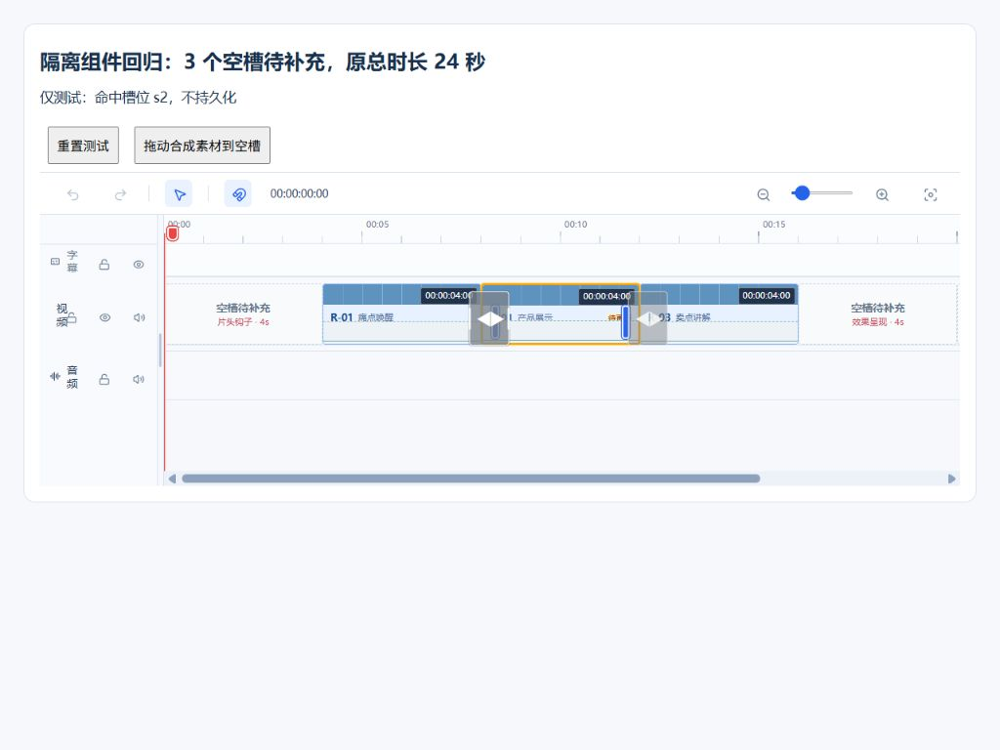

# 混剪局部更新：空槽追加成片与包装顺序对齐

## 已确认目标

局部更新先处理素材删除、替换，再将新增素材归槽并追加成片。某槽位没有合法候选时，新成片保留空槽，不因缺槽失败；包装按实际画面开始时间和明确槽位身份处理，跳过空槽，不把过滤后的序号当作槽位。

仅放宽局部更新 APPEND；首次和重新智能填充仍要求完整成片，重新智能填充仍对全部最新有效素材重新归槽。

## 执行与契约

- 复用净差异和冻结操作，已有工程更新和追加读取同一冻结来源；不混入在途新编辑，不新增表或变更队列。
- 明确删除从素材池排除，已有引用清空画面及关联原声、口播和字幕，保留时间、总时长、其他内容和 BGM；成功删除不因追加失败撤销。
- 保留合法已有归槽和人工归槽，新增沿原追加规则归槽；有合法候选的槽位不得主动留空，不跨用途借素材，不拉长短素材。
- 每条新工程至少采用一条新增素材，单片非空素材不重复；去重包含槽位位置和空槽。沿用数量上限、自适应组合和新增覆盖策略，不生成全空工程。
- 来源不明、文件异常不能伪装空槽。新增无合法归槽或时长不适配时保留未处理状态并报告原因；成功仅确认实际采用的冻结版本，重试不重复成功结果。
- Contracts 追加快照新增可选空槽策略和组合空槽信息，仅服务端新协议 APPEND 启用；旧快照保持严格完整性。
- 工程复用 intentionallyEmptySlotIds、preservedTimelineEnd；空槽无伪造绑定、版本、截取或匹配。重新绑定清理空槽标记。
- API/Worker 校验实际绑定与明确空槽覆盖全部模板槽位，只对实际素材抽帧和截取。保留项目/Run/模板、编辑冲突、租约、attempt token、幂等和工作副本提交边界。

## 包装、展示和导出

- 包装按实际时间排序，使用 slotId 绑定用途及固定时间；空槽不进入视觉理解、口播、配音和字幕，后续内容不前移；叠加画面不参与口播规则不变。
- 包装记录保留来源槽位，其他包装、独立内容和 BGM 不误删。自动包装沿原规则，新增 BGM 覆盖原模板总时长；已有全空工程不生成空口播字幕。
- 空槽显示用途、时长和待补充提示；允许现有拖入/替换补齐。合法空槽不造成更新失败或素材待更新。真实未采用新增及在途新变化仍显示净差异。
- 空槽原位黑屏预览/导出，不压缩时间；空槽不参与转场，不跨空槽衔接画面。非空相邻转场不变。
- 完成提示区分成功含空槽和真实失败。局部更新不新建分支、不自动最终编码；手工补槽不自动包装，已导出文件由用户主动更新。

## 验收

- 首/中/末、多槽为空，新增补齐和未补齐，只有一个非空槽，混合增删改、纯新增、无合法新增、去重及新增覆盖。
- 总时长、黑屏、转场、包装顺序/槽位身份、口播字幕不前移、BGM/独立内容、手工补槽。
- 两轮变化、在途编辑、部分失败、重复请求、刷新恢复、迟到回调、切换模板及兄弟分支隔离。
- 首次/重新填充仍严格，历史快照兼容，来源异常不误留空。
- Contracts/API/Web/Worker 测试、类型检查、构建、git diff --check；浏览器 1920/1440/窄屏回归。
- 同步效果类指南；默认不付费、不部署、不自动提交 Git，不清理历史文件，不批改历史工程。

## 实施记录

2026-10-10 已完成本计划代码改动，未部署、未提交 Git，未启动真实付费生成。

- 新局部 APPEND 使用可选 `ALLOW_EMPTY_POOLS` 策略，组合首条真实选片记录携带空槽信息；旧快照、首次和重新智能填充仍严格完整。服务端完成时再次校验候选、槽位覆盖、唯一性、组合去重和新增覆盖，拒绝伪造空槽。
- 新工程仅绑定实际素材，保存明确空槽及完整模板结束时间；没有可采用新增素材时明确报错，不生成全空工程，不确认未采用新增素材。
- 包装按实际开始时间排序且保留 `slotId`，复用已有空槽跳过规则；Worker 只对真实选片抽帧、选区和恢复检查点。
- 时间轴显示空槽用途和时长，补槽拖放识别真实空位，重新绑定清理空槽标记；预览不跨空槽提前播放转场。完成提示和工程卡片区分含空槽成功与来源待更新。
- 同步本指南相关规则及 Worker README；无数据库表变更，不批改历史工程或清理历史视频。

### 已执行验证

| 范围            | 命令及结果                                                                                                                                                                                                                                                                                 |
| --------------- | ------------------------------------------------------------------------------------------------------------------------------------------------------------------------------------------------------------------------------------------------------------------------------------------ |
| Contracts       | `pnpm --filter @ai-marketing/contracts test`：14 个文件、185 项通过；包含首/中/末空槽固定位置与原总时长                                                                                                                                                                                    |
| API             | `pnpm --filter @ai-marketing/api test -- effect-template-mix-incremental.spec.ts effect-template-mix-regeneration.spec.ts effect-packaging.domain.spec.ts effect-template-mix.service.spec.ts`：4 个文件、232 项通过                                                                       |
| API 包装        | `pnpm --filter @ai-marketing/api test -- effect-packaging.service.spec.ts effect-packaging.repository.spec.ts`：2 个文件、73 项通过                                                                                                                                                        |
| Web             | `pnpm --filter @ai-marketing/web test -- effect-template-mix-empty-append.spec.ts effect-template-mix-source-update.spec.ts effect-template-mix-playback-clock.spec.ts effect-template-mix-playback-start.spec.ts effect-template-mix-template-catalog.spec.ts`：5 个文件、58 项通过       |
| Worker          | 所属目录执行 `uv run pytest tests/test_packaging.py tests/test_consumer.py tests/test_incremental_plan.py tests/test_source_refresh.py tests/test_final_output.py -o addopts='' -q --tb=short --basetemp <本次独立临时目录>`：193 项通过，包含真实 FFmpeg 黑屏区间、总时长和空槽旁转场测试 |
| Worker 静态检查 | `uv run mypy src`：20 个源码文件通过；`uv run ruff check src/effect_template_mix/models.py tests/test_packaging.py tests/test_consumer.py tests/test_final_output.py` 通过                                                                                                                 |
| 类型与构建      | `pnpm typecheck` 通过；`pnpm --filter @ai-marketing/web build` 通过（保留现有大 chunk 提醒）；API 使用 `pnpm exec tsc -p apps/api/tsconfig.build.json --outDir C:/Users/mikasa/AppData/Local/Temp/empty-append-api-build-20261010 --incremental false` 编译通过，未覆盖运行中进程          |
| 差异检查        | `git -c core.safecrlf=false diff --check` 通过                                                                                                                                                                                                                                             |

Worker 初次测试遇到共享 pytest 临时目录访问权限问题，改用本次独立临时目录运行；新增恢复测试的分类检查点 fixture 曾不完整，补齐后重新运行上述 193 项全部通过。没有将这两次失败计作通过。

### 浏览器证据与未验证范围

在本地 Web 中挂载正式时间轴组件，使用明确标注的隔离合成数据验证 1920、1440、1024 宽度：首、中、末空槽标签与固定时长、拖入中间空槽命中正确位置、补齐后清理空槽、窄屏显示与横向滚动。未修改真实项目；临时测试页面和合成视频已移除，浏览器尺寸已恢复。

浏览器证据只证明组件交互，不代替真实项目的持久化或付费端到端验收。首次/重新填充、历史协议、两轮来源变化、失败恢复和租约/作用域使用相关单元回归覆盖；未运行真实数据库并发、供应商生成、真实自动包装或生产部署验收。未执行仓库全量 lint/格式门禁；相关 Vue 大文件和指南的 Prettier 检查仍提示格式差异，未为此次需求扩展整页格式化。
