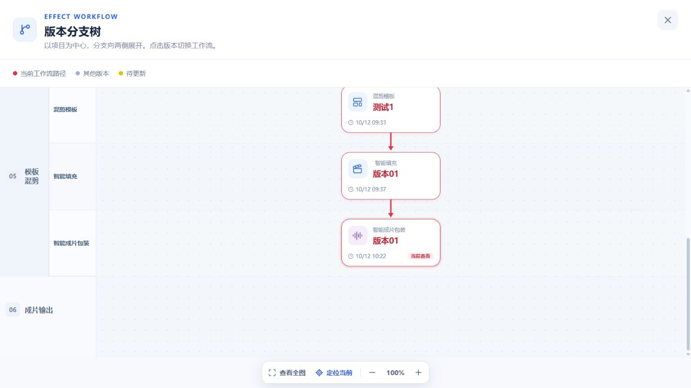

# 智能填充头在首次原位包装后保留

## 范围与证据

广式腊肠项目的测试1当前 Run 同时返回填充版本01、32条工程、包装版本01和30条包装，服务端却将 forkMixStage 投影为 PACKAGING。布局从包装层开始绘制，跳过该 Run 自己的填充层。

模板混剪消费已确认素材与模板，完整填充提交 mix-template / timeline-project；首次包装在同 Run 提交 timeline-package，不改变既有填充来源。修复只调整版本树读取投影和缓存命名，不写业务数据、不更改 revision、分支选择或任务。

## 实施

1. 复用完整、非继承、非增量/截取修复的填充任务及本地工程产物作为填充头证据。
2. 有本地完整填充头时，首次原位包装不能将 Run 改判成包装 fork；同 Run 首次包装失败/运行也不能隐藏已发布填充。
3. 继承填充的重新包装子分支仍从包装层开始；APPEND 和 trimOnly 不占填充版本。
4. 更新树投影缓存命名，验证实际接口与浏览器连线。

## 验收

- 原位包装前后保留智能填充节点和版本号，连线为模板 → 智能填充 → 包装。
- 覆盖完整/部分/失败/运行中的首次包装，以及继承、增量、其他模板、兄弟与重新填充分支。
- 相关 API / Web 测试、类型检查、构建、diff 检查；浏览器只读回归，无付费任务和历史数据修复。

## 2026-10-12 验证结果

- API：`workflow-working.service`、`effect-branch-freshness`、`effect-template-current-path` 共 88 项测试通过。
- Web：分支树布局、视口与分支导航共 66 项测试通过；覆盖父模板尚无填充、子 Run 首次填充和原位包装的实际数据形态。
- API / Web 类型检查和生产构建通过；Web 构建仍提示已有的大包体积警告。相关文件 `git diff --check` 通过。
- 实际运行接口已将广式腊肠测试1投影为 TEMPLATE 来源头，保留填充版本01 / 32条工程与包装版本01 / 30项包装；浏览器确认模板 → 智能填充 → 智能成片包装连线恢复。
- 只读验证，没有重新生成、付费调用、修改历史数据或变更活动分支。未执行真实生成端到端测试。

