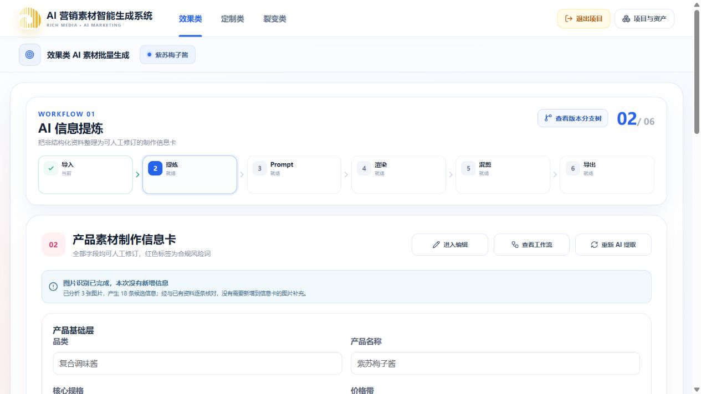

# 效果类 Redis 缓存真实链路验收

日期：2026-10-08。作用域：本地 5173 Vite → 3100 API → PostgreSQL / Redis，当前「紫苏梅子酱」项目，以及随机创建并清理的测试项目。对应 [缓存优化计划](../plans/2026-10-08-效果类Redis缓存优化计划.md)。

## 结论

- 共享 Redis 缓存已被实际业务接口使用。检查了 API 命中日志、Redis 中的条目，以及 HTTP 响应与缓存正文的校验和；没有把前端去重或 Redis 全实例计数当成命中证据。
- 截图中的加载/节点同步 HTTP 502，与本地 API 曾启动失败的日志一致。日志反复出现 `Cannot find module .../apps/api/dist/main`。原开发热更新和生产构建共用 `dist`，Nest 的 `deleteOutDir` 会删除该目录；这是已发现的服务中断原因。无法仅凭截图还原该次请求的全部时间线。
- 已将开发命令改为 `nest start --watch --path tsconfig.dev.json`，输出到 `dist-dev`；生产构建仍使用 `dist`。实际 3100 进程已更新为 `dist-dev/main`，构建期间主要接口全部读取成功，构建后运行进程未被替换。两种输出均包含资料导入 DOCX 模板。
- 后续追查发现同时存在三个 API watch，包含此前遗留的旧 `dist` watcher；源码变化后它重新抢占端口，新 watcher 报 `EADDRINUSE`。在再次确认生成与清理任务均为 0 后，清理三个已核实的 API 进程树，只启动一个 `dist-dev` watcher。后续验收以这个单进程服务为准；开发指南已补充重复进程排查要求。
- 冷读取、草稿整理和高负载下的数据库回退仍可能较慢。缓存优化不代表所有请求都从 Redis 读取，也不代表首次恢复没有等待。

## 真实命中证据

通过 5173 的实际 API 代理运行 [验证脚本](../../../../apps/api/scripts/verify-effect-read-cache.mjs)。脚本限定当前项目、EFFECT、当前 Run 和具体资源；不清空 Redis，不修改业务数据，不输出连接串、键或正文。

验证项：连续两次 HTTP 响应一致；存在正文校验和与响应相同的真实 Redis 条目；条目 checksum 与正文一致、键中版本与信封版本一致、TTL 大于 0。版本保存后的新鲜度另由数据库和 HTTP 集成测试验证。

13:04:51 的实际结果：

| 资源       | 第二次 HTTP 耗时 | 匹配条目数 | 示例剩余 TTL | 正文大小 |
| ---------- | ---------------- | ---------- | ------------ | -------- |
| 混剪工作区 | 36 ms            | 3          | 287 s        | 783272 B |
| 成片目录   | 20 ms            | 3          | 313 s        | 23340 B  |
| 版本树     | 23 ms            | 3          | 147 s        | 34925 B  |

多个条目表示不同依赖版本可有相同展示内容；旧版本按 TTL 过期。运行服务仍先读取 PostgreSQL 当前版本，再决定使用哪个键。

同一测量窗口的运行日志（包含嵌套读取和验证脚本）记录：混剪 1 miss / 12 hit，成片 1 miss / 12 hit，版本树 1 miss / 13 hit。命中记录 `loadMs=0`，实际 Redis 读耗时单独计入 `redisMs`；版本查询仍访问 PostgreSQL。提炼、Prompt 和渲染各 11 次 `fast`，原加载器低于 50 ms，按现有自适应规则直接读取数据库。

Redis 实例实测为 7.4.10，`maxmemory=268435456`，`allkeys-lru`，使用约 5.5 MiB，淘汰 0。实例命中/未命中计数包含其他业务，未用于计算本次命中率。

## 正确性测试

本轮相关测试：12 个文件、88 项通过，包含真实 PostgreSQL / Redis 的两个 opt-in 集成测试。

新增 [HTTP 集成测试](../../../../apps/api/src/platform/cache/effect-cache.http.spec.ts) 启动实际 Nest 模块、控制器和服务，使用独立随机项目/Run：

- Prompt、混剪、成片、版本树实际 HTTP 接口连续读取，确认运行服务记录 hit，并在真实 Redis 检查条目与 TTL。
- 通过实际节点草稿 PUT 接口连续保存两轮；立即 GET 混剪工作区，确认内容和 `draftRevision` 最新，产生两个新的版本键。
- 通过截图涉及的节点 activate 接口更新当前节点，确认返回成功、版本树立即显示新节点。
- 同项目另一个 Run 恢复为空草稿，不读取第一个 Run 的内容。
- 仅将该测试应用的 Redis 连接改为拒绝连接的本地端口；实际 HTTP 仍成功并返回最新草稿，记录 error 后回退 PostgreSQL。共享 Redis 没有被停止。
- 禁用测试应用的后台投递、租约恢复和清理钩子；业务控制器、加载器、数据库及 Redis 均真实运行。只删除本测试随机项目，测试键自行过期，恢复测试环境变量。

既有缓存测试本轮重跑，覆盖项目/Run/产品/模板/分页隔离、权限重新检查、多个资源版本 SQL、两轮 revision 变化、漏增业务 revision 的物理行变化、删除、TTL 真过期、损坏值、签名 URL/大载荷跳过、同键并发、迟到填充、断连、超时和冷却后恢复。

本轮未重跑全量 API 门禁；此前全量回归中存在的原有失败及复现说明保留在计划文档。没有发起付费生成、包装、导出或修改用户产品正文。

## 性能与限制

13:04:44–13:04:50，通过 5173 代理，每个端点串行 11 次。第一个样本独立记录，其后 10 次作为重复读取样本；样本量小，不代表生产压测分位数。

| 读取       | 首请求  | 重复 P50 / P95 |
| ---------- | ------- | -------------- |
| 导入工作区 | 20 ms   | 20 / 22 ms     |
| 导入草稿   | 24 ms   | 26 / 29 ms     |
| 提炼       | 44 ms   | 32 / 50 ms     |
| Prompt     | 48 ms   | 30 / 37 ms     |
| 渲染       | 65 ms   | 44 / 49 ms     |
| 混剪       | 832 ms  | 31 / 36 ms     |
| 成片目录   | 2095 ms | 19 / 21 ms     |
| 版本树     | 20 ms   | 18 / 19 ms     |

资料导入工作区/草稿仍执行原有初始化整理，当前未套入 Redis；快速请求按测量规则绕过缓存。版本树的首请求已由成片目录嵌套读取预热，不作为冷读取收益。

**清理重复进程后的最终复测（13:14:39–13:14:46）：**仍为每端点 11 次，全部返回成功。混剪首请求 949 ms、重复 P50/P95 为 33/40 ms；成片首请求 2214 ms、重复 20/22 ms；版本树重复 20/22 ms。提炼、Prompt、渲染重复 P95 分别为 25/44/47 ms。实际日志继续记录 mix/output/tree 的 hit，提炼/Prompt/渲染各 11 次 fast。生产构建完成后，3100 仍由同一 PID 568 的 `dist-dev/main` 提供服务，只有一个 PID 20880 的 watcher；新进程错误日志为空。

另外在同时执行生产构建的窗口，所有测量请求也成功，但记录到 Redis 150 ms 预算超时及后续 5 秒冷却回退，数据库/投影加载也变慢。该轮导入草稿、渲染和混剪出现数秒尾延迟，不能用正常负载结果宣称高负载也达标。本轮保留原等待预算；生产需要结合并发与 CPU 负载验证并调整该配置，继续优化冷读取 SQL。Redis 错误不会保证读取更快，只保证不会成为业务数据不可读的单点。

## 可复验命令

仓库根目录执行；按部署环境通过环境变量传入数据库/Redis 地址，不打印密钥：

```powershell
$env:EFFECT_CACHE_DATABASE_TEST = '1'
pnpm --filter @ai-marketing/api exec vitest run src/platform/cache src/config/environment.spec.ts src/platform/job src/workflows/effect/source-import --maxWorkers=1
pnpm --filter @ai-marketing/api typecheck
pnpm --filter @ai-marketing/api build
pnpm exec eslint apps/api/src/platform/cache apps/api/scripts/verify-effect-read-cache.mjs
pnpm exec prettier --check apps/api/src/platform/cache apps/api/scripts/verify-effect-read-cache.mjs apps/api/tsconfig.dev.json apps/api/package.json docs/development/local-development.md
git diff --check
```

以上本轮均已执行通过；另以 `nest build --path tsconfig.dev.json` 验证开发输出。浏览器实际检查信息提炼恢复，主要六节点请求均返回成功；没有用单测替代实际监听服务检查。

浏览器还检查了渲染队列、混剪四个模板及成片目录恢复；效果类 → 定制类显示空项目，返回效果类保留「紫苏梅子酱」及原成片目录。最终信息提炼页面已恢复信息卡，没有加载失败或节点后台同步失败提示。3100 直连和 5173 代理健康检查均为 HTTP 200。



运行服务的数值观测开关 `EFFECT_READ_CACHE_LOG_METRICS=true` 已临时开启在本次开发进程中，未修改 `.env`。正常重新启动仍使用既有配置默认值。

```powershell
$env:EFFECT_BENCH_API_URL = 'http://localhost:5173/api'
node apps/api/scripts/verify-effect-read-cache.mjs <projectId>
node apps/api/scripts/measure-effect-read-cache.mjs <projectId> 11
node apps/api/scripts/inspect-effect-read-cache.mjs
```

Nest CLI 的输出目录清理行为与 `--path` 参数见 [官方 CLI 文档](https://docs.nestjs.com/cli/usages) 和 [compilerOptions 文档](https://docs.nestjs.com/cli/monorepo)。Context7 本轮不可用，使用官方文档并核对本地安装的 Nest CLI 11.0.14 实现。未升级依赖或变更公共接口。
